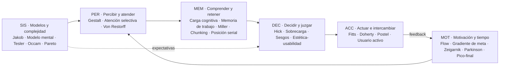

# Mapa global de las leyes de UX

> Visión de conjunto de las 30 leyes: **qué parte de la mente humana describen, en qué
> momento de la interacción actúan, cómo se refuerzan entre sí y dónde chocan.**
> Es la lectura obligatoria (capa 0) para cualquier agente que use este sistema.

---

## 1. La idea que lo une todo

Todas las leyes describen la misma realidad desde ángulos distintos:

> **Las personas tienen recursos limitados (atención, memoria, tiempo, precisión motora,
> paciencia) y los administran con atajos (expectativas, agrupación perceptiva, sesgos).
> Una buena interfaz gasta poco de esos recursos y trabaja *con* los atajos, nunca contra
> ellos ni aprovechándose de ellos.**

De ahí salen cinco **meta-principios** que resumen el mapa:

| # | Meta-principio | Leyes que lo sostienen |
|---|---|---|
| M1 | **La capacidad es limitada → reduce, agrupa, prioriza.** | Carga cognitiva, Memoria de trabajo, Miller, Chunking, Hick, Sobrecarga de opciones, Atención selectiva |
| M2 | **La gente llega con expectativas → sé familiar y coherente.** | Jakob, Modelo mental, Semejanza, Paradoja del usuario activo |
| M3 | **La forma comunica estructura → organiza lo visual para que diga la verdad.** | Proximidad, Semejanza, Región común, Conectividad uniforme, Prägnanz, Von Restorff, Posición serial |
| M4 | **La complejidad no desaparece, se reubica → que la absorba el sistema.** | Tesler, Postel, Occam, Pareto, Fitts, Doherty |
| M5 | **La experiencia se vive en el tiempo y se recuerda de forma sesgada → diseña ritmo, progreso, picos y finales.** | Flow, Gradiente de meta, Zeigarnik, Parkinson, Pico-final, Estética-usabilidad, Sesgo cognitivo |

---

## 2. El ciclo de interacción (dónde actúa cada familia)

Basado en el ciclo de acción de Norman (golfos de ejecución y evaluación). Cada familia
de leyes "vive" en una etapa:

```
                    ┌──────────────────────────────────────────────┐
                    │  SIS · MODELOS Y COMPLEJIDAD (marco previo)   │
                    │  Jakob · Modelo mental · Tesler · Occam ·     │
                    │  Pareto  → qué espera la persona y dónde vive │
                    │            la complejidad                     │
                    └───────────────────────┬──────────────────────┘
                                            ▼
   ┌─────────────────┐   ┌─────────────────┐   ┌─────────────────┐   ┌─────────────────┐
   │ PER · PERCIBIR  │──▶│ MEM · COMPRENDER│──▶│ DEC · DECIDIR   │──▶│ ACC · ACTUAR    │
   │ y ATENDER       │   │ y RETENER       │   │ y JUZGAR        │   │ e INTERCAMBIAR  │
   │ Proximidad      │   │ Carga cognitiva │   │ Hick            │   │ Fitts           │
   │ Semejanza       │   │ Memoria trabajo │   │ Sobrecarga opc. │   │ Doherty         │
   │ Región común    │   │ Miller          │   │ Sesgo cognitivo │   │ Postel          │
   │ Conectividad    │   │ Chunking        │   │ Estética-usab.  │   │ Usuario activo  │
   │ Prägnanz        │   │ Posición serial │   │                 │   │                 │
   │ Atención selec. │   │                 │   │                 │   │                 │
   │ Von Restorff    │   │                 │   │                 │   │                 │
   └─────────────────┘   └─────────────────┘   └─────────────────┘   └────────┬────────┘
            ▲                                                                 │ feedback
            │            ┌──────────────────────────────────────────┐         │
            └────────────│ MOT · MOTIVACIÓN Y EXPERIENCIA EN EL TIEMPO│◀───────┘
                         │ Flow · Gradiente de meta · Zeigarnik ·    │
                         │ Parkinson · Pico-final                    │
                         │ → ¿sigo? ¿cómo lo recordaré? ¿vuelvo?     │
                         └──────────────────────────────────────────┘
```



**Golfo de ejecución** (de la intención a la acción): SIS → DEC → ACC.
**Golfo de evaluación** (de la respuesta a la comprensión): ACC (feedback, Doherty) → PER → MEM.
Un problema de UX casi siempre es un golfo demasiado ancho; las leyes indican *cuál* y *por qué*.

---

## 3. Las seis familias

Ids estables (úsalos al citar). Fichas completas en `01-leyes/`.

### PER · Percepción y atención — *¿qué ve y qué agrupa?*
La organización visual se produce **antes** de leer. Si la forma contradice el significado,
gana la forma.

| Id | Ley | En una línea |
|---|---|---|
| PER-01 | Ley de proximidad (*Law of Proximity*) | Lo cercano se percibe como relacionado. |
| PER-02 | Ley de semejanza (*Law of Similarity*) | Lo que se parece se percibe como del mismo grupo o función. |
| PER-03 | Ley de región común (*Law of Common Region*) | Lo que comparte un contenedor delimitado se percibe como grupo. |
| PER-04 | Ley de conectividad uniforme (*Law of Uniform Connectedness*) | Lo unido por líneas o marcos se percibe más relacionado que lo no unido. |
| PER-05 | Ley de Prägnanz (*Law of Prägnanz*) | Interpretamos lo ambiguo como la forma más simple posible. |
| PER-06 | Atención selectiva (*Selective Attention*) | Sólo procesamos un subconjunto de estímulos, el ligado a nuestra meta. |
| PER-07 | Efecto Von Restorff (*Von Restorff Effect*) | Lo que difiere del resto se nota y se recuerda. |

### MEM · Memoria y carga cognitiva — *¿cuánto puede sostener a la vez?*
La memoria de trabajo es el cuello de botella de toda interacción.

| Id | Ley | En una línea |
|---|---|---|
| MEM-01 | Carga cognitiva (*Cognitive Load*) | Recursos mentales que exige entender y usar la interfaz. |
| MEM-02 | Memoria de trabajo (*Working Memory*) | Sistema temporal y pequeño donde manipulamos lo necesario para la tarea. |
| MEM-03 | Ley de Miller (*Miller's Law*) | La capacidad inmediata es limitada (≈7±2 según Miller; ≈4 según la investigación posterior). |
| MEM-04 | Fragmentación (*Chunking*) | Agrupar piezas en unidades con sentido amplía lo que podemos procesar. |
| MEM-05 | Efecto de posición serial (*Serial Position Effect*) | Recordamos mejor lo primero y lo último de una serie. |

### DEC · Decisión y juicio — *¿cómo elige y cómo juzga?*
Decidimos con atajos rápidos; el diseño de la elección es diseño del resultado.

| Id | Ley | En una línea |
|---|---|---|
| DEC-01 | Ley de Hick (*Hick's Law*) | El tiempo de decisión crece con el número y la complejidad de opciones. |
| DEC-02 | Sobrecarga de opciones (*Choice Overload*) | Demasiadas opciones pueden paralizar o empeorar la satisfacción. |
| DEC-03 | Sesgo cognitivo (*Cognitive Bias*) | Errores sistemáticos de juicio derivados de atajos mentales. |
| DEC-04 | Efecto estética-usabilidad (*Aesthetic-Usability Effect*) | Lo atractivo se percibe como más usable (y se le perdonan fallos). |

### ACC · Acción e interacción — *¿cuesta actuar y responde el sistema?*
El intercambio físico y temporal entre persona y sistema.

| Id | Ley | En una línea |
|---|---|---|
| ACC-01 | Ley de Fitts (*Fitts's Law*) | El tiempo para alcanzar un objetivo depende de su distancia y tamaño. |
| ACC-02 | Umbral de Doherty (*Doherty Threshold*) | Con respuestas por debajo de un umbral subsegundo (≈400 ms como regla práctica), la interacción fluye y la productividad sube. |
| ACC-03 | Ley de Postel (*Postel's Law*) | Sé tolerante con lo que aceptas y riguroso con lo que entregas. |
| ACC-04 | Paradoja del usuario activo (*Paradox of the Active User*) | La gente no lee manuales: empieza a usar directamente. |

### MOT · Motivación y experiencia en el tiempo — *¿sigue, termina, cómo lo recuerda?*
La experiencia no es un instante: tiene ritmo, progreso, tensión y memoria.

| Id | Ley | En una línea |
|---|---|---|
| MOT-01 | Flujo (*Flow*) | Inmersión total cuando el reto se ajusta a la habilidad y hay feedback claro. |
| MOT-02 | Efecto de gradiente de meta (*Goal-Gradient Effect*) | El esfuerzo aumenta cuanto más cerca se percibe la meta. |
| MOT-03 | Efecto Zeigarnik (*Zeigarnik Effect*) | Las tareas inacabadas se mantienen presentes en la mente. |
| MOT-04 | Ley de Parkinson (*Parkinson's Law*) | Una tarea se expande hasta ocupar el tiempo disponible. |
| MOT-05 | Regla pico-final (*Peak-End Rule*) | Juzgamos una experiencia por su momento más intenso y por su final. |

### SIS · Modelos mentales y complejidad del sistema — *¿qué espera y quién carga la complejidad?*
Principios estratégicos: deciden el marco en el que operan las demás leyes.

| Id | Ley | En una línea |
|---|---|---|
| SIS-01 | Ley de Jakob (*Jakob's Law*) | La gente espera que tu producto funcione como los que ya usa. |
| SIS-02 | Modelo mental (*Mental Model*) | Representación comprimida de cómo creemos que funciona un sistema. |
| SIS-03 | Ley de Tesler (*Tesler's Law*) | Toda tarea tiene una complejidad irreducible: o la asume el sistema o la persona. |
| SIS-04 | Navaja de Occam (*Occam's Razor*) | Entre soluciones equivalentes, la que menos supuestos (elementos) necesita. |
| SIS-05 | Principio de Pareto (*Pareto Principle*) | Pocas causas producen la mayoría de los efectos. |

---

## 4. Grafo de relaciones (resumen)

Detalle y matriz completa: `02-relaciones/matriz-relaciones.md`.

**Clústeres que se refuerzan:**

- **Agrupación visual** — PER-01 Proximidad + PER-02 Semejanza + PER-03 Región común +
  PER-04 Conectividad uniforme → producen **MEM-04 Chunking** visual → reducen
  **MEM-01 Carga cognitiva**. Prägnanz (PER-05) es el principio paraguas.
- **Capacidad limitada** — MEM-02 Memoria de trabajo ⊃ MEM-03 Miller → se compensa con
  MEM-04 Chunking y con "reconocer mejor que recordar" → baja MEM-01.
- **Elección** — DEC-01 Hick (tiempo) + DEC-02 Sobrecarga (parálisis/satisfacción) →
  se mitigan con defaults, recomendación destacada (PER-07 Von Restorff) y
  divulgación progresiva (SIS-03 Tesler).
- **Expectativas** — SIS-02 Modelo mental es la teoría; SIS-01 Jakob es su consecuencia
  práctica; ACC-04 Usuario activo explica por qué no se puede "enseñar" un modelo nuevo
  con manuales.
- **Saliencia** — PER-06 Atención selectiva (filtra) ↔ PER-07 Von Restorff (destaca) ↔
  MEM-05 Posición serial (ordena el recuerdo).
- **Progreso y motivación** — MOT-02 Gradiente de meta + MOT-03 Zeigarnik + MOT-01 Flow,
  con ACC-02 Doherty como condición (sin respuesta rápida no hay flujo).
- **Recuerdo de la experiencia** — MOT-05 Pico-final ⊂ DEC-03 Sesgos; DEC-04
  Estética-usabilidad tiñe la valoración global.
- **Economía de la complejidad** — SIS-03 Tesler (conservación) + SIS-04 Occam (no añadir) +
  SIS-05 Pareto (priorizar) + ACC-03 Postel (absorber la variabilidad del input).

**Tensiones principales** (resolución en `02-relaciones/tensiones.md`):

| Tensión | Resumen |
|---|---|
| T1 Hick / Occam ↔ Tesler | Quitar opciones vs. no trasladar la complejidad a la persona. |
| T2 Jakob ↔ innovación / diferenciación | Familiaridad vs. mejora del modelo. |
| T3 Von Restorff ↔ Semejanza / coherencia | Destacar rompe la uniformidad; abusar anula el destaque. |
| T4 Estética-usabilidad ↔ validez del test | Lo bonito oculta problemas en las pruebas. |
| T5 Chunking / pasos ↔ Fitts / Parkinson | Dividir en pasos reduce carga pero añade interacciones y tiempo. |
| T6 Doherty ↔ "labor illusion" | Rápido es mejor, salvo cuando la espera comunica trabajo y genera confianza. |
| T7 Gradiente de meta / Zeigarnik ↔ ética | Motivar con progreso vs. manipular con progreso falso o tareas abiertas. |
| T8 Postel ↔ seguridad / precisión | Aceptar input flexible vs. ambigüedad y errores silenciosos. |
| T9 Pareto ↔ inclusión | Optimizar para la mayoría vs. abandonar casos minoritarios (a menudo, accesibilidad). |
| T10 Flow ↔ interrupciones necesarias | Inmersión vs. confirmaciones, avisos, pausas saludables. |

---

## 5. Niveles de evidencia (cómo de "ley" es cada ley)

No todas las "leyes" tienen el mismo estatus. Escala completa en
`00-indice/niveles-de-evidencia.md`; el nivel de cada ley figura en su ficha y en
`00-indice/indice-leyes.md`.

- **E1 · Ley cuantitativa** — modelo matemático con alto poder predictivo en su dominio
  (p. ej. Fitts, Hick en condiciones controladas).
- **E2 · Efecto robusto** — muy replicado, pero su magnitud depende del contexto
  (p. ej. Gestalt, posición serial, límites de memoria de trabajo).
- **E3 · Efecto con evidencia mixta** — existe en algunas condiciones, falla en otras o
  tiene problemas de replicación (p. ej. sobrecarga de opciones, Zeigarnik).
- **C · Constructo teórico** — marco explicativo útil, no una predicción puntual
  (p. ej. carga cognitiva, modelo mental, flow).
- **H · Heurística de diseño** — principio práctico derivado de la experiencia, no de un
  experimento (p. ej. Jakob, Tesler, Occam, Postel, Parkinson, Pareto).

---

## 6. Cómo navegar el mapa según la pregunta

| Si la pregunta es… | Empieza por… |
|---|---|
| "No encuentran X / no lo ven" | PER-06, PER-07, PER-01…04, MEM-05 |
| "Se pierden / no entienden cómo funciona" | SIS-02, SIS-01, ACC-04, PER-05 |
| "Tardan mucho en decidir / abandonan en la elección" | DEC-01, DEC-02, DEC-03, SIS-05 |
| "Se equivocan al pulsar / es incómodo en móvil" | ACC-01, PER-01 |
| "Se siente lento" | ACC-02, MOT-01, MOT-02 |
| "Abandonan formularios u onboarding" | MEM-01, MEM-04, MOT-02, MOT-03, ACC-03, MOT-04 |
| "Es demasiado complejo / tiene demasiadas funciones" | SIS-03, SIS-04, SIS-05, DEC-01 |
| "No vuelven / mala impresión final" | MOT-05, DEC-04, MOT-01 |
| "Datos introducidos con errores" | ACC-03, MEM-02, ACC-01 |

Router completo síntoma → leyes → acciones: `03-aplicacion/por-sintoma.md`.
