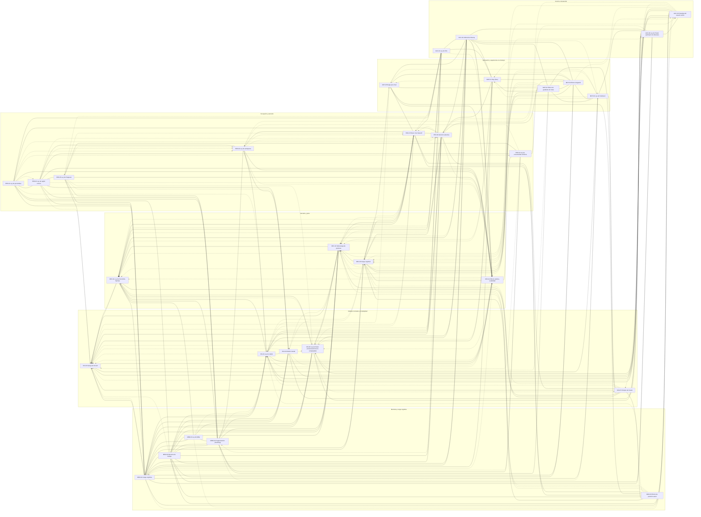

<!-- Archivo generado por herramientas/generar_indices.py. No editar a mano. -->

# Matriz de relaciones

Generada del front matter de cada ficha (`refuerza`, `tensiona`). El porqué de cada relación está en la sección *Relaciones* de la ficha; las resoluciones de las tensiones, en `02-relaciones/tensiones.md`.

## Lista de adyacencia

| Ley | Refuerza / se apoya en | Tensiona con | Tensiones |
|---|---|---|---|
| ACC-01 Ley de Fitts | PER-01, ACC-02, MOT-01, SIS-01 | DEC-01, DEC-02, SIS-04, PER-05, DEC-04, PER-07, SIS-03, MEM-04 | T5 |
| ACC-02 Umbral de Doherty | MOT-01, MOT-05, MOT-02, MOT-03, ACC-01 | MOT-04, DEC-04, DEC-03 | T6, T10 |
| ACC-03 Ley de Postel (principio de robustez) | SIS-03, ACC-04, SIS-02, MEM-01, MEM-02, SIS-01, MOT-04, ACC-02 | SIS-04, PER-02 | T8, T1 |
| ACC-04 Paradoja del usuario activo | SIS-01, SIS-02, MEM-01, MEM-02, SIS-04, SIS-03, ACC-03 | MOT-01, DEC-01, SIS-05, PER-06 | T14, T9, T2 |
| DEC-01 Ley de Hick (Hick-Hyman) | MEM-01, MEM-04, PER-07, SIS-05, SIS-01, ACC-01, ACC-02 | SIS-03, SIS-04, ACC-04 | T1 |
| DEC-02 Sobrecarga de opciones | DEC-01, MEM-01, MEM-02, MEM-04, DEC-03, PER-07, SIS-05 | SIS-03, ACC-03, SIS-02 | T1, T11, T12 |
| DEC-03 Sesgo cognitivo | MOT-05, MEM-05, PER-07, DEC-04, DEC-02, MOT-02, MOT-03, MEM-01, MEM-02, PER-06 | ACC-04, SIS-01 | T12, T7, T4 |
| DEC-04 Efecto estética-usabilidad | DEC-03, PER-05, PER-01, PER-02, PER-03, PER-04, MOT-05, SIS-01, ACC-02 | SIS-04, DEC-01, DEC-02, SIS-03 | T4, T1 |
| MEM-01 Carga cognitiva | MEM-02, MEM-03, MEM-04, DEC-01, DEC-02, SIS-01, SIS-02, SIS-03, SIS-04, PER-05, ACC-02, PER-06, MOT-01 | DEC-04, ACC-04, SIS-04 | T1, T5, T11, T14 |
| MEM-02 Memoria de trabajo | MEM-01, MEM-03, MEM-04, PER-06, SIS-01, SIS-02, ACC-02, SIS-03 | SIS-04 | T1, T5, T11 |
| MEM-03 Ley de Miller | MEM-02, MEM-04, MEM-01, DEC-01, DEC-02, SIS-03 | ACC-04, SIS-01 | T1, T11 |
| MEM-04 Fragmentación (chunking) | MEM-03, MEM-02, MEM-01, PER-01, PER-02, PER-03, PER-04, PER-05, DEC-01, MOT-02 | ACC-01, MOT-04, SIS-01 | T5, T11 |
| MEM-05 Efecto de posición serial | MEM-02, PER-07, MOT-05, PER-06 | SIS-01, DEC-01, DEC-02, DEC-03 | T13 |
| MOT-01 Flujo (flow) | ACC-02, ACC-01, MOT-02, MEM-01, PER-06, SIS-04 | ACC-04, DEC-01, DEC-02, SIS-03, MOT-05 | T10 |
| MOT-02 Efecto de gradiente de meta | MOT-01, MOT-05, MOT-03, MEM-04, ACC-02, MOT-04 | DEC-01, DEC-02, SIS-03, DEC-03 | T5, T7 |
| MOT-03 Efecto Zeigarnik | MOT-02, MOT-01, MOT-05, MEM-02, MEM-01, MOT-04 | DEC-03, ACC-04 | T7 |
| MOT-04 Ley de Parkinson | MOT-02, MOT-03, MEM-01, SIS-04, SIS-05, ACC-03 | DEC-02, MOT-01, ACC-02, DEC-03, MEM-04, MOT-05 | T5 |
| MOT-05 Regla pico-final | DEC-03, MEM-05, PER-07, MOT-03, ACC-02, DEC-04, MOT-02 | MOT-04, MOT-01 | T4, T7 |
| PER-01 Ley de proximidad | PER-03, MEM-04, MEM-01, MEM-02, ACC-01, DEC-04 | PER-02, PER-03, PER-04, PER-06, SIS-01 | T5, T11 |
| PER-02 Ley de semejanza | SIS-01, SIS-02, MEM-04, PER-03 | PER-07, PER-01, PER-06, DEC-04 | T3 |
| PER-03 Ley de región común | PER-01, MEM-04, PER-05, MEM-01 | PER-01, PER-02, DEC-04, SIS-04, PER-06 | T5 |
| PER-04 Ley de conectividad uniforme | PER-03, MOT-02, MEM-04, PER-05 | PER-01, PER-02, MEM-01, SIS-04 | — |
| PER-05 Ley de Prägnanz | SIS-04, DEC-04, MEM-01, MEM-04, PER-03, PER-04 | SIS-03, PER-07, SIS-02, PER-02 | T1, T3 |
| PER-06 Atención selectiva | MEM-01, MEM-02, ACC-02, PER-01, SIS-01, MOT-01, MOT-03 | PER-07, DEC-04, DEC-01, DEC-02, ACC-04 | T3, T10, T14 |
| PER-07 Efecto Von Restorff | PER-02, MEM-05, PER-06, MOT-05, ACC-01 | PER-06, PER-02, PER-05, DEC-01, DEC-02, DEC-03 | T3, T12 |
| SIS-01 Ley de Jakob | SIS-02, MEM-01, DEC-01, ACC-04, ACC-03, ACC-02 | PER-07, DEC-04, SIS-04, MOT-05, MEM-05 | T2, T13 |
| SIS-02 Modelo mental | SIS-01, MEM-01, MEM-02, MEM-04, ACC-04, PER-02, PER-03 | SIS-03, SIS-04, DEC-04, DEC-03 | T1, T2 |
| SIS-03 Ley de Tesler (conservación de la complejidad) | ACC-04, MEM-01, DEC-01, DEC-02, ACC-03, ACC-02 | SIS-04, SIS-02, SIS-05 | T1, T9 |
| SIS-04 Navaja de Occam | DEC-01, DEC-02, MEM-01, PER-05, PER-06, SIS-05, DEC-04 | SIS-03, SIS-01, SIS-02, PER-07, ACC-03 | T1 |
| SIS-05 Principio de Pareto | SIS-04, DEC-01, DEC-02, MEM-05, PER-07, MOT-02, MOT-04 | SIS-03, ACC-03, SIS-01, DEC-03 | T9 |

## Leyes más conectadas (centrales en el mapa)

- MEM-01 Carga cognitiva: 36 relaciones
- SIS-04 Navaja de Occam: 29 relaciones
- SIS-01 Ley de Jakob: 28 relaciones
- MEM-04 Fragmentación (chunking): 27 relaciones
- DEC-01 Ley de Hick (Hick-Hyman): 26 relaciones
- DEC-04 Efecto estética-usabilidad: 26 relaciones
- DEC-02 Sobrecarga de opciones: 24 relaciones
- SIS-03 Ley de Tesler (conservación de la complejidad): 24 relaciones
- PER-06 Atención selectiva: 24 relaciones
- PER-07 Efecto Von Restorff: 23 relaciones

## Grafo de refuerzos

Línea continua = refuerzo · línea discontinua con x = tensión.
