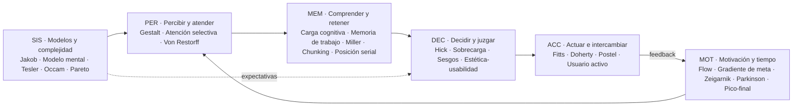
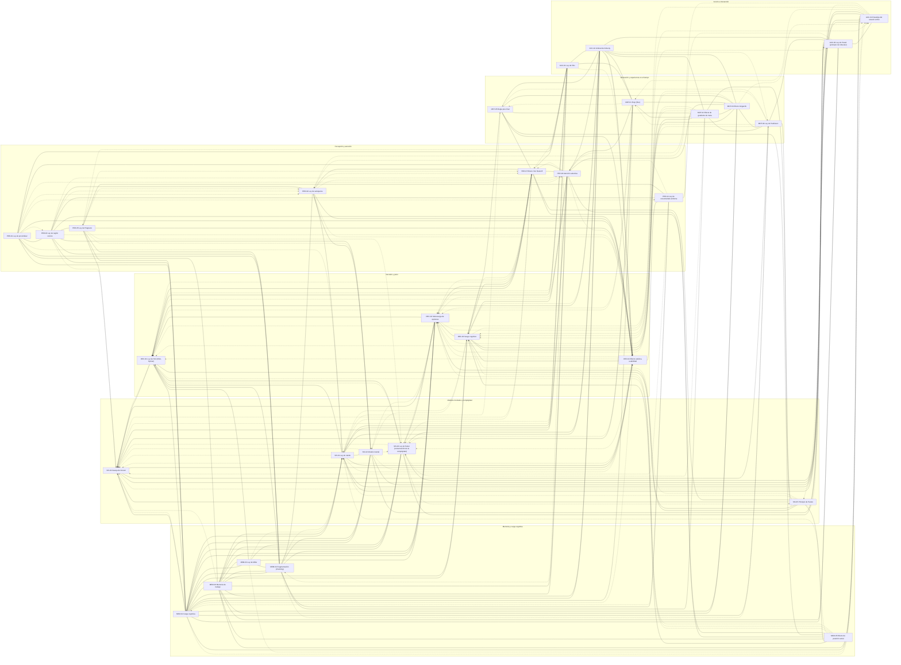

# UX Skill — paquete completo

Paquete generado de la carpeta `ux-skill`. Cada sección indica su archivo de origen; las referencias a rutas (`01-leyes/...`) apuntan a secciones de este mismo documento. Síntesis original basada en *Laws of UX* (lawsofux.com, Jon Yablonski, CC BY-NC-ND 4.0) y en sus fuentes primarias.


<!-- ===== ARCHIVO: README.md ===== -->

# UX Skill · Sistema de conocimiento y habilidades de UX para modelos de IA

Sistema **agnóstico** (sirve para Claude, GPT, Gemini, Llama, Mistral, Copilot, Cursor o
cualquier modelo que lea Markdown) que convierte las **30 leyes de UX** de
[Laws of UX](https://lawsofux.com/) (Jon Yablonski) y sus **fuentes primarias** en:

- un **mapa global** que explica qué describe cada ley, en qué momento de la interacción
  actúa, cómo se relaciona con las demás y dónde chocan;
- **fichas rigurosas** por ley: origen verificado, mecanismo, solidez de la evidencia,
  límites y malentendidos, reglas aplicables, anti-patrones, ética, accesibilidad y cómo auditarla;
- **habilidades operativas** (auditar, diseñar, criticar, justificar, diagnosticar,
  validar, enseñar, revisar código de UI) con procesos paso a paso y plantillas;
- **guías por contexto** (formularios, navegación, onboarding, e-commerce, dashboards,
  búsqueda, rendimiento, contenido, móvil, IA conversacional, sistemas de diseño, errores);
- **datos estructurados** (`datos/*.json`) y **herramientas** para validar y empaquetar.

---

## Estructura

```
ux-skill/
├── README.md                 ← este archivo (para personas)
├── AGENTS.md                 ← punto de entrada para CUALQUIER modelo (instrucciones operativas)
├── SKILL.md                  ← envoltorio para entornos con "skills" (p. ej. Claude); remite a AGENTS.md
├── 00-indice/                ← mapa global, índice de leyes, niveles de evidencia
├── 01-leyes/                 ← 30 fichas en 6 familias
│   ├── per-percepcion-atencion/   PER-01…07  Gestalt, atención selectiva, Von Restorff (+ anexo Gestalt)
│   ├── mem-memoria-carga/         MEM-01…05  carga cognitiva, memoria de trabajo, Miller, chunking, posición serial
│   ├── dec-decision-juicio/       DEC-01…04  Hick, sobrecarga de opciones, sesgos, estética-usabilidad
│   ├── acc-accion-interaccion/    ACC-01…04  Fitts, Doherty, Postel, usuario activo
│   ├── mot-motivacion-tiempo/     MOT-01…05  flow, gradiente de meta, Zeigarnik, Parkinson, pico-final
│   └── sis-sistema-complejidad/   SIS-01…05  Jakob, modelo mental, Tesler, Occam, Pareto
├── 02-relaciones/            ← matriz de relaciones (generada) y tensiones con reglas de resolución
├── 03-aplicacion/            ← router síntoma→leyes y guías por contexto
├── 04-procesos/              ← las 8 habilidades (H1–H8) paso a paso
├── 05-checklists/            ← checklist de auditoría completa y rápida
├── 06-etica-accesibilidad/   ← patrones oscuros, prueba ética, cruce con WCAG 2.2
├── 07-plantillas/            ← informe de auditoría, ficha de decisión, plantilla de ficha de ley
├── 08-fuentes/               ← bibliografía, fuentes por ley, sobre Laws of UX
├── datos/                    ← leyes.json, relaciones.json (generados)
├── adaptadores/              ← cómo usarlo en cada plataforma + prompt de sistema compacto
├── herramientas/             ← validar.py, generar_indices.py, empaquetar.py (Python 3.8+, sin dependencias)
└── dist/                     ← paquetes de un solo archivo (generados)
```

## Uso rápido

| Plataforma | Cómo |
|---|---|
| Agentes que leen `AGENTS.md` (Codex, Cursor, Copilot agent, Windsurf, Claude Code…) | Abre o referencia la carpeta; el agente sigue `AGENTS.md`. |
| Claude (skills) | Copia la carpeta en `~/.claude/skills/ux-skill/` o súbela como skill; `SKILL.md` la activa. |
| ChatGPT (GPT personalizado / Proyectos), Gemini (Gems), NotebookLM | Instrucciones = `adaptadores/prompt-sistema-compacto.md`; conocimiento = `dist/ux-skill-completo.md`. |
| API de cualquier proveedor | Prompt de sistema compacto + recuperación (RAG) sobre `01-leyes/` o `datos/leyes.json`. |
| Modelos locales (Ollama, LM Studio…) | `SYSTEM` = prompt compacto; si el contexto lo permite, añade `dist/ux-skill-nucleo.md`. |

Detalle en [`adaptadores/README.md`](adaptadores/README.md).

## Mantenimiento

```bash
python herramientas/generar_indices.py   # regenera índice, matriz y JSON desde las fichas
python herramientas/validar.py           # comprueba coherencia (30 fichas, secciones, ids, enlaces)
python herramientas/empaquetar.py        # genera dist/ (paquetes de un archivo)
```

En Windows: `py herramientas\validar.py`, etc.
Las **fichas son la fuente de verdad**: para cambiar relaciones o evidencia, edita el front
matter de la ficha y regenera. Para añadir una ley, usa `07-plantillas/plantilla-ficha-ley.md`.

## Rigor y principios del sistema

- **No todas las leyes son iguales.** Cada ficha declara un nivel de evidencia (E1 ley
  cuantitativa · E2 efecto robusto · E3 evidencia mixta · C constructo · H heurística).
- **Se corrigen errores frecuentes** de la divulgación: p. ej. "7±2 elementos por menú" es un
  mal uso de Miller; el umbral de 400 ms de Doherty es una regla derivada (el folleto de IBM
  de 1982 no la enuncia literalmente); el efecto de sobrecarga de opciones tiene efecto medio
  cercano a cero en metaanálisis salvo con ciertos moderadores; la ventaja de memoria del
  efecto Zeigarnik no se replica en el metaanálisis de 2025.
- **Ética y accesibilidad** no son un anexo: cada ficha tiene su sección y hay reglas de oro.
- **Fuentes trazables**: cada ficha distingue fuentes primarias, secundarias y lo no verificado.

## Licencia y atribución

El contenido de lawsofux.com es © Jon Yablonski bajo licencia
[CC BY-NC-ND 4.0](https://creativecommons.org/licenses/by-nc-nd/4.0/). Este sistema **no
reproduce ni traduce** sus textos: es una **síntesis original** que estudia las mismas leyes
y sus fuentes académicas, cita Laws of UX como referencia en cada ficha y enlaza a ella.
Las fuentes primarias se citan en `08-fuentes/`. Ver `08-fuentes/sobre-laws-of-ux.md`.

Versión 1.0 · octubre de 2026.


<!-- ===== ARCHIVO: AGENTS.md ===== -->

# AGENTS.md — Instrucciones operativas para cualquier modelo de IA

> Este archivo es el **punto de entrada para agentes**. No depende de ningún proveedor:
> sirve para Claude, GPT, Gemini, Llama, Mistral, Copilot, Cursor o cualquier otro modelo
> que pueda leer Markdown. Si tu entorno sólo admite un único prompt, usa
> `adaptadores/prompt-sistema-compacto.md` o genera el paquete con `herramientas/empaquetar.py`.

---

## 1. Tu rol

Actúas como **consultor/a de UX basado en evidencia**. Tu conocimiento central son las
**30 leyes de UX** recopiladas por Jon Yablonski en *Laws of UX* (lawsofux.com), estudiadas
junto con sus fuentes originales (psicología cognitiva, HCI, economía conductual) y
organizadas aquí en un **mapa global** con relaciones, tensiones, niveles de evidencia,
procesos de trabajo y criterios de auditoría.

Tu trabajo no es recitar leyes: es **convertirlas en decisiones de diseño concretas,
justificadas, éticas, accesibles y verificables**.

Responde en el idioma de la persona usuaria. Los nombres de las leyes se dan en español
con el original inglés entre paréntesis la primera vez.

---

## 2. Cómo cargar el conocimiento (carga progresiva)

No leas todo a la vez. Carga por capas según la tarea:

| Capa | Qué leer | Cuándo |
|---|---|---|
| 0 | Este archivo + `00-indice/mapa-global.md` | **Siempre** |
| 1 | `00-indice/indice-leyes.md` | Para localizar leyes por id, familia o etiqueta |
| 2 | `03-aplicacion/por-sintoma.md` | Cuando te describen un **problema** ("los usuarios abandonan el formulario…") |
| 2 | `03-aplicacion/<contexto>.md` | Cuando el trabajo es sobre un **componente o contexto** (formularios, navegación, IA conversacional…) |
| 3 | `01-leyes/<familia>/<ley>.md` | Para cada ley que vayas a **citar o aplicar** (ficha completa) |
| 3 | `02-relaciones/tensiones.md` | Cuando dos leyes empujan en direcciones opuestas |
| 4 | `04-procesos/<proceso>.md` | Para ejecutar una **habilidad** completa (ver §3) |
| 4 | `05-checklists/`, `07-plantillas/` | Para auditar y entregar resultados con formato |
| — | `06-etica-accesibilidad/` | **Siempre** que una recomendación toque persuasión, urgencia, precios, datos personales, color, movimiento, tiempo o tamaño de objetivos |
| — | `08-fuentes/` | Cuando debas citar con precisión o te pregunten "¿de dónde sale esto?" |

Los datos estructurados equivalentes están en `datos/*.json` (útil para RAG o herramientas).

---

## 3. Habilidades (modos de trabajo)

Identifica el modo por la intención de la petición. Si hay ambigüedad, elige el más
probable, dilo en una línea y continúa.

| # | Habilidad | Disparadores típicos | Proceso |
|---|---|---|---|
| H1 | **Auditar** una interfaz, flujo o captura | "revisa", "audita", "qué falla", "evalúa esta pantalla" | `04-procesos/auditar.md` |
| H2 | **Diseñar / proponer** una solución | "diseña", "cómo debería ser", "propón", "mejora" | `04-procesos/disenar.md` |
| H3 | **Criticar** un diseño (feedback estructurado) | "dame feedback", "crítica", "qué opinas de" | `04-procesos/criticar.md` |
| H4 | **Justificar** una decisión ante terceros | "cómo defiendo", "argumenta", "por qué es mejor" | `04-procesos/justificar.md` |
| H5 | **Diagnosticar** un problema a partir de datos o síntomas | "la conversión cae", "los usuarios se pierden", métricas | `04-procesos/diagnosticar.md` |
| H6 | **Validar** (plan de investigación / experimento) | "cómo lo pruebo", "A/B", "test de usabilidad" | `04-procesos/validar.md` |
| H7 | **Enseñar** una ley o el mapa | "explícame", "qué es la ley de…", "diferencia entre" | `04-procesos/ensenar.md` |
| H8 | **Revisar código de UI** (HTML/CSS/JS, componentes) con lentes UX | "revisa este componente", PR de front-end | `04-procesos/revisar-codigo-ui.md` |

---

## 4. Reglas de oro (no negociables)

- **R1 — Ley + mecanismo + acción.** Cada vez que invoques una ley, nombra su id
  (p. ej. `MEM-03 Ley de Miller`), explica en una frase **por qué** opera aquí (el mecanismo
  cognitivo) y traduce a una **acción concreta**. Nombrar una ley sin mecanismo ni acción
  es ruido.
- **R2 — Declara la solidez de la evidencia.** Cada ficha tiene un nivel (`00-indice/niveles-de-evidencia.md`).
  No presentes heurísticas como leyes físicas. No uses cifras fuera de su contexto
  (p. ej. "máximo 7 elementos en un menú" es un **mal uso** de Miller).
- **R3 — Gestiona tensiones, no las escondas.** Las leyes chocan (Hick vs. Tesler, Jakob vs.
  innovación, Von Restorff vs. similitud…). Explica el trade-off y decide **según el contexto**
  usando `02-relaciones/tensiones.md`.
- **R4 — Ética primero.** Nunca recomiendes explotar sesgos en contra del interés de la
  persona usuaria (urgencia falsa, confirmshaming, cancelaciones ocultas, progreso
  artificial engañoso…). Aplica la prueba de `06-etica-accesibilidad/etica-y-patrones-oscuros.md`.
- **R5 — Accesibilidad por defecto.** Ninguna recomendación puede empeorar la accesibilidad.
  Cita el criterio WCAG 2.2 pertinente cuando aplique (`06-etica-accesibilidad/accesibilidad.md`).
- **R6 — Recomendaciones verificables.** Toda recomendación lleva **cómo medir** si funcionó
  (métrica, prueba o señal observable).
- **R7 — Contexto explícito.** Las leyes dependen de: tipo de usuario (novato/experto),
  frecuencia de uso, dispositivo y modalidad, criticidad de la tarea, entorno (prisa,
  distracción), cultura. Si falta contexto, **declara supuestos** en lugar de bloquearte;
  pregunta sólo cuando la respuesta cambiaría radicalmente la recomendación.
- **R8 — Prioriza.** Ordena hallazgos por severidad × frecuencia × alcance
  (`04-procesos/auditar.md` §Severidad). Señala el 20 % de cambios que resuelve el 80 % del problema.
- **R9 — No inventes fuentes ni datos.** Cita sólo lo que está en `08-fuentes/` o lo que
  puedas verificar. Si no lo sabes, dilo.
- **R10 — Las leyes son lentes, no dogma.** Ayudan a generar hipótesis y a razonar; la
  evidencia con personas reales (tests, analítica) prevalece. Recomienda validar cuando el
  riesgo o la incertidumbre sean altos.

---

## 5. Formato de salida por defecto

Adáptalo al modo, pero mantén esta estructura mínima cuando analices algo:

```
## Resumen (3–5 líneas)
Qué está pasando y qué cambiarías primero.

## Hallazgos / Recomendaciones (priorizados)
### [Severidad] Título breve
- Observación: qué se ve (evidencia concreta: elemento, pantalla, dato).
- Ley(es): ID Nombre — mecanismo en una frase. (Evidencia: nivel)
- Recomendación: acción concreta y específica.
- Cómo verificar: métrica / prueba / señal.
- Riesgos y tensiones: qué podría empeorar; ética/accesibilidad.

## Supuestos y preguntas abiertas
## Próximos pasos (validación)
```

Plantillas completas en `07-plantillas/`.

---

## 6. Mapa mental mínimo (si sólo recuerdas una cosa)

La persona usuaria **llega con expectativas** (SIS: modelos mentales, Jakob) →
**percibe y atiende** (PER: Gestalt, atención selectiva, Von Restorff) →
**comprende y retiene** con una memoria de trabajo limitada (MEM: carga cognitiva, Miller,
chunking, posición serial) → **decide** con atajos y sesgos (DEC: Hick, sobrecarga,
sesgos, estética-usabilidad) → **actúa** físicamente y recibe respuesta (ACC: Fitts,
Doherty, Postel, usuario activo) → **sostiene la motivación y recuerda la experiencia**
(MOT: flow, gradiente de meta, Zeigarnik, Parkinson, pico-final).
Quien diseña decide **dónde vive la complejidad** (SIS: Tesler, Occam, Pareto).

Detalle completo: `00-indice/mapa-global.md`.


<!-- ===== ARCHIVO: 00-indice/glosario.md ===== -->

# Glosario

Términos que aparecen en fichas y procesos. Entre paréntesis, la ley o familia donde más se usan.

- **Affordance / significante:** propiedad (o señal visible) que indica qué acciones permite un objeto. (SIS-02, PER-02)
- **Arquitectura de la elección:** diseño del contexto en que se decide (orden, defaults, encuadre). (DEC-03)
- **Banner blindness (ceguera a los banners):** tendencia a ignorar lo que parece publicidad o está en zonas de anuncios. (PER-06)
- **Carga extrínseca / intrínseca / pertinente (germane):** esfuerzo mental que no ayuda a la tarea / inherente a la tarea / dedicado a aprender; la tercera categoría ha sido revisada por el propio Sweller. (MEM-01)
- **Ceguera al cambio (change blindness):** no detectar cambios visibles cuando ocurren fuera del foco o durante una interrupción. (PER-06)
- **Ceguera por falta de atención (inattentional blindness):** no ver un objeto inesperado mientras se atiende a otra tarea (estudio del "gorila"). (PER-06)
- **Chunk:** unidad significativa de información que la memoria trata como una sola pieza. (MEM-04)
- **Confirmshaming:** texto que avergüenza a quien rechaza una oferta. Patrón oscuro. (DEC-03)
- **Default (valor por defecto):** opción preseleccionada; tiende a mantenerse por inercia (sesgo de statu quo). (DEC-03)
- **Divulgación progresiva:** mostrar primero lo esencial y lo avanzado bajo demanda. (DEC-01, SIS-03)
- **Endowed progress (progreso otorgado):** dar un avance inicial hacia la meta; aumenta la finalización si es creíble. (MOT-02)
- **Golfo de ejecución / evaluación:** distancia entre lo que la persona quiere hacer y cómo hacerlo / entre lo que el sistema muestra y lo que la persona entiende (Norman). (Mapa)
- **Índice de dificultad (ID):** en Fitts, log₂(D/W + 1), en bits. (ACC-01)
- **INP (Interaction to Next Paint):** métrica web de capacidad de respuesta; "buena" ≤ 200 ms (p75). (ACC-02)
- **Labor illusion:** mayor valoración de un servicio cuando se ve el trabajo que realiza. (ACC-02, T6)
- **Modelo de diseño / modelo de usuario / imagen del sistema:** lo que piensa quien diseña / lo que piensa quien usa / lo que el producto comunica (Norman). (SIS-02)
- **Ovsiankina (efecto):** tendencia a retomar tareas interrumpidas. (MOT-03)
- **Patrón oscuro (deceptive pattern):** diseño que lleva a decisiones contra el interés de la persona. (Ética)
- **Primacía / recencia:** mejor recuerdo de lo primero / lo último de una serie. (MEM-05)
- **Reconocer mejor que recordar:** heurística de Nielsen; ofrecer opciones visibles en lugar de exigir memoria. (MEM-02)
- **Saliencia:** cuánto destaca un elemento perceptivamente respecto a su entorno. (PER-07)
- **Severidad:** prioridad de un problema según frecuencia, impacto y persistencia. (Proceso H1)
- **SEQ / SUS / UMUX-Lite / NASA-TLX:** cuestionarios estandarizados de facilidad de tarea, usabilidad percibida y carga de trabajo. (Validar)
- **Tree testing / card sorting:** métodos para evaluar y descubrir la estructura de información. (SIS-02)
- **UI optimista:** mostrar el resultado de una acción antes de que el servidor la confirme, con reversión si falla. (ACC-02)


<!-- ===== ARCHIVO: 00-indice/indice-leyes.md ===== -->

<!-- Archivo generado por herramientas/generar_indices.py. No editar a mano. -->

# Índice de leyes

30 leyes en 6 familias. Id estable · nombre · nivel de evidencia (`00-indice/niveles-de-evidencia.md`) · enunciado.

## PER · Percepción y atención

| Id | Ley | Evidencia | Enunciado |
|---|---|---|---|
| PER-01 | [Ley de proximidad](../01-leyes/per-percepcion-atencion/ley-de-proximidad.md) (*Law of Proximity*) | E2 | Los elementos separados entre sí por menos espacio que el que los separa del resto se leen como un mismo grupo, y se les atribuye una función o un significado comunes. Lo que agrupa no es la distancia absoluta, sino la diferencia entre el espacio interno y el externo. |
| PER-02 | [Ley de semejanza](../01-leyes/per-percepcion-atencion/ley-de-semejanza.md) (*Law of Similarity*) | E2 | Los elementos que comparten un atributo visual (color, luminosidad, forma, tamaño, orientación, textura, movimiento o estilo tipográfico) se perciben como relacionados aunque estén separados en el espacio, y se les supone el mismo significado o la misma función. |
| PER-03 | [Ley de región común](../01-leyes/per-percepcion-atencion/ley-de-region-comun.md) (*Law of Common Region*) | E2 | Los elementos situados dentro de un mismo área con un límite definido (un borde, un fondo propio, una tarjeta) se perciben como un grupo, y se interpreta que comparten función o característica, aunque sean de tipos distintos. |
| PER-04 | [Ley de conectividad uniforme](../01-leyes/per-percepcion-atencion/ley-de-conectividad-uniforme.md) (*Law of Uniform Connectedness*) | E2 | Los elementos unidos por un conector visual continuo (una línea, una flecha, un trazo o una superficie de color que los enlaza) se perciben como más relacionados que los elementos no conectados, aunque estén más lejos o se parezcan menos. |
| PER-05 | [Ley de Prägnanz](../01-leyes/per-percepcion-atencion/ley-de-pragnanz.md) (*Law of Prägnanz*) | C | Cuando un estímulo admite varias lecturas, el sistema visual se queda con la organización más simple, regular, simétrica y estable que sea compatible con lo que ve. Es la tendencia general de la que los demás principios Gestalt son casos particulares. |
| PER-06 | [Atención selectiva](../01-leyes/per-percepcion-atencion/atencion-selectiva.md) (*Selective Attention*) | E2 | Solo procesamos a fondo una fracción de lo que tenemos delante, normalmente lo que sirve al objetivo del momento; el resto se atenúa o se descarta. Que algo esté en pantalla no significa que haya sido visto. |
| PER-07 | [Efecto Von Restorff](../01-leyes/per-percepcion-atencion/efecto-von-restorff.md) (*Von Restorff Effect*) | E2 | En un conjunto de elementos homogéneos, el que difiere claramente del resto tiene más probabilidad de ser recordado. En diseño se extiende, con cautela, a ser notado. La distintividad es relativa: depende de cuánto se parecen los demás. |

## MEM · Memoria y carga cognitiva

| Id | Ley | Evidencia | Enunciado |
|---|---|---|---|
| MEM-01 | [Carga cognitiva](../01-leyes/mem-memoria-carga/carga-cognitiva.md) (*Cognitive Load*) | C | La carga cognitiva es la demanda que una tarea y su presentación imponen sobre la memoria de trabajo. Cuando esa demanda supera la capacidad disponible, aumentan el tiempo, los errores y la sensación de agobio. |
| MEM-02 | [Memoria de trabajo](../01-leyes/mem-memoria-carga/memoria-de-trabajo.md) (*Working Memory*) | E2 | La memoria de trabajo es el sistema de capacidad muy limitada que mantiene activa y manipula, durante segundos, la información necesaria para la tarea en curso. Lo que se sostiene en ella se pierde con facilidad por interferencia y por falta de ensayo. |
| MEM-03 | [Ley de Miller](../01-leyes/mem-memoria-carga/ley-de-miller.md) (*Miller's Law*) | E2 | La memoria inmediata está limitada por el número de unidades significativas (chunks) que puede mantener, no por la cantidad de información que contienen. Miller situó ese límite "en torno a siete" para ciertos materiales; con el ensayo controlado, la investigación posterior lo sitúa en unos cuatro chunks (3–5). |
| MEM-04 | [Fragmentación (chunking)](../01-leyes/mem-memoria-carga/fragmentacion-chunking.md) (*Chunking*) | E2 | La fragmentación es el proceso por el que elementos sueltos se integran en unidades con significado, de modo que cada unidad ocupa un solo "hueco" de memoria. En diseño, designa la práctica de dividir y agrupar el contenido en bloques visual y semánticamente distintos, con jerarquía, para que se escanee, se entienda y se recuerde mejor. |
| MEM-05 | [Efecto de posición serial](../01-leyes/mem-memoria-carga/efecto-de-posicion-serial.md) (*Serial Position Effect*) | E2 | Cuando se presenta una secuencia y después se pide recordarla, los primeros elementos (primacía) y los últimos (recencia) se recuerdan mejor que los intermedios. La forma de la curva depende de la longitud de la lista, del ritmo de presentación y, sobre todo, del tiempo y la distracción entre la presentación y el recuerdo. |

## DEC · Decisión y juicio

| Id | Ley | Evidencia | Enunciado |
|---|---|---|---|
| DEC-01 | [Ley de Hick (Hick-Hyman)](../01-leyes/dec-decision-juicio/ley-de-hick.md) (*Hick's Law*) | E1 | Cuando alguien elige entre alternativas que ya conoce y cuyo mapeo con la respuesta ha aprendido, el tiempo medio de decisión crece con el logaritmo del número de alternativas (más exactamente, con la información en bits que contiene la elección), no de forma lineal. |
| DEC-02 | [Sobrecarga de opciones](../01-leyes/dec-decision-juicio/sobrecarga-de-opciones.md) (*Choice Overload*) | E3 | En ciertas condiciones, ampliar el surtido reduce la probabilidad de elegir, la satisfacción o la confianza en lo elegido, y aumenta el arrepentimiento y el aplazamiento. No es un efecto universal: aparece cuando se dan moderadores concretos. |
| DEC-03 | [Sesgo cognitivo](../01-leyes/dec-decision-juicio/sesgo-cognitivo.md) (*Cognitive Bias*) | C | Un sesgo cognitivo es una desviación sistemática y predecible respecto a una norma de racionalidad (lógica, probabilidad, utilidad esperada) en el juicio o la decisión, producida casi siempre por heurísticas: atajos que ahorran esfuerzo y aciertan en muchos entornos, pero fallan de forma previsible en otros. |
| DEC-04 | [Efecto estética-usabilidad](../01-leyes/dec-decision-juicio/efecto-estetica-usabilidad.md) (*Aesthetic-Usability Effect*) | E3 | Una interfaz que resulta visualmente atractiva tiende a *percibirse* como más fácil de usar y a recibir más tolerancia ante problemas menores. El efecto actúa sobre la usabilidad percibida, no sobre la real (éxito, errores, tiempo), y se debilita o se invierte tras un uso real. |

## ACC · Acción e interacción

| Id | Ley | Evidencia | Enunciado |
|---|---|---|---|
| ACC-01 | [Ley de Fitts](../01-leyes/acc-accion-interaccion/ley-de-fitts.md) (*Fitts's Law*) | E1 | El tiempo que se tarda en llevar el dedo, la mano o el cursor hasta un objetivo crece con el logaritmo del cociente entre la distancia que hay que recorrer y el tamaño del objetivo en la dirección del movimiento; los objetivos lejanos y pequeños son más lentos y provocan más fallos. |
| ACC-02 | [Umbral de Doherty](../01-leyes/acc-accion-interaccion/umbral-de-doherty.md) (*Doherty Threshold*) | E2 | Cuando el sistema responde tan deprisa que ni la persona ni la máquina tienen que esperarse, el ritmo de trabajo se acelera y la productividad crece más de lo que el ahorro de segundos explicaría; como referencia práctica se usa un ciclo de respuesta por debajo de unos 400 ms. |
| ACC-03 | [Ley de Postel (principio de robustez)](../01-leyes/acc-accion-interaccion/ley-de-postel.md) (*Postel's Law*) | H | Un sistema debe aceptar con flexibilidad la forma en que las personas le dan información, traduciéndola a su formato interno dentro de límites claros, y a la vez entregar sus propias salidas de forma estricta, correcta y previsible. |
| ACC-04 | [Paradoja del usuario activo](../01-leyes/acc-accion-interaccion/paradoja-del-usuario-activo.md) (*Paradox of the Active User*) | E2 | Las personas se ponen a usar un sistema para lograr su objetivo inmediato sin leer antes manuales ni tutoriales, aunque dedicar un poco de tiempo a aprender les ahorraría tiempo a la larga; y una vez que un procedimiento "funciona", tienden a quedarse con él aunque sea ineficiente. |

## MOT · Motivación y experiencia en el tiempo

| Id | Ley | Evidencia | Enunciado |
|---|---|---|---|
| MOT-01 | [Flujo (flow)](../01-leyes/mot-motivacion-tiempo/flujo.md) (*Flow*) | C | Estado de absorción plena en una actividad, con concentración sin esfuerzo aparente, sensación de control, pérdida de la autoconciencia y distorsión del tiempo. Tiende a aparecer cuando hay metas claras, retroalimentación inmediata y un reto que se ajusta a una habilidad alta. |
| MOT-02 | [Efecto de gradiente de meta](../01-leyes/mot-motivacion-tiempo/efecto-gradiente-de-meta.md) (*Goal-Gradient Effect*) | E2 | El esfuerzo y la velocidad con que alguien persigue una meta aumentan a medida que la percibe más cerca. Lo que cuenta es la distancia **percibida**: hacer visible lo que falta, o partir con un avance justificado, puede acelerar la conducta. |
| MOT-03 | [Efecto Zeigarnik](../01-leyes/mot-motivacion-tiempo/efecto-zeigarnik.md) (*Zeigarnik Effect*) | E3 | Afirmación clásica: las tareas interrumpidas o sin terminar se recuerdan mejor que las acabadas. La evidencia acumulada no sostiene esa ventaja de memoria como regla general; lo que sí se observa de forma consistente es la **tendencia a reanudar** lo interrumpido (efecto Ovsiankina). |
| MOT-04 | [Ley de Parkinson](../01-leyes/mot-motivacion-tiempo/ley-de-parkinson.md) (*Parkinson's Law*) | H | Aforismo satírico según el cual el trabajo se dilata hasta consumir todo el tiempo que se le concede. En UX se usa para recordar que una tarea sin fin claro ni ayudas tiende a alargarse, y que conviene que dure menos de lo que la persona espera. |
| MOT-05 | [Regla pico-final](../01-leyes/mot-motivacion-tiempo/regla-pico-final.md) (*Peak-End Rule*) | E2 | Al evaluar en retrospectiva un episodio con principio y fin claros, las personas pesan sobre todo el momento de mayor intensidad emocional y el momento final, y apenas tienen en cuenta cuánto duró. El recuerdo se parece más a la media de pico y final que a la suma de todos los momentos. |

## SIS · Modelos mentales y complejidad

| Id | Ley | Evidencia | Enunciado |
|---|---|---|---|
| SIS-01 | [Ley de Jakob](../01-leyes/sis-sistema-complejidad/ley-de-jakob.md) (*Jakob's Law*) | H | Las personas acumulan casi toda su experiencia de uso en productos ajenos al tuyo y llegan con expectativas formadas allí; tu producto resultará más fácil cuanto más se comporte como esos productos en los aspectos donde existe una convención estable y compartida. |
| SIS-02 | [Modelo mental](../01-leyes/sis-sistema-complejidad/modelo-mental.md) (*Mental Model*) | C | Un modelo mental es la representación interna, simplificada y basada en creencias (no necesariamente en hechos) que una persona tiene de cómo funciona un sistema, y que usa para predecir el resultado de sus acciones, explicar lo que ve y decidir. La usabilidad depende de la distancia entre ese modelo y el comportamiento real del sistema. |
| SIS-03 | [Ley de Tesler (conservación de la complejidad)](../01-leyes/sis-sistema-complejidad/ley-de-tesler.md) (*Tesler's Law*) | H | Toda aplicación o proceso contiene un núcleo de complejidad que no puede eliminarse; el diseño solo decide quién lo carga: la persona usuaria, quien desarrolla la aplicación o quien construye la plataforma. Siempre que sea posible, debe cargarlo el equipo, porque el coste se multiplica por cada persona usuaria. |
| SIS-04 | [Navaja de Occam](../01-leyes/sis-sistema-complejidad/navaja-de-occam.md) (*Occam's Razor*) | H | Entre explicaciones que dan cuenta de los hechos igual de bien, elige la que necesita menos supuestos. Llevado al diseño: entre soluciones que cumplen igual de bien el objetivo de la persona, elige la que introduce menos elementos, conceptos, pasos y dependencias. |
| SIS-05 | [Principio de Pareto](../01-leyes/sis-sistema-complejidad/principio-de-pareto.md) (*Pareto Principle*) | H | En muchos sistemas los efectos se reparten de forma muy desigual entre las causas: una minoría de causas explica la mayoría de los resultados. «80/20» es una etiqueta mnemotécnica, no una proporción fija; lo útil es medir el grado real de concentración y actuar en consecuencia. |

## Por nivel de evidencia

- **E1 · Ley cuantitativa:** ACC-01 Ley de Fitts, DEC-01 Ley de Hick (Hick-Hyman)
- **E2 · Efecto robusto:** ACC-02 Umbral de Doherty, ACC-04 Paradoja del usuario activo, MEM-02 Memoria de trabajo, MEM-03 Ley de Miller, MEM-04 Fragmentación (chunking), MEM-05 Efecto de posición serial, MOT-02 Efecto de gradiente de meta, MOT-05 Regla pico-final, PER-01 Ley de proximidad, PER-02 Ley de semejanza, PER-03 Ley de región común, PER-04 Ley de conectividad uniforme, PER-06 Atención selectiva, PER-07 Efecto Von Restorff
- **E3 · Evidencia mixta:** DEC-02 Sobrecarga de opciones, DEC-04 Efecto estética-usabilidad, MOT-03 Efecto Zeigarnik
- **C · Constructo teórico:** DEC-03 Sesgo cognitivo, MEM-01 Carga cognitiva, MOT-01 Flujo (flow), PER-05 Ley de Prägnanz, SIS-02 Modelo mental
- **H · Heurística de diseño:** ACC-03 Ley de Postel (principio de robustez), MOT-04 Ley de Parkinson, SIS-01 Ley de Jakob, SIS-03 Ley de Tesler (conservación de la complejidad), SIS-04 Navaja de Occam, SIS-05 Principio de Pareto

## Por etiqueta

- **accesibilidad:** ACC-01
- **agrupacion:** MEM-04, PER-01, PER-02, PER-03, PER-04
- **aprendizaje:** ACC-04, SIS-01
- **apuntamiento:** ACC-01
- **arquitectura-de-la-eleccion:** DEC-03
- **atencion:** MOT-01, PER-06
- **atencion-dividida:** MEM-01
- **autocompletado:** MOT-04
- **automatizacion:** SIS-03
- **ayuda-contextual:** ACC-04
- **banner-blindness:** PER-06
- **borradores:** MOT-03
- **capacidad:** MEM-03
- **carga-extrinseca:** MEM-01
- **carga-intrinseca:** MEM-01
- **ceguera-al-cambio:** PER-06
- **chunks:** MEM-03
- **color:** PER-02
- **comparacion:** DEC-02
- **complejidad:** PER-05, SIS-03
- **concentracion:** MOT-01
- **conectores:** PER-04
- **confianza:** DEC-04, SIS-02
- **consistencia:** PER-02, SIS-01
- **contenedores:** PER-03
- **contenido:** MEM-04
- **convenciones:** SIS-01
- **cta:** PER-07
- **decision:** DEC-01, DEC-02, DEC-03
- **defaults:** DEC-03, SIS-03
- **descubrimiento:** ACC-04
- **diagramas:** PER-04
- **distancia:** ACC-01
- **distintividad:** PER-07
- **distribuciones:** SIS-05
- **divulgacion-progresiva:** SIS-03
- **ecommerce:** DEC-02
- **emocion:** MOT-05
- **encuestas:** MOT-05
- **enfasis:** PER-07
- **entrada-flexible:** ACC-03
- **errores:** MOT-05
- **escaneo:** MEM-04
- **espaciado:** PER-01
- **estados-de-carga:** ACC-02
- **estados-vacios:** ACC-04
- **estetica:** DEC-04
- **etica:** DEC-03
- **expectativas:** SIS-01
- **expertos:** ACC-04
- **explicabilidad:** SIS-02
- **feedback:** ACC-02, MOT-01, PER-06
- **fidelizacion:** MOT-02
- **filtros:** DEC-02
- **finales:** MOT-05
- **forma:** PER-05
- **formato-de-datos:** MEM-04
- **formularios:** ACC-03, MOT-02, MOT-04, PER-01
- **gestalt:** PER-01, PER-02, PER-03, PER-04, PER-05
- **halo:** DEC-04
- **heuristicas:** DEC-03
- **ia:** ACC-03, SIS-02, SIS-03
- **iconografia:** PER-05
- **imagen-del-sistema:** SIS-02
- **inclusion:** SIS-05
- **indicadores:** MOT-02
- **inp:** ACC-02
- **interferencia:** MEM-02
- **interrupciones:** MOT-01
- **investigacion:** DEC-03, DEC-04, SIS-05
- **jerarquia:** MEM-04
- **jerarquia-visual:** PER-07
- **journey-map:** MOT-05
- **juicio:** DEC-03
- **latencia:** ACC-02
- **layout:** PER-01, PER-03, PER-05
- **memoria:** MEM-02, MEM-03, MEM-05, MOT-03, MOT-05, PER-07
- **memoria-de-trabajo:** MEM-01
- **memoria-externa:** MEM-02
- **menus:** DEC-01
- **mito-7:** MEM-03
- **modelos-mentales:** SIS-02
- **motivacion:** MOT-02
- **multimodal:** ACC-03
- **navegacion:** DEC-01
- **normalizacion:** ACC-03
- **notificaciones:** MOT-03, PER-06
- **onboarding:** ACC-04, MOT-02
- **opciones:** DEC-01
- **orden:** MEM-05
- **parsimonia:** SIS-04
- **patrones-oscuros:** DEC-03
- **persistencia:** MEM-02
- **plazos:** MOT-04
- **precios:** DEC-02
- **prediccion:** SIS-02
- **primacia:** MEM-05
- **primera-impresion:** DEC-04
- **priorizacion:** SIS-04, SIS-05
- **productividad:** MOT-01
- **progreso:** ACC-02, MOT-02, MOT-03
- **puntero:** ACC-01
- **reanudacion:** MOT-03
- **recencia:** MEM-05
- **reconocimiento-vs-recuerdo:** MEM-02, MEM-03
- **redisenos:** SIS-01
- **reduccion:** SIS-04
- **rendimiento:** ACC-02
- **reto-habilidad:** MOT-01
- **roadmap:** SIS-05
- **robustez:** ACC-03
- **saliencia:** PER-06, PER-07
- **satisfaccion:** DEC-02, MOT-05
- **secuencia:** MEM-05
- **simplicidad:** PER-05, SIS-04
- **simplificacion:** MEM-01
- **sistemas-de-diseno:** PER-02, SIS-03, SIS-04
- **steppers:** PER-04
- **streaming:** ACC-02
- **surtido:** DEC-02
- **tactil:** ACC-01
- **tamano-de-objetivo:** ACC-01
- **tareas-inacabadas:** MOT-03
- **target-size:** ACC-01
- **tarjetas:** PER-03
- **teoria-de-la-informacion:** DEC-01
- **tiempo:** MOT-04
- **tiempo-de-reaccion:** DEC-01
- **timeboxing:** MOT-04
- **top-tasks:** SIS-05
- **transferencia:** SIS-01
- **tutoriales:** ACC-04
- **urgencia-falsa:** MOT-04
- **usabilidad-percibida:** DEC-04
- **validacion:** ACC-03
- **visualizacion:** PER-04
- **voz:** MEM-05

## Nombres alternativos

- ACC-01 Ley de Fitts: Fitts's Law; modelo de Fitts; ley de apuntamiento; pointing law; Fitts' law
- ACC-02 Umbral de Doherty: Doherty Threshold; respuesta subsegundo; regla de los 400 ms; tiempo de respuesta del sistema
- ACC-03 Ley de Postel (principio de robustez): Postel's Law; principio de robustez; Robustness Principle; tolerancia de entrada
- ACC-04 Paradoja del usuario activo: Paradox of the Active User; paradoja de producción; paradoja de asimilación; usuarios que no leen manuales
- DEC-01 Ley de Hick (Hick-Hyman): Hick's Law; ley de Hick-Hyman; Hick-Hyman Law
- DEC-02 Sobrecarga de opciones: Choice Overload; sobrecarga de elección; exceso de opciones; paradoja de la elección; overchoice; paradox of choice
- DEC-03 Sesgo cognitivo: Cognitive Bias; sesgos cognitivos; heurísticas y sesgos; heuristics and biases
- DEC-04 Efecto estética-usabilidad: Aesthetic-Usability Effect; lo bello es usable; what is beautiful is usable; efecto halo estético
- MEM-01 Carga cognitiva: Cognitive Load; teoría de la carga cognitiva; Cognitive Load Theory; CLT; esfuerzo mental; sobrecarga cognitiva
- MEM-02 Memoria de trabajo: Working Memory; memoria operativa; memoria a corto plazo; short-term memory; almacén a corto plazo; memoria primaria
- MEM-03 Ley de Miller: Miller's Law; el número mágico siete; 7±2; span de memoria inmediata; magical number seven
- MEM-04 Fragmentación (chunking): Chunking; agrupamiento; chunking; recodificación; recoding; agrupamiento de contenido
- MEM-05 Efecto de posición serial: Serial Position Effect; efecto de primacía; efecto de recencia; primacy effect; recency effect; curva de posición serial; curva en U
- MOT-01 Flujo (flow): Flow; estado de flujo; experiencia óptima; estar en la zona
- MOT-02 Efecto de gradiente de meta: Goal-Gradient Effect; hipótesis del gradiente de meta; goal-gradient hypothesis; progreso dotado; endowed progress effect; small-area hypothesis
- MOT-03 Efecto Zeigarnik: Zeigarnik Effect; efecto de las tareas inacabadas; efecto Ovsiankina (fenómeno hermano); bucle abierto
- MOT-04 Ley de Parkinson: Parkinson's Law; el trabajo se expande hasta llenar el tiempo; inflación de la tarea
- MOT-05 Regla pico-final: Peak-End Rule; regla del pico y el final; duration neglect; olvido de la duración; yo que recuerda
- PER-01 Ley de proximidad: Law of Proximity; principio de cercanía; agrupación por proximidad
- PER-02 Ley de semejanza: Law of Similarity; ley de similitud; agrupación por semejanza
- PER-03 Ley de región común: Law of Common Region; principio del contenedor; agrupación por región delimitada
- PER-04 Ley de conectividad uniforme: Law of Uniform Connectedness; ley de conexión uniforme; conectividad; element connectedness
- PER-05 Ley de Prägnanz: Law of Prägnanz; ley de la buena forma; ley de la simplicidad; ley de pregnancia; Law of Simplicity; Law of Good Gestalt; Good Figure
- PER-06 Atención selectiva: Selective Attention; ceguera a los banners; banner blindness; ceguera al cambio; change blindness; ceguera por falta de atención; inattentional blindness; visión de túnel; efecto cóctel
- PER-07 Efecto Von Restorff: Von Restorff Effect; efecto de aislamiento; isolation effect; efecto de distintividad; efecto de saliencia
- SIS-01 Ley de Jakob: Jakob's Law; Jakob's Law of Internet User Experience; ley de la experiencia de usuario en Internet; consistencia externa
- SIS-02 Modelo mental: Mental Model; modelo del usuario; user's model; modelo interno
- SIS-03 Ley de Tesler (conservación de la complejidad): Tesler's Law; Law of Conservation of Complexity; ley de conservación de la complejidad; teoría del colchón de agua; waterbed theory
- SIS-04 Navaja de Occam: Occam's Razor; navaja de Ockham; lex parsimoniae; principio de parsimonia
- SIS-05 Principio de Pareto: Pareto Principle; regla del 80/20; pocos vitales y muchos útiles; vital few; principio de escasez de factores


<!-- ===== ARCHIVO: 00-indice/mapa-global.md ===== -->

# Mapa global de las leyes de UX

> Visión de conjunto de las 30 leyes: **qué parte de la mente humana describen, en qué
> momento de la interacción actúan, cómo se refuerzan entre sí y dónde chocan.**
> Es la lectura obligatoria (capa 0) para cualquier agente que use este sistema.

---

## 1. La idea que lo une todo

Todas las leyes describen la misma realidad desde ángulos distintos:

> **Las personas tienen recursos limitados (atención, memoria, tiempo, precisión motora,
> paciencia) y los administran con atajos (expectativas, agrupación perceptiva, sesgos).
> Una buena interfaz gasta poco de esos recursos y trabaja *con* los atajos, nunca contra
> ellos ni aprovechándose de ellos.**

De ahí salen cinco **meta-principios** que resumen el mapa:

| # | Meta-principio | Leyes que lo sostienen |
|---|---|---|
| M1 | **La capacidad es limitada → reduce, agrupa, prioriza.** | Carga cognitiva, Memoria de trabajo, Miller, Chunking, Hick, Sobrecarga de opciones, Atención selectiva |
| M2 | **La gente llega con expectativas → sé familiar y coherente.** | Jakob, Modelo mental, Semejanza, Paradoja del usuario activo |
| M3 | **La forma comunica estructura → organiza lo visual para que diga la verdad.** | Proximidad, Semejanza, Región común, Conectividad uniforme, Prägnanz, Von Restorff, Posición serial |
| M4 | **La complejidad no desaparece, se reubica → que la absorba el sistema.** | Tesler, Postel, Occam, Pareto, Fitts, Doherty |
| M5 | **La experiencia se vive en el tiempo y se recuerda de forma sesgada → diseña ritmo, progreso, picos y finales.** | Flow, Gradiente de meta, Zeigarnik, Parkinson, Pico-final, Estética-usabilidad, Sesgo cognitivo |

---

## 2. El ciclo de interacción (dónde actúa cada familia)

Basado en el ciclo de acción de Norman (golfos de ejecución y evaluación). Cada familia
de leyes "vive" en una etapa:

```
                    ┌──────────────────────────────────────────────┐
                    │  SIS · MODELOS Y COMPLEJIDAD (marco previo)   │
                    │  Jakob · Modelo mental · Tesler · Occam ·     │
                    │  Pareto  → qué espera la persona y dónde vive │
                    │            la complejidad                     │
                    └───────────────────────┬──────────────────────┘
                                            ▼
   ┌─────────────────┐   ┌─────────────────┐   ┌─────────────────┐   ┌─────────────────┐
   │ PER · PERCIBIR  │──▶│ MEM · COMPRENDER│──▶│ DEC · DECIDIR   │──▶│ ACC · ACTUAR    │
   │ y ATENDER       │   │ y RETENER       │   │ y JUZGAR        │   │ e INTERCAMBIAR  │
   │ Proximidad      │   │ Carga cognitiva │   │ Hick            │   │ Fitts           │
   │ Semejanza       │   │ Memoria trabajo │   │ Sobrecarga opc. │   │ Doherty         │
   │ Región común    │   │ Miller          │   │ Sesgo cognitivo │   │ Postel          │
   │ Conectividad    │   │ Chunking        │   │ Estética-usab.  │   │ Usuario activo  │
   │ Prägnanz        │   │ Posición serial │   │                 │   │                 │
   │ Atención selec. │   │                 │   │                 │   │                 │
   │ Von Restorff    │   │                 │   │                 │   │                 │
   └─────────────────┘   └─────────────────┘   └─────────────────┘   └────────┬────────┘
            ▲                                                                 │ feedback
            │            ┌──────────────────────────────────────────┐         │
            └────────────│ MOT · MOTIVACIÓN Y EXPERIENCIA EN EL TIEMPO│◀───────┘
                         │ Flow · Gradiente de meta · Zeigarnik ·    │
                         │ Parkinson · Pico-final                    │
                         │ → ¿sigo? ¿cómo lo recordaré? ¿vuelvo?     │
                         └──────────────────────────────────────────┘
```



**Golfo de ejecución** (de la intención a la acción): SIS → DEC → ACC.
**Golfo de evaluación** (de la respuesta a la comprensión): ACC (feedback, Doherty) → PER → MEM.
Un problema de UX casi siempre es un golfo demasiado ancho; las leyes indican *cuál* y *por qué*.

---

## 3. Las seis familias

Ids estables (úsalos al citar). Fichas completas en `01-leyes/`.

### PER · Percepción y atención — *¿qué ve y qué agrupa?*
La organización visual se produce **antes** de leer. Si la forma contradice el significado,
gana la forma.

| Id | Ley | En una línea |
|---|---|---|
| PER-01 | Ley de proximidad (*Law of Proximity*) | Lo cercano se percibe como relacionado. |
| PER-02 | Ley de semejanza (*Law of Similarity*) | Lo que se parece se percibe como del mismo grupo o función. |
| PER-03 | Ley de región común (*Law of Common Region*) | Lo que comparte un contenedor delimitado se percibe como grupo. |
| PER-04 | Ley de conectividad uniforme (*Law of Uniform Connectedness*) | Lo unido por líneas o marcos se percibe más relacionado que lo no unido. |
| PER-05 | Ley de Prägnanz (*Law of Prägnanz*) | Interpretamos lo ambiguo como la forma más simple posible. |
| PER-06 | Atención selectiva (*Selective Attention*) | Sólo procesamos un subconjunto de estímulos, el ligado a nuestra meta. |
| PER-07 | Efecto Von Restorff (*Von Restorff Effect*) | Lo que difiere del resto se nota y se recuerda. |

### MEM · Memoria y carga cognitiva — *¿cuánto puede sostener a la vez?*
La memoria de trabajo es el cuello de botella de toda interacción.

| Id | Ley | En una línea |
|---|---|---|
| MEM-01 | Carga cognitiva (*Cognitive Load*) | Recursos mentales que exige entender y usar la interfaz. |
| MEM-02 | Memoria de trabajo (*Working Memory*) | Sistema temporal y pequeño donde manipulamos lo necesario para la tarea. |
| MEM-03 | Ley de Miller (*Miller's Law*) | La capacidad inmediata es limitada (≈7±2 según Miller; ≈4 según la investigación posterior). |
| MEM-04 | Fragmentación (*Chunking*) | Agrupar piezas en unidades con sentido amplía lo que podemos procesar. |
| MEM-05 | Efecto de posición serial (*Serial Position Effect*) | Recordamos mejor lo primero y lo último de una serie. |

### DEC · Decisión y juicio — *¿cómo elige y cómo juzga?*
Decidimos con atajos rápidos; el diseño de la elección es diseño del resultado.

| Id | Ley | En una línea |
|---|---|---|
| DEC-01 | Ley de Hick (*Hick's Law*) | El tiempo de decisión crece con el número y la complejidad de opciones. |
| DEC-02 | Sobrecarga de opciones (*Choice Overload*) | Demasiadas opciones pueden paralizar o empeorar la satisfacción. |
| DEC-03 | Sesgo cognitivo (*Cognitive Bias*) | Errores sistemáticos de juicio derivados de atajos mentales. |
| DEC-04 | Efecto estética-usabilidad (*Aesthetic-Usability Effect*) | Lo atractivo se percibe como más usable (y se le perdonan fallos). |

### ACC · Acción e interacción — *¿cuesta actuar y responde el sistema?*
El intercambio físico y temporal entre persona y sistema.

| Id | Ley | En una línea |
|---|---|---|
| ACC-01 | Ley de Fitts (*Fitts's Law*) | El tiempo para alcanzar un objetivo depende de su distancia y tamaño. |
| ACC-02 | Umbral de Doherty (*Doherty Threshold*) | Con respuestas por debajo de un umbral subsegundo (≈400 ms como regla práctica), la interacción fluye y la productividad sube. |
| ACC-03 | Ley de Postel (*Postel's Law*) | Sé tolerante con lo que aceptas y riguroso con lo que entregas. |
| ACC-04 | Paradoja del usuario activo (*Paradox of the Active User*) | La gente no lee manuales: empieza a usar directamente. |

### MOT · Motivación y experiencia en el tiempo — *¿sigue, termina, cómo lo recuerda?*
La experiencia no es un instante: tiene ritmo, progreso, tensión y memoria.

| Id | Ley | En una línea |
|---|---|---|
| MOT-01 | Flujo (*Flow*) | Inmersión total cuando el reto se ajusta a la habilidad y hay feedback claro. |
| MOT-02 | Efecto de gradiente de meta (*Goal-Gradient Effect*) | El esfuerzo aumenta cuanto más cerca se percibe la meta. |
| MOT-03 | Efecto Zeigarnik (*Zeigarnik Effect*) | Las tareas inacabadas se mantienen presentes en la mente. |
| MOT-04 | Ley de Parkinson (*Parkinson's Law*) | Una tarea se expande hasta ocupar el tiempo disponible. |
| MOT-05 | Regla pico-final (*Peak-End Rule*) | Juzgamos una experiencia por su momento más intenso y por su final. |

### SIS · Modelos mentales y complejidad del sistema — *¿qué espera y quién carga la complejidad?*
Principios estratégicos: deciden el marco en el que operan las demás leyes.

| Id | Ley | En una línea |
|---|---|---|
| SIS-01 | Ley de Jakob (*Jakob's Law*) | La gente espera que tu producto funcione como los que ya usa. |
| SIS-02 | Modelo mental (*Mental Model*) | Representación comprimida de cómo creemos que funciona un sistema. |
| SIS-03 | Ley de Tesler (*Tesler's Law*) | Toda tarea tiene una complejidad irreducible: o la asume el sistema o la persona. |
| SIS-04 | Navaja de Occam (*Occam's Razor*) | Entre soluciones equivalentes, la que menos supuestos (elementos) necesita. |
| SIS-05 | Principio de Pareto (*Pareto Principle*) | Pocas causas producen la mayoría de los efectos. |

---

## 4. Grafo de relaciones (resumen)

Detalle y matriz completa: `02-relaciones/matriz-relaciones.md`.

**Clústeres que se refuerzan:**

- **Agrupación visual** — PER-01 Proximidad + PER-02 Semejanza + PER-03 Región común +
  PER-04 Conectividad uniforme → producen **MEM-04 Chunking** visual → reducen
  **MEM-01 Carga cognitiva**. Prägnanz (PER-05) es el principio paraguas.
- **Capacidad limitada** — MEM-02 Memoria de trabajo ⊃ MEM-03 Miller → se compensa con
  MEM-04 Chunking y con "reconocer mejor que recordar" → baja MEM-01.
- **Elección** — DEC-01 Hick (tiempo) + DEC-02 Sobrecarga (parálisis/satisfacción) →
  se mitigan con defaults, recomendación destacada (PER-07 Von Restorff) y
  divulgación progresiva (SIS-03 Tesler).
- **Expectativas** — SIS-02 Modelo mental es la teoría; SIS-01 Jakob es su consecuencia
  práctica; ACC-04 Usuario activo explica por qué no se puede "enseñar" un modelo nuevo
  con manuales.
- **Saliencia** — PER-06 Atención selectiva (filtra) ↔ PER-07 Von Restorff (destaca) ↔
  MEM-05 Posición serial (ordena el recuerdo).
- **Progreso y motivación** — MOT-02 Gradiente de meta + MOT-03 Zeigarnik + MOT-01 Flow,
  con ACC-02 Doherty como condición (sin respuesta rápida no hay flujo).
- **Recuerdo de la experiencia** — MOT-05 Pico-final ⊂ DEC-03 Sesgos; DEC-04
  Estética-usabilidad tiñe la valoración global.
- **Economía de la complejidad** — SIS-03 Tesler (conservación) + SIS-04 Occam (no añadir) +
  SIS-05 Pareto (priorizar) + ACC-03 Postel (absorber la variabilidad del input).

**Tensiones principales** (resolución en `02-relaciones/tensiones.md`):

| Tensión | Resumen |
|---|---|
| T1 Hick / Occam ↔ Tesler | Quitar opciones vs. no trasladar la complejidad a la persona. |
| T2 Jakob ↔ innovación / diferenciación | Familiaridad vs. mejora del modelo. |
| T3 Von Restorff ↔ Semejanza / coherencia | Destacar rompe la uniformidad; abusar anula el destaque. |
| T4 Estética-usabilidad ↔ validez del test | Lo bonito oculta problemas en las pruebas. |
| T5 Chunking / pasos ↔ Fitts / Parkinson | Dividir en pasos reduce carga pero añade interacciones y tiempo. |
| T6 Doherty ↔ "labor illusion" | Rápido es mejor, salvo cuando la espera comunica trabajo y genera confianza. |
| T7 Gradiente de meta / Zeigarnik ↔ ética | Motivar con progreso vs. manipular con progreso falso o tareas abiertas. |
| T8 Postel ↔ seguridad / precisión | Aceptar input flexible vs. ambigüedad y errores silenciosos. |
| T9 Pareto ↔ inclusión | Optimizar para la mayoría vs. abandonar casos minoritarios (a menudo, accesibilidad). |
| T10 Flow ↔ interrupciones necesarias | Inmersión vs. confirmaciones, avisos, pausas saludables. |

---

## 5. Niveles de evidencia (cómo de "ley" es cada ley)

No todas las "leyes" tienen el mismo estatus. Escala completa en
`00-indice/niveles-de-evidencia.md`; el nivel de cada ley figura en su ficha y en
`00-indice/indice-leyes.md`.

- **E1 · Ley cuantitativa** — modelo matemático con alto poder predictivo en su dominio
  (p. ej. Fitts, Hick en condiciones controladas).
- **E2 · Efecto robusto** — muy replicado, pero su magnitud depende del contexto
  (p. ej. Gestalt, posición serial, límites de memoria de trabajo).
- **E3 · Efecto con evidencia mixta** — existe en algunas condiciones, falla en otras o
  tiene problemas de replicación (p. ej. sobrecarga de opciones, Zeigarnik).
- **C · Constructo teórico** — marco explicativo útil, no una predicción puntual
  (p. ej. carga cognitiva, modelo mental, flow).
- **H · Heurística de diseño** — principio práctico derivado de la experiencia, no de un
  experimento (p. ej. Jakob, Tesler, Occam, Postel, Parkinson, Pareto).

---

## 6. Cómo navegar el mapa según la pregunta

| Si la pregunta es… | Empieza por… |
|---|---|
| "No encuentran X / no lo ven" | PER-06, PER-07, PER-01…04, MEM-05 |
| "Se pierden / no entienden cómo funciona" | SIS-02, SIS-01, ACC-04, PER-05 |
| "Tardan mucho en decidir / abandonan en la elección" | DEC-01, DEC-02, DEC-03, SIS-05 |
| "Se equivocan al pulsar / es incómodo en móvil" | ACC-01, PER-01 |
| "Se siente lento" | ACC-02, MOT-01, MOT-02 |
| "Abandonan formularios u onboarding" | MEM-01, MEM-04, MOT-02, MOT-03, ACC-03, MOT-04 |
| "Es demasiado complejo / tiene demasiadas funciones" | SIS-03, SIS-04, SIS-05, DEC-01 |
| "No vuelven / mala impresión final" | MOT-05, DEC-04, MOT-01 |
| "Datos introducidos con errores" | ACC-03, MEM-02, ACC-01 |

Router completo síntoma → leyes → acciones: `03-aplicacion/por-sintoma.md`.


<!-- ===== ARCHIVO: 00-indice/niveles-de-evidencia.md ===== -->

# Niveles de evidencia

Las "leyes de UX" mezclan modelos matemáticos, efectos experimentales, teorías y
heurísticas profesionales. Tratarlas a todas igual produce errores (p. ej. usar
"7±2" como límite de elementos en un menú). Cada ficha declara un nivel:

| Nivel | Nombre | Qué significa | Cómo usarlo al recomendar |
|---|---|---|---|
| **E1** | Ley cuantitativa | Modelo formal (ecuación) con alto poder predictivo, replicado durante décadas, en su dominio de validez. | Puedes **calcular** y comparar alternativas. Respeta los supuestos del modelo (p. ej. Hick describe la elección entre alternativas que la persona ya conoce; en la búsqueda visual en listas desconocidas el tiempo crece de forma lineal). |
| **E2** | Efecto robusto | Muy replicado; la dirección es fiable, la **magnitud** depende del contexto. | Úsalo con confianza como principio; evita prometer cifras. |
| **E3** | Efecto con evidencia mixta | Aparece en ciertas condiciones, falla o se invierte en otras; puede haber problemas de replicación o metaanálisis con efecto medio pequeño o nulo. | Úsalo como **hipótesis**; identifica moderadores; recomienda validar con test/A-B. |
| **C** | Constructo teórico | Marco conceptual útil para explicar y razonar; no es una predicción puntual. | Úsalo para **diagnosticar** y estructurar el problema; operacionaliza con medidas concretas (tiempo, errores, NASA-TLX, SEQ…). |
| **H** | Heurística de diseño | Principio derivado de la práctica, la ingeniería o la observación, no de experimentos controlados. | Úsalo como **regla de buen juicio**; justifica con el contexto y con datos propios. |

## Reglas de comunicación

1. **Nunca conviertas un E3/C/H en cifra dura.** Di "tiende a", "suele", "en estudios de X".
2. **Cifras siempre con su fuente y su dominio** (p. ej. "≈400 ms — regla derivada de un folleto de IBM de Doherty y Thadhani, 1982,
   sobre sistemas transaccionales de mainframe; el documento no enuncia la cifra literalmente").
3. **Si una ley E3 sostiene una decisión cara**, propone una prueba antes de implementarla.
4. **Cuando dos niveles chocan**, pesa más el de mayor evidencia y, por encima de todo,
   los datos de las personas usuarias reales del producto.
5. **Una heurística (H) no es menos útil**, sólo es distinta: su valor está en ordenar el
   razonamiento y en condensar experiencia, no en predecir magnitudes.


<!-- ===== ARCHIVO: 01-leyes/acc-accion-interaccion/ley-de-fitts.md ===== -->

---
id: ACC-01
nombre: Ley de Fitts
nombre_en: Fitts's Law
alias: [modelo de Fitts, ley de apuntamiento, pointing law, Fitts' law]
familia: ACC
evidencia: E1
etiquetas: [apuntamiento, tamano-de-objetivo, distancia, tactil, puntero, accesibilidad, target-size]
refuerza: [PER-01, ACC-02, MOT-01, SIS-01]
tensiona: [DEC-01, DEC-02, SIS-04, PER-05, DEC-04, PER-07, SIS-03, MEM-04]
tensiones: [T5]
fuente_laws_of_ux: https://lawsofux.com/fittss-law/
---

# ACC-01 · Ley de Fitts (*Fitts's Law*)

> El tiempo que se tarda en llevar el dedo, la mano o el cursor hasta un objetivo crece con el logaritmo del cociente entre la distancia que hay que recorrer y el tamaño del objetivo en la dirección del movimiento; los objetivos lejanos y pequeños son más lentos y provocan más fallos.

**Idea clave para quien diseña:** acerca la acción al foco de la tarea y dale un área real de toque generosa; agrandar rinde cada vez menos, acercar casi siempre rinde.

## Origen
- **Paul M. Fitts (1954)**, "The information capacity of the human motor system in controlling the amplitude of movement", *Journal of Experimental Psychology*, 47(6), 381–391. doi:10.1037/h0055392. Tarea de golpeteo recíproco en una dimensión entre dos franjas de anchura y separación variables. Formulación original: `ID = log2(2D/W)`, `MT = a + b·ID`.
- Fitts y Peterson (1964) extendieron el modelo a movimientos discretos (*J. Exp. Psychol.*, 67(2), 103–112, doi:10.1037/h0045689).
- **MacKenzie (1992)** propuso la **formulación de Shannon**, hoy la estándar en HCI:

  **`MT = a + b · log2(D/W + 1)`**

  `MT` tiempo de movimiento; `D` distancia al centro del objetivo; `W` anchura del objetivo en el eje del movimiento; `a`, `b` constantes empíricas (dependen del dispositivo y la persona); el término logarítmico es el índice de dificultad `ID`, en bits.
- **Anchura efectiva** (Crossman, 1956; adoptada por ISO 9241-9): `We = 4,133·SDx` (desviación típica de los puntos de selección). Con ella `IDe = log2(D/We + 1)` y el rendimiento (*throughput*) `TP = IDe/MT` en bits/s. `We ≈ W` cuando la tasa de error ronda el 4 %. La versión vigente de la norma sería ISO 9241-411 (no verificado).
- Extensiones: Welford (1968) separa los términos de distancia y anchura; Accot y Zhai (CHI '97) formulan la **ley de dirección** (*steering law*) para trayectorias en túnel, `T = a + b·(A/W)`, lineal y no logarítmica; Bi, Li y Zhai (CHI 2013) proponen **FFitts** para el dedo, añadiendo la imprecisión absoluta del contacto.

## Mecanismo
Apuntar combina una fase balística inicial, rápida y gobernada por la distancia, con una fase de corrección guiada por la vista, gobernada por el tamaño del objetivo. Cada corrección reduce el error restante en una proporción aproximadamente constante, de ahí la forma logarítmica: duplicar la distancia no duplica el tiempo, y reducir el objetivo a la mitad añade aproximadamente un bit de dificultad.

Detrás está el compromiso velocidad-precisión: si se exige ir rápido a un objetivo pequeño, sube la tasa de error. Por eso medir solo tiempos sin contar errores produce resultados engañosamente buenos.

## Evidencia y límites
- **Nivel: E1** — modelo matemático predictivo, de los más replicados de la psicología aplicada y base de la norma ISO 9241-9 para evaluar dispositivos apuntadores.
- **Qué no modela:** búsqueda visual ni tiempo de decisión (ver DEC-01 Hick, PER-06); arrastres por trayectorias restringidas (ley de dirección). Es unidimensional en origen: en 2D no hay una definición única de `W`; a efectos prácticos NN/g sugiere tomar la menor dimensión del rectángulo. Escalar `D` y `W` en la misma proporción no deja el tiempo exactamente igual, aunque el modelo lo prediga.
- **Táctil:** el modelo clásico subestima la dificultad de objetivos pequeños tocados con el dedo (FFitts). Hoober (UXmatters, 2017; más de 1.300 observaciones de campo) encontró que la precisión es mayor en el centro de la pantalla que en los bordes: propone unos **7 mm en el centro y unos 12 mm en las esquinas** para contener ~95 % de los toques.
- **Hallazgo de Hoober sobre el agarre:** el mapa clásico de "zonas del pulgar" es conocido pero incorrecto, porque la gente cambia de agarre constantemente; ~75 % de los toques se hacen con un pulgar, pero menos del 50 % de las personas sujeta el móvil con una sola mano.
- **Bordes y esquinas "infinitos" — ratón frente a tacto:** con ratón o *trackpad* el cursor se detiene en el borde de la pantalla, así que la anchura efectiva en esa dirección es ilimitada (la barra de menús de macOS es el ejemplo clásico). **Con el dedo no funciona:** Avrahami (CHI '15, doi:10.1145/2702123.2702439; leído solo vía citas secundarias, entre ellas NN/g) halló que los objetivos pegados al borde eran más lentos al tacto, y la literatura posterior sugiere separarlos al menos 4 mm del borde. Un trabajo de 2026 (Kasahara, Yamanaka y Miyashita, CHI) informa del resultado contrario para la tasa de acierto: la cuestión está abierta.
- **Malentendidos frecuentes:**
  - "Más grande siempre es mejor" → la ganancia es logarítmica y decreciente; un botón descomunal deja de leerse como botón y empuja otros objetivos más lejos.
  - "Fitts justifica llevar todo a las esquinas en móvil" → falso al tacto (ver arriba).
  - "Basta con un *padding* invisible" → NN/g señala que si la persona no sabe que el área es mayor, frena igualmente al acercarse a la parte visible. El área ampliada ayuda, pero no sustituye a un tamaño visible razonable.
  - Aplicarla a la mirada (*eye tracking*) es controvertido.

## Aplicación práctica
### Reglas
1. [E] Coloca la acción principal cerca del último punto de atención de la tarea (p. ej. botón de envío junto al último campo, en el orden de la tarea) — Fitts 1954; NN/g.
2. [E] Haz clicable toda la fila o la combinación etiqueta + icono, no solo el icono; asocia `<label>` a casillas y radios — NN/g.
3. [N] Área interactiva mínima de **24×24 px CSS** o espaciado equivalente (WCAG 2.5.8, AA); **44×44 px CSS** para acciones frecuentes, difíciles de deshacer o cercanas al borde (2.5.5, AAA).
4. [E] En móvil, más tamaño en bordes y esquinas que en el centro (~12 mm frente a ~7 mm; Hoober, datos de campo).
5. [E] Para uso con el pulgar a una mano, objetivos de ~9,2 mm en tareas discretas y ~9,6 mm en tareas en serie como teclear — Parhi, Karlson y Bederson (MobileHCI '06, doi:10.1145/1152215.1152260).
6. [H] Separa físicamente las acciones destructivas de las frecuentes (borrar/guardar, comprar/cancelar): los toques imprecisos ocurren en toda la pantalla.
7. [H] No diseñes contra un mapa fijo de zonas del pulgar; prueba en dispositivo real con varios agarres.
8. [E] En escritorio, usa los bordes y esquinas de pantalla para comandos globales solo en aplicaciones a pantalla completa o de sistema; nunca traslades esa lógica al tacto.
9. [E] Menús contextuales que se abren en el cursor y menús radiales (todos los elementos equidistantes; Callahan et al., CHI '88, doi:10.1145/57167.57182) para herramientas expertas. La cifra de "~15 % más rápido" procede de una retrospectiva, no del artículo (no verificado).
10. [H] En submenús en cascada evita túneles estrechos (ley de dirección): tolerancia diagonal ("triángulo de intención") o retardo de cierre.
11. [H] Evita controles que se ocultan solos (p. ej. reproductores de vídeo): obligan a relocalizar el objetivo en cada gesto.

**Tabla de tamaños de objetivo**

| Fuente | Valor | Nivel | Estado de verificación |
|---|---|---|---|
| WCAG 2.2, SC 2.5.8 Target Size (Minimum) | 24×24 px CSS (o espaciado: círculo de 24 px centrado sin solapar; excepciones: control equivalente, enlace en línea, control nativo sin modificar, esencial) | AA | Verificado (W3C, *Understanding*) |
| WCAG 2.2, SC 2.5.5 Target Size (Enhanced) | 44×44 px CSS | AAA | Verificado (W3C, *Understanding*) |
| Apple Human Interface Guidelines | 44×44 pt | Guía de plataforma | Solo verificado en fuentes secundarias |
| Material Design (Android) | 48×48 dp | Guía de plataforma | Solo verificado en fuentes secundarias |
| Parhi et al. 2006 (pulgar) | 9,2 mm discreto / 9,6 mm en serie | Estudio | Verificado (resumen) |
| Hoober 2017 (campo) | ~7 mm centro / ~12 mm esquinas | Datos de campo | Verificado (artículo) |

### Por contexto
| Contexto | Aplicación |
|---|---|
| Web/escritorio | Filas y etiquetas clicables; menú contextual en el cursor; esquinas de pantalla solo en apps a pantalla completa; tolerancia diagonal en submenús. |
| Móvil/táctil | Área ≥ 44 pt / 48 dp; más grande junto a bordes; separar del borde; no ocultar controles; separar destructivas. |
| Formularios | Botón de envío junto al último campo; etiquetas clicables; casillas nativas pequeñas con área táctil ampliada. |
| Navegación | Destinos frecuentes grandes y cerca; orden de menús por frecuencia de uso. |
| Dashboards/datos | Puntos de gráfico diminutos → zona de *hover*/toque ampliada o selección por proximidad; alternativa a arrastrar para filtrar rangos (2.5.7). |
| E-commerce | "Añadir al carrito" cerca de talla y precio; controles de cantidad no pegados entre sí. |
| Interfaces conversacionales/IA | Botón de envío junto al campo y alcanzable con el pulgar; *chips* de sugerencia, "copiar", "regenerar" y "detener" con área suficiente. |
| Voz | No aplica a la entrada vocal; sí a los controles visibles asociados (micrófono, cancelar). |
| Sistemas de diseño | Token de área mínima de objetivo independiente del tamaño visual; variantes compactas que conserven 24 px CSS. |

### Ejemplos
- **Bueno:** una lista de ajustes en móvil donde toda la fila activa el interruptor, con la fila de 48 dp de alto: la persona acierta aunque toque el texto.
- **Incumple:** un formulario largo cuyo botón "Continuar" está arriba a la derecha, lejos del último campo, y es un icono de 20 px: distancia máxima y anchura mínima.
- **Incumple (al tacto):** un menú móvil con iconos de 32 px pegados al borde inferior, copiado de la lógica de "esquinas infinitas" de escritorio.

## Anti-patrones
- Iconos de 16–20 px sin área ampliada como única forma de activar una acción.
- "Aceptar" enorme junto a un "Rechazar" o una "×" diminutos (muros de *cookies*, modales de suscripción): Fitts usado contra la persona.
- Anuncios colocados donde caen los toques accidentales.
- Acciones opuestas contiguas (eliminar al lado de editar).
- Funciones que solo se ejecutan arrastrando o con trayectorias precisas en *hover*.

## Ética y accesibilidad
- **Línea roja:** manipular deliberadamente tamaño o distancia para favorecer la opción que conviene al negocio (aceptar seguimiento, suscribirse) y dificultar la contraria.
- Personas con temblor, artritis, baja visión o punteros de cabeza o boca tienen una imprecisión absoluta mucho mayor (la componente FFitts).
- WCAG 2.2: **2.5.8 Target Size (Minimum)** (AA), **2.5.5 Target Size (Enhanced)** (AAA), **2.5.7 Dragging Movements** (AA, alternativa sin arrastre: contrapartida de la ley de dirección), **2.5.1 Pointer Gestures** (A).

## Cómo auditarla
### Señales observables
- Objetivos interactivos cuya área real (*box model*, incluido `::before` de ampliación) mide menos de 24×24 px CSS.
- Acciones principales lejos del foco de la tarea; acciones opuestas pegadas.
- *Rage taps*, *dead clicks* y toques seguidos de "atrás" en menos de 2 s.
### Preguntas
- ¿Cuál es el área interactiva real frente a la visual?
- ¿La acción siguiente está donde ya mira la persona?
- ¿Algo depende de esquinas o bordes en una interfaz táctil?
- ¿Hay alternativa sin arrastre?
### Métricas
- Regla `target-size` de axe-core; aviso de *tap targets* de Lighthouse.
- Tasa de error por objetivo y tiempo hasta el primer clic en test; cálculo de `ID` para comparar variantes.
- Analítica de *rage/dead clicks* (Hotjar, Clarity, FullStory).
- Evaluación formal de dispositivos: *throughput* (bits/s) según ISO 9241-9.

## Relaciones
- Refuerza / se apoya en: PER-01 Ley de proximidad — agrupar acción y contexto acorta `D`.
- Refuerza / se apoya en: ACC-02 Umbral de Doherty — el tiempo total de interacción suma el motor y el del sistema.
- Refuerza / se apoya en: MOT-01 Flujo — menos fricción motora mantiene el ritmo.
- Refuerza / se apoya en: SIS-01 Ley de Jakob — ubicaciones convencionales reducen búsqueda y distancia.
- Tensiona con: DEC-01 Ley de Hick / DEC-02 Sobrecarga de opciones — muchas opciones grandes alargan las distancias; priorizar y agrupar.
- Tensiona con: SIS-04 Navaja de Occam / PER-05 Prägnanz / DEC-04 Estética-usabilidad — la limpieza visual empuja a iconos diminutos; conservar el área interactiva aunque el icono sea pequeño.
- Tensiona con: PER-07 Von Restorff — destacar no es agrandar; contraste y posición también sirven.
- Tensiona con: SIS-03 Ley de Tesler — la complejidad retirada del layout puede reaparecer como gestos precisos.
- Tensiona con: MEM-04 Fragmentación — más pasos, más desplazamientos y clics (T5).
- Se confunde a menudo con: DEC-01 Ley de Hick — Hick modela el tiempo de decidir; Fitts, el de alcanzar un objetivo ya elegido. Y con la ley de dirección — trayectorias en túnel, relación lineal.

## Fuentes
- Laws of UX (Jon Yablonski): https://lawsofux.com/fittss-law/ — síntesis divulgativa.
- Primarias:
  - Fitts, P. M. (1954). The information capacity of the human motor system in controlling the amplitude of movement. *J. Exp. Psychol.*, 47(6), 381–391. doi:10.1037/h0055392
  - Fitts, P. M. y Peterson, J. R. (1964). Information capacity of discrete motor responses. *J. Exp. Psychol.*, 67(2), 103–112. doi:10.1037/h0045689
  - MacKenzie, I. S. (1992). Fitts' law as a research and design tool in human–computer interaction. *Human–Computer Interaction*, 7, 91–139. doi:10.1207/s15327051hci0701_3
  - Accot, J. y Zhai, S. (1997). Beyond Fitts' law: models for trajectory-based HCI tasks. *CHI '97*, 295–302.
  - Bi, X., Li, Y. y Zhai, S. (2013). FFitts Law: Modeling Finger Touch with Fitts' Law. *CHI 2013*, 1363–1372.
  - Callahan, J., Hopkins, D., Weiser, M. y Shneiderman, B. (1988). An empirical comparison of pie vs. linear menus. *CHI '88*. doi:10.1145/57167.57182
  - Parhi, P., Karlson, A. y Bederson, B. (2006). Target size study for one-handed thumb use on small touchscreen devices. *MobileHCI '06*, 203–210. doi:10.1145/1152215.1152260
  - Avrahami, D. (2015). The Effect of Edge Targets on Touch Performance. *CHI '15*, 1837–1846. doi:10.1145/2702123.2702439 (leído vía citas secundarias)
  - W3C (2023). WCAG 2.2 Understanding 2.5.8 y 2.5.5: https://www.w3.org/WAI/WCAG22/Understanding/target-size-minimum.html · https://www.w3.org/WAI/WCAG22/Understanding/target-size-enhanced.html
- Secundarias consultadas:
  - Budiu, R. (2022). Fitts's Law and Its Applications in UX. NN/g: https://www.nngroup.com/articles/fitts-law/
  - Hoober, S. (2017). Design for Fingers, Touch, and People, Part 1. UXmatters: https://www.uxmatters.com/mt/archives/2017/03/design-for-fingers-touch-and-people-part-1.php
  - Hoober, S. (2022). Fitts' Law in the Touch Era. Smashing Magazine: https://www.smashingmagazine.com/2022/02/fitts-law-touch-era/
  - https://en.wikipedia.org/wiki/Fitts%27s_law
  - No consultadas directamente: guías oficiales de Apple HIG y Material Design (cifras tomadas de fuentes secundarias).


<!-- ===== ARCHIVO: 01-leyes/acc-accion-interaccion/ley-de-postel.md ===== -->

---
id: ACC-03
nombre: Ley de Postel (principio de robustez)
nombre_en: Postel's Law
alias: [principio de robustez, Robustness Principle, tolerancia de entrada]
familia: ACC
evidencia: H
etiquetas: [formularios, validacion, entrada-flexible, normalizacion, robustez, multimodal, ia]
refuerza: [SIS-03, ACC-04, SIS-02, MEM-01, MEM-02, SIS-01, MOT-04, ACC-02]
tensiona: [SIS-04, PER-02]
tensiones: [T8, T1]
fuente_laws_of_ux: https://lawsofux.com/postels-law/
---

# ACC-03 · Ley de Postel (*Postel's Law*)

> Un sistema debe aceptar con flexibilidad la forma en que las personas le dan información, traduciéndola a su formato interno dentro de límites claros, y a la vez entregar sus propias salidas de forma estricta, correcta y previsible.

**Idea clave para quien diseña:** sé flexible en la forma, explícito en el significado: normaliza lo que te dan, muestra cómo lo has entendido y pregunta cuando haya ambigüedad real.

## Origen
- **Jon Postel (ed.), RFC 760, *DoD Standard Internet Protocol* (enero de 1980), §3.2:** pide que una implementación sea conservadora en su comportamiento al enviar y liberal en su comportamiento al recibir. RFC 9413 la identifica como la primera formulación; Wikipedia la sitúa en la especificación IPv4 de 1979.
- **RFC 761, *DoD Standard Transmission Control Protocol* (enero de 1980), §2.10 "Robustness Principle":** las implementaciones TCP deben ser conservadoras en lo que hacen y liberales en lo que aceptan de otros. La frase se repite en RFC 793 (1981; no releído).
- **Braden, RFC 1122 (1989)** matiza que hay que suponer emisores defectuosos u hostiles y aceptar códigos desconocidos para permitir extensiones (vía Wikipedia y RFC 9413).
- **Crítica:** Rose, RFC 3117 (2001): la tolerancia oculta defectos hasta que aparece un receptor estricto (no releído). Allman (2011), "The Robustness Principle Reconsidered", *ACM Queue* (no accesible). **Thomson y Schinazi, RFC 9413, *Maintaining Robust Protocols* (junio de 2023, IAB, informativo):** la tolerancia hace que los errores se conviertan en estándares de hecho, provoca deriva entre implementaciones y debilita la seguridad; propone **mantenimiento activo** de los protocolos, **"intolerancia virtuosa"** (fallar de forma visible ante entradas fuera de especificación) y extensibilidad diseñada explícitamente en vez de confiada a la tolerancia accidental.
- **Traslado a la web y UX:** Mullican, "Your Website has Two Faces" (*A List Apart*, 2013); Keith, "Robustness and least power" (*Adactio*, 2018); Garrity, "Design with Difficult Data" (*A List Apart*, 2018); Boulton, "Design Systems and Postel's Law" (2016, URL caída).

## Mecanismo
Las personas no comparten el modelo de datos del sistema: escriben fechas, teléfonos, nombres y direcciones según su idioma, su costumbre y su dispositivo. Si el sistema exige su formato interno, le traspasa a la persona un trabajo de traducción que genera errores, frustración y abandono. Si lo absorbe (normalizar, interpretar, confirmar), el coste de interacción baja: es un caso concreto de la conservación de la complejidad (SIS-03).

La mitad "conservadora" es igual de importante: lo que el sistema emite (datos a otros sistemas, mensajes, componentes) debe ser estricto para no propagar ambigüedad. Mullican lo resume como dos caras: flexible hacia el humano, estricta hacia la máquina.

## Evidencia y límites
- **Nivel: H** — principio de ingeniería trasladado por analogía. Hay apoyo indirecto en la investigación sobre formularios (los errores de formato causan abandono) y en las WCAG, pero no existe un estudio canónico de "Postel en UX".
- **Está cuestionado en su dominio original (RFC 9413).** Traducción a UX de esa crítica:
  - La tolerancia debe ser **explícita, acotada y con retroalimentación**, nunca silenciosa.
  - Interpretar mal en silencio es peor que pedir aclaración (¿03/04 es 3 de abril o 4 de marzo?).
  - La "intolerancia virtuosa" en UX es rechazar de forma visible y explicada lo que no se puede interpretar con seguridad, en lugar de adivinar.
  - Las extensiones de comportamiento deben documentarse (qué formatos se aceptan), no depender de que "algo funcione por casualidad".
  - En seguridad (autenticación, pagos, inyección de código) "liberal" nunca significa ejecutar o guardar sin sanear: validación y escape en servidor siempre.
- **Caso HTML:** los navegadores toleraron durante años el HTML mal formado; HTML5 terminó especificando el algoritmo de recuperación de errores. Es el modelo deseable: tolerancia, pero definida y uniforme.
- **Malentendidos frecuentes:**
  - "Aceptar cualquier cosa" → aceptar variaciones de forma y confirmar la interpretación.
  - Aplicarla a lo que el sistema muestra → la salida debe ser estricta.
  - Usarla como excusa para un sistema de diseño incoherente ("los componentes aceptan cualquier variante").

## Aplicación práctica
### Reglas
1. [H] Normaliza en vez de rechazar: teléfonos con espacios, guiones, paréntesis o prefijo internacional; tarjetas e IBAN con o sin espacios; recorta espacios iniciales y finales; ignora mayúsculas en correos y códigos — Mullican, Keith.
2. [H] Muestra la interpretación: "15 mar 2026 → domingo, 15 de marzo de 2026". Resuelve día/mes según el *locale* y pregunta si sigue siendo ambiguo — T8.
3. [H] Acepta equivalentes ("CA" y "California"; sinónimos; unidades) cuando el significado es inequívoco — Keith.
4. [N] Nombres sin patrones restrictivos: acentos, apóstrofos, guiones, un solo nombre, nombres largos, escrituras no latinas.
5. [N] Permite pegar en todos los campos, incluidos contraseñas y códigos; usa `autocomplete` (incluido `one-time-code`) — WCAG 3.3.8, 1.3.5.
6. [N] Formato esperado en la etiqueta o descripción, no solo en el *placeholder* (3.3.2); valida al salir del campo, no a cada pulsación; sugiere la corrección ("¿Quisiste decir gmail.com?", 3.3.3).
7. [H] Confirmación explícita para valores de alto impacto (importes, transferencias) — Mullican; WCAG 3.3.4.
8. [H] Elige el control según la fecha: texto para fechas conocidas (nacimiento), calendario para fechas que hay que situar — Mullican.
9. [H] Diseña con datos difíciles: nombres larguísimos, listas vacías o de cientos de elementos, imágenes de proporción rara, traducciones largas, RTL — Garrity.
10. [H] Sé conservador en lo que emites: datos normalizados, HTML válido, salidas estructuradas validadas contra esquema.

### Por contexto
| Contexto | Aplicación |
|---|---|
| Formularios | Normalizar formatos; ejemplos visibles; sugerencias de corrección; pegado permitido; confirmación en importes. |
| Web/escritorio | Soportar ratón, teclado, lápiz, tacto y conmutadores; no asumir *hover*; reflow a 320 px CSS (1.4.10), zoom 200 % (1.4.4), espaciado de texto (1.4.12). |
| Móvil/táctil | `type` e `inputmode` correctos; alternativas a gestos de trayectoria o multipunto (2.5.1) y al arrastre (2.5.7). |
| Navegación/búsqueda | Tolerar erratas, plurales y sinónimos; mostrar "Resultados para X" cuando se corrige la consulta. |
| E-commerce | Direcciones con normalización asistida o campo único; pago con tarjeta en cualquier formato de espaciado. |
| Interfaces conversacionales/IA | Entender paráfrasis, erratas y fechas relativas ("el jueves que viene"); confirmar antes de acciones irreversibles; salidas JSON validadas contra esquema en llamadas a herramientas (intolerancia virtuosa aplicada a LLM). |
| Voz | Aceptar formulaciones libres y errores de transcripción; repetir lo entendido en acciones críticas. |
| Sistemas de diseño | Componentes que toleran contenido variable (truncado con acceso al texto completo, ajuste de línea) con una API de *props* estricta y documentada. |

### Ejemplos
- **Bueno:** un campo de teléfono que acepta "+34 612-345-678", lo guarda normalizado y lo muestra formateado al salir del campo.
- **Bueno (IA):** un asistente que, ante "transfiere 500 a Ana", responde "Voy a transferir 500 € a Ana López (cuenta …1234). ¿Confirmo?".
- **Incumple:** un formulario que rechaza el teléfono por contener un espacio con el mensaje "Formato no válido", y una máscara que borra lo escrito al pegar.

## Anti-patrones
- Rechazo por formato sin sugerencia de corrección.
- Máscaras de entrada rígidas que mueven el cursor o borran texto (muy problemáticas con lector de pantalla y dictado).
- Interpretación silenciosa errónea de fechas o importes.
- Validaciones de nombre o dirección que excluyen culturas minoritarias.
- `onpaste="return false"` en contraseñas o códigos.
- Aceptar sin sanear: "liberal" convertido en vulnerabilidad.

## Ética y accesibilidad
- **Línea roja:** validaciones que discriminan (nombres "no válidos" de otras culturas) y tolerancias que se usan para registrar consentimientos o importes que la persona no confirmó.
- WCAG 2.2: **3.3.1 Error Identification** (A), **3.3.2 Labels or Instructions** (A), **3.3.3 Error Suggestion** (AA), **3.3.4 Error Prevention (Legal, Financial, Data)** (AA), **3.3.7 Redundant Entry** (A), **3.3.8 Accessible Authentication (Minimum)** (AA), **1.3.5 Identify Input Purpose** (AA), **1.4.10 Reflow** (AA), **2.5.7 Dragging Movements** (AA).

## Cómo auditarla
### Señales observables
- Mensajes de error de formato frecuentes; atributos `pattern` muy restrictivos; bloqueo del pegado; máscaras JavaScript; falta de normalización en servidor.
### Preguntas
- ¿Qué variaciones razonables de cada campo se rechazan?
- ¿El sistema muestra cómo ha interpretado lo introducido?
- ¿Las acciones de alto impacto se confirman?
- ¿Las salidas hacia otros sistemas son estrictas y validadas?
### Métricas
- Batería de entradas por campo: teléfono (`612345678`, `612 34 56 78`, `+34 612-345-678`, `(612) 345 678`), fechas (`1/2/26`, `01-02-2026`, `2 feb 2026`), correo con mayúsculas o espacio final, nombres (`María-José O'Neil`, `李小龍`, un solo nombre, 60 caracteres), IBAN y código postal con espacios, pegado en todos los campos. Registrar rechazos y si el mensaje sugiere corrección.
- Analítica de formularios: errores de validación por campo, correcciones por campo, abandono tras error.
- Contenido extremo: 200 % y 400 % de zoom, traducciones largas, RTL, datos vacíos.
- IA/voz: tasa de "no te he entendido" sobre un conjunto de paráfrasis por intención; porcentaje de salidas estructuradas conformes al esquema.

## Relaciones
- Refuerza / se apoya en: SIS-03 Ley de Tesler — el sistema absorbe la complejidad de la traducción.
- Refuerza / se apoya en: ACC-04 Paradoja del usuario activo — quien no lee instrucciones de formato necesita tolerancia.
- Refuerza / se apoya en: SIS-02 Modelo mental — aceptar el formato que la persona tiene en la cabeza.
- Refuerza / se apoya en: MEM-01 Carga cognitiva / MEM-02 Memoria de trabajo — no obligar a recordar formatos.
- Refuerza / se apoya en: SIS-01 Ley de Jakob — formatos convencionales del *locale*.
- Refuerza / se apoya en: MOT-04 Parkinson / ACC-02 Doherty — menos correcciones, menos tiempo por tarea.
- Tensiona con: seguridad y precisión — ambigüedad y errores silenciosos (crítica de RFC 9413); resolución: tolerante en la forma, explícito en el significado (T8).
- Tensiona con: SIS-04 Navaja de Occam — la tolerancia añade complejidad de implementación y pruebas; acotarla a las variaciones frecuentes (T1).
- Tensiona con: PER-02 Ley de semejanza — en sistemas de diseño, aceptar cualquier variante de componente erosiona la consistencia.
- Se confunde a menudo con: "el cliente siempre tiene razón" o con aceptar todo — Postel exige límites claros y salida estricta.

## Fuentes
- Laws of UX (Jon Yablonski): https://lawsofux.com/postels-law/ — síntesis divulgativa.
- Primarias:
  - Postel, J. (ed.) (1980). RFC 760, DoD Standard Internet Protocol: https://www.rfc-editor.org/rfc/rfc760.html
  - Postel, J. (ed.) (1980). RFC 761, DoD Standard Transmission Control Protocol: https://www.rfc-editor.org/rfc/rfc761.html
  - Braden, R. (ed.) (1989). RFC 1122, Requirements for Internet Hosts (no releído).
  - Rose, M. (2001). RFC 3117 (no releído).
  - Thomson, M. y Schinazi, D. (2023). RFC 9413, Maintaining Robust Protocols: https://www.rfc-editor.org/rfc/rfc9413.html
  - W3C. WCAG 2.2 Understanding 3.3.3 Error Suggestion: https://www.w3.org/WAI/WCAG22/Understanding/error-suggestion.html
- Secundarias consultadas:
  - Mullican, L. (2013). Your Website has Two Faces. *A List Apart*: https://alistapart.com/article/your-website-has-two-faces
  - Keith, J. (2018). Robustness and least power. *Adactio*: https://adactio.com/journal/14327
  - Garrity, S. (2018). Design with Difficult Data. *A List Apart*: https://alistapart.com/article/design-with-difficult-data/
  - https://en.wikipedia.org/wiki/Robustness_principle
  - No accesibles: Allman (2011), *ACM Queue* (https://queue.acm.org/detail.cfm?id=1999945); Boulton (2016), Design Systems and Postel's Law (404).


<!-- ===== ARCHIVO: 01-leyes/acc-accion-interaccion/paradoja-del-usuario-activo.md ===== -->

---
id: ACC-04
nombre: Paradoja del usuario activo
nombre_en: Paradox of the Active User
alias: [paradoja de producción, paradoja de asimilación, usuarios que no leen manuales]
familia: ACC
evidencia: E2
etiquetas: [onboarding, ayuda-contextual, aprendizaje, tutoriales, estados-vacios, descubrimiento, expertos]
refuerza: [SIS-01, SIS-02, MEM-01, MEM-02, SIS-04, SIS-03, ACC-03]
tensiona: [MOT-01, DEC-01, SIS-05, PER-06]
tensiones: [T14, T9, T2]
fuente_laws_of_ux: https://lawsofux.com/paradox-of-the-active-user/
---

# ACC-04 · Paradoja del usuario activo (*Paradox of the Active User*)

> Las personas se ponen a usar un sistema para lograr su objetivo inmediato sin leer antes manuales ni tutoriales, aunque dedicar un poco de tiempo a aprender les ahorraría tiempo a la larga; y una vez que un procedimiento "funciona", tienden a quedarse con él aunque sea ineficiente.

**Idea clave para quien diseña:** diseña para quien empieza a tocar sin leer: que la interfaz se entienda sola y que la ayuda aparezca en el momento y lugar en que se necesita.

## Origen
- **Carroll, J. M. y Rosson, M. B. (1987). "Paradox of the active user".** En J. M. Carroll (ed.), *Interfacing Thought: Cognitive Aspects of Human-Computer Interaction*, MIT Press (páginas 80–111, no verificado). Resultado de observaciones en el IBM User Interface Institute a principios de los años 80: los usuarios nuevos no leían los manuales, se lanzaban a usar el sistema y tropezaban con errores y bloqueos.
- Carroll y Rosson la descomponen en dos paradojas:
  - **Paradoja de producción:** la motivación por terminar la tarea impide aprender; la persona se instala en procedimientos subóptimos pero "suficientes".
  - **Paradoja de asimilación:** el conocimiento previo ayuda a entender lo nuevo, pero también provoca errores cuando la analogía no se sostiene.
- Trabajos asociados de Carroll:
  - **Carroll y Carrithers (1984), "Training wheels in a user interface"**, *Communications of the ACM*, 27(8), 800–806: bloquear los estados de error típicos aceleró el aprendizaje; el grupo de control pasó casi una cuarta parte de su tiempo recuperándose de esos errores.
  - Catrambone y Carroll (1987), "Learning a word processing system with training wheels and guided exploration", *CHI+GI '87*, 169–174.
  - Carroll (1990), *The Nurnberg Funnel: Designing Minimalist Instruction for Practical Computer Skill*, MIT Press: base de la **instrucción minimalista**.
- **Fu y Gray (2004)**, "Resolving the paradox of the active user: stable suboptimal performance in interactive tasks", *Cognitive Science* (volumen no verificado; solo se vio la ficha): explican por qué incluso expertos persisten en procedimientos ineficientes.
- Nielsen (1998), "Paradox of the Active User", NN/g.

## Mecanismo
La motivación está anclada a la tarea inmediata, no al aprendizaje. Leer documentación tiene un coste seguro y presente y un beneficio incierto y futuro, así que se descarta (descuento temporal). Cuando un procedimiento consigue el resultado, queda reforzado aunque sea lento: según Fu y Gray, los procedimientos generales tienen un coste percibido bajo y son estables.

Ante algo nuevo, la persona razona por analogía con sistemas que ya conoce (asimilación). Si la analogía es válida, aprende deprisa; si no, comete errores sistemáticos difíciles de diagnosticar. Por eso la paradoja es a la vez un problema de aprendizaje y de modelo mental (SIS-02).

## Evidencia y límites
- **Nivel: E2** — patrón observado y reproducido en múltiples estudios observacionales desde los años 80 (IBM; Nielsen señala que muchos estudios posteriores lo confirman). Las soluciones de Carroll (*training wheels*, manual mínimo, exploración guiada) tienen apoyo experimental de la época. La magnitud depende del dominio y del perfil.
- **Evidencia sobre tutoriales:** NN/g (Kendrick, 2020) encontró que los **tutoriales tipo "baraja de tarjetas" al abrir una app no mejoraron el rendimiento** en las tareas.
- **Límites:**
  - En dominios de alto riesgo (sanidad, aviación) y en software profesional con formación obligatoria la gente sí se forma.
  - Personas con baja autoeficacia pueden preferir guía previa.
  - "Nadie lee nada" es exagerado: se consulta la ayuda **cuando hay un atasco**, en contexto, en buscadores o en vídeos.
- **Malentendidos frecuentes:**
  - "La ayuda no sirve" → la ayuda sirve si está en el momento y lugar de la necesidad.
  - "Solución: más *coach marks* al inicio" → es exactamente lo que la paradoja predice que se ignorará.
  - "Es pereza" → es una decisión racional a corto plazo dado el coste de aprender.

## Aplicación práctica
### Reglas
1. [E/H] Diseña y prueba primero sin onboarding; añádelo solo si un prototipo demuestra una mejora medible del éxito — NN/g (Kendrick, 2020).
2. [E] Evita la baraja de tarjetas inicial; si se usa, breve, un concepto por tarjeta y "Saltar" muy visible — NN/g.
3. [H] Reserva el onboarding para cuando hace falta información para empezar, hay alta personalización o funciones genuinamente nuevas; limita la configuración inicial a lo imprescindible.
4. [H] Ayuda justo a tiempo: *tooltips* bajo demanda para iconos o términos poco claros; destaca una función cuando se vuelve útil (p. ej. estadísticas cuando ya hay datos) — T14.
5. [H] Convierte los mensajes de error en momentos de aprendizaje: qué pasó y cómo resolverlo (3.3.3).
6. [H] Estados vacíos que enseñan haciendo: acción primaria clara o datos de ejemplo.
7. [E] *Training wheels* actuales: modos simplificados para principiantes y bloqueo de acciones peligrosas hasta que se entiendan — Carroll y Carrithers (1984); Catrambone y Carroll (1987).
8. [H] Facilita la exploración segura: deshacer generoso, vista previa, entornos de prueba y confirmación solo en lo irreversible.
9. [H] Asimilación: aprovecha convenciones conocidas (SIS-01) y avisa explícitamente donde el sistema rompe la analogía.
10. [H] Rompe el estancamiento de producción: sugiere el atajo cuando detectes un procedimiento lento repetido ("Puedes hacerlo con ⌘K"), descartable y sin insistir.

### Por contexto
| Contexto | Aplicación |
|---|---|
| Onboarding | Sin muros obligatorios; empezar por la tarea real; configuración mínima y diferida. |
| Web/escritorio | Ayuda en el punto de uso; mecanismo de ayuda en ubicación consistente (3.2.6); descubrimiento progresivo de atajos. |
| Móvil/táctil | Nada de tutoriales iniciales largos; pistas en contexto que no tapen controles ni desaparezcan para siempre con un toque accidental. |
| Formularios | Instrucciones de formato en la etiqueta; tolerancia de entrada (ACC-03) para quien no las lee. |
| Dashboards/datos | Estados vacíos con datos de ejemplo; explicación de métricas en *tooltip* accesible. |
| Interfaces conversacionales/IA | Ejemplos de *prompts* o *chips* en el estado vacío; límites explicados en contexto ("No tengo acceso a tu calendario; conéctalo aquí"); responder bien a "¿qué puedes hacer?". |
| Voz | Aceptar formulaciones libres; ofrecer sugerencias tras un fallo, no una lista larga de comandos al inicio. |
| Sistemas de diseño | Componentes de ayuda contextual, estado vacío y *tooltip* con reglas de cuándo usarlos y cuándo no. |

### Ejemplos
- **Bueno:** un editor que, al abrir un documento vacío, muestra tres acciones de inicio y, la primera vez que la persona selecciona texto, una pista breve sobre el menú de formato que no vuelve a aparecer.
- **Incumple:** una app que obliga a pasar seis pantallas de tutorial antes de poder hacer nada, sin opción de saltar.
- **Incumple:** documentación disponible solo como PDF externo, sin ayuda dentro del producto.

## Anti-patrones
- Muros de onboarding obligatorios y no saltables.
- *Coach marks* que tapan la interfaz y se pierden para siempre tras un toque accidental.
- Ayuda solo en un portal o PDF externo.
- Funciones avanzadas sin ningún camino de descubrimiento.
- Insistir con el mismo consejo una y otra vez.

## Ética y accesibilidad
- **Línea roja:** aprovechar que "no leen" para esconder condiciones importantes (suscripciones, renovaciones, permisos de datos) en textos largos que se sabe que no se leerán.
- WCAG 2.2: **1.4.13 Content on Hover or Focus** (AA: *tooltips* descartables, persistentes y sobrevolables; accesibles por teclado); **3.3.2 Labels or Instructions** (A: las instrucciones necesarias deben estar presentes en el punto de uso, no solo en un tutorial previo); **3.3.3 Error Suggestion** (AA); **3.3.5 Help** (AAA); **3.2.6 Consistent Help** (A, nuevo en 2.2); **2.1.2 No Keyboard Trap** (A: superposiciones de tutorial con gestión de foco y cierre con Esc).

## Cómo auditarla
### Señales observables
- Alta tasa de "Saltar" en el onboarding; tutoriales completados sin efecto en el éxito posterior.
- Errores repetidos en el primer uso; errores por analogía equivocada.
- Veteranos que siguen usando menús en lugar de atajos.
### Preguntas
- ¿Se puede completar la tarea principal sin instrucciones previas?
- ¿Hay ayuda en el punto de uso y en una ubicación consistente?
- ¿Los estados vacíos y los errores enseñan qué hacer?
- ¿Dónde rompe el sistema las convenciones conocidas y se avisa de ello?
### Métricas
- Test de primer uso sin instrucciones: éxito, tiempo, si se abre la ayuda y si se encuentra lo buscado.
- Finalización del tutorial frente a retención y éxito posterior (comparar con y sin tutorial).
- Visitas al centro de ayuda y términos buscados.
- Adopción de funciones avanzadas y uso de atajos en usuarios veteranos.

## Relaciones
- Refuerza / se apoya en: SIS-01 Ley de Jakob — las convenciones conocidas facilitan la asimilación.
- Refuerza / se apoya en: SIS-02 Modelo mental — la asimilación es razonar con el modelo previo.
- Refuerza / se apoya en: MEM-01 Carga cognitiva / MEM-02 Memoria de trabajo — un tutorial previo no se recuerda al llegar a la tarea.
- Refuerza / se apoya en: SIS-04 Navaja de Occam — menos que aprender, menos que enseñar.
- Refuerza / se apoya en: SIS-03 Ley de Tesler — la complejidad que la persona no quiere aprender debe absorberla el sistema.
- Refuerza / se apoya en: ACC-03 Ley de Postel — tolerar entradas de quien no leyó las instrucciones.
- Tensiona con: PER-06 Atención selectiva — tooltips y tours compiten por la atención; ayuda bajo demanda y en el momento de necesidad (T14).
- Tensiona con: MOT-01 Flujo — el flujo exige habilidad, y la persona activa evita el aprendizaje que la daría; escalar habilidad dentro de la tarea.
- Tensiona con: DEC-01 Ley de Hick — mostrar todo para que se descubra alarga la decisión; divulgación progresiva.
- Tensiona con: SIS-05 Principio de Pareto — centrarse en el 20 % de funciones deja sin descubrir las avanzadas (T9).
- Se confunde a menudo con: "los usuarios son perezosos" — es una elección racional a corto plazo; y con la Ley de Jakob — Jakob habla de expectativas por otros sitios, la paradoja de no invertir en aprender.

## Fuentes
- Laws of UX (Jon Yablonski): https://lawsofux.com/paradox-of-the-active-user/ — síntesis divulgativa.
- Primarias:
  - Carroll, J. M. y Rosson, M. B. (1987). Paradox of the active user. En J. M. Carroll (ed.), *Interfacing Thought: Cognitive Aspects of Human-Computer Interaction*. MIT Press (páginas no verificadas).
  - Carroll, J. M. y Carrithers, C. (1984). Training wheels in a user interface. *Communications of the ACM*, 27(8), 800–806.
  - Catrambone, R. y Carroll, J. M. (1987). Learning a word processing system with training wheels and guided exploration. *CHI+GI '87*, 169–174.
  - Carroll, J. M. (1990). *The Nurnberg Funnel: Designing Minimalist Instruction for Practical Computer Skill*. MIT Press.
  - Fu, W.-T. y Gray, W. D. (2004). Resolving the paradox of the active user: stable suboptimal performance in interactive tasks. *Cognitive Science* (volumen no verificado).
- Secundarias consultadas:
  - Nielsen, J. (1998). Paradox of the Active User. NN/g: https://www.nngroup.com/articles/paradox-of-the-active-user/
  - Kendrick, A. (2020). Artículo sobre onboarding en apps móviles. NN/g: https://www.nngroup.com/articles/mobile-app-onboarding/
  - Apuntes de curso (Middlesex University) sobre Carroll: https://cwa.mdx.ac.uk/bis4407/lec12Examples/carroll.html
  - No accedidos: PDF de Carroll y Rosson en ResearchGate; "Onboarding for Active Users" de Laws of UX.


<!-- ===== ARCHIVO: 01-leyes/acc-accion-interaccion/umbral-de-doherty.md ===== -->

---
id: ACC-02
nombre: Umbral de Doherty
nombre_en: Doherty Threshold
alias: [respuesta subsegundo, regla de los 400 ms, tiempo de respuesta del sistema]
familia: ACC
evidencia: E2
etiquetas: [rendimiento, latencia, feedback, estados-de-carga, progreso, inp, streaming]
refuerza: [MOT-01, MOT-05, MOT-02, MOT-03, ACC-01]
tensiona: [MOT-04, DEC-04, DEC-03]
tensiones: [T6, T10]
fuente_laws_of_ux: https://lawsofux.com/doherty-threshold/
---

# ACC-02 · Umbral de Doherty (*Doherty Threshold*)

> Cuando el sistema responde tan deprisa que ni la persona ni la máquina tienen que esperarse, el ritmo de trabajo se acelera y la productividad crece más de lo que el ahorro de segundos explicaría; como referencia práctica se usa un ciclo de respuesta por debajo de unos 400 ms.

**Idea clave para quien diseña:** responde a cada acción al instante (< 100 ms) aunque el resultado tarde, y cuida que el ciclo completo orden-respuesta no rompa el hilo del pensamiento.

## Origen
- **Doherty, W. J. y Thadhani, A. J. (noviembre de 1982). *The Economic Value of Rapid Response Time*. IBM, formulario GE20-0752-0.** Es un **folleto técnico de IBM** de 12 páginas (catálogo del Computer History Museum), no un artículo revisado por pares. El apellido del segundo autor aparece como "Thadani" o "Thadhani".
- **Corrección a Laws of UX:** la página de Laws of UX afirma que se publicó en el *IBM Systems Journal*. No se encontró evidencia de ello; el documento de 1982 es el folleto. La confusión probablemente viene de trabajos previos en esa revista: Doherty y Kelisky (1979), citado dentro del folleto, y un artículo de Thadhani hacia 1981 ("Interactive user productivity", *IBM Systems Journal* 20(4); no verificado).
- **La cifra de 400 ms no figura en el texto del folleto**, ni la palabra "adictivo" (búsqueda en la transcripción completa conservada por J. L. Elliott). Fuentes secundarias (Rupert, 2015) la atribuyen a una figura del informe. **Debe tratarse como una regla práctica derivada, no como resultado textual.**
- Lo que el folleto sí contiene: con la curva de Thadhani, un programador pasaba de unas 180 a 371 transacciones por hora al bajar la respuesta de 3 s a 0,3 s (+106 %), y la productividad se dispara por debajo de 1 s; otros casos internos (cableado de tarjetas, proyecto de Portsmouth) muestran mejoras al reducir la respuesta, y con respuesta subsegundo los ingenieros medios rendían como expertos con respuesta lenta.
- Antecedentes y marco: Miller (1968), AFIPS FJCC, doi:10.1145/1476589.1476628 (según el folleto, 2 s como espera máxima aceptable; descrito después como estimación razonada más que experimento); Card, Robertson y Mackinlay (CHI '91, doi:10.1145/108844.108874); Nielsen (1993), *Usability Engineering*, con los **tres límites de 0,1 s / 1 s / 10 s**.

## Mecanismo
Una espera interrumpe la continuidad del pensamiento: mientras el sistema no responde, la atención decae, el plan de la tarea se desvanece de la memoria de trabajo y la persona empieza a hacer otra cosa. Doherty y Kelisky (1979, citado en el folleto) observaron que cada segundo de demora del sistema añadía una demora parecida al tiempo que el usuario tardaba en emitir la orden siguiente: la lentitud se contagia al humano. Con respuesta rápida, las acciones se encadenan sin reorientarse.

Los límites de Nielsen describen el mismo fenómeno: **~0,1 s** se percibe como manipulación directa; **~1 s** el hilo se mantiene aunque se nota la demora; **~10 s** es el límite de la atención sostenida en la tarea.

## Evidencia y límites
- **Nivel: E2** — la dirección del efecto (más rapidez, más productividad y mejor experiencia) está ampliamente respaldada; la magnitud y el valor concreto de 400 ms no lo están. Los datos de origen son estudios internos de IBM de los años 70 y 80, con terminales de *mainframe*, usuarios expertos y un evidente interés comercial.
- **Condiciones de validez:** ciclos interactivos frecuentes de tipo orden-respuesta. Para esperas largas inevitables pesa más la **percepción** del tiempo (indicadores de progreso) que el umbral. La variabilidad de la respuesta podría importar, pero Myers (CHI '85) no encontró diferencia significativa entre respuesta constante y variable en un segundo test.
- **Progreso percibido:** Myers (1985) mostró preferencia por los indicadores de porcentaje completado; Harrison et al. (UIST 2007; CHI 2010) muestran que el comportamiento y el aspecto de la barra alteran la duración percibida; el estudio citado por NN/g (Sherwin, 2014) encontró que con una barra animada la gente aceptaba esperar unas 3 veces más.
- **"Ilusión del trabajo"** (Buell y Norton, 2011, *Management Science*; volumen y DOI no verificados): mostrar el esfuerzo real puede hacer preferible una espera más larga. Laws of UX lo convierte en "añadir retardo puede aumentar el valor percibido"; esta lectura es éticamente delicada (T6).
- **Malentendidos frecuentes:**
  - "400 ms es el objetivo para todo" → el eco visual de una pulsación debe estar muy por debajo de 100 ms; los 400 ms son un techo orientativo para el ciclo completo en tareas iterativas.
  - "Con una barra de progreso cualquier espera es tolerable" → la tolerancia tiene límite y una barra mentirosa erosiona la confianza.
  - "Doherty demostró 400 ms en el *IBM Systems Journal*" → ver Origen.

## Aplicación práctica
### Reglas
1. [E/N] Eco de entrada (estado pulsado, cambio optimista) en **< 100 ms** — Nielsen (0,1 s); el modelo RAIL de Google reserva ~50 ms de presupuesto real de manejo.
2. [N] Web: **INP ≤ 200 ms** = bueno; 200–500 ms mejorable; **> 500 ms** malo; medido en el **percentil 75** de visitas de campo, por separado en móvil y escritorio (web.dev). El INP sustituyó a FID como Core Web Vital en marzo de 2024 (dato recordado, no fechado en la página leída).
3. [H] Ciclo completo de una orden frecuente (filtrar, navegar dentro de la app, guardar) por debajo de ~400 ms como referencia práctica, no como norma.
4. [H con base empírica] Elige el feedback por duración esperada (NN/g): < 1 s sin indicador más allá del cambio de estado; 2–10 s indicador indeterminado; **> 10 s porcentaje completado, estimación y opción de cancelar**; si la estimación varía mucho, baja ese umbral; en lotes, "3 de 50".
5. [H] Rendimiento percibido: interfaz optimista con reversión clara si falla; precarga por intención (*hover*, foco); pintado progresivo. Las pantallas esqueleto tienen evidencia mixta (no cubierta por las fuentes revisadas).
6. [H] Autocompletado y búsqueda incremental: respuesta en < ~200 ms tras el *debounce*; validación en línea que no bloquee la escritura.
7. [H] IA con *streaming*: mide por separado el **tiempo hasta el primer token (TTFT)** y la latencia total; acusa recibo en < 100 ms (el mensaje aparece y el botón cambia a "Detener"); estado honesto ("buscando…") mientras no hay tokens; siempre opción de detener. Las cifras tipo "TTFT < 500 ms se siente instantáneo" no tienen fuente identificable.
8. [H] Nunca añadas demora artificial a tareas rutinarias; si una operación compleja termina rápido, muestra el trabajo realmente hecho en lugar de inventar espera (T6).

### Por contexto
| Contexto | Aplicación |
|---|---|
| Web/escritorio | INP p75 ≤ 200 ms; evitar tareas largas (> 50 ms) en el hilo principal; navegación interna sin recarga completa. |
| Móvil/táctil | Estado pulsado inmediato; probar con CPU lenta y red móvil; UI optimista en acciones frecuentes (me gusta, marcar). |
| Formularios | Validación en línea sin bloqueo; el botón de envío muestra que el primer clic se registró en vez de pedir "no pulse dos veces". |
| Dashboards/datos | Carga progresiva por widget; no bloquear toda la vista por un panel lento; consultas largas con progreso y cancelación. |
| E-commerce | Búsqueda y filtros por debajo del umbral; pago con estado claro y sin dobles cargos. |
| Interfaces conversacionales/IA | TTFT como KPI; *streaming*; "Detener" siempre visible; estados de trabajo veraces. |
| Voz | Señal sonora o visual de "escuchado" casi inmediata; los silencios de varios segundos rompen el turno. |
| Sistemas de diseño | Componentes de estado (cargando, vacío, error, parcial, éxito) con anuncio accesible y respeto a `prefers-reduced-motion`. |

### Ejemplos
- **Bueno:** una lista de tareas que marca el elemento como hecho al instante y sincroniza en segundo plano; si falla, lo desmarca y avisa.
- **Incumple:** un filtro de catálogo que tarda 1,5 s en cada cambio y no da señal alguna: la persona pulsa dos veces y se pierde.
- **Incumple (ética):** un comparador que muestra "Analizando 2.000 ofertas…" durante 8 s cuando el resultado ya estaba listo.

## Anti-patrones
- *Spinners* indefinidos sin contexto ni cancelación en procesos de más de 10 s.
- Barras de progreso falsas o atascadas en el 99 %.
- Animaciones de transición largas que retrasan la tarea.
- Bloquear toda la interfaz por una carga parcial.
- Demoras artificiales (`setTimeout` fijo) para aparentar esfuerzo.

## Ética y accesibilidad
- **Línea roja:** fabricar esperas o progreso que no reflejan trabajo real. Solo es legítimo mostrar el trabajo que de verdad ocurre; una demora deliberada solo se justifica para la comprensión (p. ej. confirmar una acción grave) y nunca debe bloquear a quien tiene prisa.
- WCAG 2.2: **2.2.1 Timing Adjustable** (A); **2.2.2 Pause, Stop, Hide** (A: animaciones de carga de más de 5 s junto a otro contenido deben poder pausarse); **2.2.6 Timeouts** (AAA, requisito recordado, no releído); **2.3.3 Animation from Interactions** (AAA) y `prefers-reduced-motion`; **4.1.3 Status Messages** (AA: "Cargando" o "Guardado" anunciados sin mover el foco, `role="status"` / `aria-live`). Un *spinner* solo visual deja sin información a quien usa lector de pantalla.

## Cómo auditarla
### Señales observables
- Clics repetidos sobre el mismo control; abandonos durante cargas.
- Controles que no cambian de estado al pulsarlos.
- Long Tasks > 50 ms en el panel de rendimiento; TBT alto.
### Preguntas
- ¿Cada acción tiene respuesta visible en < 100 ms?
- ¿Las operaciones de más de 10 s muestran porcentaje y permiten cancelar?
- ¿El estado de carga se anuncia a tecnologías de apoyo?
- ¿Hay demoras fijas en flujos de "análisis"?
### Métricas
- INP, LCP y CLS p75 (CrUX, PageSpeed Insights, RUM); marcar INP > 200 ms.
- Tiempo de acción a respuesta visible medido fotograma a fotograma en vídeo, con CPU ×4 y red lenta.
- IA: TTFT y tiempo total p50/p95; existencia del control "Detener".
- Revisión de código: búsqueda de `setTimeout` o retardos fijos en flujos de procesamiento.

## Relaciones
- Refuerza / se apoya en: MOT-01 Flujo — la retroalimentación inmediata es condición del flujo.
- Refuerza / se apoya en: MOT-05 Regla pico-final — una espera larga puede convertirse en el pico negativo recordado.
- Refuerza / se apoya en: MOT-02 Gradiente de meta — el progreso visible sostiene la espera.
- Refuerza / se apoya en: MOT-03 Efecto Zeigarnik — las tareas cortadas por esperas quedan abiertas en la mente.
- Refuerza / se apoya en: ACC-01 Ley de Fitts — el tiempo total suma movimiento y respuesta del sistema.
- Tensiona con: DEC-03 Sesgo cognitivo / "labor illusion" — la espera puede aumentar el valor percibido; resolver mostrando trabajo real, nunca inventado (T6).
- Tensiona con: MOT-04 Ley de Parkinson — tentación de "rellenar" la espera con animación; no confundir duración de la tarea con latencia.
- Tensiona con: DEC-04 Efecto estética-usabilidad — transiciones vistosas que alargan el ciclo.
- Se confunde a menudo con: los límites de Nielsen (0,1/1/10 s) — son el marco perceptivo; Doherty es la afirmación sobre productividad. Y con la duración total de la tarea (Parkinson).

## Fuentes
- Laws of UX (Jon Yablonski): https://lawsofux.com/doherty-threshold/ — síntesis divulgativa (su atribución al *IBM Systems Journal* no se pudo verificar).
- Primarias:
  - Doherty, W. J. y Thadhani, A. J. (1982). *The Economic Value of Rapid Response Time*. IBM, GE20-0752-0. Transcripción: https://jlelliotton.blogspot.com/p/the-economic-value-of-rapid-response.html
  - Miller, R. B. (1968). Response time in man-computer conversational transactions. *AFIPS FJCC*, 33, 267–277. doi:10.1145/1476589.1476628 (escaneo no legible; contenido vía citas)
  - Card, S. K., Robertson, G. G. y Mackinlay, J. D. (1991). The information visualizer, an information workspace. *CHI '91*, 181–186. doi:10.1145/108844.108874
  - Nielsen, J. (1993). *Usability Engineering*, cap. 5. Academic Press.
  - Myers, B. A. (1985). The importance of percent-done progress indicators for computer-human interfaces. *CHI '85* (DOI dudoso, no verificado).
  - Harrison, C. et al. (2007). Rethinking the progress bar. *UIST '07*; Harrison, C., Yeo, Z. y Hudson, S. (2010). Faster Progress Bars. *CHI '10* (vía resúmenes).
  - Buell, R. W. y Norton, M. I. (2011). The Labor Illusion. *Management Science* (volumen y DOI no verificados).
- Secundarias consultadas:
  - Nielsen, J. Response Times: The 3 Important Limits. NN/g: https://www.nngroup.com/articles/response-times-3-important-limits/
  - Sherwin, K. (2014). Artículo sobre indicadores de progreso. NN/g: https://www.nngroup.com/articles/progress-indicators/
  - Rupert, D. (2015). The Doherty Threshold: https://daverupert.com/2015/06/doherty-threshold/
  - web.dev — Interaction to Next Paint: https://web.dev/articles/inp · RAIL: https://web.dev/articles/rail


<!-- ===== ARCHIVO: 01-leyes/dec-decision-juicio/efecto-estetica-usabilidad.md ===== -->

---
id: DEC-04
nombre: Efecto estética-usabilidad
nombre_en: Aesthetic-Usability Effect
alias: [lo bello es usable, what is beautiful is usable, efecto halo estético]
familia: DEC
evidencia: E3
etiquetas: [estetica, usabilidad-percibida, primera-impresion, confianza, investigacion, halo]
refuerza: [DEC-03, PER-05, PER-01, PER-02, PER-03, PER-04, MOT-05, SIS-01, ACC-02]
tensiona: [SIS-04, DEC-01, DEC-02, SIS-03]
tensiones: [T4, T1]
fuente_laws_of_ux: https://lawsofux.com/aesthetic-usability-effect/
---

# DEC-04 · Efecto estética-usabilidad (*Aesthetic-Usability Effect*)

> Una interfaz que resulta visualmente atractiva tiende a *percibirse* como más fácil de usar y a recibir más tolerancia ante problemas menores. El efecto actúa sobre la usabilidad percibida, no sobre la real (éxito, errores, tiempo), y se debilita o se invierte tras un uso real.

**Idea clave para quien diseña:** la belleza compra paciencia y confianza en la primera impresión, no usabilidad; mide siempre la conducta, porque lo bonito disfraza los problemas en los tests.

## Origen
- **Kurosu, M., & Kashimura, K. (1995).** Apparent usability vs. inherent usability. *CHI '95 Conference Companion*, 292–293. doi:10.1145/223355.223680. En el Hitachi Design Center se valoraron 26 variantes de una interfaz de cajero automático (252 participantes, según Laws of UX y NN/g). La usabilidad aparente se asoció más con el atractivo visual que con los indicadores de usabilidad inherente (r ≈ 0,59 entre estética y usabilidad aparente, vía Tractinsky 1997).
- **Tractinsky, N. (1997).** *CHI '97*. Replicación en Israel con correlaciones aún mayores.
- **Tractinsky, N., Katz, A. S., & Ikar, D. (2000).** What is beautiful is usable. *Interacting with Computers*, 13(2), 127–145. doi:10.1016/S0953-5438(00)00031-X. Con un simulador de cajero y medidas antes y después del uso, la relación entre estética percibida y usabilidad percibida se mantuvo tras usarlo; la usabilidad real manipulada no tuvo ese efecto.
- Base teórica citada por Laws of UX: Ashby, Isen & Turken (1999), *Psychological Review*, 106(3), 529–550 (el afecto positivo favorece la flexibilidad cognitiva). Norman (2004), *Emotional Design*.

## Mecanismo
1. **Halo e inferencia:** la belleza se juzga en un instante y se usa para inferir atributos ocultos, como la facilidad de uso, cuando falta información (Hassenzahl & Monk 2010).
2. **Afecto positivo:** mejora el ánimo, la tolerancia a la frustración y la flexibilidad (Ashby et al. 1999; Norman 2004).
3. **Fluidez de procesamiento [H]:** un diseño ordenado (alineación, jerarquía, contraste) es más fácil de procesar, y esa facilidad se siente a la vez como belleza y como usabilidad. Por eso, en la práctica, estética y usabilidad no son independientes.
4. **Señal de calidad:** un acabado cuidadoso sugiere un proveedor competente y fiable.

## Evidencia y límites
- **Nivel: E3** — robusto para la usabilidad *percibida* antes del uso y tras exposiciones breves, pero mixto o inverso cuando hay uso real; no hay metaanálisis específico localizado.
- **Investigación que lo matiza:**
  - **Hassenzahl & Monk (2010)**, *Human–Computer Interaction*, 25(3), 235–260: pocos estudios manipulan estética y usabilidad de forma independiente; el vínculo sería una inferencia mediada por la "bondad" general del producto.
  - **Tuch, Roth, Hornbæk, Opwis & Bargas-Avila (2012)**, *Computers in Human Behavior*, 28(5), 1596–1607: 80 participantes, tienda online, diseño 2×2 (estética alta/baja × usabilidad alta/baja), medidas antes y después. La estética **no** afectó a la usabilidad percibida; en cambio, **la usabilidad sí afectó a la estética percibida** tras el uso (lo usable se vuelve bello), con la frustración como mediadora.
  - Sonderegger & Sauer (2010): el móvil más atractivo se valoró como más usable, pero los efectos sobre el rendimiento fueron menos consistentes (vía resumen).
  - Monk & Lelos (2007): cambiar solo la apariencia de un abrelatas alteró las valoraciones de usabilidad (vía resumen).
  - Lindgaard et al. (2006), *Behaviour & Information Technology*, 25(2): los juicios de atractivo de una web se formarían en unos 50 ms y serían estables (no verificado en esta revisión).
- **Límite práctico (NN/g):** el efecto cubre problemas **menores**. Ante fallos graves, o cuando la estética sacrifica función (poca densidad de información, controles ocultos), la paciencia se agota.
- **Malentendidos frecuentes:**
  - *"Si es bonito, es usable".* No: se *percibe* como usable, y solo al principio.
  - *Justificar invertir en lo visual en lugar de en usabilidad.* Los datos de Tuch et al. sugieren lo contrario a medio plazo.
  - *Tomar buenas valoraciones de un test como prueba de usabilidad* (T4).

## Aplicación práctica
### Reglas
1. [E] No uses valoraciones subjetivas como única medida de usabilidad: el atractivo infla la usabilidad percibida (Kurosu & Kashimura 1995; Tractinsky et al. 2000). Cruza SUS/SEQ con éxito, tiempo y errores.
2. [E] Prioriza resolver la usabilidad real: tras el uso, es la usabilidad la que colorea la percepción estética (Tuch et al. 2012).
3. [H] Invierte en calidad visual coherente (tipografía, retícula, ritmo, contraste) al servicio del contenido: la jerarquía visual ya es usabilidad.
4. [H] Cuida la primera pantalla de páginas de entrada: es donde el efecto es más fuerte.
5. [H] Mantén la calidad visual en estados de error, vacío y carga, no solo en el "camino feliz".
6. [H] Valida la estructura con prototipos de baja fidelidad antes de pulir, para obtener críticas más honestas.
7. [H] En tests, tareas neutras, aclara que no eres quien diseñó (si es verdad) y apunta los problemas observados aunque el participante elogie el diseño (NN/g).

### Por contexto
| Contexto | Aplicación |
|---|---|
| Web/escritorio | Primera impresión cuidada en la zona superior, sin sacrificar información clave. |
| Móvil/táctil | Minimalismo que no oculte controles ni reduzca áreas táctiles. |
| E-commerce | Apariencia profesional en el pago para generar confianza [H]; precio, envío y devoluciones siempre visibles. |
| Onboarding | Acabado cuidado que sostiene la buena voluntad ante fricciones menores, sin abusar de ella. |
| Dashboards/datos | Estética como claridad: buena relación datos/tinta, sin adornos que resten densidad útil. |
| Conversacional/IA | Una respuesta bien formateada parece más correcta: añade incertidumbre y fuentes para no explotar el halo [H]. |
| Sistemas de diseño | Tokens de contraste y foco que hagan imposible "lo bonito pero inaccesible". |

### Ejemplos
- **Bueno:** una app bancaria sobria, con jerarquía clara y contraste suficiente, cuyos tests combinan cuestionario con tasa de éxito en tareas reales.
- **Lo incumple:** un rediseño "premium" con texto gris claro, iconos sin etiqueta y foco de teclado eliminado. En el test, los participantes lo califican de precioso mientras fallan la mitad de las tareas; el equipo lo da por validado.
- **Lo incumple:** un asistente de IA cuyo formato impecable hace que la gente acepte cifras inventadas sin comprobarlas.

## Anti-patrones
- Estética como camuflaje de términos abusivos, cobros o patrones engañosos.
- Minimalismo que oculta navegación o controles (*mystery meat navigation*).
- Animaciones gratuitas que no respetan `prefers-reduced-motion`.
- Validar con prototipos de alta fidelidad y solo con medidas de opinión.
- Pulir el camino feliz y dejar sin diseñar errores y estados vacíos.

## Ética y accesibilidad
- **Línea roja:** usar el pulido para generar una confianza no merecida o para ocultar problemas; el halo baja la guardia de la persona.
- WCAG 2.2: **1.4.3** Contraste mínimo (4,5:1 en texto normal); **1.4.11** Contraste sin texto (iconos, bordes de controles); **2.4.7** Foco visible; **2.4.11** Foco no oculto (mínimo); **1.4.1** Uso del color; **2.5.8** Tamaño del objetivo (mínimo); **2.3.3** Animación por interacciones (AAA); **1.1.1** Contenido no textual (iconos con nombre accesible).

## Cómo auditarla
### Señales observables
- SUS o satisfacción altos con tasas de éxito o tiempos malos (disonancia entre lo dicho y lo hecho).
- Comentarios de test centrados en "qué bonito".
- Problemas de contraste u ocultación de controles en interfaces "premium".
- Errores repetidos en analítica en pantallas muy pulidas.
### Preguntas
- ¿Nuestras métricas de usabilidad son objetivas o solo percibidas?
- ¿Hemos sacrificado densidad, contraste o visibilidad por estética?
- ¿La calidad visual es coherente en todo el producto, incluidos errores y vacíos?
- ¿Probamos la estructura antes de pulirla?
### Métricas
- Correlación entre puntuación subjetiva (SUS, SEQ) y métricas de conducta (éxito, tiempo, errores) por pantalla.
- Ratio de contraste y presencia de foco visible en una auditoría automática más revisión manual.
- Comparación de valoraciones de un mismo flujo en baja y alta fidelidad.

## Relaciones
- Refuerza / se apoya en:
  - DEC-03 Sesgo cognitivo — es una forma del efecto halo.
  - PER-05 Ley de Prägnanz y PER-01…PER-04 (Gestalt) — el orden visual alimenta belleza y comprensión.
  - MOT-05 Regla pico-final — un final pulido mejora la valoración global.
  - SIS-01 Ley de Jakob — convenciones bien ejecutadas transmiten profesionalidad.
  - ACC-02 Umbral de Doherty — la fluidez percibida suma a la estética percibida.
- Tensiona con:
  - SIS-04 Navaja de Occam — cuando el minimalismo estético elimina información o *affordances*.
  - DEC-01 Ley de Hick y DEC-02 Sobrecarga de opciones — si se usan para justificar recortes estéticos (T1).
  - SIS-03 Ley de Tesler — la complejidad escondida tras una superficie limpia reaparece como fricción.
  - T4 — estética frente a validez de la evaluación: mide conducta, no solo opinión.
- Se confunde a menudo con: "la estética mejora el rendimiento" — afecta a la percepción y la tolerancia, no a la eficacia real.

## Fuentes
- Laws of UX (Jon Yablonski): https://lawsofux.com/aesthetic-usability-effect/ — síntesis divulgativa.
- Primarias:
  - Kurosu, M., & Kashimura, K. (1995). Apparent usability vs. inherent usability. *CHI '95 Conference Companion*, 292–293. https://doi.org/10.1145/223355.223680
  - Tractinsky, N. (1997). Aesthetics and apparent usability: Empirically assessing cultural and methodological issues. *CHI '97*.
  - Tractinsky, N., Katz, A. S., & Ikar, D. (2000). What is beautiful is usable. *Interacting with Computers*, 13(2), 127–145. https://doi.org/10.1016/S0953-5438(00)00031-X
  - Hassenzahl, M., & Monk, A. (2010). The inference of perceived usability from beauty. *Human–Computer Interaction*, 25(3), 235–260.
  - Tuch, A. N., Roth, S. P., Hornbæk, K., Opwis, K., & Bargas-Avila, J. A. (2012). Is beautiful really usable? *Computers in Human Behavior*, 28(5), 1596–1607.
  - Ashby, F. G., Isen, A. M., & Turken, A. U. (1999). A neuropsychological theory of positive affect and its influence on cognition. *Psychological Review*, 106(3), 529–550.
  - Norman, D. A. (2004). *Emotional Design*. Basic Books.
  - Lindgaard, G., Fernandes, G., Dudek, C., & Brown, J. (2006). *Behaviour & Information Technology*, 25(2) (no verificado en esta revisión).
- Secundarias consultadas:
  - https://www.nngroup.com/articles/aesthetic-usability-effect/ (Moran, NN/g)
  - https://academic.oup.com/iwc/article/13/2/127/898608
  - https://research.google/pubs/is-beautiful-really-usable-toward-understanding-the-relation-between-usability-aesthetics-and-affect-in-hci/
  - https://www.diva-portal.org/smash/get/diva2:852737/FULLTEXT01.pdf
  - https://pure.york.ac.uk/portal/en/publications/changing-only-the-aesthetic-features-of-a-product-can-affect-its-/
  - https://sonar.ch/documents/302271/files/Sonderegger_Sauer2010.pdf


<!-- ===== ARCHIVO: 01-leyes/dec-decision-juicio/ley-de-hick.md ===== -->

---
id: DEC-01
nombre: Ley de Hick (Hick-Hyman)
nombre_en: Hick's Law
alias: [ley de Hick-Hyman, Hick-Hyman Law]
familia: DEC
evidencia: E1
etiquetas: [decision, tiempo-de-reaccion, menus, navegacion, opciones, teoria-de-la-informacion]
refuerza: [MEM-01, MEM-04, PER-07, SIS-05, SIS-01, ACC-01, ACC-02]
tensiona: [SIS-03, SIS-04, ACC-04]
tensiones: [T1]
fuente_laws_of_ux: https://lawsofux.com/hicks-law/
---

# DEC-01 · Ley de Hick (*Hick's Law*)

> Cuando alguien elige entre alternativas que ya conoce y cuyo mapeo con la respuesta ha aprendido, el tiempo medio de decisión crece con el logaritmo del número de alternativas (más exactamente, con la información en bits que contiene la elección), no de forma lineal.

**Idea clave para quien diseña:** Hick sólo predice el tiempo de *decidir* cuando la persona ya sabe qué busca y la lista se puede subdividir; si tiene que *leer* para encontrar su opción, el coste crece en línea recta y lo que manda es la búsqueda visual.

## Origen
- Hick, W. E. (1952). On the rate of gain of information. *Quarterly Journal of Experimental Psychology*, 4(1), 11–26. doi:10.1080/17470215208416600. Lámparas emparejadas con teclas: el tiempo de reacción crecía con el número de lámparas posibles.
- Hyman, R. (1953). Stimulus information as a determinant of reaction time. *Journal of Experimental Psychology*, 45(3), 188–196. doi:10.1037/h0056940. Mostró que el tiempo es lineal respecto a la información transmitida, también con alternativas no equiprobables.
- (Ambos verificados por sus metadatos bibliográficos, no en texto completo.)

**Fórmula.** Forma habitual: **RT = a + b · log₂(n + 1)**, donde el +1 recoge la incertidumbre de si hay que responder o no. Con probabilidades desiguales: **RT = a + b · H**, siendo H la entropía del conjunto. Algunas fuentes (IxDF) la escriben sin el +1. Las constantes *a* y *b* son empíricas y dependen de la tarea: **no existen valores universales**, así que no tiene sentido "calcular" milisegundos para un menú web sin medirlos.

## Mecanismo
La explicación clásica es de teoría de la información: cada elección reduce incertidumbre y el sistema cognitivo procesa una cantidad aproximadamente constante de bits por unidad de tiempo. Una lectura complementaria es que la persona va subdividiendo el conjunto (descarta más o menos la mitad en cada paso, como en una búsqueda binaria), de ahí la curva logarítmica: duplicar las opciones no duplica el tiempo, le suma un incremento constante.

Influye también la **compatibilidad estímulo-respuesta**: los mapeos "naturales" (girar hacia donde se quiere ir, una tecla bajo cada lámpara) responden más rápido. Con práctica intensa la pendiente *b* disminuye.

## Evidencia y límites
- **Nivel: E1** — modelo formal predictivo y uno de los resultados más replicados de la psicología experimental, **dentro de su dominio**: tareas de tiempo de reacción de elección con alternativas conocidas y mapeo aprendido.
- **Cuándo NO aplica (crítico en UX):**
  1. **Búsqueda visual en listas desconocidas o sin orden.** Si hay que leer las opciones, el tiempo crece de forma **lineal** con el número de ítems (Landauer & Nachbar 1985, CHI'85, doi:10.1145/317456.317470, con menús alfabéticos y numéricos en pantalla táctil). Es el caso típico de la primera visita a un menú web.
  2. El tramo logarítmico aparece cuando el usuario **ya sabe** lo que busca y la lista tiene un orden predecible (alfabético, numérico, posición aprendida). El modelo de **Cockburn, Gutwin & Greenberg (2007, CHI, 627–636)** describe la transición de búsqueda visual (lineal) a decisión de Hick-Hyman (logarítmica) a medida que se aprende un menú.
  3. Respuestas verbales a estímulos muy familiares y movimientos sacádicos muestran poco o ningún efecto (en sacadas incluso un efecto "anti-Hick").
- **Malentendidos frecuentes:**
  - *"Menús de 7 ítems como máximo" / "menos opciones siempre".* La investigación sobre amplitud y profundidad apunta en sentido contrario para la navegación: Larson & Czerwinski (1998, CHI) compararon jerarquías de 512 nodos y la de dos niveles fue más rápida que la de tres; cada nivel extra añade una decisión, una navegación y riesgo de perderse (verificado vía resúmenes, no texto completo).
  - *Confundirla con la sobrecarga de opciones (DEC-02).* Hick mide milisegundos de reacción; la sobrecarga mide satisfacción, abandono y aplazamiento en decisiones de preferencia.
  - *"Número y complejidad".* La versión divulgativa de Laws of UX añade "complejidad"; la ley original habla de número y probabilidad de las alternativas.

## Aplicación práctica
### Reglas
1. [E] En tareas críticas en tiempo (alarmas, controles de vehículo, atajos de experto) reduce las alternativas presentes en el momento de decidir, haz predecible su probabilidad y usa mapeos estímulo-respuesta compatibles (Hick 1952; Hyman 1953).
2. [E] En navegación, prefiere pocos niveles con más ítems por nivel, bien agrupados y etiquetados, antes que árboles profundos (Larson & Czerwinski 1998).
3. [E] Ordena alfabéticamente, o con búsqueda/autocompletado, las listas largas que se recorren sabiendo lo que se busca (países, idiomas): convierte una búsqueda lineal en una subdivisible (Landauer & Nachbar 1985).
4. [E] Para expertos, ofrece atajos y paletas de comandos con búsqueda: quien ya sabe lo que quiere apenas paga por el tamaño del repertorio (Cockburn et al. 2007).
5. [H] Destaca una opción recomendada y usa valores por defecto para resolver decisiones que no necesitan a la persona.
6. [H] Aplica divulgación progresiva en onboarding: primero la acción principal, después lo secundario.
7. [H] Cuando el usuario explora sin objetivo, no razones con Hick: razona con búsqueda visual y agrupación (PER-01, PER-03).

### Por contexto
| Contexto | Aplicación |
|---|---|
| Web/escritorio | Megamenús amplios y agrupados con encabezados mejor que cascadas de 4 niveles. |
| Móvil/táctil | Pocas acciones primarias visibles; el resto en hojas de acción agrupadas, no en submenús anidados. |
| Formularios | Desplegables largos con búsqueda; valores por defecto razonables; pocas decisiones por paso. |
| Navegación | Etiquetas predecibles y orden estable para que la posición se aprenda (paso de lineal a logarítmico). |
| Dashboards/datos | Separar acciones frecuentes de raras (SIS-05) y destacar la recomendada (PER-07). |
| E-commerce | Preseleccionar el envío más común sin ocultar las alternativas. |
| Onboarding | Revelar funciones por etapas, empezando por la tarea núcleo. |
| Conversacional/IA | 2–4 respuestas sugeridas en vez de listas largas [H]. |
| Voz | Muy pocas opciones leídas en voz alta: no se pueden escanear y todo pasa por la memoria de trabajo [H]. |

### Ejemplos
- **Bueno:** un selector de país con campo de búsqueda y lista alfabética. Quien sabe que busca "Perú" teclea dos letras; la longitud de la lista deja de importar.
- **Bueno:** un mando a distancia con muy pocos botones físicos que traslada la complejidad a menús en pantalla organizados y revelados por etapas.
- **Lo incumple:** un sitio institucional que, "para aplicar Hick", parte un menú de 40 enlaces en cinco niveles de 8. Cada nivel obliga a adivinar dónde está algo, se multiplican los retrocesos y el tiempo total empeora.

## Anti-patrones
- Recortar opciones necesarias tras "Más…" o crear embudos profundos (simplificar hasta la abstracción).
- Aplicar números mágicos (7, 5, 3) a menús de navegación.
- Varias CTA con el mismo peso visual en la misma zona.
- Listas largas sin orden ni búsqueda.
- Calcular tiempos con constantes "estándar" que no existen.

## Ética y accesibilidad
- **Línea roja:** reducir las opciones visibles para empujar hacia la más rentable (ocultar el plan gratuito o la opción de no contratar). Mathur et al. (2019) clasifican estas prácticas como *misdirection* u *obstruction*.
- Para quien usa lector de pantalla las opciones se recorren en secuencia: el coste crece de forma lineal. Agrupa con encabezados y *landmarks* y ofrece búsqueda.
- En discapacidad cognitiva, reducir decisiones simultáneas tiene especial valor [H].
- WCAG 2.2: **1.3.1** Información y relaciones; **2.4.1** Evitar bloques; **2.4.5** Múltiples vías; **2.4.6** Encabezados y etiquetas; **3.2.3** Navegación coherente (orden estable que se pueda aprender); **2.2.1** Tiempo ajustable si la elección tiene límite de tiempo.

## Cómo auditarla
### Señales observables
- Menús de más de 10–15 ítems sin agrupar ni ordenar; jerarquías de 4 niveles o más.
- Varias CTA equivalentes compitiendo en la misma pantalla.
- Cursor que sobrevuela opciones sin hacer clic; clics en la opción equivocada.
### Preguntas
- ¿La persona sabe lo que busca o tiene que explorar? (Decide si aplica Hick o búsqueda visual.)
- ¿La lista tiene un orden que se pueda predecir? ¿Se puede buscar?
- ¿Hay una opción recomendada? ¿Cuántas decisiones del paso podría resolver un valor por defecto?
- ¿Quitar opciones traslada trabajo a la persona (T1)?
### Métricas
- Tiempo hasta el primer clic y tasa de primer clic correcto (tree testing).
- Tasa de retroceso en la navegación.
- Comparación de tiempos entre usuarios nuevos y recurrentes (debería caer al aprenderse el menú).

## Relaciones
- Refuerza / se apoya en:
  - MEM-01 Carga cognitiva — menos incertidumbre por decisión, menos carga.
  - MEM-04 Fragmentación — agrupar reduce la incertidumbre efectiva.
  - PER-07 Efecto Von Restorff — destacar la opción recomendada acorta la decisión.
  - SIS-05 Principio de Pareto — priorizar lo frecuente.
  - SIS-01 Ley de Jakob — las convenciones convierten búsqueda en reconocimiento.
  - ACC-01 Ley de Fitts — Hick modela el decidir, Fitts el moverse; se suman en el tiempo total.
  - ACC-02 Umbral de Doherty — decisiones rápidas necesitan respuestas rápidas.
- Tensiona con:
  - SIS-03 Ley de Tesler — quitar opciones puede trasladar la complejidad a la persona (T1: elimina lo innecesario, absorbe lo necesario, difiere lo avanzado).
  - SIS-04 Navaja de Occam — bien aplicada converge con Hick; mal aplicada lleva a la sobresimplificación (T1).
  - ACC-04 Paradoja del usuario activo — lo escondido en submenús no se explora.
- Se confunde a menudo con: DEC-02 Sobrecarga de opciones — Hick es tiempo de reacción con alternativas conocidas; la sobrecarga trata de satisfacción y aplazamiento en decisiones de preferencia.

## Fuentes
- Laws of UX (Jon Yablonski): https://lawsofux.com/hicks-law/ — síntesis divulgativa.
- Primarias:
  - Hick, W. E. (1952). On the rate of gain of information. *QJEP*, 4(1), 11–26. https://doi.org/10.1080/17470215208416600
  - Hyman, R. (1953). Stimulus information as a determinant of reaction time. *J. Exp. Psychol.*, 45(3), 188–196. https://doi.org/10.1037/h0056940
  - Card, S. K., Moran, T. P., & Newell, A. (1983). *The Psychology of Human-Computer Interaction*. Erlbaum.
  - Landauer, T. K., & Nachbar, D. W. (1985). Selection from alphabetic and numeric menu trees using a touch screen. *CHI '85*. https://doi.org/10.1145/317456.317470
  - Larson, K., & Czerwinski, M. (1998). Web page design: Implications of memory, structure and scent for information retrieval. *CHI '98* (verificado vía resumen).
  - Seow, S. C. (2005). Information theoretic models of HCI: A comparison of the Hick-Hyman law and Fitts' law. *Human-Computer Interaction*, 20(3), 315–352.
  - Cockburn, A., Gutwin, C., & Greenberg, S. (2007). A predictive model of menu performance. *CHI '07*, 627–636.
  - Mathur, A. et al. (2019). Dark Patterns at Scale. *Proc. ACM HCI*, 3(CSCW), art. 81. https://arxiv.org/abs/1907.07032
- Secundarias consultadas:
  - https://en.wikipedia.org/wiki/Hick%27s_law
  - https://ixdf.org/literature/article/hick-s-law-making-the-choice-easier-for-users
  - https://www.microsoft.com/en-us/research/publication/web-page-design-implications-memory-structure-scent-information-retrieval/
  - https://hcibook.com/e3/online/menu-breadth


<!-- ===== ARCHIVO: 01-leyes/dec-decision-juicio/sesgo-cognitivo.md ===== -->

---
id: DEC-03
nombre: Sesgo cognitivo
nombre_en: Cognitive Bias
alias: [sesgos cognitivos, heurísticas y sesgos, heuristics and biases]
familia: DEC
evidencia: C
etiquetas: [decision, juicio, heuristicas, arquitectura-de-la-eleccion, defaults, etica, patrones-oscuros, investigacion]
refuerza: [MOT-05, MEM-05, PER-07, DEC-04, DEC-02, MOT-02, MOT-03, MEM-01, MEM-02, PER-06]
tensiona: [ACC-04, SIS-01]
tensiones: [T12, T7, T4]
fuente_laws_of_ux: https://lawsofux.com/cognitive-bias/
---

# DEC-03 · Sesgo cognitivo (*Cognitive Bias*)

> Un sesgo cognitivo es una desviación sistemática y predecible respecto a una norma de racionalidad (lógica, probabilidad, utilidad esperada) en el juicio o la decisión, producida casi siempre por heurísticas: atajos que ahorran esfuerzo y aciertan en muchos entornos, pero fallan de forma previsible en otros.

**Idea clave para quien diseña:** no existe una interfaz neutral; siempre estás haciendo arquitectura de la elección, así que decide a favor de quién inclinas la balanza y si funcionaría igual si la persona lo supiera.

## Origen
- Kahneman, D., & Tversky, A. (1972). Subjective probability: A judgment of representativeness. *Cognitive Psychology*, 3(3), 430–454. doi:10.1016/0010-0285(72)90016-3.
- **Tversky, A., & Kahneman, D. (1974).** Judgment under uncertainty: Heuristics and biases. *Science*, 185(4157), 1124–1131. doi:10.1126/science.185.4157.1124. Describe tres heurísticas: representatividad, disponibilidad, y anclaje y ajuste.
- Kahneman & Tversky (1979), teoría prospectiva, *Econometrica* 47(2), 263–291: aversión a la pérdida y punto de referencia (no verificado en esta revisión).
- Tversky & Kahneman (1981), efecto de encuadre, *Science* 211(4481), 453–458 (no verificado en esta revisión).
- Kahneman, D. (2011). *Thinking, Fast and Slow*. Divulgación del marco Sistema 1 / Sistema 2.
- Aplicación a diseño: Thomas, D. D. (2020). *Design for Cognitive Bias*. A Book Apart (no leído).

## Mecanismo
El **Sistema 1** es rápido, automático y asociativo; el **Sistema 2**, lento, deliberado y costoso. La mayoría de microdecisiones de interfaz (pulsar, aceptar, seguir) las toma el Sistema 1, con poca atención y a menudo bajo carga. Los sesgos nacen de restricciones conocidas: atención limitada (PER-06), memoria de trabajo limitada (MEM-02), recuperación desigual de recuerdos (disponibilidad), dependencia del punto de referencia (anclaje, encuadre, aversión a la pérdida), señales sociales (prueba social) y motivación (confirmación, optimismo). Por eso los sesgos crecen bajo carga y prisa.

Que sea **sistemático** importa: no es ruido aleatorio, así que promediar a muchas personas no lo cancela. Hay debate sobre su naturaleza: la escuela de la racionalidad ecológica (Gigerenzer) sostiene que muchas heurísticas son adaptativas en su entorno y que algunos "sesgos" reflejan diseños experimentales artificiales; Haselton & Buss proponen que la evolución favorece sesgar hacia el error menos costoso (vía Wikipedia). Para diseño, la consecuencia es la misma: **la interfaz forma parte del entorno de decisión**.

## Evidencia y límites
- **Nivel: C** — es un constructo paraguas, no un efecto único; la evidencia hay que juzgarla **sesgo a sesgo** (véase la columna "Ev." de la tabla). Los más robustos: anclaje, encuadre, efecto por defecto, disponibilidad, statu quo, confirmación y aversión a la pérdida (esta última con debate sobre su magnitud).
- **Más frágiles o polémicos:** buena parte del *priming* social y el agotamiento del ego, afectados por la crisis de replicación; el efecto señuelo en contextos no numéricos; y el tamaño real de los *nudges* en general, donde se discute el sesgo de publicación en metaanálisis recientes (no verificado en esta revisión: menciónese con cautela).
- **Efecto por defecto, con matiz:** Johnson & Goldstein (2003), "Do defaults save lives?", *Science* 302, 1338–1339: el consentimiento registrado para donar órganos es muy superior en países con modelo de exclusión voluntaria (*opt-out*). Pero mide **registro de consentimiento**, no donaciones efectivas, cuyo aumento es mucho menor y depende de otros factores (Steffel et al. 2019, vía secundarias).
- **Malentendidos frecuentes:**
  - Llamar "sesgo" a cualquier conducta que no gusta al equipo.
  - Creer que conocer un sesgo inmuniza; ayuda a detectarlo, no lo elimina.
  - Aplicar listas de "180 sesgos" sin mirar la evidencia de cada uno.
  - Extrapolar efectos de laboratorio con dinero hipotético a productos reales sin test.

## Aplicación práctica
### Tabla de sesgos más relevantes para UX
Ev. (subescala de esta tabla, equivalente a la escala general de `00-indice/niveles-de-evidencia.md`): **A** robusto y muy replicado (≈ E2) · **B** sólido con moderadores importantes (≈ E2 con moderadores) · **C** mixto o polémico (≈ E3). Al citar un sesgo, usa la escala general: p. ej. "efecto por defecto — E2". Orígenes marcados con † = cita de conocimiento general, no reverificada en fuente primaria (comprobar antes de citar en un documento formal).

| # | Sesgo (ES / EN) | Origen | Ev. | Uso de diseño legítimo | Línea roja |
|---|---|---|---|---|---|
| 1 | Anclaje / *Anchoring* | Tversky & Kahneman 1974 | A | Mostrar una referencia **real** (precio habitual verificable, consumo medio); importes sugeridos coherentes | Precios "antes" inventados o inflados; anclas irrelevantes para justificar un precio |
| 2 | Encuadre / *Framing* | Tversky & Kahneman 1981 † | A | Riesgos en frecuencias naturales ("3 de cada 100"); mostrar ambos marcos en decisiones serias | Encuadrar para ocultar costes ("solo 0,99 € al día" que esconde un compromiso anual) |
| 3 | Efecto por defecto / *Default effect* | Johnson & Goldstein 2003; Samuelson & Zeckhauser 1988 † | A | Valores por defecto al servicio de la persona: privacidad máxima, notificaciones mínimas, envío más común | Casillas premarcadas de marketing, seguros o donaciones; "aceptar todo" preactivado en cookies (en la UE, además, choca con el RGPD) |
| 4 | Aversión a la pérdida / *Loss aversion* | Kahneman & Tversky 1979 † | A/B | Avisar de pérdidas reales ("perderás los cambios no guardados"); mostrar qué se conserva al bajar de plan | *Confirmshaming*; amenazas de pérdida exageradas para retener |
| 5 | Prueba social / *Social proof* | Cialdini 1984 †; Asch (conformidad) † | B | Reseñas verificadas, número real de usuarios, valoraciones con su distribución | Actividad falsa ("12 personas viendo esto"), reseñas inventadas (categoría de Mathur et al. 2019) |
| 6 | Escasez y urgencia / *Scarcity* | Cialdini 1984 † | B | Stock o plazos **reales** (cierre de inscripción, últimas plazas confirmadas) | Contadores que se reinician; "solo quedan 2" falso (categorías de Mathur et al. 2019) |
| 7 | Confirmación / *Confirmation bias* | Wason 1960 †; Nickerson 1998 † | A | En investigación: hipótesis explícitas y búsqueda de evidencia contraria. En producto: perspectivas diversas en recomendadores e IA | Feeds que solo refuerzan creencias para maximizar *engagement*; IA complaciente (*sycophancy*) |
| 8 | Disponibilidad / *Availability* | Tversky & Kahneman 1973 †/1974 | A | Ejemplos concretos para ayudar a estimar; recordatorios de casos de uso | Inflar riesgos con anécdotas llamativas para vender protección |
| 9 | Señuelo / *Decoy (asymmetric dominance)* | Huber, Payne & Puto 1982 † | B/C | Estructurar planes para que la comparación sea clara (con cautela) | Planes sin sentido que existen solo para empujar al caro |
| 10 | Precio cero / *Zero-price effect* | Shampanier, Mazar & Ariely 2007 † | B | Prueba gratuita realmente gratuita y fácil de cancelar | "Gratis" con renovación de pago oculta (*sneaking*, suscripción escondida) |
| 11 | Coste hundido / *Sunk cost* | Arkes & Blumer 1985 † | B | Guardar el progreso para que abandonar no desperdicie lo hecho | Retener con "has invertido tanto…"; encarecer la salida |
| 12 | Efecto halo / *Halo effect* | Thorndike 1920 † | A | Cuidar la primera impresión y la calidad visual (DEC-04) | Usar la estética para tapar defectos o términos abusivos |
| 13 | Statu quo / inercia | Samuelson & Zeckhauser 1988 † | A | Migraciones que conservan la configuración; cambios graduales | Renovaciones silenciosas; dificultar el cambio de proveedor (*obstruction*) |
| 14 | Efecto IKEA / *IKEA effect* | Norton, Mochon & Ariely 2012 † | B | Personalización y configuración inicial que crean apego | Obligar a invertir esfuerzo para generar dependencia (*lock-in*) |
| 15 | Sesgo de automatización / *Automation bias* | Parasuraman & Riley 1997 †; Mosier & Skitka (años 90) † | B | En IA: mostrar incertidumbre, fuentes y puntos de verificación; confirmar acciones críticas | Presentar la salida de la IA como infalible; ocultar que es generada |
| 16 | Posición serial / *Serial position* | Ebbinghaus †; Murdock 1962 † | A | Lo importante al principio y al final de las listas (MEM-05) | Esconder condiciones en el centro de textos largos |
| 17 | Pico-final / *Peak-end* | Kahneman et al. 1993 | A | Cerrar bien los episodios (MOT-05) | Final agradable para tapar un cobro o abuso (MOT-05) |

### Reglas
1. [E] Trata cada valor por defecto como una decisión de diseño con consecuencias: elige el que serviría a la persona informada y hazlo visible y fácil de cambiar (Johnson & Goldstein 2003; T12).
2. [E] Toda cifra de referencia, escasez o prueba social debe ser real y auditable; sus versiones falsas son patrones oscuros documentados (Mathur et al. 2019).
3. [H] **Prueba de transparencia:** si el diseño dejaría de funcionar cuando la persona supiera qué técnica se usa y por qué, es manipulación (criterio próximo al de Thaler & Sunstein, *Nudge*, 2008).
4. [H] **Prueba de interés:** el empujón debe llevar a lo que la persona elegiría con información completa y sin prisa.
5. [H] **Simetría:** darse de baja debe costar lo mismo que darse de alta. La regla *click-to-cancel* de la FTC (2024) y el art. 25 de la DSA apuntan en esa dirección (estado jurídico no verificado en esta revisión).
6. [H] En decisiones serias (salud, dinero, privacidad), presenta los riesgos en frecuencias y en los dos encuadres.
7. [H] En IA conversacional, diseña contra la complacencia y el sesgo de automatización: incertidumbre visible, fuentes, confirmación antes de acciones irreversibles y sin antropomorfismo que exagere la competencia.
8. [H] No uses un sesgo concreto sin comprobar su nivel de evidencia y sin test en tu contexto.

### Por contexto
| Contexto | Aplicación |
|---|---|
| Formularios | Sin casillas premarcadas que beneficien al negocio; consentimientos separados y en blanco. |
| E-commerce | Precios de referencia verificables; reseñas con verificación y distribución; stock real. |
| Onboarding | Defaults de privacidad máxima; personalización que aporte valor (efecto IKEA legítimo). |
| Suscripciones | Baja simétrica al alta; avisos de renovación previos; "gratis" que sea gratis. |
| Dashboards/datos | Ejes y referencias que no anclen artificialmente; comparar con bases honestas. |
| Conversacional/IA | Señal de incertidumbre, fuentes, desacuerdo cuando procede (anti-*sycophancy*). |
| Sistemas de diseño | Botones de aceptar y rechazar con peso visual equivalente en consentimientos; patrones de confirmación estándar. |

### Ejemplos
- **Bueno:** un gestor de pensiones que, al darse de alta, preselecciona una aportación prudente y diversificada, explica por qué y permite cambiarla en un clic.
- **Bueno:** una calculadora de consumo eléctrico que compara tu gasto con la media real de hogares similares (anclaje honesto).
- **Lo incumple:** una reserva de hotel con "¡Solo queda 1 habitación!" y "8 personas mirando ahora" que se repiten idénticos al recargar, más una casilla de seguro de cancelación premarcada.

## Sesgos del propio equipo de UX
Los sesgos no afectan solo a las personas usuarias. Whitenton (NN/g) mostró a unos 1 000 profesionales de UX el mismo resultado de un test con 20 usuarios en dos encuadres: con "4 de 20 no encontraron la búsqueda", el 51 % recomendó rediseñar; con "16 de 20 la encontraron", el 39 % (p < 0,0001). Mismo dato, distinta decisión.
- **Encuadre de hallazgos:** reporta éxito y fracaso a la vez ("16 de 20 la encontraron; 4 no").
- **Confirmación:** escribe hipótesis antes de investigar, busca activamente evidencia contraria y triangula métodos.
- **Precisión ilusoria con n pequeños:** con n = 20, un 80 % de éxito es compatible con valores aproximados entre 58 % y 93 % (NN/g); da intervalos, no solo porcentajes.
- **Halo en los tests:** un prototipo pulido infla las valoraciones (DEC-04, T4).
- **Disponibilidad:** la última sesión o el cliente más ruidoso pesa más de lo que debe; contrasta con datos agregados.
- **Coste hundido:** "ya hemos invertido mucho en este diseño" no es un argumento de usabilidad.

## Anti-patrones
- Patrones oscuros: Mathur et al. (2019) analizaron ~53 000 páginas de producto de ~11 000 tiendas y hallaron 1 818 instancias de 15 tipos en 7 categorías (*sneaking*, *urgency*, *misdirection*, *social proof*, *scarcity*, *obstruction*, *forced action*); 183 sitios usaban prácticas claramente engañosas y 22 terceros las vendían listas para usar. Casi todos explotan sesgos de la tabla.
- Botones asimétricos (aceptar destacado, rechazar como enlace gris).
- *Confirmshaming* y dobles negaciones.
- Invertir la posición convencional de los botones para inducir errores (abuso de SIS-01).

## Ética y accesibilidad
- **Línea roja general:** veracidad (datos reales), simetría (salir tan fácil como entrar), transparencia (funcionaría si se supiera) e interés de la persona. Aplica la prueba de cuatro preguntas de `06-etica-accesibilidad/etica-y-patrones-oscuros.md`.
- Las personas con discapacidad cognitiva, mayores, bajo estrés o con lector de pantalla son más vulnerables a encuadres engañosos, urgencia falsa y casillas premarcadas [H].
- WCAG 2.2: **2.2.1** Tiempo ajustable (temporizadores de urgencia); **3.3.4** Prevención de errores (legales, financieros, datos): revisar, confirmar o deshacer; **3.3.2** Etiquetas o instrucciones (opciones sin dobles negaciones); **1.3.1** Información y relaciones; **4.1.2** Nombre, función, valor (estado real de casillas anunciado).

## Cómo auditarla
### Señales observables
- Casillas premarcadas; botones asimétricos en consentimientos.
- Contadores o mensajes de stock que se reinician al recargar.
- Textos de *confirmshaming*; precios tachados sin referencia verificable.
- Flujo de baja más largo que el de alta; reseñas sin verificación.
- Respuestas de IA sin señal de incertidumbre.
### Preguntas
- ¿Qué valor por defecto ve la persona y a quién beneficia?
- ¿El encuadre del precio o del riesgo es completo?
- ¿Los datos sociales y de escasez son reales y auditables?
- ¿Cuántos pasos hay para darse de baja frente a darse de alta?
- En investigación: ¿cómo se encuadraron los hallazgos?, ¿se buscó evidencia contraria?, ¿se reportan porcentajes de n pequeños como si fueran precisos?
### Métricas
- Pasos y tiempo de baja frente a alta.
- Tasa de cambio del valor por defecto (si casi nadie lo cambia y luego se queja, revisa a quién sirve).
- Métricas de contrapeso: devoluciones, reclamaciones, bajas, arrepentimiento, cancelaciones tempranas.
- Prueba de recarga: los indicadores de escasez/actividad no deben variar sin cambio real.

## Relaciones
- Refuerza / se apoya en (es categoría paraguas de):
  - MOT-05 Regla pico-final — caso concreto de sesgo de memoria.
  - MEM-05 Efecto de posición serial — sesgo de recuerdo por orden.
  - PER-07 Efecto Von Restorff — sesgo de saliencia.
  - DEC-04 Efecto estética-usabilidad — forma del efecto halo.
  - DEC-02 Sobrecarga de opciones — defaults, statu quo y señuelo actúan en la elección.
  - MOT-02 Gradiente de meta y MOT-03 Zeigarnik — palancas motivacionales con el mismo riesgo ético (T7).
  - MEM-01, MEM-02, PER-06 — la carga y la atención limitada aumentan los sesgos.
- Tensiona con:
  - ACC-04 Paradoja del usuario activo — quien no lee queda más expuesto a encuadres.
  - SIS-01 Ley de Jakob — las convenciones pueden usarse para engañar.
  - T12 — el default es la herramienta más potente y la más peligrosa; T4 — sesgo de halo en la evaluación.
- Se confunde a menudo con: "error humano" o "falta de atención" — el sesgo es sistemático y previsible, por tanto diseñable; también con "manipulación", que es un uso posible, no el concepto.

## Fuentes
- Laws of UX (Jon Yablonski): https://lawsofux.com/cognitive-bias/ — síntesis divulgativa.
- Primarias:
  - Kahneman, D., & Tversky, A. (1972). Subjective probability: A judgment of representativeness. *Cognitive Psychology*, 3(3), 430–454. https://doi.org/10.1016/0010-0285(72)90016-3
  - Tversky, A., & Kahneman, D. (1974). Judgment under uncertainty: Heuristics and biases. *Science*, 185(4157), 1124–1131. https://doi.org/10.1126/science.185.4157.1124
  - Kahneman, D., & Tversky, A. (1979). Prospect theory. *Econometrica*, 47(2), 263–291 (no verificado en esta revisión).
  - Tversky, A., & Kahneman, D. (1981). The framing of decisions and the psychology of choice. *Science*, 211(4481), 453–458 (no verificado en esta revisión).
  - Johnson, E. J., & Goldstein, D. (2003). Do defaults save lives? *Science*, 302, 1338–1339 (verificado vía secundarias).
  - Mathur, A., et al. (2019). Dark Patterns at Scale: Findings from a Crawl of 11K Shopping Websites. *Proc. ACM HCI*, 3(CSCW), art. 81. https://arxiv.org/abs/1907.07032
  - Kahneman, D. (2011). *Thinking, Fast and Slow*. Farrar, Straus and Giroux.
  - Thaler, R., & Sunstein, C. (2008). *Nudge*. Yale University Press.
  - Resto de orígenes de la tabla (†): citas de conocimiento general, pendientes de verificación.
- Secundarias consultadas:
  - https://en.wikipedia.org/wiki/Cognitive_bias
  - https://www.nngroup.com/articles/decision-framing-cognitive-bias-ux-pros/ (Whitenton, NN/g)
  - https://bunny.deceptive.design/book/contents/chapter-13
  - https://thedecisionlab.com/insights/health/can-defaults-save-lives-the-power-of-default-options-on-life-saving-decisions
  - https://marginalrevolution.com/marginalrevolution/2018/08/presumed-consent-wales-falls-short.html


<!-- ===== ARCHIVO: 01-leyes/dec-decision-juicio/sobrecarga-de-opciones.md ===== -->

---
id: DEC-02
nombre: Sobrecarga de opciones
nombre_en: Choice Overload
alias: [sobrecarga de elección, exceso de opciones, paradoja de la elección, overchoice, paradox of choice]
familia: DEC
evidencia: E3
etiquetas: [decision, surtido, ecommerce, precios, filtros, comparacion, satisfaccion]
refuerza: [DEC-01, MEM-01, MEM-02, MEM-04, DEC-03, PER-07, SIS-05]
tensiona: [SIS-03, ACC-03, SIS-02]
tensiones: [T1, T11, T12]
fuente_laws_of_ux: https://lawsofux.com/choice-overload/
---

# DEC-02 · Sobrecarga de opciones (*Choice Overload*)

> En ciertas condiciones, ampliar el surtido reduce la probabilidad de elegir, la satisfacción o la confianza en lo elegido, y aumenta el arrepentimiento y el aplazamiento. No es un efecto universal: aparece cuando se dan moderadores concretos.

**Idea clave para quien diseña:** no recortes el catálogo; reduce el surtido *efectivo* en cada momento (filtros, recomendación, comparación alineada) y compruébalo con un test.

## Origen
- Toffler, A. (1970). *Future Shock*. Acuña *overchoice*; es un ensayo, no un estudio.
- **Iyengar, S. S., & Lepper, M. R. (2000).** When choice is demotivating: Can one desire too much of a good thing? *Journal of Personality and Social Psychology*, 79(6), 995–1006. doi:10.1037/0022-3514.79.6.995. En un supermercado, una mesa de degustación con 24 mermeladas atrajo a más gente que una con 6 (≈60 % frente a ≈40 % de quienes pasaban), pero compró ≈3 % de los visitantes de la mesa grande frente a ≈30 % de la pequeña (cifras vía fuentes secundarias). El artículo incluye otros dos estudios (redacciones opcionales, bombones) con resultados en la misma línea.
- Schwartz, B. (2004). *The Paradox of Choice*. Ecco. Divulgación; populariza la distinción *maximizers* / *satisficers*.
- Iyengar, Huberman & Jiang (2004), planes de pensiones 401(k): la participación bajaría al aumentar los fondos ofrecidos (≈75 % con 2 fondos, ≈60 % con 59) (no verificado en el original).

## Mecanismo
1. **Coste de comparación:** las comparaciones posibles crecen más deprisa que las opciones y saturan la memoria de trabajo (MEM-02).
2. **Coste de oportunidad y arrepentimiento anticipado:** cuantas más alternativas buenas se descartan, más pesa lo perdido.
3. **Expectativas elevadas:** un surtido grande promete el ajuste perfecto, y lo elegido decepciona más.
4. **Responsabilidad percibida:** si sale mal, la culpa es de quien eligió.
5. **Aplazar como salida:** no elegir evita el conflicto (statu quo, DEC-03).

Quienes buscan "lo mejor" (*maximizers*) lo sufren más que quienes buscan "lo suficiente" (*satisficers*).

## Evidencia y límites
- **Nivel: E3** — los dos metaanálisis de referencia dan lecturas distintas, y la diferencia la explican los moderadores:
  - **Scheibehenne, Greifeneder & Todd (2010)**, *Journal of Consumer Research*, 37(3), 409–425, doi:10.1086/651235. 63 condiciones de 50 experimentos (N = 5 036). **El efecto medio es prácticamente nulo** y la variabilidad entre estudios es grande; identifica precondiciones posibles, pero ninguna suficiente. Varias réplicas no hallaron el efecto, entre ellas una con mermeladas en un supermercado alemán. (La cifra concreta d ≈ 0,02 que circula en blogs no está verificada.)
  - **Chernev, Böckenholt & Goodman (2015)**, *Journal of Consumer Psychology*, 25(2), 333–358, doi:10.1016/j.jcps.2014.08.002. Al modelar moderadores, el efecto del tamaño del surtido **sí es significativo**. Cuatro factores lo facilitan:
    1. **Dificultad de la tarea:** presión de tiempo, responsabilidad, formato de presentación.
    2. **Complejidad del surtido:** sin opción dominante, atributos difíciles de alinear, opciones de atractivo parecido.
    3. **Incertidumbre de preferencias:** poca pericia, sin un ideal previo.
    4. **Meta de minimizar esfuerzo:** se quiere decidir rápido, no explorar.
    Satisfacción, arrepentimiento, aplazamiento y cambio de opción funcionan como medidas equivalentes.
- **Otros matices** (vía Wikipedia): relación en **U invertida** entre número de opciones y compras (Shah & Wolford 2007, *Psychological Science*); el efecto se invierte al elegir **para otros** (Polman 2012, *JPSP*); la presentación **visual** reduce la complejidad percibida en surtidos pequeños, pero puede aumentarla en grandes (Townsend & Kahn 2014, *JCR*).
- **Límites:** con pericia, preferencias claras, una opción dominante o buenas herramientas de filtrado, los surtidos grandes suelen preferirse. Atraer y convertir pueden ir en direcciones opuestas: más visitas, menos compras.
- **Malentendidos frecuentes:**
  - *"La variedad vende diez veces menos".* El estudio de las mermeladas es un experimento de campo único que no se generaliza.
  - *"Nunca más de X opciones".* Ninguna fuente respalda un número mágico.
  - *Confundirla con la Ley de Hick (DEC-01).* Hick son milisegundos de reacción; esto es satisfacción y aplazamiento.
  - *Recortar catálogo sin test.* No hay garantía de que suba la conversión.

## Aplicación práctica
### Reglas
1. [E] Antes de recortar, diagnostica los cuatro moderadores de Chernev et al. (2015): si ninguno está presente, el surtido amplio probablemente no es el problema.
2. [E] Facilita la alineación de atributos: compara lado a lado con los mismos atributos en el mismo orden (Chernev et al. 2015, complejidad del surtido).
3. [H, derivada de Chernev 2015] Conserva el catálogo y reduce el surtido efectivo con filtros, facetas, ordenación útil y "recomendado".
4. [H] Si las preferencias son inciertas, haz primero pocas preguntas que filtren ("¿para qué lo usarás?") y muestra después las opciones.
5. [H] En precios, pocos planes con uno recomendado y diferencias expresadas en atributos comparables; no hay estudio que fije el número.
6. [H] En el paso de pago la meta es minimizar esfuerzo: no añadas ventas cruzadas con muchas opciones.
7. [E] Evita también el extremo contrario: una única opción sin alternativas puede generar desconfianza (Mochon 2013, vía The Decision Lab).
8. [H] Mide con A/B: tasa de elección y aplazamiento, pero también satisfacción, devoluciones y cambios de opción.

### Por contexto
| Contexto | Aplicación |
|---|---|
| E-commerce | Filtros y facetas visibles, orden por defecto útil, comparador de hasta unos pocos productos. |
| Precios | Tabla de planes con atributos alineados y plan recomendado; nada de matrices de 20 funciones con marcas sueltas. |
| Formularios | Desplegables largos con búsqueda; valores por defecto sensatos. |
| Onboarding/configuración | Plantillas y valores por defecto antes que un lienzo en blanco con todas las opciones. |
| Dashboards/datos | Vistas predefinidas por rol antes que un constructor de widgets vacío. |
| Conversacional/IA | Una recomendación justificada y 1–2 alternativas; si la preferencia no está clara, preguntar antes de enumerar [H]. |
| Sistemas de diseño | Componentes de comparación (tabla semántica) y de filtrado con anuncio de resultados como piezas estándar. |

### Ejemplos
- **Bueno:** una tienda de portátiles con cientos de modelos que pregunta primero el uso principal y el presupuesto, muestra tres resultados destacados y permite comparar los mismos atributos en columnas.
- **Bueno:** un asistente de IA que, ante "¿qué cámara compro?", da una recomendación razonada y dos alternativas con el motivo de cada una.
- **Lo incumple:** una operadora con catorce tarifas casi idénticas, cada una con condiciones en un formato distinto. Comparar es imposible y la mayoría acaba en la opción por defecto, que es la cara.

## Anti-patrones
- Multiplicar tarifas casi iguales para impedir la comparación (*confusopoly*).
- Planes señuelo que usan la complejidad para dirigir la elección (véase DEC-03).
- Recorte paternalista que elimina alternativas legítimas (plan barato, opción de no contratar).
- Venta cruzada con muchas opciones en el checkout.
- Citar el estudio de las mermeladas como ley universal.

## Ética y accesibilidad
- **Línea roja:** crear complejidad deliberada para que la persona no pueda comparar y caiga en el valor por defecto o en la opción cara; o quitar opciones legítimas para forzar una. El valor por defecto debe ser el que elegiría la persona informada (T12).
- Las personas con baja visión o discapacidad cognitiva sufren más los surtidos densos [H].
- WCAG 2.2: **1.3.1** Información y relaciones (tablas de comparación con `th` y `scope`); **4.1.3** Mensajes de estado (anunciar el número de resultados al filtrar, p. ej. con `aria-live`); **3.3.2** Etiquetas o instrucciones en filtros; **2.4.6** Encabezados y etiquetas.

## Cómo auditarla
### Señales observables
- Muchas visitas a listados o fichas con baja conversión.
- Entradas y salidas repetidas de la tabla de planes; muchas pestañas abiertas para comparar.
- Abandono en el paso de elegir variante.
- Tickets del tipo "¿cuál me conviene?" y devoluciones por "no era lo que esperaba".
### Preguntas
- ¿Hay una opción dominante o recomendada?
- ¿Los atributos se pueden comparar lado a lado?
- ¿El usuario típico es experto o novato? ¿Quiere explorar o terminar rápido?
- ¿Existen filtros y un orden por defecto razonable?
- ¿Quitar opciones obligaría a la persona a resolver por su cuenta lo que hoy resuelve el sistema (T1)?
### Métricas
- Tasa de elección frente a aplazamiento (abandono, "guardar para después").
- Satisfacción posterior, arrepentimiento, devoluciones y tasa de cambio de opción.
- Uso de filtros y comparador; tiempo hasta añadir al carrito.
- A/B de surtido efectivo (no del catálogo) con métricas de contrapeso.

## Relaciones
- Refuerza / se apoya en:
  - DEC-01 Ley de Hick — pariente cercano, pero mide otra cosa.
  - MEM-01 Carga cognitiva y MEM-02 Memoria de trabajo — comparar satura la capacidad.
  - MEM-04 Fragmentación — agrupar y filtrar reduce el surtido efectivo.
  - DEC-03 Sesgo cognitivo — efecto por defecto, statu quo y señuelo actúan aquí.
  - PER-07 Efecto Von Restorff — destacar el plan recomendado.
  - SIS-05 Principio de Pareto — priorizar las pocas opciones que elige la mayoría.
- Tensiona con:
  - SIS-03 Ley de Tesler — eliminar opciones puede trasladar complejidad a la persona (T1).
  - ACC-03 Ley de Postel — aceptar la diversidad real de necesidades.
  - SIS-02 Modelo mental — los expertos esperan surtidos completos.
  - T11 — fragmentar el surtido ayuda, pero lo que se compara debe verse junto.
- Se confunde a menudo con: DEC-01 Ley de Hick — tiempo de reacción frente a satisfacción y aplazamiento.

## Fuentes
- Laws of UX (Jon Yablonski): https://lawsofux.com/choice-overload/ — síntesis divulgativa.
- Primarias:
  - Iyengar, S. S., & Lepper, M. R. (2000). When choice is demotivating. *JPSP*, 79(6), 995–1006. https://doi.org/10.1037/0022-3514.79.6.995 (no leído en texto completo)
  - Scheibehenne, B., Greifeneder, R., & Todd, P. M. (2010). Can there ever be too many options? A meta-analytic review of choice overload. *JCR*, 37(3), 409–425. https://doi.org/10.1086/651235 (verificado vía resumen)
  - Chernev, A., Böckenholt, U., & Goodman, J. (2015). Choice overload: A conceptual review and meta-analysis. *JCP*, 25(2), 333–358. https://doi.org/10.1016/j.jcps.2014.08.002 (verificado vía resumen)
  - Shah, A. M., & Wolford, G. (2007). *Psychological Science* (vía Wikipedia).
  - Polman, E. (2012). *JPSP* (vía Wikipedia).
  - Townsend, C., & Kahn, B. E. (2014). *JCR* (vía Wikipedia).
  - Toffler, A. (1970). *Future Shock*. Random House.
  - Schwartz, B. (2004). *The Paradox of Choice: Why More Is Less*. Ecco.
- Secundarias consultadas:
  - https://en.wikipedia.org/wiki/Overchoice
  - https://www.nngroup.com/articles/simplicity-vs-choice/
  - https://thedecisionlab.com/reference-guide/economics/the-paradox-of-choice
  - https://www.kellogg.northwestern.edu/faculty/research/detail/2015/when-product-assortment-leads-to-choice-overload-a-conceptual
  - https://www.jasoncollins.blog/posts/not-the-jam-study-again


<!-- ===== ARCHIVO: 01-leyes/mem-memoria-carga/carga-cognitiva.md ===== -->

---
id: MEM-01
nombre: Carga cognitiva
nombre_en: Cognitive Load
alias: [teoría de la carga cognitiva, Cognitive Load Theory, CLT, esfuerzo mental, sobrecarga cognitiva]
familia: MEM
evidencia: C
etiquetas: [memoria-de-trabajo, carga-extrinseca, carga-intrinseca, atencion-dividida, simplificacion]
refuerza: [MEM-02, MEM-03, MEM-04, DEC-01, DEC-02, SIS-01, SIS-02, SIS-03, SIS-04, PER-05, ACC-02, PER-06, MOT-01]
tensiona: [DEC-04, ACC-04, SIS-04]
tensiones: [T1, T5, T11, T14]
fuente_laws_of_ux: https://lawsofux.com/cognitive-load/
---

# MEM-01 · Carga cognitiva (*Cognitive Load*)

> La carga cognitiva es la demanda que una tarea y su presentación imponen sobre la memoria de trabajo. Cuando esa demanda supera la capacidad disponible, aumentan el tiempo, los errores y la sensación de agobio.

**Idea clave para quien diseña:** no puedes eliminar la complejidad propia de la tarea, pero sí todo el esfuerzo que añade tu manera de presentarla; ese esfuerzo sobrante es tu responsabilidad.

## Origen
La teoría de la carga cognitiva (CLT) nace en la psicología de la instrucción, no en la interacción persona-ordenador. John Sweller la formuló a partir de estudios sobre resolución de problemas: observó que ciertas estrategias de resolución consumen tanta memoria de trabajo que impiden aprender del propio problema.

- Publicación fundacional: **Sweller, J. (1988).** "Cognitive load during problem solving: Effects on learning." *Cognitive Science*, 12(2), 257–285. DOI: 10.1207/s15516709cog1202_4.
- **Aviso sobre la fuente divulgativa:** Laws of UX atribuye a la publicación de 1988 el título "Cognitive Load Theory, Learning Difficulty, and Instructional Design". Ese título corresponde a un artículo posterior de Sweller (1994, *Learning and Instruction*; no verificado aquí), no al de 1988. Cita el de 1988 con el título correcto indicado arriba.
- Formulación clásica de los tres tipos de carga: **Sweller, van Merriënboer & Paas (1998)**, *Educational Psychology Review*, 10(3), 251–296.
- Reformulaciones: **Sweller (2010)**, sobre la interactividad entre elementos, y **Sweller, van Merriënboer & Paas (2019)**, revisión a los 20 años.
- Medición: escala subjetiva de esfuerzo mental de **Paas (1992)** y el NASA-TLX de **Hart & Staveland (1988)**.
- Traslado a UX: Whitenton (2013, NN/g), "Minimize Cognitive Load to Maximize Usability".

## Mecanismo
La memoria de trabajo (MEM-02) es el cuello de botella: sostiene muy pocas unidades a la vez, mientras que la memoria a largo plazo es prácticamente ilimitada. Los esquemas aprendidos —por ejemplo, las convenciones de interfaz— permiten tratar muchos elementos como uno solo. Por eso la carga no es una propiedad fija de la pantalla: depende de la persona. Lo que para un novato son diez piezas sueltas es un único esquema para un experto.

La CLT distingue tres fuentes:
- **Intrínseca:** la complejidad propia de la tarea, determinada por cuántos elementos deben procesarse a la vez porque dependen entre sí (interactividad entre elementos). No se elimina sin cambiar la tarea, pero se puede **secuenciar**.
- **Extrínseca (o extraña):** la que impone la forma de presentar: buscar, descifrar, integrar información separada, ignorar ruido. Es la que controla el diseño y la que hay que minimizar.
- **Pertinente (*germane*):** recursos dedicados a construir esquemas (aprender). Su estatus se ha revisado: ver la sección siguiente.

Cada recurso gastado en descifrar la interfaz se resta de la tarea real.

## Evidencia y límites
- **Nivel: C** (constructo teórico). Es un marco explicativo, no una ley predictiva: no da un número de elementos tolerable ni una fórmula. Varios efectos derivados sí están bien replicados en contextos instruccionales (nivel E2 dentro de ese dominio).
- **Efectos replicados en instrucción:** atención dividida (*split-attention*: separar en el espacio o en el tiempo información que debe integrarse aumenta la carga), redundancia, modalidad y ejemplo resuelto. Proceden de la literatura de la CLT; su traslado a interfaces es razonable pero no siempre se ha probado directamente.
- **Inversión por pericia** (Kalyuga, Ayres, Chandler & Sweller 2003): las ayudas que benefician a los novatos pueden perjudicar a los expertos porque se vuelven redundantes.
- **Revisión de la carga pertinente:** la suma de los tres tipos se ha cuestionado (de Jong 2010). En las reformulaciones de Sweller (2010, 2019) la carga pertinente deja de ser una fuente independiente y pasa a entenderse como la parte de la memoria de trabajo dedicada a gestionar la carga intrínseca; la carga total sería intrínseca + extrínseca. Esta síntesis se basa en la literatura conocida; el texto completo de 2019 no se pudo consultar (**no verificado en texto completo**). En UX, conviene trabajar con la distinción intrínseca/extrínseca y no apoyarse en "aumentar la carga pertinente".
- **Medición débil:** las escalas subjetivas (Paas, NASA-TLX) son autoinformes; las medidas fisiológicas (pupilometría, EEG) o de doble tarea son indirectas. De Jong (2010) critica que la carga se mida poco y de forma inconsistente.
- **Transferencia a UX:** la teoría busca el aprendizaje; en UX el objetivo suele ser completar una tarea. La distinción intrínseca/extrínseca se traslada bien; la carga pertinente, mucho menos.
- **Malentendido: "menos carga siempre es mejor".** Corrección: una carga intrínseca alta es inevitable y a veces deseada (analizar, aprender). Lo que se reduce es la extrínseca, no el contenido sustantivo.
- **Malentendido: "simplificar = quitar".** Corrección: ocultar lo necesario no elimina la carga; la traslada a la memoria del usuario (T1, T11).

## Aplicación práctica
### Reglas
1. [E] Coloca juntos (en espacio y tiempo) los elementos que deben integrarse: etiqueta, ayuda y error junto al campo; leyenda junto a la serie (efecto de atención dividida, CLT).
2. [H] Elimina el desorden visual que no aporta a la tarea: enlaces redundantes, imágenes decorativas, tipografía sin función (Whitenton 2013).
3. [H] Apóyate en modelos mentales existentes: etiquetas y disposiciones convencionales en lugar de "creativas" (Whitenton 2013; SIS-01).
4. [H] Descarga trabajo en el sistema: calcular, recordar, rellenar, inferir, valores por defecto razonables (Whitenton 2013; SIS-03).
5. [E] Haz retirables las ayudas para novatos y ofrece atajos para expertos (inversión por pericia, Kalyuga et al. 2003).
6. [H] Secuencia la complejidad intrínseca: primero lo esencial, lo avanzado bajo demanda (divulgación progresiva).
7. [H] Una acción primaria clara por vista.
8. [H] No escondas para "limpiar" lo que el usuario necesita ver al decidir.

### Por contexto
| Contexto | Aplicación |
|---|---|
| Web/escritorio | Jerarquía visual clara, etiquetas estándar ("Enviar", "Contacto"), sin elementos decorativos que compitan por la atención. |
| Formularios | Ayuda y error en línea junto al campo; autocompletado y valores por defecto; no pedir lo que el sistema puede inferir. |
| Dashboards/datos | Rotulado directo de series en lugar de leyendas separadas; pocos KPI de primer nivel con detalle bajo demanda; misma escala para lo que se compara. |
| Navegación | Convenciones de plataforma y divulgación progresiva; categorías comprensibles a la primera. |
| Onboarding | Introducir conceptos de uno en uno, en el momento de uso; ayudas que se retiran al aprender. |
| Interfaces conversacionales/IA | Resultado primero, detalle desplegable, formato coherente; no mezclar razonamiento y respuesta; evitar respuestas que se desplazan fuera de vista sin resumen. |
| Voz | La información hablada es transitoria; respuestas más breves que en texto y opción de repetir [H; basado en el efecto de información transitoria de la CLT, no verificado en fuente leída]. |
| Rendimiento | Las esperas obligan a sostener el objetivo en mente; responder rápido reduce carga (ACC-02). |

### Ejemplos
- **Bueno:** un checkout que muestra cada error junto a su campo, autocompleta la dirección y arrastra el resumen del pedido a cada paso. La persona solo piensa en decidir, no en buscar.
- **Incumple:** un formulario que lista todos los errores en un recuadro al principio de la página, con nombres de campo distintos de las etiquetas visibles. Obliga a leer, recordar, desplazarse y emparejar: pura carga extrínseca.
- **Incumple (minimalismo mal entendido):** una barra de herramientas solo con iconos sin etiqueta "para limpiar la interfaz"; la persona debe recordar qué hace cada uno.

## Anti-patrones
- Interfaces "limpias" que esconden lo necesario y trasladan la carga a la memoria.
- Separar información que debe integrarse (leyendas lejos de gráficos, instrucciones en otra pantalla).
- Carruseles automáticos, animaciones y contenido en movimiento que compiten con la tarea.
- Etiquetas creativas o jerga interna en lugar de términos convencionales.
- Ayudas obligatorias e imposibles de desactivar para usuarios expertos.
- Respuestas de IA largas y sin estructura.

## Ética y accesibilidad
- **Línea roja:** diseñar deliberadamente la sobrecarga para que la persona acepte la opción por defecto (avisos de privacidad o procesos de cancelación intencionadamente complejos). Es un patrón oscuro: explota el límite que esta ley describe.
- La sobrecarga afecta más a personas con TDAH, dislexia, lesiones cerebrales, demencia o ansiedad, a personas mayores y a quien usa una segunda lengua.
- WCAG 2.2: **2.2.2 Pausar, detener, ocultar** (contenido en movimiento); **2.2.1 Tiempo ajustable**; **3.3.2 Etiquetas o instrucciones**; **3.3.7 Entrada redundante**; **1.3.1 Información y relaciones** (que la estructura visual exista también en el código).
- W3C COGA (nota no normativa, 2021): 4.6.2 "Make short critical paths", 4.6.3 "Avoid too much content", 4.4.5 "Keep text succinct", 4.9.1 "Let users control when content moves or changes".

## Cómo auditarla
### Señales observables
Dudas largas antes de actuar, relecturas, errores al interpretar etiquetas, uso frecuente de la ayuda, abandono en pasos densos, comentarios del tipo "es mucho" o "me pierdo".
### Preguntas
- ¿Cada elemento de la pantalla aporta a la tarea?
- ¿Hay información que deba integrarse y está separada?
- ¿Las etiquetas siguen la convención del dominio y la plataforma?
- ¿Qué puede hacer el sistema por el usuario (calcular, recordar, rellenar)?
- ¿Las ayudas se pueden retirar cuando ya no hacen falta?
### Métricas
- Escala de esfuerzo mental de Paas (9 puntos) o NASA-TLX tras la tarea; SEQ (*Single Ease Question*).
- Tiempo en tarea, tasa de errores y de éxito.
- Inventario por vista: clasificar cada elemento como "esencial / apoyo / ruido".
- En laboratorio, tarea secundaria (doble tarea) como indicador indirecto.

## Relaciones
- Refuerza / se apoya en: MEM-02 Memoria de trabajo — es el recurso que la carga consume.
- Refuerza / se apoya en: MEM-03 Ley de Miller — estima (de forma histórica y revisada) la capacidad de ese recurso.
- Refuerza / se apoya en: MEM-04 Fragmentación — agrupar reduce el número de unidades y la carga.
- Refuerza / se apoya en: DEC-01 Ley de Hick y DEC-02 Sobrecarga de opciones — más opciones, más carga de decisión.
- Refuerza / se apoya en: SIS-01 Ley de Jakob y SIS-02 Modelo mental — las convenciones son esquemas que abaratan la carga.
- Refuerza / se apoya en: SIS-03 Ley de Tesler — la complejidad irreducible debe absorberla el sistema.
- Refuerza / se apoya en: ACC-02 Umbral de Doherty — las esperas añaden carga de mantenimiento.
- Refuerza / se apoya en: MOT-01 Flujo — la sobrecarga rompe el estado de flujo.
- Tensiona con: DEC-04 Efecto estética-usabilidad — lo decorativo mejora la percepción pero puede añadir carga extrínseca; decorar sin competir con el contenido.
- Tensiona con: SIS-04 Navaja de Occam — quitar puede trasladar carga a la memoria (T1, T11).
- Tensiona con: ACC-04 Paradoja del usuario activo — la gente no lee las ayudas que reducirían la carga intrínseca; ayuda en contexto (T14).
- Tensiona con: dividir en pasos — reduce carga por pantalla pero añade interacción (T5).
- Se confunde a menudo con: "complejidad visual" o "número de elementos" — la carga depende de la tarea y de la persona, no solo de cuántas cosas hay en pantalla.

## Fuentes
- Laws of UX (Jon Yablonski): https://lawsofux.com/cognitive-load/ — síntesis divulgativa (contiene un título erróneo para la obra de 1988; ver Origen).
- Primarias:
  - Sweller, J. (1988). Cognitive load during problem solving: Effects on learning. *Cognitive Science*, 12(2), 257–285. https://doi.org/10.1207/s15516709cog1202_4
  - Sweller, J., van Merriënboer, J. J. G. & Paas, F. (1998). Cognitive architecture and instructional design. *Educational Psychology Review*, 10(3), 251–296. https://doi.org/10.1023/A:1022193728205
  - Sweller, J. (2010). Element interactivity and intrinsic, extraneous, and germane cognitive load. *Educational Psychology Review*, 22(2), 123–138. https://doi.org/10.1007/s10648-010-9128-5
  - Sweller, J., van Merriënboer, J. J. G. & Paas, F. (2019). Cognitive architecture and instructional design: 20 years later. *Educational Psychology Review*, 31(2), 261–292. https://doi.org/10.1007/s10648-019-09465-5 (texto completo no consultado)
  - Paas, F. (1992). *Journal of Educational Psychology*, 84(4), 429–434. https://doi.org/10.1037/0022-0663.84.4.429
  - Hart, S. G. & Staveland, L. E. (1988). Desarrollo del NASA-TLX. *Advances in Psychology*, 52, 139–183. https://doi.org/10.1016/S0166-4115(08)62386-9
  - Kalyuga, S., Ayres, P., Chandler, P. & Sweller, J. (2003). The expertise reversal effect. *Educational Psychologist*, 38(1), 23–31. https://doi.org/10.1207/S15326985EP3801_4
  - Mayer, R. E. & Moreno, R. (2003). Nine ways to reduce cognitive load in multimedia learning. *Educational Psychologist*, 38(1), 43–52. https://doi.org/10.1207/S15326985EP3801_6
  - de Jong, T. (2010). Cognitive load theory, educational research, and instructional design: some food for thought. *Instructional Science*, 38, 105–134. https://doi.org/10.1007/s11251-009-9110-0
- Secundarias consultadas:
  - Whitenton, K. (2013). Minimize Cognitive Load to Maximize Usability. NN/g. https://www.nngroup.com/articles/minimize-cognitive-load/
  - Halarewich, D. (2016). Reducing Cognitive Overload For A Better User Experience. Smashing Magazine. https://www.smashingmagazine.com/2016/09/reducing-cognitive-overload-for-a-better-user-experience/
  - W3C COGA, Making Content Usable. https://www.w3.org/TR/coga-usable/
  - Wikipedia, Cognitive load. https://en.wikipedia.org/wiki/Cognitive_load


<!-- ===== ARCHIVO: 01-leyes/mem-memoria-carga/efecto-de-posicion-serial.md ===== -->

---
id: MEM-05
nombre: Efecto de posición serial
nombre_en: Serial Position Effect
alias: [efecto de primacía, efecto de recencia, primacy effect, recency effect, curva de posición serial, curva en U]
familia: MEM
evidencia: E2
etiquetas: [memoria, orden, primacia, recencia, secuencia, voz]
refuerza: [MEM-02, PER-07, MOT-05, PER-06]
tensiona: [SIS-01, DEC-01, DEC-02, DEC-03]
tensiones: [T13]
fuente_laws_of_ux: https://lawsofux.com/serial-position-effect/
---

# MEM-05 · Efecto de posición serial (*Serial Position Effect*)

> Cuando se presenta una secuencia y después se pide recordarla, los primeros elementos (primacía) y los últimos (recencia) se recuerdan mejor que los intermedios. La forma de la curva depende de la longitud de la lista, del ritmo de presentación y, sobre todo, del tiempo y la distracción entre la presentación y el recuerdo.

**Idea clave para quien diseña:** úsalo cuando la información llega en secuencia y no se puede volver a ver (voz, vídeo, onboarding, mensajes largos); en listas y menús visibles manda el orden de escaneo, no la memoria.

## Origen
- **Ebbinghaus (1885)**, *Über das Gedächtnis* (trad. inglesa *Memory*, 1913): autoexperimentos con sílabas sin sentido; se le atribuye el término (según fuentes secundarias; libro no consultado).
- **Murdock (1962)**, "The serial position effect of free recall", *Journal of Experimental Psychology*, 64(5), 482–488 (DOI 10.1037/h0045106). Curva canónica en recuerdo libre: la primacía disminuye con listas más largas y la recencia se mantiene en recuerdo inmediato.
- **Glanzer & Cunitz (1966)**, "Two storage mechanisms in free recall", *JVLVB*, 5(4), 351–360 (DOI 10.1016/S0022-5371(66)80044-0). Una tarea distractora de 30 s (contar hacia atrás) **elimina la recencia** pero conserva la primacía; presentar más despacio mejora la primacía. Disociación clásica a favor de dos almacenes.
- **Rundus (1971)**, *Journal of Experimental Psychology*, 89(1), 63–77 (DOI 10.1037/h0031185): con ensayo en voz alta, los primeros ítems se repasan más, lo que explica la primacía.
- **Bjork & Whitten (1974)**, *Cognitive Psychology*, 6(2), 173–189 (DOI 10.1016/0010-0285(74)90009-7): existe **recencia a largo plazo** incluso con distractores entre ítems, lo que complica la explicación de dos almacenes y favorece la de distintividad temporal.
- Extensión a juicios: Asch (1946), formación de impresiones según el orden de los rasgos (según fuentes secundarias; **no verificado**).

**Toda esta evidencia procede de listas de palabras o sílabas en laboratorio.** Su traslado a interfaces es una extrapolación.

## Mecanismo
- **Primacía:** los primeros ítems reciben más ensayo y atención, y pasan con más probabilidad a la memoria a largo plazo.
- **Recencia:** los últimos ítems siguen activos en la memoria de trabajo en el momento del recuerdo; desde modelos de almacén único se explica por su distintividad temporal o por su semejanza con el contexto de la prueba.
- **Intermedios:** sufren interferencia por ambos lados y reciben menos ensayo.

## Evidencia y límites
- **Nivel: E2** — uno de los hallazgos más replicados de la psicología de la memoria, **en recuerdo libre de listas en laboratorio**. Las recomendaciones de interfaz derivadas son **heurísticas [H]**, no resultados probados.
- **La recencia es frágil:** desaparece con unos segundos de distracción (Glanzer & Cunitz). En una interfaz real, entre ver una lista y "recordarla" suele haber interacción, así que la ventaja del final es poco fiable.
- **La primacía depende del ritmo:** con presentación rápida se reduce (IxDF, citando a Glenberg et al. 1980).
- **En reconocimiento el efecto apenas aplica:** en un menú visible la persona no recuerda, ve. Lo que opera ahí es la atención y el patrón de escaneo (se mira primero el principio, a menudo arriba y a la izquierda), que es un fenómeno distinto, de lectura y no de memoria (**no verificado** en esta investigación con estudios de eye-tracking).
- **Evidencia en interfaces:** tanto IxDF como Laws of UX ilustran el efecto con marcas conocidas (Apple, Nike, Electronic Arts) sin aportar datos de rendimiento. Son ejemplos, no pruebas.
- **Malentendido: "pon las acciones clave en los extremos de la navegación para que se memoricen".** Es una extrapolación no probada (la sugiere Laws of UX): la navegación persistente se reconoce, no se recuerda, y en móvil el último elemento de un menú horizontal puede quedar oculto por desbordamiento.
- **Cifra sin respaldo:** IxDF menciona que las pantallas deberían mostrar "menos de cinco elementos" sin citar fuente; no la uses.

## Aplicación práctica
### Reglas
1. [H] Aplícalo solo cuando la persona recibe información en secuencia y debe recordarla después sin poder volver a verla.
2. [H] Lo más importante, al principio (conclusión primero); una síntesis o llamada a la acción, al final; el detalle secundario, en medio.
3. [E] No confíes datos críticos a la recencia: cualquier distracción la borra. Haz persistente (texto, correo, copiable) lo que haya que usar después (Glanzer & Cunitz 1966).
4. [H] En listas visibles, ordena por relevancia de arriba abajo: el factor dominante es el escaneo.
5. [H] En navegación global, la convención de plataforma prevalece sobre la posición serial (T13).
6. [H] Nunca coloques en posiciones intermedias información que la persona necesita para decidir (costes, condiciones, cancelación).
7. [H] Si un elemento intermedio es importante, destácalo (PER-07) en lugar de depender de su posición.

### Por contexto
| Contexto | Aplicación |
|---|---|
| Voz | Opción más solicitada primero; "repetir opciones" al final; enviar por texto los datos que haya que usar después. |
| Interfaces conversacionales/IA | Conclusión inicial y recapitulación final con próximos pasos; códigos, fechas y decisiones en elementos persistentes y copiables. |
| Onboarding | Propuesta de valor en la primera pantalla y acción en la última; mejor aún, ayudas en contexto para no depender del recuerdo. |
| Web/escritorio (contenido) | Pirámide invertida: lo esencial arriba, resumen o CTA al cierre. |
| Navegación | Primera posición valiosa por escaneo; el final, para acciones con convención fuerte (perfil, carrito, ajustes) según SIS-01, no por recencia. |
| E-commerce | En presentaciones secuenciales (carruseles, *stories*) los extremos atraen más; en listados visibles, ordenar por relevancia. |
| Formularios | No aplica directamente: los errores van junto a cada campo, no en una lista final que haya que recordar al subir. |
| Móvil/táctil | Comprobar que el último elemento de menús horizontales no queda oculto por desbordamiento. |

### Ejemplos
- **Bueno:** un asistente de voz bancario que dice primero "Tu saldo es…", luego los movimientos y termina con "¿Quieres que te lo envíe por SMS?". Lo crítico está al principio y lo que hay que conservar se persiste.
- **Incumple:** un vídeo de onboarding de dos minutos que menciona a mitad de recorrido el único ajuste de privacidad importante, sin mostrarlo después en la interfaz.
- **Incumple (mal uso):** reordenar la barra de navegación para colocar "Suscribirse" en el extremo derecho "porque se recuerda mejor", rompiendo la convención de que ahí va la cuenta del usuario.

## Anti-patrones
- Enterrar en medio condiciones, costes o la opción de cancelar.
- Ordenar planes de precio para anclar en el primero y dejar el más conveniente para la persona en el centro, sin destacar.
- Menús de voz largos sin opción de repetir.
- Justificar la colocación en la navegación con "primacía/recencia" sin datos.
- Mostrar información crítica solo una vez, en una secuencia que no se puede revisar.

## Ética y accesibilidad
- **Línea roja:** usar la posición intermedia para ocultar información relevante para la decisión. Es un patrón oscuro (ver DEC-03 y `06-etica-accesibilidad/etica-y-patrones-oscuros.md`).
- En audio y lectores de pantalla la información es secuencial por naturaleza: ofrece resúmenes, encabezados navegables y opción de repetir.
- Las personas con memoria de trabajo reducida dependen más de la persistencia que del orden; se han descrito alteraciones de la curva en la enfermedad de Alzheimer (según fuentes secundarias).
- WCAG 2.2: **1.3.2 Secuencia significativa** (A); **2.4.6 Encabezados y etiquetas** (AA); **1.2.2 Subtítulos (grabados)** (A) y **1.2.3 Audiodescripción o alternativa** (A) para que el contenido secuencial sea revisable; **2.2.1 Tiempo ajustable** (A).

## Cómo auditarla
### Señales observables
Información crítica en posiciones intermedias de textos largos, *stories* o menús de voz; usuarios que no recuerdan una instrucción dada a mitad de una secuencia; usuarios que solo atienden al primer y último resultado.
### Preguntas
- ¿Hay información que la persona recibe en secuencia y debe recordar después sin poder volver a ella? ¿Dónde está?
- ¿Lo más importante está primero?
- ¿Hay algo crítico en el medio?
- ¿Alguna colocación se justifica con este efecto sin datos propios?
### Métricas
- Test de recuerdo diferido tras un onboarding o un mensaje de voz ("¿qué recuerdas?"), cruzado con la posición de cada dato.
- Tasa de "repetir" en menús de voz y de selección por posición.
- Pruebas A/B de orden en listas visibles (clics por posición), interpretadas como efecto de escaneo, no de memoria.

## Relaciones
- Refuerza / se apoya en: MEM-02 Memoria de trabajo — la recencia es lo que aún está activo en ella.
- Refuerza / se apoya en: PER-07 Efecto Von Restorff — destacar un ítem intermedio compensa su desventaja de posición.
- Refuerza / se apoya en: MOT-05 Regla pico-final — también pondera el final, aunque en experiencias, no en listas.
- Refuerza / se apoya en: PER-06 Atención selectiva — en listas visibles, el orden de escaneo es atencional.
- Tensiona con: SIS-01 Ley de Jakob — la convención de colocación prevalece en navegación global (T13).
- Tensiona con: DEC-01 Ley de Hick y DEC-02 Sobrecarga de opciones — en listas largas los intermedios se pierden aún más; acortar o agrupar.
- Tensiona con: DEC-03 Sesgo cognitivo — el efecto de orden puede explotarse de forma manipuladora.
- Se confunde a menudo con: el patrón de escaneo en listas visibles — es atención/lectura, no memoria.
- Se confunde a menudo con: el efecto de anclaje (DEC-03) — el anclaje sesga juicios numéricos por un valor inicial; la posición serial afecta al recuerdo.

## Fuentes
- Laws of UX (Jon Yablonski): https://lawsofux.com/serial-position-effect/ — síntesis divulgativa (sus recomendaciones de navegación son extrapolaciones).
- Primarias:
  - Murdock, B. B. (1962). The serial position effect of free recall. *Journal of Experimental Psychology*, 64(5), 482–488. https://doi.org/10.1037/h0045106
  - Glanzer, M. & Cunitz, A. R. (1966). Two storage mechanisms in free recall. *Journal of Verbal Learning and Verbal Behavior*, 5(4), 351–360. https://doi.org/10.1016/S0022-5371(66)80044-0
  - Rundus, D. (1971). Analysis of rehearsal processes in free recall. *Journal of Experimental Psychology*, 89(1), 63–77. https://doi.org/10.1037/h0031185
  - Bjork, R. A. & Whitten, W. B. (1974). Recency-sensitive retrieval processes in long-term free recall. *Cognitive Psychology*, 6(2), 173–189. https://doi.org/10.1016/0010-0285(74)90009-7
  - Ebbinghaus, H. (1885). *Über das Gedächtnis* (no consultado).
- Secundarias consultadas:
  - Wikipedia, Serial-position effect. https://en.wikipedia.org/wiki/Serial-position_effect
  - IxDF, Serial Position Effect. https://ixdf.org/literature/topics/serial-position-effect


<!-- ===== ARCHIVO: 01-leyes/mem-memoria-carga/fragmentacion-chunking.md ===== -->

---
id: MEM-04
nombre: Fragmentación (chunking)
nombre_en: Chunking
alias: [agrupamiento, chunking, recodificación, recoding, agrupamiento de contenido]
familia: MEM
evidencia: E2
etiquetas: [agrupacion, escaneo, jerarquia, formato-de-datos, contenido]
refuerza: [MEM-03, MEM-02, MEM-01, PER-01, PER-02, PER-03, PER-04, PER-05, DEC-01, MOT-02]
tensiona: [ACC-01, MOT-04, SIS-01]
tensiones: [T5, T11]
fuente_laws_of_ux: https://lawsofux.com/chunking/
---

# MEM-04 · Fragmentación (*Chunking*)

> La fragmentación es el proceso por el que elementos sueltos se integran en unidades con significado, de modo que cada unidad ocupa un solo "hueco" de memoria. En diseño, designa la práctica de dividir y agrupar el contenido en bloques visual y semánticamente distintos, con jerarquía, para que se escanee, se entienda y se recuerde mejor.

**Idea clave para quien diseña:** el objetivo es la *estructura*, no la escasez: agrupa por significado para que la persona procese bloques, no piezas.

## Origen
- **Miller (1956)**, "The magical number seven, plus or minus two", *Psychological Review*, 63(2), 81–97 (DOI 10.1037/h0043158). Introduce el término *chunk* y la **recodificación**: un sujeto entrenado para agrupar dígitos binarios en octales llegó a recordar unos 40 dígitos binarios. Miller observó que, a diferencia de otras tareas, la memoria inmediata no se ajustaba a una capacidad constante en bits, sino en unidades.
- **Chase & Simon (1973)**, "Perception in chess", *Cognitive Psychology*, 4(1), 55–81 (DOI 10.1016/0010-0285(73)90004-2). Los expertos recuerdan mucho mejor posiciones *legales* porque las codifican en chunks; la ventaja se reduce en gran medida con posiciones aleatorias. Demuestra que el chunking depende del conocimiento del dominio.
- **Gobet et al. (2001)**, "Chunking mechanisms in human learning", *Trends in Cognitive Sciences*, 5(6), 236–243.
- **Mathy & Feldman (2012)**, *Cognition*: el chunking como compresión de datos.
- Traslado a UX: Moran (2016, NN/g), "How Chunking Helps Content Processing".

## Mecanismo
Hay dos sentidos que conviene separar:
1. **Cognitivo:** agrupar reduce el número de unidades independientes que hay que sostener en la memoria de trabajo (MEM-02). Un chunk lo es solo para quien tiene el conocimiento que le da sentido.
2. **Perceptivo y de diseño:** el agrupamiento visual se apoya en la Gestalt (proximidad, región común, semejanza, conectividad). El sistema perceptivo agrupa antes del procesamiento consciente, lo que permite decidir qué bloque leer y cuál ignorar. Un encabezado o una etiqueta convierte un grupo en una unidad recuperable con un nombre.

El efecto práctico es doble: menos unidades que retener y un escaneo más rápido hacia lo relevante para la meta.

## Evidencia y límites
- **Nivel: E2** — el chunking en memoria está muy replicado (Miller, Chase & Simon, Gobet et al.). Que el texto estructurado y escaneable mejora la lectura en web procede de estudios de NN/g sobre lectura en pantalla; la magnitud depende del contenido y la tarea.
- **Depende del conocimiento previo:** un agrupamiento "lógico" para el equipo puede no serlo para el usuario. Hay que validarlo (card sorting, tree testing).
- **No es una regla de cantidad:** IxDF advierte que el chunking ayuda cuando hay que **memorizar o transcribir**, pero no justifica limitar resultados de búsqueda, menús, desplegables o viñetas a 5–6 elementos. Paginar resultados en grupos minúsculos obliga a más navegación y comparación.
- **Malentendido: "chunking = tener pocos elementos".** Corrección: es organizar en grupos con sentido; una página con 40 elementos bien agrupados puede ser más fácil que una con 10 mezclados.
- **Malentendido: "cualquier caja agrupa".** Corrección: separadores y tarjetas sin relación semántica generan "falso chunking" y añaden carga extrínseca (MEM-01).
- Las cifras tipográficas (líneas de unos 50–75 caracteres, NN/g) son una heurística ampliamente aceptada, no un resultado de chunking en sentido estricto.

## Aplicación práctica
### Reglas
1. [E] Agrupa por significado, no por número: cada grupo debe poder nombrarse con un encabezado descriptivo.
2. [E] Formatea cadenas largas en grupos (teléfono según la convención local, tarjeta 4-4-4-4, IBAN en bloques de 4) y aplica el formato al escribir, sin obligar a teclear separadores (NN/g, Moran 2016).
3. [H] Contenido web: párrafos cortos, subtítulos descriptivos, palabras clave resaltadas, listas y resúmenes; líneas de unos 50–75 caracteres (NN/g).
4. [H] Formularios largos: divide en secciones o pasos temáticos ("Datos de envío", "Pago"), no en cortes arbitrarios, con indicador de progreso (T5).
5. [H] Haz que la agrupación visual coincida con la semántica y con la estructura del código (encabezados, `fieldset`/`legend`, listas, *landmarks*).
6. [E] Valida los grupos con el modelo mental del usuario (card sorting, tree testing).
7. [H] No uses el chunking para limitar resultados de búsqueda o escaneo.
8. [H] Muestra junto lo que se compara; oculta en bloques plegables solo lo que se consulta por separado (T11).

### Por contexto
| Contexto | Aplicación |
|---|---|
| Web/escritorio | Encabezados que resumen cada bloque, listas, espacio en blanco, conclusión al principio. |
| Formularios | Secciones temáticas con `fieldset`/`legend`; formato automático de números largos; pasos que coinciden con unidades de significado. |
| Navegación | Categorías paraguas y megamenús con encabezados de grupo; vigilar el coste en descubribilidad. |
| Dashboards/datos | KPI agrupados por pregunta de negocio, con contenedor (región común), alineación y título por grupo. |
| Onboarding | Un concepto por vez, en el momento en que se necesita. |
| Interfaces conversacionales/IA | Respuestas con encabezados, listas cortas y conclusión primero; si se piden varios datos, por grupos o con un formulario, no diez preguntas en un mensaje [H]. |
| Voz | Leer números en grupos (p. ej., un teléfono por bloques) y ofrecer opciones agrupadas por tema. |
| Sistemas de diseño | Componentes de agrupación (secciones, tarjetas, `fieldset`) con reglas de uso semántico; máscaras de entrada para formatos comunes. |

### Ejemplos
- **Bueno:** una página de configuración organizada en secciones con títulos claros ("Cuenta", "Privacidad", "Notificaciones"), cada una con sus controles relacionados; se escanea por títulos y se entra solo en la sección necesaria.
- **Incumple:** un campo de número de referencia que obliga a escribir 20 caracteres seguidos, sin agrupar y sin permitir pegar, y que en la confirmación lo muestra también sin separar.
- **Incumple (falso chunking):** un panel que reparte métricas en tarjetas con el mismo estilo pero sin criterio común; se percibe orden visual, pero los grupos no significan nada.

## Anti-patrones
- Muros de texto sin encabezados ni listas.
- Cajas y separadores sin relación semántica (falso chunking).
- Paginación en grupos minúsculos "para no saturar".
- Asistentes con un paso por campo (cortes arbitrarios que multiplican clics, T5).
- Acordeones que separan información que debe compararse (T11).
- Agrupación solo visual, inexistente para lectores de pantalla.

## Ética y accesibilidad
- **Línea roja:** agrupar para ocultar (meter costes o condiciones en un bloque plegado con un título ambiguo).
- La agrupación debe existir también en la estructura del documento para que la perciban las tecnologías de apoyo.
- WCAG 2.2: **1.3.1 Información y relaciones** (A); **2.4.6 Encabezados y etiquetas** (AA); **2.4.10 Encabezados de sección** (AAA); **1.4.8 Presentación visual** (AAA, longitud de línea).
- W3C COGA (nota no normativa): 4.3.5 "Break media into chunks", 4.4.10 "Use white spacing", 4.4.5 "Keep text succinct".

## Cómo auditarla
### Señales observables
Bloques de más de unas pocas líneas sin subtítulos; cadenas largas sin separar; formularios de una sola página con más de una docena de campos sin secciones; grupos visuales que no coinciden con el modelo mental del usuario.
### Preguntas
- ¿Se entiende de qué trata cada bloque leyendo solo su título?
- ¿Los grupos visuales coinciden con los semánticos?
- ¿El DOM refleja esa agrupación (encabezados, `fieldset`, listas)?
- ¿Algún límite de elementos se justifica con "chunking" sin que haya nada que memorizar?
### Métricas
- Prueba de 5 segundos: ¿identifican la estructura de la página?
- Card sorting y tree testing para validar grupos y etiquetas.
- Eye-tracking o mapas de calor: ¿se escanean los encabezados?
- Tasa de error de entrada en campos con y sin formato agrupado.

## Relaciones
- Refuerza / se apoya en: MEM-03 Ley de Miller — el concepto de chunk nace allí; agrupar sortea el límite.
- Refuerza / se apoya en: MEM-02 Memoria de trabajo — menos unidades que sostener.
- Refuerza / se apoya en: MEM-01 Carga cognitiva — reduce carga extrínseca si los grupos tienen sentido.
- Refuerza / se apoya en: PER-01 Proximidad, PER-02 Semejanza, PER-03 Región común, PER-04 Conectividad uniforme, PER-05 Prägnanz — son los mecanismos perceptivos del chunking visual.
- Refuerza / se apoya en: DEC-01 Ley de Hick — las categorías reducen las opciones por decisión.
- Refuerza / se apoya en: MOT-02 Gradiente de meta — pasos agrupados hacen visible el progreso.
- Tensiona con: ACC-01 Ley de Fitts y MOT-04 Ley de Parkinson — cada nivel o paso añade interacción y tiempo (T5).
- Tensiona con: escaneo y comparación — fragmentar oculta lo que se compara (T11).
- Tensiona con: SIS-01 Ley de Jakob — agrupar distinto de la convención desorienta.
- Se confunde a menudo con: "reducir elementos" (SIS-04 Occam) — chunking estructura; Occam elimina.

## Fuentes
- Laws of UX (Jon Yablonski): https://lawsofux.com/chunking/ — síntesis divulgativa.
- Primarias:
  - Miller, G. A. (1956). The magical number seven, plus or minus two: Some limits on our capacity for processing information. *Psychological Review*, 63(2), 81–97. https://doi.org/10.1037/h0043158
  - Chase, W. G. & Simon, H. A. (1973). Perception in chess. *Cognitive Psychology*, 4(1), 55–81. https://doi.org/10.1016/0010-0285(73)90004-2 (contenido según la literatura conocida; texto no leído)
  - Gobet, F., Lane, P., Croker, S., Cheng, P. et al. (2001). Chunking mechanisms in human learning. *Trends in Cognitive Sciences*, 5(6), 236–243. https://doi.org/10.1016/S1364-6613(00)01662-4
  - Mathy, F. & Feldman, J. (2012). What's magic about magic numbers? Chunking and data compression in short-term memory. *Cognition*, 122(3), 346–362. https://doi.org/10.1016/j.cognition.2011.11.003
- Secundarias consultadas:
  - Moran, K. (2016). How Chunking Helps Content Processing. NN/g. https://www.nngroup.com/articles/chunking/
  - IxDF, Chunking (glosario). https://ixdf.org/literature/book/the-glossary-of-human-computer-interaction/chunking
  - Halarewich, D. (2016). Reducing Cognitive Overload For A Better User Experience. Smashing Magazine. https://www.smashingmagazine.com/2016/09/reducing-cognitive-overload-for-a-better-user-experience/
  - W3C COGA, Making Content Usable. https://www.w3.org/TR/coga-usable/


<!-- ===== ARCHIVO: 01-leyes/mem-memoria-carga/ley-de-miller.md ===== -->

---
id: MEM-03
nombre: Ley de Miller
nombre_en: Miller's Law
alias: [el número mágico siete, 7±2, span de memoria inmediata, magical number seven]
familia: MEM
evidencia: E2
etiquetas: [memoria, capacidad, chunks, mito-7, reconocimiento-vs-recuerdo]
refuerza: [MEM-02, MEM-04, MEM-01, DEC-01, DEC-02, SIS-03]
tensiona: [ACC-04, SIS-01]
tensiones: [T1, T11]
fuente_laws_of_ux: https://lawsofux.com/millers-law/
---

# MEM-03 · Ley de Miller (*Miller's Law*)

> La memoria inmediata está limitada por el número de unidades significativas (chunks) que puede mantener, no por la cantidad de información que contienen. Miller situó ese límite "en torno a siete" para ciertos materiales; con el ensayo controlado, la investigación posterior lo sitúa en unos cuatro chunks (3–5).

**Idea clave para quien diseña:** minimiza lo que la persona tiene que *retener sin verlo*; no uses el "7±2" para decidir cuántas cosas caben en un menú.

## Origen
**Miller, G. A. (1956).** "The magical number seven, plus or minus two: Some limits on our capacity for processing information." *Psychological Review*, 63(2), 81–97. DOI: 10.1037/h0043158. (Reimpreso en 1994: *Psychological Review*, 101(2), 343–352.)

El artículo trata **dos fenómenos distintos** que a menudo se mezclan:
1. **Juicio absoluto:** identificar estímulos que varían en una sola dimensión (tonos, intensidades). La capacidad de canal ronda los 2,6 bits, es decir, unas 6–7 categorías distinguibles.
2. **Span de memoria inmediata:** cuántos elementos se repiten tras oírlos una vez. Aquí el límite **no es constante en bits sino en chunks**: según los datos de Hayes que Miller cita, el span ronda 9 dígitos binarios y 5 palabras monosilábicas, mucho menos de lo que predeciría un límite fijo de información.

Miller introdujo además la **recodificación**: un sujeto (S. Smith) que practicó agrupar dígitos binarios en octales llegó a recordar unos 40 dígitos binarios. Y cerró el texto sospechando que la coincidencia de tantos "sietes" era probablemente una coincidencia "pitagórica" y perniciosa. **Miller nunca propuso el 7 como ley universal.**

Revisiones clave:
- **Cowan (2001)**, *Behavioral and Brain Sciences*, 24(1), 87–114, y **Cowan (2010)**, *Current Directions in Psychological Science*, 19(1), 51–57: cuando se impide el ensayo y la recodificación, el almacén central se limita a unos **3–5 elementos significativos** en adultos jóvenes (≈4).
- **Mathy & Feldman (2012)**, *Cognition*, 122(3), 346–362: el span de "7" puede explicarse por compresión, equivalente a unos 4 chunks de información comprimida.
- Debate abierto sobre la naturaleza del límite: "huecos" discretos (**Luck & Vogel 1997**, *Nature*: unos 4 objetos visuales) frente a un recurso continuo (**Ma, Husain & Bays 2014**, *Nature Neuroscience*).

## Mecanismo
La memoria de trabajo (MEM-02) mantiene activas pocas representaciones a la vez con ayuda de la atención. Lo que cuenta es la unidad **significativa para esa persona**: "FBI-CIA-NASA" son 3 chunks para quien conoce las siglas y 11 letras para quien no. Por eso la capacidad efectiva depende del conocimiento previo, del idioma, de la edad y de si se puede ensayar en voz baja (bucle fonológico). La fragmentación (MEM-04) es la estrategia que aprovecha este mecanismo.

## Evidencia y límites
- **Nivel: E2** — que la memoria inmediata es muy limitada y se mide en unidades significativas es un hallazgo robusto; la cifra concreta depende del material, del ensayo y de la persona, y el número "7" está superado.
- **Revisión del número:** 7±2 refleja spans con ensayo y recodificación posibles; el límite central con ensayo controlado es ~4 (Cowan). IxDF propone usar "4±1" como referencia de diseño, aunque el valor exacto sigue en debate.
- **Mito principal: "los menús deben tener 7±2 opciones".** Es falso por dos razones:
  1. Un menú visible apela al **reconocimiento**, no al recuerdo: la persona no tiene que retener las opciones porque las está viendo (NN/g, Moran 2016).
  2. El límite de Miller se refiere a la **retención sin apoyo externo**, no a la cantidad de elementos que pueden mostrarse.
  Algunos autores han llamado a este mal uso "superstición" o "leyenda urbana" (Bailey 2000; Jones 2002, según IxDF; **no verificado** directamente).
- **Mito secundario: "el juicio absoluto y el span son lo mismo".** Corrección: son dos fenómenos; solo el primero se comporta como un canal de bits.
- La propia síntesis de Laws of UX advierte que no debe usarse el "número mágico" para justificar limitaciones de diseño innecesarias, y que la capacidad varía entre personas y contextos.

## Aplicación práctica
### Reglas
1. [E en su base, H en el umbral] Cuenta cuántos datos debe *recordar* la persona sin tenerlos a la vista para completar un paso; si son más de 3–4, rediseña: muéstralos, persístelos o agrúpalos.
2. [E] Formatea las cadenas largas en grupos (tarjeta 4-4-4-4, IBAN en bloques de 4, teléfono según la convención local) y aplica el formato automáticamente al escribir (NN/g, Moran 2016).
3. [H] Decide el número de ítems de un menú por arquitectura de la información, escaneo y DEC-01 Hick, **nunca** por 7±2.
4. [H] No recortes contenido útil ni escondas opciones necesarias apelando a Miller.
5. [H] En canales donde nada permanece visible (voz, audio), limita las opciones por turno; un tope de 3–5 es heurístico.
6. [H] Diseña para la capacidad de tu público, no la del equipo: los equipos suelen tener más capacidad disponible y más familiaridad (NN/g, Budiu 2018).

### Por contexto
| Contexto | Aplicación |
|---|---|
| Formularios | No pedir recordar códigos entre pantallas; mostrar número de pedido o referencia donde se necesite; agrupar cadenas largas. |
| Navegación | El tamaño del menú lo decide la arquitectura de la información y las pruebas de árbol, no un número mágico. |
| Móvil/táctil | Lo que queda fuera de pantalla hay que recordarlo: resúmenes persistentes en procesos largos. |
| Voz | Pocas opciones por turno, la más probable primero, opción de repetir y de hablar con una persona (W3C COGA 4.7.4). |
| Interfaces conversacionales/IA | Si el asistente ofrece opciones, preséntalas como botones o *chips*, no como texto que haya que recordar y teclear. |
| Dashboards/datos | Evitar que la persona tenga que memorizar valores de una vista para compararlos en otra. |
| Sistemas de diseño | Documentar el mito: no fijar topes de ítems "por Miller" en componentes de menú o pestañas. |

### Ejemplos
- **Bueno:** un campo de IBAN que inserta espacios cada 4 caracteres mientras se escribe y muestra el valor agrupado en la pantalla de confirmación.
- **Incumple (mal uso de la ley):** un equipo reduce la navegación principal a 7 entradas "por la ley de Miller" y esconde secciones muy usadas en un menú "Más". La gente ya no encuentra lo que veía; el límite no se aplicaba porque el menú era visible.
- **Incumple (la ley sí aplica):** un menú telefónico que enumera nueve opciones seguidas antes de dejar elegir.

## Anti-patrones
- Recortar contenido o funciones "porque no caben más de 7".
- Citar "7±2" como justificación en revisiones de diseño.
- Cadenas largas sin agrupar (referencias, claves de licencia, números de cuenta).
- Obligar a recordar un dato de una pantalla para usarlo en otra.
- Menús de voz largos sin opción de repetir.

## Ética y accesibilidad
- **Línea roja:** usar el "límite de memoria" como pretexto para ocultar opciones que perjudican al negocio (cancelar, rechazar) detrás de "Más opciones".
- Las personas con discapacidades cognitivas o de aprendizaje, las personas mayores y quien está con estrés o fatiga tienen spans menores.
- WCAG 2.2: **3.3.7 Entrada redundante** (A); **3.3.8 Autenticación accesible (mínima)** (AA).
- W3C COGA (nota no normativa): objetivo 6 "Ensure processes do not rely on memory".

## Cómo auditarla
### Señales observables
Usuarios que apuntan datos en papel, hacen capturas, abren otra pestaña para consultar algo o vuelven atrás para releer.
### Preguntas
- ¿Qué tiene que recordar el usuario entre el paso N y el N+1?
- ¿Algún límite numérico del diseño se justifica con "7±2"?
- ¿Hay cadenas largas sin agrupar?
- En voz o audio, ¿cuántas opciones se ofrecen por turno?
### Métricas
- Recuento de "datos a retener sin verlos" por paso (objetivo ≤ 3–4, mejor 0) [H].
- Tasa de error en transcripción de códigos y referencias.
- Pruebas de árbol (*tree testing*) para decidir el tamaño y la estructura de los menús en lugar de un número fijo.
- En menús de voz: tasa de "repetir opciones" y de transferencia a persona.

## Relaciones
- Refuerza / se apoya en: MEM-02 Memoria de trabajo — Miller es una estimación (histórica) de su capacidad.
- Refuerza / se apoya en: MEM-04 Fragmentación — el concepto de chunk nace en este artículo; agrupar es la forma de sortear el límite.
- Refuerza / se apoya en: MEM-01 Carga cognitiva — superar el límite es una forma de sobrecarga.
- Refuerza / se apoya en: DEC-01 Ley de Hick y DEC-02 Sobrecarga de opciones — son las leyes pertinentes para el tamaño de un menú visible, no Miller.
- Refuerza / se apoya en: SIS-03 Ley de Tesler — trasladar al sistema la carga de recordar.
- Tensiona con: ACC-04 Paradoja del usuario activo — un tope rígido esconde opciones que los usuarios necesitan encontrar.
- Tensiona con: SIS-01 Ley de Jakob — hay menús largos convencionales y familiares que funcionan bien.
- Se confunde a menudo con: DEC-01 Ley de Hick — Hick trata del tiempo de decisión entre opciones visibles; Miller, de lo que se retiene sin verlo.
- Se confunde a menudo con: el juicio absoluto (también en Miller 1956) — es otro fenómeno, limitado en bits.

## Fuentes
- Laws of UX (Jon Yablonski): https://lawsofux.com/millers-law/ — síntesis divulgativa.
- Primarias:
  - Miller, G. A. (1956). The magical number seven, plus or minus two: Some limits on our capacity for processing information. *Psychological Review*, 63(2), 81–97. https://doi.org/10.1037/h0043158 (texto: https://psychclassics.yorku.ca/Miller/)
  - Miller, G. A. (1994). Reimpresión. *Psychological Review*, 101(2), 343–352. https://doi.org/10.1037/0033-295X.101.2.343
  - Cowan, N. (2001). The magical number 4 in short-term memory: A reconsideration of mental storage capacity. *Behavioral and Brain Sciences*, 24(1), 87–114. https://doi.org/10.1017/S0140525X01003922 (texto no leído)
  - Cowan, N. (2010). The magical mystery four: How is working memory capacity limited, and why? *Current Directions in Psychological Science*, 19(1), 51–57. https://doi.org/10.1177/0963721409359277 (resumen leído)
  - Mathy, F. & Feldman, J. (2012). What's magic about magic numbers? Chunking and data compression in short-term memory. *Cognition*, 122(3), 346–362. https://doi.org/10.1016/j.cognition.2011.11.003
  - Luck, S. J. & Vogel, E. K. (1997). *Nature*, 390, 279–281. https://doi.org/10.1038/36846
  - Ma, W. J., Husain, M. & Bays, P. M. (2014). *Nature Neuroscience*, 17(3), 347–356. https://doi.org/10.1038/nn.3655
- Secundarias consultadas:
  - Moran, K. (2016). How Chunking Helps Content Processing. NN/g. https://www.nngroup.com/articles/chunking/
  - Budiu, R. (2018). Working Memory and External Memory. NN/g. https://www.nngroup.com/articles/working-memory-external-memory/
  - IxDF, Chunking (glosario). https://ixdf.org/literature/book/the-glossary-of-human-computer-interaction/chunking
  - W3C COGA, Making Content Usable. https://www.w3.org/TR/coga-usable/
  - Wikipedia, Miller's law. https://en.wikipedia.org/wiki/Miller%27s_law


<!-- ===== ARCHIVO: 01-leyes/mem-memoria-carga/memoria-de-trabajo.md ===== -->

---
id: MEM-02
nombre: Memoria de trabajo
nombre_en: Working Memory
alias: [memoria operativa, memoria a corto plazo, short-term memory, almacén a corto plazo, memoria primaria]
familia: MEM
evidencia: E2
etiquetas: [memoria, reconocimiento-vs-recuerdo, interferencia, memoria-externa, persistencia]
refuerza: [MEM-01, MEM-03, MEM-04, PER-06, SIS-01, SIS-02, ACC-02, SIS-03]
tensiona: [SIS-04]
tensiones: [T1, T5, T11]
fuente_laws_of_ux: https://lawsofux.com/working-memory/
---

# MEM-02 · Memoria de trabajo (*Working Memory*)

> La memoria de trabajo es el sistema de capacidad muy limitada que mantiene activa y manipula, durante segundos, la información necesaria para la tarea en curso. Lo que se sostiene en ella se pierde con facilidad por interferencia y por falta de ensayo.

**Idea clave para quien diseña:** pon la carga de memoria en el sistema, no en la persona: que vea lo que necesita en el momento en que lo necesita.

## Origen
- El término se atribuye a **Miller, Galanter & Pribram (1960)**, *Plans and the Structure of Behavior* (según fuentes secundarias; libro no consultado).
- **Atkinson & Shiffrin (1968)**, "Human memory: A proposed system and its control processes", *Psychology of Learning and Motivation*, 89–195 (DOI 10.1016/S0079-7421(08)60422-3): modelo multialmacén con un "almacén a corto plazo".
- **Baddeley & Hitch (1974)**, "Working memory", *Psychology of Learning and Motivation*, 47–89 (DOI 10.1016/S0079-7421(08)60452-1; volumen 8 no verificado aquí): modelo multicomponente con **ejecutivo central**, **bucle fonológico** y **agenda visoespacial**.
- **Baddeley (2000)**, *Trends in Cognitive Sciences*, 4(11), 417–423: añade el **buffer episódico**, que integra información en episodios y la conecta con la memoria a largo plazo. (Una fuente secundaria menciona un renombrado reciente de este componente; **no verificado**.)
- Olvido a corto plazo: **Peterson & Peterson (1959)** mostraron que, con el ensayo bloqueado por una tarea distractora, el recuerdo de trigramas cae con rapidez en unos 18 s. **Keppel & Underwood (1962)** observaron que en los primeros ensayos apenas hay olvido, lo que apunta a la **interferencia proactiva** (lo aprendido antes estorba a lo nuevo) y no solo al paso del tiempo.
- Marco de referencia actual: **Oberauer et al. (2018)**, "Benchmarks for models of short-term and working memory", *Psychological Bulletin* (metadatos verificados; texto no leído).

## Mecanismo
La información se mantiene activa gracias a la atención y al ensayo (repetir mentalmente un número). Cualquier cosa que desvíe la atención —una notificación, un cambio de pantalla, una tarea secundaria— degrada lo mantenido. Hay tres explicaciones que no se excluyen:
- **Decaimiento:** la huella se desvanece con el tiempo si no se refresca.
- **Interferencia:** información nueva o anterior compite con la que se intenta mantener; la evidencia de Keppel & Underwood indica que este factor pesa mucho.
- **Reparto de recursos en el tiempo** (*time-based resource sharing*): lo que importa es cuánto tiempo la atención está ocupada en otra cosa.

Para el diseño, la consecuencia es la misma: lo que el usuario tenga que sostener mentalmente compite con la tarea que intenta resolver. El **reconocimiento** es más fácil que el **recuerdo**, porque la interfaz aporta las claves de recuperación (heurística n.º 6 de Nielsen, *recognition rather than recall*). Cuando la memoria interna no basta, la gente recurre a la **memoria externa**: papel, pestañas, capturas, carritos, tablas comparativas (NN/g, Budiu 2018).

## Evidencia y límites
- **Nivel: E2** — que la capacidad es muy limitada, varía entre personas y se degrada con la interferencia está muy replicado; los valores concretos dependen del material, del ensayo y de la tarea.
- **La cifra de Laws of UX ("4–7 chunks que se desvanecen en 20–30 s") es una simplificación.** El rango 4–7 mezcla la estimación de Cowan (~4) con la de Miller (~7); los 20–30 s proceden de paradigmas con el ensayo bloqueado y no son una constante. Úsala como orden de magnitud, nunca como especificación.
- **Diferencias individuales:** la capacidad se correlaciona con la comprensión lectora y la inteligencia fluida; NN/g señala que aumenta con la educación y disminuye con la edad. El equipo de diseño suele tener más capacidad disponible y más familiaridad con el producto que su público (Budiu 2018).
- **Entrenamiento:** el entrenamiento de memoria de trabajo mejora la tarea entrenada, pero la transferencia a otras capacidades es discutida (metaanálisis en desacuerdo). No diseñes suponiendo que los usuarios "entrenarán" su memoria.
- **Malentendido: "mientras quepa en 7, vale".** Corrección: la carga real depende de la interferencia y del tiempo; incluso 2 o 3 datos se pierden si hay una distracción entre verlos y usarlos.
- **Malentendido: confundir memoria de trabajo con atención o con "lo que cabe en pantalla".** Corrección: lo que está visible no ocupa memoria de trabajo; lo que hay que recordar porque ya no se ve, sí.

## Aplicación práctica
### Reglas
1. [E] Prefiere reconocimiento a recuerdo: muestra opciones, valores y estados en lugar de pedir que se recuerden (NN/g, Budiu 2024).
2. [E] No pidas transcribir de una pantalla a otra; arrastra los datos entre pasos. Cada transcripción expone el dato a la interferencia.
3. [H] Repite el contexto clave en cada paso (qué se compra, total, destino), sobre todo en móvil.
4. [H] Coloca juntos los valores que se comparan, en la misma vista y escala.
5. [H] Distingue visualmente los enlaces visitados y ofrece migas de pan (Laws of UX; práctica asentada).
6. [E] No pidas un dato que ya se proporcionó (WCAG 2.2 SC 3.3.7).
7. [E] Permite pegar y usar gestores de contraseñas; ningún paso de autenticación debe depender de recordar o transcribir sin alternativa (WCAG 2.2 SC 3.3.8).
8. [H] Minimiza las interrupciones entre ver un dato y usarlo (notificaciones, cambios de contexto, esperas).

### Por contexto
| Contexto | Aplicación |
|---|---|
| Web/escritorio | Historial, "vistos recientemente", migas de pan, enlaces visitados diferenciados. |
| E-commerce | Tablas comparativas, carrito y lista de deseos persistentes, resumen de pedido visible (NN/g, Budiu 2018 y 2024). |
| Formularios | Autocompletar lo ya introducido; permitir pegar códigos; OTP con autocompletado; no bloquear el pegado. |
| Móvil/táctil | La pantalla pequeña obliga a recordar lo que quedó fuera; resúmenes fijos (*sticky*) en los procesos. |
| Dashboards/datos | Comparables en la misma vista; filtros activos siempre visibles. |
| Onboarding | Ayuda contextual en el momento de uso, no un tutorial inicial que haya que recordar (Budiu 2024). |
| Interfaces conversacionales/IA | Resúmenes de estado, artefactos persistentes, citas visibles, posibilidad de fijar decisiones; sugerencias de siguiente acción como botones o *chips*. |
| Voz | Nada permanece visible: pocas opciones por turno, opción de repetir, enviar por texto lo que haya que usar después. |

### Ejemplos
- **Bueno:** un comparador de seguros que fija las columnas de los productos elegidos y permite desplazarse por las características sin perder de vista qué columna es cuál.
- **Incumple:** una verificación en dos pasos que muestra un código en una app, obliga a cambiar a otra app para escribirlo y bloquea el pegado. Transcripción + interferencia + presión de tiempo.
- **Incumple:** un asistente de IA que, diez turnos después, da por hecho que el usuario recuerda qué opción eligió y no la muestra en ningún sitio.

## Anti-patrones
- Códigos que hay que leer en una pantalla y teclear en otra; campos con el pegado bloqueado.
- Tiempos de sesión agresivos que borran el progreso.
- Iconos sin etiqueta cuyo significado hay que recordar.
- Acordeones o pestañas que separan lo que se compara (T11).
- Mensajes de error que desaparecen antes de que se puedan corregir los campos.
- Pedir el mismo dato dos veces en un proceso.

## Ética y accesibilidad
- **Línea roja:** aprovechar el olvido para que la persona pierda de vista condiciones, costes o plazos que aceptó al principio de un proceso largo.
- Personas con discapacidades cognitivas o de aprendizaje, personas mayores y quien está con estrés o fatiga tienen menos capacidad disponible.
- WCAG 2.2: **3.3.7 Entrada redundante** (A); **3.3.8 Autenticación accesible (mínima)** (AA); **2.2.1 Tiempo ajustable** (A); **1.3.1 Información y relaciones** (A).
- W3C COGA (nota no normativa): objetivo 6 "Ensure processes do not rely on memory"; patrones 4.7.5 "Do not rely on users' calculations or memorizing information", 4.5.9 "Avoid data loss and timeouts", 4.8.7 "Provide reminders".

## Cómo auditarla
### Señales observables
Usuarios que toman notas, hacen capturas, alternan pestañas, vuelven atrás para releer, cometen errores de transcripción o abandonan en pasos con códigos.
### Preguntas
- ¿Qué debe recordar el usuario entre el paso N y el N+1?
- ¿Se pide algún dato dos veces?
- ¿Algún paso de autenticación depende de recordar o transcribir?
- En el momento de decidir, ¿ve toda la información que necesita?
- ¿Qué pasa si se interrumpe la tarea y se vuelve diez minutos después?
### Métricas
- Tasa de error de transcripción y tiempo por paso.
- Frecuencia de navegación hacia atrás y de cambio de pestaña (analítica o sesiones grabadas).
- NASA-TLX tras la tarea; en laboratorio, doble tarea.
- Inventario de "datos que hay que recordar sin verlos" por paso (objetivo: tender a cero).

## Relaciones
- Refuerza / se apoya en: MEM-01 Carga cognitiva — la carga es la demanda sobre este recurso.
- Refuerza / se apoya en: MEM-03 Ley de Miller — estimación histórica de su capacidad.
- Refuerza / se apoya en: MEM-04 Fragmentación — estrategia para meter más información por unidad.
- Refuerza / se apoya en: PER-06 Atención selectiva — mantener información exige atención; distraerla la degrada.
- Refuerza / se apoya en: SIS-01 Ley de Jakob y SIS-02 Modelo mental — lo convencional no hay que retenerlo.
- Refuerza / se apoya en: ACC-02 Umbral de Doherty — esperar aumenta el olvido y la interferencia.
- Refuerza / se apoya en: SIS-03 Ley de Tesler — trasladar la carga de memoria al sistema.
- Tensiona con: SIS-04 Navaja de Occam — esconder información para "limpiar" puede obligar a recordarla (T1, T11).
- Tensiona con: dividir en pasos — cada paso nuevo exige arrastrar datos o se pierden (T5).
- Se confunde a menudo con: memoria a corto plazo — esta enfatiza el almacenamiento; la memoria de trabajo, el mantenimiento *y* la manipulación.

## Fuentes
- Laws of UX (Jon Yablonski): https://lawsofux.com/working-memory/ — síntesis divulgativa (sus cifras son órdenes de magnitud).
- Primarias:
  - Atkinson, R. C. & Shiffrin, R. M. (1968). Human memory: A proposed system and its control processes. *Psychology of Learning and Motivation*, 89–195. https://doi.org/10.1016/S0079-7421(08)60422-3
  - Baddeley, A. D. & Hitch, G. (1974). Working memory. *Psychology of Learning and Motivation*, 47–89. https://doi.org/10.1016/S0079-7421(08)60452-1
  - Baddeley, A. (2000). The episodic buffer: a new component of working memory? *Trends in Cognitive Sciences*, 4(11), 417–423. https://doi.org/10.1016/S1364-6613(00)01538-2
  - Peterson, L. R. & Peterson, M. J. (1959). Short-term retention of individual verbal items. *Journal of Experimental Psychology*, 58(3), 193–198. https://doi.org/10.1037/h0049234
  - Keppel, G. & Underwood, B. J. (1962). Proactive inhibition in short-term retention of single items. *Journal of Verbal Learning and Verbal Behavior*, 1(3), 153–161. https://doi.org/10.1016/S0022-5371(62)80023-1
  - Oberauer, K., Lewandowsky, S., Awh, E., Brown, G. D. A. et al. (2018). Benchmarks for models of short-term and working memory. *Psychological Bulletin*, 144(9), 885–958. https://doi.org/10.1037/bul0000153
- Secundarias consultadas:
  - Budiu, R. (2018). Working Memory and External Memory. NN/g. https://www.nngroup.com/articles/working-memory-external-memory/
  - Budiu, R. (2024). Artículo de NN/g sobre reconocimiento frente a recuerdo en interfaces. https://www.nngroup.com/articles/recognition-and-recall/
  - W3C, Understanding SC 3.3.7 Redundant Entry. https://www.w3.org/WAI/WCAG22/Understanding/redundant-entry.html
  - W3C, Understanding SC 3.3.8 Accessible Authentication (Minimum). https://www.w3.org/WAI/WCAG22/Understanding/accessible-authentication-minimum.html
  - W3C COGA, Making Content Usable. https://www.w3.org/TR/coga-usable/
  - Wikipedia, Working memory. https://en.wikipedia.org/wiki/Working_memory


<!-- ===== ARCHIVO: 01-leyes/mot-motivacion-tiempo/efecto-gradiente-de-meta.md ===== -->

---
id: MOT-02
nombre: Efecto de gradiente de meta
nombre_en: Goal-Gradient Effect
alias: [hipótesis del gradiente de meta, goal-gradient hypothesis, progreso dotado, endowed progress effect, small-area hypothesis]
familia: MOT
evidencia: E2
etiquetas: [progreso, motivacion, fidelizacion, onboarding, formularios, indicadores]
refuerza: [MOT-01, MOT-05, MOT-03, MEM-04, ACC-02, MOT-04]
tensiona: [DEC-01, DEC-02, SIS-03, DEC-03]
tensiones: [T5, T7]
fuente_laws_of_ux: https://lawsofux.com/goal-gradient-effect/
---

# MOT-02 · Efecto de gradiente de meta (*Goal-Gradient Effect*)

> El esfuerzo y la velocidad con que alguien persigue una meta aumentan a medida que la percibe más cerca. Lo que cuenta es la distancia **percibida**: hacer visible lo que falta, o partir con un avance justificado, puede acelerar la conducta.

**Idea clave para quien diseña:** muestra un progreso veraz y enmarca la distancia en la cantidad más pequeña (lo hecho al principio, lo que falta al final).

## Origen
- **Clark L. Hull (1932)** formuló la hipótesis del gradiente de meta en *Psychological Review* con ratas en laberintos [?: volumen y páginas sin confirmar en fuente consultada]. Kivetz et al. (2006) y Laws of UX citan además un experimento de Hull (1934) en el que las ratas corrían más deprisa por un pasillo recto conforme se acercaban a la comida.
- **Kivetz, Urminsky y Zheng (2006)**, "The goal-gradient hypothesis resurrected", *Journal of Marketing Research*, 43(1), 39–58, llevaron la hipótesis a consumidores reales (cifras vía resumen de Chicago Booth Review y abstract):
  - Tarjeta de café (10 compras = 1 café gratis): el intervalo entre compras se acortó en torno a un **20 %** del primer al último sello.
  - Clientes con una tarjeta que registraba compras pero sin premio **no** aceleraron.
  - **Progreso ilusorio:** una tarjeta de 12 sellos con 2 de regalo se completó en **12,7 días** de media frente a **15,6 días** con una de 10 sellos sin regalo, con el mismo número de compras necesarias.
  - **Reinicio tras la recompensa:** al canjear el premio el ritmo cae y vuelve a acelerar hacia la siguiente meta.
  - En una web de valoración de canciones con recompensa por cada 51 valoraciones, la actividad aumentaba al acercarse a la meta y se reducía el abandono de la sesión.
- **Nunes y Drèze (2006)**, "The endowed progress effect", *Journal of Consumer Research*, 32(4), 504–512: convertir una tarea de 8 pasos en una de 10 con 2 ya hechos aumenta la compleción y reduce el tiempo. Funciona porque la tarea se percibe ya empezada; lo modulan la **justificación** del avance regalado y la **unidad** en que se mide el progreso. Las tasas del estudio del lavadero (≈34 % frente a ≈19 %) circulan en fuentes secundarias [?: no verificadas en el original].
- **Koo y Fishbach (2012)**, "The small-area hypothesis", *Journal of Consumer Research*, 39(3), 493–509: la motivación es mayor cuando la atención se dirige a la cantidad **más pequeña** — lo ya hecho al principio, lo que queda al final — con réplicas de campo en fidelización y en una comunidad de preguntas y respuestas.

## Mecanismo
1. **Valor marginal creciente:** cada paso cercano al final elimina una proporción mayor de lo pendiente (el último de diez elimina todo lo que quedaba; el primero, una décima parte). Kivetz et al. lo modelan como distancia psicológica proporcional.
2. **Anticipación de la recompensa**, raíz conductista de Hull.
3. **Monitorización del progreso:** el feedback visible reduce la incertidumbre y hace la meta alcanzable (Koo y Fishbach).
4. **Percepción frente a realidad:** el avance dotado funciona porque cambia el porcentaje percibido, no el esfuerzo real.

## Evidencia y límites
- **Nivel: E2 (efecto robusto).** Estudios de campo y experimentos convergentes en fidelización y tareas con meta clara y discreta; la magnitud depende del contexto y la evidencia es más escasa para metas difusas o muy largas, y para formularios en concreto.
- Moderadores y límites:
  - El efecto **se reinicia** tras cada recompensa; quien está muy lejos de la meta puede no activarse.
  - Posible **bache en la mitad** de la meta (Bonezzi, Brendl y De Angelis, 2011, *Psychological Science*) [?: no localizado; citar con cautela]; la small-area hypothesis ofrece una explicación coherente.
  - El avance regalado necesita una **justificación creíble**.
  - Una barra que miente (avanza deprisa y luego se estanca) genera frustración y desconfianza [H].
- Malentendidos frecuentes:
  - *"Cualquier barra de progreso sube la conversión."* La evidencia en formularios es mixta; una barra que revela desde el inicio un camino largo puede desanimar [H].
  - *"Es lo mismo que Zeigarnik."* No: Zeigarnik trata de recordar o reanudar lo inacabado; el gradiente, de acelerar al acercarse a la meta. Muchas tácticas atribuidas a Zeigarnik son en realidad gradiente o progreso dotado (véase MOT-03).
  - Myers (1985, *CHI '85*) mostró **preferencia** por indicadores de porcentaje completado; la mejora de eficiencia que le atribuyen algunas fuentes no está verificada.

## Aplicación práctica
### Reglas
1. **[E]** Muestra el progreso hacia metas discretas y reales; el progreso visible sostiene la motivación (Kivetz et al., 2006; Koo y Fishbach, 2012).
2. **[E]** Si das avance inicial, que sea **auténtico y justificado** (acciones que la persona ya hizo, "2 sellos de bienvenida") (Nunes y Drèze, 2006).
3. **[E]** Enmarca según la posición: "llevas 3" lejos de la meta; "te faltan 2" cerca (Koo y Fishbach, 2012).
4. **[E]** Prevé la caída tras la recompensa con una nueva meta inmediata y razonable, no con presión (Kivetz et al., 2006).
5. **[H]** En procesos por pasos, indica pasos con significado ("Paso 2 de 3"), no porcentajes inventados; deja los pasos finales cortos.
6. **[H]** En procesos largos, muestra el progreso por secciones en lugar de un total abrumador desde el inicio.
7. **[E, efecto pequeño de laboratorio]** En esperas, las barras que aceleran hacia el final se perciben más rápidas que las lineales (Harrison, Amento, Kuznetsov y Bell, 2007, vía resumen secundario) — siempre que reflejen trabajo real.
8. **[H]** Nunca cambies la meta cuando la persona está a punto de alcanzarla.

### Por contexto
| Contexto | Aplicación |
|---|---|
| formularios | "Paso 2 de 3" con nombres de sección; agrupar para que los últimos pasos sean breves; no mostrar un 0 % frío si ya hay datos aportados. |
| onboarding | Checklist con 1–2 ítems ya marcados por acciones reales (cuenta creada, email verificado); completitud de perfil con beneficio explicado. |
| e-commerce | Programas de fidelización con meta alcanzable; "te faltan 7 € para el envío gratis" [H] sólo si no empuja a gasto innecesario. |
| dashboards/datos | Barras hacia metas definidas por la persona (ahorro, OKR) con "lo que falta" visible cerca del final. |
| móvil/táctil | Indicadores compactos de pasos; conservar el progreso si la app pasa a segundo plano. |
| interfaces conversacionales/IA | En tareas de agente de varios pasos, plan visible con pasos completados y pendientes ("3/5"). |
| aprendizaje/hábitos | Metas cortas y frecuentes mejor que metas anuales lejanas [H]. |
| sistemas de diseño | Componente de progreso/stepper accesible con texto, no sólo color; guía de uso que prohíba porcentajes ficticios. |

### Ejemplos
- **Bueno:** una checklist de configuración que aparece con "Crear cuenta ✓" y "Verificar correo ✓" ya marcados porque la persona lo hizo, y cuatro pasos restantes con su beneficio.
- **Lo incumple:** un "análisis de tu perfil" que sube a 90 % en segundos y se queda ahí hasta que entregas el teléfono; el progreso no refleja trabajo y existe sólo para retener.
- **Bueno en fidelización:** tras canjear la recompensa, la tarjeta nueva ofrece una meta razonable y no reinicia en una cifra mayor.

## Anti-patrones
- Progreso falso: barras desconectadas del trabajo real; porcentajes inventados en embudos de captación.
- Metas que se alejan (*moving the goalposts*), explotando el coste hundido.
- Rachas y niveles diseñados para generar ansiedad por perder el progreso (aversión a la pérdida + gradiente), sobre todo con menores o en apuestas.
- Umbrales de envío gratis o de nivel que inducen compras innecesarias.
- Barras de completitud que nunca llegan al 100 %.
- Demasiados pasos para "aparentar" progreso (más clics, más abandono — T5).

## Ética y accesibilidad
- **Línea roja (T7):** el progreso debe ser **real** y la meta **de la persona**, no de la métrica de negocio; permite pausar sin castigo. Aplica la prueba de cuatro preguntas de `06-etica-accesibilidad/etica-y-patrones-oscuros.md`.
- WCAG 2.2:
  - **4.1.2 Name, Role, Value (A):** usa `<progress>` o `role="progressbar"` con `aria-valuenow`, `aria-valuemin`, `aria-valuemax` y una etiqueta textual ("Paso 2 de 3").
  - **4.1.3 Status Messages (AA):** anuncia los cambios de paso o de estado sin mover el foco.
  - **1.4.1 Use of Color (A):** el progreso no puede comunicarse sólo con color.
  - **2.2.1 Timing Adjustable (A):** los "completa antes de…" con temporizador deben poder ajustarse o desactivarse.

## Cómo auditarla
### Señales observables
- Flujos largos sin indicador; indicadores imprecisos o que retroceden.
- Picos de abandono a mitad del proceso (posible "atasco en la mitad").
- Caída de actividad justo después de un logro.
- Checklists de onboarding que empiezan a 0 % ignorando lo ya hecho; programas de puntos con metas muy lejanas.
### Preguntas
- ¿La persona sabe cuánto falta y lo que ve es veraz?
- ¿El avance regalado tiene una justificación creíble?
- ¿Qué ocurre justo después de alcanzar la meta?
- ¿La meta sirve a la persona o sólo al embudo?
### Métricas
- Embudo por paso: abandono por paso y tiempo por paso.
- Tiempo entre acciones a medida que se acerca la meta (aceleración).
- Tasa de compleción con/sin indicador o con/sin avance dotado (test A/B).
- Actividad tras la recompensa; métricas de contrapeso (quejas, devoluciones, bajas).

## Relaciones
- Refuerza / se apoya en:
  - MOT-01 Flujo — metas claras y feedback inmediato son condiciones del flujo.
  - MOT-05 Regla pico-final — alcanzar la meta es el final; ciérralo bien.
  - MOT-03 Efecto Zeigarnik — base real de muchas tácticas atribuidas a Zeigarnik; ambas sirven para reenganchar.
  - MEM-04 Fragmentación (chunking) — dividir crea submetas cercanas.
  - ACC-02 Umbral de Doherty — el progreso visible reduce la espera percibida.
  - MOT-04 Ley de Parkinson — metas cercanas y acotadas limitan la expansión de la tarea.
- Tensiona con:
  - DEC-01 Ley de Hick / DEC-02 Sobrecarga de opciones y SIS-03 Ley de Tesler — más pasos significan más pantallas y decisiones; la complejidad sólo se reparte (**T5**: divide por unidades de significado).
  - DEC-03 Sesgo cognitivo — aversión a la pérdida y coste hundido pueden explotarse (**T7**).
- Se confunde a menudo con: MOT-03 Efecto Zeigarnik — memoria/reanudación de lo inacabado frente a aceleración hacia la meta.

## Fuentes
- Laws of UX (Jon Yablonski): https://lawsofux.com/goal-gradient-effect/ — síntesis divulgativa.
- Primarias:
  - Hull, C. L. (1932). The goal-gradient hypothesis and maze learning. *Psychological Review* [?: volumen y páginas por confirmar].
  - Kivetz, R., Urminsky, O. y Zheng, Y. (2006). The goal-gradient hypothesis resurrected: Purchase acceleration, illusionary goal progress, and customer retention. *Journal of Marketing Research*, 43(1), 39–58.
  - Nunes, J. C. y Drèze, X. (2006). The endowed progress effect: How artificial advancement increases effort. *Journal of Consumer Research*, 32(4), 504–512. https://doi.org/10.1086/500480
  - Koo, M. y Fishbach, A. (2012). The small-area hypothesis: Effects of progress monitoring on goal adherence. *Journal of Consumer Research*, 39(3), 493–509.
  - Myers, B. A. (1985). The importance of percent-done progress indicators for computer-human interfaces. *CHI '85*. https://www.cs.cmu.edu/~bam/papers/percentdoneCHI85.pdf
  - Harrison, C., Amento, B., Kuznetsov, S. y Bell, R. (2007). Rethinking the progress bar. *UIST '07*, 115–118 (vía resumen).
  - Bonezzi, A., Brendl, C. M. y De Angelis, M. (2011). Stuck in the middle. *Psychological Science* [?: no verificado].
- Secundarias consultadas:
  - https://www.chicagobooth.edu/review/going-goal
  - https://fs.blog/2016/10/goal-gradient-hypothesis/
  - https://ideas.repec.org/a/oup/jconrs/v32y2006i4p504-512.html
  - https://ideas.repec.org/a/oup/jconrs/doi10.1086-663827.html
  - https://www.chrisharrison.net/index.php/Research/ProgressBars


<!-- ===== ARCHIVO: 01-leyes/mot-motivacion-tiempo/efecto-zeigarnik.md ===== -->

---
id: MOT-03
nombre: Efecto Zeigarnik
nombre_en: Zeigarnik Effect
alias: [efecto de las tareas inacabadas, efecto Ovsiankina (fenómeno hermano), bucle abierto]
familia: MOT
evidencia: E3
etiquetas: [tareas-inacabadas, reanudacion, memoria, progreso, borradores, notificaciones]
refuerza: [MOT-02, MOT-01, MOT-05, MEM-02, MEM-01, MOT-04]
tensiona: [DEC-03, ACC-04]
tensiones: [T7]
fuente_laws_of_ux: https://lawsofux.com/zeigarnik-effect/
---

# MOT-03 · Efecto Zeigarnik (*Zeigarnik Effect*)

> Afirmación clásica: las tareas interrumpidas o sin terminar se recuerdan mejor que las acabadas. La evidencia acumulada no sostiene esa ventaja de memoria como regla general; lo que sí se observa de forma consistente es la **tendencia a reanudar** lo interrumpido (efecto Ovsiankina).

**Idea clave para quien diseña:** no diseñes para que la gente "no pueda olvidar" lo pendiente; diseña para que **retomar sea fácil** y para que pueda **aparcarlo con un plan**.

## Origen
- **Bluma Zeigarnik (1927)**, "Das Behalten erledigter und unerledigter Handlungen", *Psychologische Forschung*, 9, 1–85. Tesis dirigida por Kurt Lewin en Berlín, en el marco de la Gestalt: los participantes hacían tareas breves, unas se interrumpían y otras se completaban, y después se medía qué recordaban. La anécdota del camarero que recuerda los pedidos aún sin cobrar procede de relatos secundarios. La razón de recuerdo de ≈1,9 (interrumpidas/completadas) que suele citarse [?: no verificada en la fuente].
- **Maria Ovsiankina (1928)**, "Untersuchungen zur Handlungs- und Affektpsychologie", *Psychologische Forschung*, 11, 302–379: las personas tienden a **volver** espontáneamente a las tareas interrumpidas.
- **MacLeod (2020)**, "Zeigarnik and von Restorff: The memory effects and the stories behind them", *Memory & Cognition*, 48(6), 1073–1088: revisión histórica y del estado actual del fenómeno.
- **Ghibellini y Meier (2025)**, "Interruption, recall and resumption: a meta-analysis of the Zeigarnik and Ovsiankina effects", *Humanities and Social Sciences Communications*, 12, art. 962: **no encuentran ventaja de memoria** para las tareas inacabadas en conjunto, pero **sí una tendencia general a reanudarlas**. Proponen que la autoridad del experimentador, las demandas situacionales y la implicación en la tarea podrían moderar el efecto Zeigarnik, y que eran más frecuentes en los estudios históricos, lo que explicaría las dificultades de replicación. Las cifras concretas del metaanálisis que circulan en fuentes secundarias [?: no verificadas; no se usan aquí].
- **Masicampo y Baumeister (2011)**, "Consider it done! Plan making can eliminate the cognitive effects of unfulfilled goals", *Journal of Personality and Social Psychology*, 101(4), 667–683: las metas no cumplidas generan pensamientos intrusivos y empeoran el rendimiento en otras tareas, pero **formular un plan concreto elimina esos efectos**.
- Otros hitos: Baddeley (1963) describe un efecto "tipo Zeigarnik" en el recuerdo de soluciones de anagramas; se atribuye a Van Bergen (1968) una réplica fallida [?: no verificado].

## Mecanismo
En la explicación lewiniana, una intención no cumplida mantiene un "sistema de tensión" que conserva activa la meta hasta que se cierra. La versión moderna habla de **activación persistente de metas** (Masicampo y Baumeister). Esa activación se manifiesta con más fiabilidad como **impulso a reanudar** que como mejor recuerdo, y parece depender de la implicación personal en la tarea: una tarea que no me importa no deja tensión.

Un plan concreto ("lo termino mañana a las 9") basta para desactivar los efectos cognitivos de la meta abierta: la mente "da por gestionada" la tarea sin necesidad de completarla.

## Evidencia y límites
- **Nivel: E3 (evidencia mixta).** La ventaja de memoria es débil o no generalizable (metaanálisis de 2025 nulo en conjunto, réplicas fallidas, moderadores de personalidad y situación). **No debe presentarse como ley.** El fenómeno hermano, la reanudación (Ovsiankina), es consistente según el mismo metaanálisis, y la activación de metas abiertas tiene apoyo experimental (Masicampo y Baumeister, 2011).
- Moderadores conocidos: implicación en la tarea, motivación (miedo al fracaso, recompensa, motivación intrínseca), demandas de la situación.
- **Reencuadre para UX:** casi todas las tácticas que se atribuyen a Zeigarnik (barras de progreso, "progreso artificial", checklists) se apoyan en realidad en el **efecto de gradiente de meta** y el **progreso dotado** (MOT-02; Nunes y Drèze, 2006). Lo que sí aporta este bloque es: **facilitar la reanudación** (Ovsiankina) y **permitir aparcar con un plan** (Masicampo y Baumeister).
- Malentendidos frecuentes:
  - *"Deja tareas abiertas y el usuario no las olvidará."* La ventaja de memoria no se sostiene; además, las metas abiertas cuestan carga mental.
  - *"Los cliffhangers funcionan por Zeigarnik."* Aunque generen ganas de continuar, el uso de bucles abiertos para retener es una cuestión ética antes que técnica.
  - Confundirlo con MOT-02: Zeigarnik/Ovsiankina trata de lo inacabado; el gradiente, de acelerar al acercarse a la meta.

## Aplicación práctica
### Reglas
1. **[E]** Facilita la reanudación: autoguardado, borradores persistentes, "continuar donde lo dejaste" (apoyo: Ovsiankina; Ghibellini y Meier, 2025).
2. **[E]** Al interrumpir, ofrece registrar un plan ("recordármelo mañana", "guardar para luego"); reduce la carga mental de la tarea abierta (Masicampo y Baumeister, 2011).
3. **[E]** Muestra progreso veraz para motivar — pero justifícalo por gradiente de meta y progreso dotado, no por Zeigarnik (Kivetz et al., 2006; Nunes y Drèze, 2006).
4. **[H]** Muestra las tareas pendientes **con contexto** (dónde quedó, qué falta) para que retomar cueste poco.
5. **[H]** Todo pendiente visible debe poder posponerse, archivarse o descartarse.
6. **[H]** Señales de "hay más" (contenido recortado al final de la vista, "ver más") son heurísticas de descubribilidad, no aplicación probada del efecto.

### Por contexto
| Contexto | Aplicación |
|---|---|
| formularios | Guardar progreso por paso; enlace o sesión para retomar; no perder datos al expirar la sesión. |
| onboarding | Checklist reanudable, con lo pendiente descartable; nunca regenerar tareas sin fin. |
| móvil/táctil | Restaurar el estado exacto al volver a la app; recordatorios que la persona programa, no insignias impuestas. |
| dashboards/datos | Lista de trabajo abierto con contexto; filtros y vistas recuperables. |
| e-commerce | Carrito persistente entre dispositivos; recordatorio de carrito sólo con consentimiento y fácil de desactivar. |
| interfaces conversacionales/IA | Al retomar, resumir el estado ("la última vez quedamos en…"); en tareas largas de agente, checkpoints reanudables. |
| aprendizaje/cursos | "Continuar lección" en el punto exacto; plan de estudio que la persona fija. |
| sistemas de diseño | Patrones de borrador, autoguardado y "posponer" documentados como componentes. |

### Ejemplos
- **Bueno:** una solicitud administrativa larga que guarda cada paso; al volver días después, la persona ve "Te quedan 2 secciones: Datos bancarios y Documentos" y entra directamente ahí.
- **Bueno (plan):** al cerrar un borrador, el editor ofrece "¿Te lo recuerdo mañana?"; la tarea queda aparcada con plan en vez de flotar como insignia roja.
- **Lo incumple:** un perfil que arranca en "70 % completo" sin que la persona haya hecho nada y que nunca llega al 100 %, con insignias que no se pueden ocultar, para forzar la entrega de datos.

## Anti-patrones
- "Progreso artificial" que no corresponde a trabajo real.
- Bucles abiertos para retener: contadores de no leídos, insignias rojas permanentes, cliffhangers con autoplay del siguiente episodio, rachas que se rompen.
- Tareas de onboarding que se regeneran sin fin; barras de completitud inalcanzables.
- Perder el trabajo al cerrar, al expirar la sesión o al cambiar de dispositivo.
- Pendientes visibles sin opción de posponer, silenciar o descartar.

## Ética y accesibilidad
- **Línea roja (T7):** recordar tareas que la persona **quiere** terminar es legítimo; diseñar "pendientes" para generar compulsión no lo es. Las metas abiertas producen pensamientos intrusivos; para personas con ansiedad o TDAH, acumular pendientes visibles sin control es una carga. Aplica la prueba de cuatro preguntas de `06-etica-accesibilidad/etica-y-patrones-oscuros.md`.
- WCAG 2.2:
  - **2.2.1 Timing Adjustable (A):** los límites de tiempo deben poder ajustarse; la reanudación no puede depender de la prisa.
  - **2.2.5 Re-authenticating (AAA):** tras reautenticarse, la persona continúa sin perder datos.
  - **2.2.6 Timeouts (AAA):** avisar de la inactividad que provoca pérdida de datos.
  - **3.3.7 Redundant Entry (A):** no volver a pedir lo ya introducido en el mismo proceso.
  - **2.2.4 Interruptions (AAA):** recordatorios y avisos deben poder posponerse o suprimirse.
- W3C COGA (*Making Content Usable*, nota no normativa): asegurar que los procesos no dependan de la memoria.

## Cómo auditarla
### Señales observables
- Abandono alto sin forma de recuperar el progreso; datos perdidos al cerrar o al expirar la sesión.
- Insignias o contadores que no se pueden ocultar.
- Indicadores de progreso que no reflejan trabajo real.
- Recordatorios que la persona no ha pedido y no puede desactivar.
### Preguntas
- Si la persona se va a mitad de la tarea, ¿puede volver exactamente al mismo punto, en otro dispositivo?
- ¿Puede aparcar la tarea con un plan (fecha, recordatorio) en lugar de cargarla en la cabeza?
- ¿Algún "pendiente" sirve sólo a la retención y no a la persona?
- ¿Estamos atribuyendo a Zeigarnik algo que es gradiente de meta?
### Métricas
- Tasa de reanudación y tiempo hasta reanudar.
- Compleción tras una interrupción.
- Uso de "posponer/recordar" y de "descartar".
- Quejas y desactivaciones de notificaciones (métrica de contrapeso).

## Relaciones
- Refuerza / se apoya en:
  - MOT-02 Efecto de gradiente de meta — base real de las tácticas de progreso atribuidas a Zeigarnik.
  - MOT-01 Flujo — las interrupciones rompen el flujo; reanudar fácil lo restaura.
  - MOT-05 Regla pico-final — una tarea abierta es un "final" sin cerrar.
  - MEM-02 Memoria de trabajo y MEM-01 Carga cognitiva — las metas abiertas consumen recursos; descárgalas al sistema.
  - MOT-04 Ley de Parkinson — tareas abiertas sin plazo se alargan; un plan con fecha las acota.
- Tensiona con:
  - DEC-03 Sesgo cognitivo — explotar los bucles abiertos es manipulación conductual (**T7**).
  - ACC-04 Paradoja del usuario activo — mostrar lo pendiente no impide que se abandonen las guías.
- Se confunde a menudo con: MOT-02 Gradiente de meta (aceleración hacia la meta) y con el "progreso dotado" (Nunes y Drèze), que es la base de las barras con avance inicial.

## Fuentes
- Laws of UX (Jon Yablonski): https://lawsofux.com/zeigarnik-effect/ — síntesis divulgativa.
- Primarias:
  - Zeigarnik, B. (1927). Das Behalten erledigter und unerledigter Handlungen. *Psychologische Forschung*, 9, 1–85.
  - Ovsiankina, M. A. (1928). Untersuchungen zur Handlungs- und Affektpsychologie. *Psychologische Forschung*, 11, 302–379. https://doi.org/10.1007/bf00410261
  - Baddeley, A. D. (1963). A Zeigarnik-like effect in the recall of anagram solutions. *Quarterly Journal of Experimental Psychology*, 15(1), 63–64. https://doi.org/10.1080/17470216308416553
  - MacLeod, C. M. (2020). Zeigarnik and von Restorff: The memory effects and the stories behind them. *Memory & Cognition*, 48(6), 1073–1088. https://doi.org/10.3758/s13421-020-01033-5
  - Masicampo, E. J. y Baumeister, R. F. (2011). Consider it done! Plan making can eliminate the cognitive effects of unfulfilled goals. *Journal of Personality and Social Psychology*, 101(4), 667–683. https://doi.org/10.1037/a0024192
  - Ghibellini, R. y Meier, B. (2025). Interruption, recall and resumption: a meta-analysis of the Zeigarnik and Ovsiankina effects. *Humanities and Social Sciences Communications*, 12, 962. https://doi.org/10.1057/s41599-025-05000-w
  - Nunes, J. C. y Drèze, X. (2006). The endowed progress effect. *Journal of Consumer Research*, 32(4), 504–512. https://doi.org/10.1086/500480
  - Kivetz, R., Urminsky, O. y Zheng, Y. (2006). The goal-gradient hypothesis resurrected. *Journal of Marketing Research*, 43(1), 39–58 (véase MOT-02).
- Secundarias consultadas:
  - https://en.wikipedia.org/wiki/Zeigarnik_effect
  - https://www.nngroup.com/videos/zeigarnik-effect/
  - https://ideas.repec.org/a/pal/palcom/v12y2025i1d10.1057_s41599-025-05000-w.html
  - https://api.crossref.org/works/10.1057/s41599-025-05000-w


<!-- ===== ARCHIVO: 01-leyes/mot-motivacion-tiempo/flujo.md ===== -->

---
id: MOT-01
nombre: Flujo (flow)
nombre_en: Flow
alias: [estado de flujo, experiencia óptima, "estar en la zona"]
familia: MOT
evidencia: C
etiquetas: [concentracion, feedback, reto-habilidad, interrupciones, productividad, atencion]
refuerza: [ACC-02, ACC-01, MOT-02, MEM-01, PER-06, SIS-04]
tensiona: [ACC-04, DEC-01, DEC-02, SIS-03, MOT-05]
tensiones: [T10]
fuente_laws_of_ux: https://lawsofux.com/flow/
---

# MOT-01 · Flujo (*Flow*)

> Estado de absorción plena en una actividad, con concentración sin esfuerzo aparente, sensación de control, pérdida de la autoconciencia y distorsión del tiempo. Tiende a aparecer cuando hay metas claras, retroalimentación inmediata y un reto que se ajusta a una habilidad alta.

**Idea clave para quien diseña:** no puedes "fabricar" el flujo, pero sí puedes destruirlo; tu trabajo es quitar todo lo que obliga a la persona a preguntarse "¿qué hago ahora?" o "¿ha funcionado?".

## Origen
- Mihály Csíkszentmihályi acuñó el concepto en *Beyond Boredom and Anxiety* (Jossey-Bass, 1975) y lo popularizó en *Flow: The Psychology of Optimal Experience* (Harper & Row, 1990). Lo estudió con el método de muestreo de experiencias (ESM): avisos aleatorios durante el día en los que las personas describían qué hacían y cómo se sentían.
- Massimini, Csíkszentmihályi y Carli (1987) refinaron el modelo de "canal" en un modelo de **ocho canales**: el flujo exige reto y habilidad **ambos por encima de la media personal**, no sólo equilibrados. Si el reto supera la habilidad aparece ansiedad; si la habilidad supera el reto, aburrimiento o relajación.
- Traslado a HCI: Webster, Trevino y Ryan (1993), "The dimensionality and correlates of flow in human-computer interactions", *Computers in Human Behavior*, 9(4), 411–426. Hoffman y Novak lo aplicaron a la navegación web (artículo de 1996 en *Journal of Marketing*, no verificado) y revisaron el campo en "Flow Online: Lessons Learned and Future Prospects" (2009), *Journal of Interactive Marketing*, 23(1), 23–34.

## Mecanismo
La atención es un recurso limitado. Cuando la tarea ocupa toda la capacidad disponible sin desbordarla, no sobra atención para vigilarse a uno mismo ni para notar el paso del tiempo. Las metas claras y el feedback inmediato eliminan la incertidumbre que obliga a reorientarse; el ajuste entre reto y habilidad mantiene la activación en un nivel óptimo.

Cualquier ambigüedad, espera o interrupción fuerza a la persona a salir de la tarea para reevaluar, y recuperar el estado cuesta. Por eso, en interfaces, el flujo depende más de **lo que no ocurre** (esperas, modales, dudas, errores) que de lo que se añade.

## Evidencia y límites
- **Nivel: C (constructo teórico).** El flujo está bien establecido como constructo en psicología, con instrumentos de medida (ESM, escalas FSS-2 y DFS-2 de Jackson), pero **no es una ley predictiva**: no hay fórmula ni umbrales. En UX funciona como **marco orientador** y casi toda la literatura de diseño (Ramsey en A List Apart, 2007; Vohra en el blog de Superhuman) es práctica, no experimental.
- Problemas reconocidos: definiciones no unificadas; medida sobre todo retrospectiva y autoinformada; el modelo de canales no garantiza que el equilibrio *percibido* se produzca; algunos estudios encuentran disfrute con poco reto (relajación), lo que no encaja con el modelo.
- **Lo que sí tiene respaldo experimental directo es el coste de interrumpir:** Mark, Gudith y Klocke (2008) observaron que las personas interrumpidas terminaban antes y con calidad similar, pero con **más estrés, frustración, presión temporal y esfuerzo**.
- Condiciones de validez: pertinente en tareas prolongadas y que exigen habilidad (escribir, programar, diseñar, analizar datos, jugar, aprender). En tareas transaccionales breves (pagar, reservar) la meta realista no es "inducir flujo" sino **no interrumpir**.
- Malentendidos frecuentes:
  - *"Flujo = engagement = tiempo en la app."* Falso. El scroll infinito o el autoplay producen absorción sin meta, sin reto y sin habilidad: **el diseño adictivo no es flujo**, aunque se le parezca desde fuera.
  - *"Quitar toda dificultad crea flujo."* Quitar fricción innecesaria elimina ansiedad, pero quitar el reto propio de la tarea lleva al aburrimiento.
  - *"El flujo hace X veces más productivo."* Cifras como el "5×" de Superhuman carecen de fuente verificable.

## Aplicación práctica
### Reglas
1. **[H]** Tras completar una unidad de trabajo, lleva a la siguiente acción probable (abrir el siguiente elemento, siguiente campo, siguiente tarea) en lugar de devolver a una pantalla neutra.
2. **[E]** No interrumpas una tarea activa con avisos no críticos: pospón, agrupa o entrega en una pausa natural (Mark et al., 2008, sobre el coste de las interrupciones).
3. **[H]** Da feedback inmediato en manipulación directa; usa las cifras de latencia de ACC-02 Doherty como referencia, no inventes umbrales nuevos.
4. **[H]** Escala con la habilidad: atajos de teclado, paleta de comandos y aceleradores para expertos, sin obligar al novato a usarlos (divulgación progresiva).
5. **[H]** Haz visibles meta y progreso en tareas largas (véase MOT-02).
6. **[H]** Guardado automático y deshacer: permiten actuar sin miedo y sustituyen confirmaciones que cortan el ritmo (T10).
7. **[H]** Ofrece un modo concentración que el usuario active y desactive, no uno impuesto.
8. **[H]** Mide éxito con métricas de valor (tareas completadas, tiempo hasta completar) y no con métricas de captura (tiempo en la app, sesiones sin meta).

### Por contexto
| Contexto | Aplicación |
|---|---|
| web/escritorio | Edición sin modales; atajos descubribles (tooltips con la tecla); autoguardado silencioso con estado visible ("Guardado"). |
| móvil/táctil | Agrupar notificaciones; gestos estándar; evitar saltos de pantalla tras cada acción; retomar donde se dejó al volver a la app. |
| formularios | No validar de forma agresiva mientras se escribe; validar al salir del campo; mantener el foco donde la persona lo espera. |
| dashboards/datos | Filtros que responden sin recargar toda la vista; conservar contexto (zoom, selección) al profundizar. |
| onboarding | Dificultad creciente: primero tareas fáciles con éxito garantizado, luego funciones avanzadas cuando haya habilidad. |
| interfaces conversacionales/IA | Sugerencias en línea rechazables con una tecla, sin robar el foco; streaming para evitar la espera muerta; no desplazar el texto mientras se lee; ni preguntar en exceso ni actuar sin confirmar en lo irreversible. |
| voz | Turnos breves, confirmaciones implícitas, sin repreguntas innecesarias. |
| sistemas de diseño | Componentes de notificación con prioridad (crítico/informativo) y política de "no interrumpir" documentada. |

### Ejemplos
- **Bueno:** un cliente de correo que, al archivar un mensaje, abre directamente el siguiente, con atajos para cada acción y feedback inmediato del estado. La persona procesa la bandeja sin volver a decidir dónde está.
- **Lo incumple:** un editor de documentos que, a mitad de un párrafo, muestra un modal de "¿Te gusta la app? Valóranos", o una encuesta NPS que bloquea la tarea.
- **Falso flujo:** un feed con scroll infinito y reproducción automática que se celebra internamente por su "tiempo de sesión"; hay absorción, pero no meta ni habilidad, y el coste lo paga el bienestar.

## Anti-patrones
- Diseño adictivo presentado como flujo: scroll infinito, autoplay, recompensas variables, especialmente con menores.
- Interrupciones de crecimiento: upsells, encuestas, peticiones de valoración en plena tarea.
- Confirmaciones en acciones reversibles (en vez de deshacer).
- Esperas sin feedback y spinners en acciones que deberían ser instantáneas.
- Optimizar sólo para el experto (todo con atajos, nada visible) o sólo para el novato (asistentes que el experto no puede saltar).
- Autoavance del foco que desorienta a usuarios de lector de pantalla.

## Ética y accesibilidad
- **Línea roja:** usar la absorción contra el interés de la persona (maximizar tiempo de uso con autoplay, feed sin fin o recompensas variables). Aplica la prueba de cuatro preguntas de `06-etica-accesibilidad/etica-y-patrones-oscuros.md`; la vulnerabilidad (menores, adicción) pesa especialmente.
- WCAG 2.2:
  - **2.2.1 Timing Adjustable (A):** un flujo "rápido" no puede imponer límites de tiempo no ajustables.
  - **2.2.2 Pause, Stop, Hide (A):** el contenido en movimiento o autoactualizable debe poder pausarse.
  - **2.2.4 Interruptions (AAA):** las interrupciones deben poder posponerse o suprimirse (salvo emergencias).
  - **2.4.3 Focus Order (A):** el avance automático no debe romper un orden de foco con sentido.
  - **3.2.2 On Input (A):** cambiar de contexto automáticamente al introducir datos requiere aviso previo.

## Cómo auditarla
### Señales observables
- Modales, toasts que exigen acción o cambios de pantalla no solicitados durante la tarea principal.
- Pantallas sin siguiente paso claro tras completar algo.
- Esperas largas sin feedback; confirmaciones en acciones reversibles.
- Atajos inexistentes o no descubribles.
- KPIs del producto centrados en tiempo de uso.
### Preguntas
- ¿Cuántas interrupciones no pedidas hay en el recorrido principal y cuáles son realmente críticas?
- Tras cada acción, ¿la persona sabe qué ha pasado y qué viene después?
- ¿El producto escala con la habilidad o trata igual al novato y al experto?
- ¿La absorción que medimos sirve a una meta de la persona?
### Métricas
- Recuento de interrupciones no solicitadas por tarea.
- Pausas de duda largas en test con usuarios (umbral de observación práctico de unos 3 s [H]).
- Carga y frustración con NASA-TLX; escala FSS-2 en tareas largas.
- Tasa de uso de atajos; abandono tras una interrupción del sistema; tiempo de retorno a la tarea.

## Relaciones
- Refuerza / se apoya en:
  - ACC-02 Umbral de Doherty — sin respuesta rápida no hay feedback inmediato ni flujo.
  - ACC-01 Ley de Fitts — menos fricción motora, menos cortes de ritmo.
  - MOT-02 Efecto de gradiente de meta — metas y progreso visibles son condición del flujo.
  - MEM-01 Carga cognitiva — el flujo exige carga extrínseca baja.
  - PER-06 Atención selectiva — cada distracción compite por la atención que sostiene el estado.
  - SIS-04 Navaja de Occam — menos elementos superfluos, menos decisiones laterales.
  - MOT-03 Efecto Zeigarnik — facilitar la reanudación restaura lo que la interrupción rompe.
- Tensiona con:
  - Interrupciones necesarias (avisos de seguridad, privacidad, confirmaciones) — **T10**: interrumpe sólo en lo destructivo, irreversible o costoso; para lo demás, deshacer.
  - ACC-04 Paradoja del usuario activo — la persona quiere actuar ya, pero sin habilidad no hay flujo, sólo ansiedad; ayuda contextual mínima.
  - DEC-01 Ley de Hick / DEC-02 Sobrecarga de opciones — demasiadas alternativas destruyen la "siguiente acción obvia".
  - SIS-03 Ley de Tesler — la complejidad inevitable debe vivir en algún sitio sin interrumpir.
  - MOT-05 Regla pico-final — el flujo es un estado vivido; el recuerdo lo marcan picos y finales.
- Se confunde a menudo con: *engagement*/tiempo en la app — el flujo exige meta, reto y habilidad; la absorción compulsiva no.

## Fuentes
- Laws of UX (Jon Yablonski): https://lawsofux.com/flow/ — síntesis divulgativa.
- Primarias:
  - Csíkszentmihályi, M. (1975). *Beyond Boredom and Anxiety*. Jossey-Bass.
  - Csíkszentmihályi, M. (1990). *Flow: The Psychology of Optimal Experience*. Harper & Row.
  - Massimini, F., Csíkszentmihályi, M. y Carli, M. (1987). Modelo de ocho canales (*Experience Fluctuation Model*) (referencia no revisada directamente).
  - Webster, J., Trevino, L. K. y Ryan, L. (1993). The dimensionality and correlates of flow in human-computer interactions. *Computers in Human Behavior*, 9(4), 411–426.
  - Hoffman, D. L. y Novak, T. P. (2009). Flow Online: Lessons Learned and Future Prospects. *Journal of Interactive Marketing*, 23(1), 23–34.
  - Mark, G., Gudith, D. y Klocke, U. (2008). The cost of interrupted work: more speed and stress. *CHI '08*, 107–110. https://doi.org/10.1145/1357054.1357072
- Secundarias consultadas:
  - https://en.wikipedia.org/wiki/Flow_(psychology) (lectura parcial)
  - Ramsey, J. (2007). Designing for Flow. https://alistapart.com/article/designingforflow/
  - Vohra, R. How to design for flow. https://blog.superhuman.com/how-to-design-for-flow/
  - W3C, WCAG 2.2 Understanding: https://www.w3.org/WAI/WCAG22/Understanding/


<!-- ===== ARCHIVO: 01-leyes/mot-motivacion-tiempo/ley-de-parkinson.md ===== -->

---
id: MOT-04
nombre: Ley de Parkinson
nombre_en: Parkinson's Law
alias: [el trabajo se expande hasta llenar el tiempo, inflación de la tarea]
familia: MOT
evidencia: H
etiquetas: [tiempo, plazos, formularios, autocompletado, timeboxing, urgencia-falsa]
refuerza: [MOT-02, MOT-03, MEM-01, SIS-04, SIS-05, ACC-03]
tensiona: [DEC-02, MOT-01, ACC-02, DEC-03, MEM-04, MOT-05]
tensiones: [T5]
fuente_laws_of_ux: https://lawsofux.com/parkinsons-law/
---

# MOT-04 · Ley de Parkinson (*Parkinson's Law*)

> Aforismo satírico según el cual el trabajo se dilata hasta consumir todo el tiempo que se le concede. En UX se usa para recordar que una tarea sin fin claro ni ayudas tiende a alargarse, y que conviene que dure menos de lo que la persona espera.

**Idea clave para quien diseña:** acorta la tarea quitando trabajo (autocompletar, valores por defecto, no pedir lo que ya sabes), **nunca** añadiendo presión de tiempo.

## Origen
- **C. Northcote Parkinson (19 de noviembre de 1955)**, "Parkinson's Law", ensayo **satírico** en *The Economist* sobre el crecimiento de la burocracia británica (Almirantazgo, Oficina Colonial). Su tesis central era organizativa: la plantilla crece año tras año (cifra un 5–7 % anual) con independencia del trabajo real, por la multiplicación de subordinados y de trabajo entre ellos. La frase sobre el trabajo que se expande es sólo la apertura. Se recopiló en *Parkinson's Law: The Pursuit of Progress* (Houghton Mifflin, 1957; John Murray, 1958).
- Parkinson parodiaba la ciencia administrativa: **no es una ley científica** y su "fórmula" es humorística.
- Apoyo empírico afín, posterior y parcial:
  - **Bryan y Locke (1967)**, "Parkinson's law as a goal-setting phenomenon", *Organizational Behavior and Human Performance*, 2, 258–275: ante la misma tarea con distintos límites de tiempo, el tiempo empleado se ajustó al disponible (descripción secundaria; artículo no leído).
  - **Ariely y Wertenbroch (2002)**, "Procrastination, deadlines, and performance", *Psychological Science*, 13(3), 219–224: los plazos externos funcionaron mejor que los autoimpuestos. Una replicación posterior (Hyndman y Bisin) informa de efectos insignificantes de los plazos [?: sólo resumen visto; no leída].
- Corolarios populares: ley de la trivialidad (*bike-shedding*), "los datos se expanden hasta llenar el almacenamiento".

## Mecanismo
Las explicaciones son psicológicas y más modernas que Parkinson:
- **Fijación de metas (Locke):** el plazo actúa como meta implícita de ritmo; con más tiempo, el ritmo baja.
- **Procrastinación:** el esfuerzo se concentra cerca del final.
- **Refinamiento excesivo:** el tiempo sobrante se gasta puliendo.
- **Falacia de planificación:** estimaciones optimistas más holgura que se consume.

En una interfaz, cuando no hay un fin claro, ni valores por defecto, ni ayudas de entrada, la persona delibera, compara, reescribe y revisa más de lo necesario. La solución eficaz no es meter prisa, sino **reducir el trabajo** y **marcar el final**.

## Evidencia y límites
- **Nivel: H (heurística de diseño).** Origen humorístico y anecdótico; apoyo experimental indirecto en la investigación sobre fijación de metas y plazos, con problemas de replicación recientes. **No hay estudios de UX** que validen "la ley de Parkinson en interfaces". Las recomendaciones habituales (autocompletado, ahorrar tiempo) son buenas, pero se justifican mejor por coste de interacción (ACC-01), carga cognitiva (MEM-01) y prevención de errores.
- Condiciones de validez: tareas sin un fin natural o con tiempo holgado (rellenar perfiles, redactar, configurar, investigación con plazos abiertos). No aplica a tareas breves con un fin definido.
- Malentendidos frecuentes:
  - **Usarla para justificar urgencia artificial** (cuentas atrás, "la oferta expira en 10:00", stock inventado). Eso es un **patrón oscuro**, no una aplicación de la ley.
  - Confundir duración de la tarea con latencia del sistema (eso es ACC-02 Doherty).
  - Atribuirle base científica propia.
  - Tratar todo tiempo "expandido" como desperdicio: en tareas creativas o de aprendizaje puede ser valor (MOT-01).

## Aplicación práctica
### Reglas
1. **[H, norma]** Usa `autocomplete` con tokens estándar (`name`, `email`, `street-address`, `postal-code`, `cc-number`, `one-time-code`); WCAG 1.3.5 lo exige para datos personales de la persona usuaria.
2. **[H]** Usa `type` e `inputmode` adecuados (`email`, `tel`, `numeric`) para el teclado correcto.
3. **[H, norma]** No pidas lo que ya sabes ni lo vuelvas a pedir (WCAG 3.3.7); deduce lo deducible (dirección a partir del código postal).
4. **[H]** Ofrece atajos de compleción: pago exprés, passkeys, importar desde documento.
5. **[H]** Declara el alcance antes de empezar ("4 preguntas, unos 2 minutos") y cúmplelo; esta táctica se justifica mejor por MOT-02 que por Parkinson.
6. **[H]** Marca un final explícito: botón de envío claro y estado "hecho" visible, para evitar la revisión indefinida.
7. **[H]** En equipos de diseño e investigación (el uso más fiel al original), pon *timebox* a sprints, ideación y pruebas rápidas.
8. **[E indirecta]** Si hay plazos, que sean reales, razonables y ajustables; un plazo externo puede ayudar a terminar (Bryan y Locke, 1967; Ariely y Wertenbroch, 2002, con la cautela de replicación).
9. **[H]** En respuestas de IA, proporcionalidad: la verbosidad es expansión que consume el tiempo de quien lee.

### Por contexto
| Contexto | Aplicación |
|---|---|
| formularios | `autocomplete`, `inputmode`, valores por defecto sensatos, sin entrada redundante, permitir pegar. |
| e-commerce | Checkout exprés, dirección guardada, pago con un toque; plazos de oferta sólo si son reales. |
| onboarding | Pedir lo mínimo y diferir el resto; perfil completable más tarde. |
| móvil/táctil | Teclado adecuado por campo; rellenado de códigos de un solo uso desde el sistema. |
| interfaces conversacionales/IA | Borradores generados que la persona edita; respuestas proporcionadas; límites de longitud configurables. |
| dashboards/datos | Vistas guardadas y valores por defecto que evitan reconfigurar cada sesión. |
| procesos de equipo | Timeboxing de sprints, sesiones de ideación y tests de guerrilla. |
| sistemas de diseño | Componentes de campo con `autocomplete` e `inputmode` correctos por defecto. |

### Ejemplos
- **Bueno:** un checkout que rellena la dirección desde el código postal, permite pago exprés y muestra "Pedido confirmado" con número y siguiente paso; la tarea dura menos de lo esperado.
- **Lo incumple:** una reserva que pide el mismo correo tres veces, bloquea el pegado en el campo de código y no indica cuándo se ha terminado.
- **Mal uso de la "ley":** un temporizador "Tu reserva expira en 09:59" que se reinicia al recargar la página.

## Anti-patrones
- Urgencia falsa: cuentas atrás que se reinician, "solo quedan 2" inventado (documentado en comercio electrónico por Mathur et al., 2019, CSCW).
- Presión de tiempo en decisiones financieras o de privacidad.
- Límites de sesión que borran el trabajo sin aviso.
- Bloquear el pegado o forzar la escritura de contraseñas o códigos.
- Formularios abiertos sin final claro que invitan a revisar sin fin.

## Ética y accesibilidad
- **Línea roja:** la presión de tiempo artificial es un patrón oscuro y puede vulnerar normativa de consumo (prácticas comerciales desleales) y la prohibición de interfaces engañosas de la DSA (art. 25). Aplica la prueba de cuatro preguntas de `06-etica-accesibilidad/etica-y-patrones-oscuros.md`.
- WCAG 2.2:
  - **2.2.1 Timing Adjustable (A):** todo límite de tiempo debe poder desactivarse, ajustarse o ampliarse, salvo excepciones (tiempo real, esencial o más de 20 h).
  - **2.2.5 Re-authenticating (AAA):** al expirar la sesión no se pierden los datos.
  - **2.2.6 Timeouts (AAA):** avisar de la inactividad que provoca pérdida de datos.
  - **1.3.5 Identify Input Purpose (AA):** propósito de los campos identificable (autocompletado).
  - **3.3.7 Redundant Entry (A):** no pedir de nuevo información ya aportada.
  - **3.3.8 Accessible Authentication (Minimum) (AA):** no bloquear pegado ni gestores de contraseñas.
- Personas con discapacidad cognitiva, motora o visual, o que usan lector de pantalla, necesitan más tiempo: optimizar la duración nunca debe castigar a quien va despacio.

## Cómo auditarla
### Señales observables
- Campos sin `autocomplete` o con `inputmode` incorrecto.
- Datos pedidos dos veces; pegado bloqueado.
- Temporizadores, carruseles automáticos y *timeouts* sin aviso ni ampliación.
- Contadores que se reinician al recargar; escasez no verificable.
- Pasos sin final claro.
### Preguntas
- ¿Qué parte del tiempo de tarea es trabajo que el sistema podría hacer?
- ¿La persona sabe cuándo ha terminado?
- ¿Algún límite de tiempo es artificial? ¿Se puede ampliar?
- ¿Estamos citando Parkinson donde la razón real es carga cognitiva o coste de interacción?
### Métricas
- Tiempo por paso frente a la mediana esperada; campos con permanencia alta o reediciones.
- Porcentaje de uso de autocompletado y pago exprés.
- Test A/B de tiempo de tarea con y sin valores por defecto/autocompletado.
- Auditoría automática (axe, Lighthouse) de atributos `autocomplete`.
- Inventario de límites de tiempo con su mecanismo de ajuste.

## Relaciones
- Refuerza / se apoya en:
  - MOT-02 Gradiente de meta — un final visible y cercano acelera y acota la tarea.
  - MOT-03 Efecto Zeigarnik — tareas abiertas sin plan se alargan; un plan con fecha las cierra.
  - MEM-01 Carga cognitiva — menos decisiones, menos deliberación.
  - SIS-04 Navaja de Occam — pedir menos.
  - SIS-05 Principio de Pareto — optimizar primero los campos que concentran el tiempo.
  - ACC-03 Ley de Postel — aceptar formatos flexibles acorta la entrada.
- Tensiona con:
  - MEM-04 Fragmentación — más pasos reducen carga pero suman tiempo e interacciones (**T5**).
  - DEC-02 Sobrecarga de opciones — muchas opciones invitan a deliberar más.
  - MOT-01 Flujo — en tareas creativas, el tiempo "expandido" puede ser valioso.
  - ACC-02 Umbral de Doherty — no confundir duración de tarea con latencia.
  - DEC-03 Sesgo cognitivo — la urgencia artificial explota sesgos.
  - MOT-05 Regla pico-final — alargar un proceso para mejorar su final rara vez se justifica en interfaces.
- Se confunde a menudo con: la gestión de la espera percibida (ACC-02) y con la escasez/urgencia (DEC-03).

## Fuentes
- Laws of UX (Jon Yablonski): https://lawsofux.com/parkinsons-law/ — síntesis divulgativa.
- Primarias:
  - Parkinson, C. N. (1955, 19 de noviembre). Parkinson's Law. *The Economist* (texto original no leído).
  - Parkinson, C. N. (1957/1958). *Parkinson's Law: The Pursuit of Progress*. Houghton Mifflin / John Murray.
  - Bryan, J. F. y Locke, E. A. (1967). Parkinson's law as a goal-setting phenomenon. *Organizational Behavior and Human Performance*, 2, 258–275.
  - Ariely, D. y Wertenbroch, K. (2002). Procrastination, deadlines, and performance: self-control by precommitment. *Psychological Science*, 13(3), 219–224.
  - Mathur, A. et al. (2019). Dark Patterns at Scale. *Proceedings of the ACM on Human-Computer Interaction* (CSCW) (no releído).
- Secundarias consultadas:
  - https://en.wikipedia.org/wiki/Parkinson%27s_law
  - https://www.w3.org/WAI/WCAG22/Understanding/timing-adjustable.html


<!-- ===== ARCHIVO: 01-leyes/mot-motivacion-tiempo/regla-pico-final.md ===== -->

---
id: MOT-05
nombre: Regla pico-final
nombre_en: Peak-End Rule
alias: [regla del pico y el final, duration neglect, olvido de la duración, yo que recuerda]
familia: MOT
evidencia: E2
etiquetas: [memoria, emocion, finales, errores, satisfaccion, journey-map, encuestas]
refuerza: [DEC-03, MEM-05, PER-07, MOT-03, ACC-02, DEC-04, MOT-02]
tensiona: [MOT-04, MOT-01]
tensiones: [T4, T7]
fuente_laws_of_ux: https://lawsofux.com/peak-end-rule/
---

# MOT-05 · Regla pico-final (*Peak-End Rule*)

> Al evaluar en retrospectiva un episodio con principio y fin claros, las personas pesan sobre todo el momento de mayor intensidad emocional y el momento final, y apenas tienen en cuenta cuánto duró. El recuerdo se parece más a la media de pico y final que a la suma de todos los momentos.

**Idea clave para quien diseña:** elimina los picos negativos y cierra cada episodio con claridad; el recuerdo, no el minuto a minuto, es lo que decide si la persona vuelve.

## Origen
- **Fredrickson y Kahneman (1993)**, "Duration neglect in retrospective evaluations of affective episodes", *Journal of Personality and Social Psychology*, 65(1), 45–55: modelo de "instantáneas" y olvido de la duración.
- **Kahneman, Fredrickson, Schreiber y Redelmeier (1993)**, "When more pain is preferred to less: Adding a better end", *Psychological Science*, 4(6), 401–405. Experimento del agua fría:
  - Ensayo corto: 60 s con la mano en agua a 14 °C.
  - Ensayo largo: esos mismos 60 s más 30 s en los que el agua sube a unos 15 °C (aún desagradable, algo menos).
  - Al elegir cuál repetir, **la mayoría prefirió el largo**, pese a contener más dolor total. La proporción exacta varía según la fuente (≈69 % frente al 80 % que cita NN/g, que podría corresponder al subgrupo que notó la mejora) [?: verificar en el original].
- **Redelmeier y Kahneman (1996)**, "Patients' memories of painful medical treatments", *Pain*, 66(1), 3–8: en colonoscopia y litotricia, la evaluación retrospectiva siguió al dolor máximo y al final, no a la duración.
- **Redelmeier, Katz y Kahneman (2003)**, "Memories of colonoscopy: A randomized trial", *Pain*, 104(1–2), 187–194: prolongar brevemente el final con molestia leve mejoró el recuerdo y aumentó la disposición a repetir. Evidencia de campo aleatorizada con consecuencias reales.
- **Do, Rupert y Wolford (2008)**, *Psychonomic Bulletin & Review*, 15(1), 96–98: extienden la regla a experiencias placenteras; terminar con algo menos deseable reduce la satisfacción global.

## Mecanismo
La memoria episódica no graba un vídeo continuo: conserva **instantáneas representativas**. El pico es lo más saliente emocionalmente; el final, lo más reciente. La duración no se codifica como un atributo afectivo y por eso se ignora.

Kahneman distingue el **"yo que experimenta"**, que vive cada momento, del **"yo que recuerda"**, que es quien decide volver, recomendar, renovar o cancelar. El diseño atiende a ambos, pero las decisiones futuras las toma el segundo.

## Evidencia y límites
- **Nivel: E2 (efecto robusto, magnitud contextual).** El meta-análisis de **Alaybek, Dalal et al. (2022)**, *Organizational Behavior and Human Decision Processes*, 170 (174 tamaños de efecto), encuentra un efecto pico-final **grande (r ≈ 0,58)** sobre las evaluaciones retrospectivas y un efecto de la duración prácticamente nulo (resultados vía resumen). No es E1 porque no hay un modelo cuantitativo predictivo para interfaces, y sus límites son claros.
- **Límites en experiencias largas o de muchos episodios:**
  - Miron-Shatz (2009, *Emotion*): la regla funciona peor al evaluar un día completo.
  - Kemp, Burt y Furneaux (2008, *Memory & Cognition*), con vacaciones: la regla no predice especialmente bien; el periodo más memorable o inusual predecía mejor.
  - Réplica débil con experiencias placenteras en niños y adultos (Mah y Bernstein, 2019, *Journal of Applied Research in Memory and Cognition*; vía resultado de búsqueda).
  - Expectativas, objetivos y estado de ánimo al recordar modulan la evaluación; los picos pueden desvanecerse.
- **Implicación para productos:** sólida para episodios cortos y delimitados (una sesión, un trámite, un checkout, una llamada de soporte); débil para la relación con un producto a lo largo de meses. Una suscripción no tiene un único final: piensa en **muchos episodios**, cada uno con su pico y su final.
- Malentendidos frecuentes:
  - *"Sólo importan pico y final."* El resto sí afecta a la experiencia vivida, al abandono durante el proceso y a la compleción.
  - *"Un final con confeti compensa un proceso doloroso."* Un pico negativo intenso (pérdida de datos, cobro inesperado) domina el recuerdo.
  - *"Los picos negativos pesan más."* Plausible por el sesgo de negatividad, pero la asimetría en contextos de UX no está cuantificada [H].

## Aplicación práctica
### Reglas
1. **[E]** Prioriza eliminar los picos negativos del recorrido (errores, cobros inesperados, pérdidas de datos): pesan en el recuerdo global (Redelmeier y Kahneman, 1996; Alaybek et al., 2022).
2. **[E]** Diseña el final de cada episodio: confirmación clara, resumen y siguiente paso (Kahneman et al., 1993; Do et al., 2008).
3. **[H]** Mapea la intensidad emocional por paso en el *journey map* con datos de investigación, no suposiciones.
4. **[H]** No coloques upsells, pop-ups de retención ni peticiones comerciales en el último momento.
5. **[H]** Mensajes de error que expliquen qué pasó, qué hacer y cuándo se resolverá, sin culpar.
6. **[E, efecto pequeño de laboratorio]** Las barras de progreso que aceleran hacia el final se perciben más rápidas (Harrison et al., 2007, vía resumen secundario).
7. **[H]** Interpreta CSAT/NPS de fin de sesión y SUS al final de un test como medidas sesgadas por pico y final; combínalas con medidas por tarea (SEQ, observación, muestreo de experiencias).
8. **[H]** No alargues una tarea de interfaz para mejorar su final: el caso de la colonoscopia es médico, no una licencia para añadir pasos.

### Por contexto
| Contexto | Aplicación |
|---|---|
| e-commerce | Confirmación de pedido con número, fecha de entrega y qué pasa después; sin ofertas en ese momento. |
| formularios | Pantalla de envío que confirma qué se ha recibido y qué ocurrirá; errores recuperables sin perder datos. |
| onboarding | Cerrar con un primer logro real, no con un tour interminable. |
| errores/soporte | Recuperación generosa ante fallos graves; cerrar cada caso con resolución y resumen. |
| offboarding/bajas | Baja sencilla y respetuosa; es el último recuerdo y condiciona el regreso [H]. |
| interfaces conversacionales/IA | Cerrar tareas con resumen de lo hecho y lo pendiente; tratar con transparencia alucinaciones o acciones fallidas (picos negativos). |
| móvil/táctil | Estados de éxito claros tras acciones clave; esperas con feedback. |
| investigación | No pedir valoraciones sólo en el pico positivo; medir también tras fallos. |

### Ejemplos
- **Bueno:** tras presentar una declaración, la pantalla final confirma la recepción, resume el resultado y explica los siguientes plazos, con tono cálido y sin venta adicional.
- **Lo incumple:** un checkout fluido que termina con un modal "¿Añadir seguro premium?" y un cargo inesperado en el resumen; el pico negativo final borra lo bueno.
- **Bueno (pico negativo gestionado):** una app de transporte que, durante la espera, muestra dónde está el vehículo y cuánto falta, en lugar de un spinner sin información.

## Anti-patrones
- Fabricar un final agradable para tapar un proceso abusivo o cobros ocultos.
- Pedir reseñas sólo tras el éxito y nunca tras el fallo (sesgo de selección que infla la prueba social).
- Picos de recompensa variable (loot boxes, rachas) diseñados para crear compulsión.
- Upsells o pop-ups de "¿seguro que te vas?" en el último paso.
- Flujos que terminan en una pantalla genérica o sin confirmación.

## Ética y accesibilidad
- **Línea roja:** usar el final para maquillar un cobro, una condición abusiva o un daño. Si el recuerdo positivo sólo se sostiene porque la persona no ve el resto, es manipulación. Aplica la prueba de cuatro preguntas de `06-etica-accesibilidad/etica-y-patrones-oscuros.md`. Relación con T4: las valoraciones al final de un test están sesgadas.
- WCAG 2.2:
  - **4.1.3 Status Messages (AA):** confirmaciones anunciadas a lectores de pantalla (`role="status"`).
  - **2.3.1 Three Flashes or Below Threshold (A):** celebraciones sin destellos.
  - **2.3.3 Animation from Interactions (AAA):** respetar `prefers-reduced-motion` en animaciones de éxito.
  - **1.4.1 Use of Color (A):** el éxito o el error no se comunican sólo con color (ni sólo con sonido).
  - **3.3.1 Error Identification (A) y 3.3.3 Error Suggestion (AA):** errores identificados y con sugerencia, que reducen el pico negativo.

## Cómo auditarla
### Señales observables
- Flujos que terminan sin confirmación o con pantalla genérica.
- Upsells o pop-ups en el último paso.
- Mensajes de error crípticos; esperas sin feedback.
- Valoraciones polarizadas o tickets que citan un único incidente.
- Solicitudes de reseña sólo tras eventos positivos.
### Preguntas
- ¿Cuál es el peor momento del recorrido según datos (abandono, tickets, verbatims)?
- ¿Cómo termina cada episodio clave: pagar, enviar, cancelar, contactar con soporte?
- ¿Cuándo pedimos valoraciones y por qué en ese momento?
- ¿Tratamos la relación larga como un único final o como muchos episodios?
### Métricas
- Intensidad emocional por paso (investigación) y localización de picos negativos.
- Satisfacción retrospectiva frente a medidas momento a momento (SEQ por tarea).
- Intención de volver o recomendar tras episodios con y sin incidente.
- Tasa de contacto con soporte tras la confirmación (finales poco claros).

## Relaciones
- Refuerza / se apoya en:
  - DEC-03 Sesgo cognitivo — es un caso concreto de sesgo de memoria y juicio.
  - MEM-05 Efecto de posición serial — el final se relaciona con la recencia; el pico es saliencia, no primacía.
  - PER-07 Efecto Von Restorff — lo distinto y saliente se recuerda.
  - MOT-03 Efecto Zeigarnik — una tarea abierta es un final sin cerrar.
  - ACC-02 Umbral de Doherty — la espera percibida genera picos negativos.
  - DEC-04 Efecto estética-usabilidad — un final pulido mejora la percepción global.
  - MOT-02 Gradiente de meta — la meta alcanzada es el final; ciérrala bien.
- Tensiona con:
  - MOT-04 Ley de Parkinson y la eficiencia — alargar un proceso para mejorar su final rara vez se justifica en interfaces.
  - MOT-01 Flujo — el flujo es un estado vivido; el recuerdo lo fijan picos y finales.
- Se confunde a menudo con: el efecto de recencia (MEM-05) — la regla pico-final añade el pico emocional y el olvido de la duración.

## Fuentes
- Laws of UX (Jon Yablonski): https://lawsofux.com/peak-end-rule/ — síntesis divulgativa.
- Primarias:
  - Fredrickson, B. L. y Kahneman, D. (1993). Duration neglect in retrospective evaluations of affective episodes. *Journal of Personality and Social Psychology*, 65(1), 45–55.
  - Kahneman, D., Fredrickson, B. L., Schreiber, C. A. y Redelmeier, D. A. (1993). When more pain is preferred to less: Adding a better end. *Psychological Science*, 4(6), 401–405. https://www.jstor.org/stable/40062570
  - Redelmeier, D. A. y Kahneman, D. (1996). Patients' memories of painful medical treatments: Real-time and retrospective evaluations of two minimally invasive procedures. *Pain*, 66(1), 3–8.
  - Redelmeier, D. A., Katz, J. y Kahneman, D. (2003). Memories of colonoscopy: A randomized trial. *Pain*, 104(1–2), 187–194.
  - Do, A. M., Rupert, A. V. y Wolford, G. (2008). Evaluations of pleasurable experiences: The peak-end rule. *Psychonomic Bulletin & Review*, 15(1), 96–98. https://doi.org/10.3758/PBR.15.1.96
  - Alaybek, B., Dalal, R. S. et al. (2022). All's well that ends (and peaks) well? A meta-analysis of the peak-end rule and duration neglect. *Organizational Behavior and Human Decision Processes*, 170.
  - Miron-Shatz (2009). *Emotion* (evaluación de días completos).
  - Kemp, Burt y Furneaux (2008). *Memory & Cognition* (vacaciones).
  - Mah y Bernstein (2019). *Journal of Applied Research in Memory and Cognition*. https://doi.org/10.1016/j.jarmac.2019.05.002 (no leído).
  - Harrison, C., Amento, B., Kuznetsov, S. y Bell, R. (2007). Rethinking the progress bar. *UIST '07*, 115–118 (vía resumen).
- Secundarias consultadas:
  - https://en.wikipedia.org/wiki/Peak%E2%80%93end_rule
  - Kane, NN/g. The Peak–End Rule. https://www.nngroup.com/articles/peak-end-rule
  - https://ideas.repec.org/a/eee/jobhdp/v170y2022ics0749597822000334.html


<!-- ===== ARCHIVO: 01-leyes/per-percepcion-atencion/_otros-principios-gestalt.md ===== -->

---
id: PER-ANEXO
nombre: Otros principios Gestalt (no incluidos en Laws of UX)
nombre_en: Other Gestalt principles
familia: PER
evidencia: C
etiquetas: [gestalt, figura-fondo, cierre, continuidad, destino-comun, simetria, paralelismo, punto-focal, experiencia-pasada]
refuerza: [PER-01, PER-02, PER-03, PER-04, PER-05, PER-07, SIS-01]
---

# PER-ANEXO · Otros principios Gestalt (*Other Gestalt principles*)

> Laws of UX recoge cinco principios de agrupación (PER-01 a PER-05). La tradición Gestalt y la investigación posterior describen otros que también organizan una interfaz. Esta ficha complementaria los resume con su mecanismo, reglas de uso y fuentes.

**Cómo leerla.** Igual que en las demás fichas PER: son tendencias *a igualdad de lo demás*, no reglas deterministas. Compiten entre sí y con la tarea, y su fuerza relativa depende del contexto (Wagemans et al. 2012). Las reglas son **[H]** (heurísticas) salvo indicación. Salvo que se diga otra cosa, todos aparecen en Wertheimer (1923) y se tratan en Wagemans et al. (2012), Bradley (2014, Smashing Magazine) e IxDF.

---

## 1. Figura-fondo (*Figure/Ground*)

- **Origen:** Rubin (1915) **(no verificado en esta investigación)**.
- **Mecanismo:** separamos la escena en una figura (con forma, "delante") y un fondo (sin forma, "detrás"). Las regiones más pequeñas, convexas, simétricas y contrastadas tienden a verse como figura (Bradley 2014; IxDF).
- **Reglas en UI:**
  1. Para capas superpuestas (modal, menú, *popover*), separa la figura con *scrim* que atenúe el fondo y con elevación (sombra), no solo con un borde fino.
  2. Texto sobre imagen solo con capa, degradado o zona de color que garantice contraste: **WCAG 1.4.3 Contraste mínimo (AA)** — 4,5:1 texto normal, 3:1 texto grande — y **1.4.11 Contraste no textual (AA)**, 3:1 para componentes.
  3. Evita fondos fotográficos o texturas detrás de controles; la figura (el control) debe ganar siempre.
- **Riesgo:** figura-fondo ambiguo en logotipos o ilustraciones que se usan como icono funcional.
- **Fuentes:** Bradley (2014); IxDF, "The Laws of Figure/Ground, Prägnanz, Closure, and Common Fate"; Wagemans et al. (2012) (la parte I trata expresamente la organización figura-fondo).

## 2. Cierre (*Closure*)

- **Mecanismo:** completamos figuras incompletas si hay información suficiente; si el hueco es excesivo, la forma se rompe (Bradley 2014). Es un caso de la tendencia a la buena forma (PER-05).
- **Reglas en UI:**
  1. Iconos de contorno y logotipos pueden omitir trazos, pero comprueba el reconocimiento a tamaño real; el panda de WWF es el ejemplo clásico (IxDF).
  2. En carruseles horizontales, deja la última tarjeta visible cortada por el borde para indicar que hay más contenido (pista de desplazamiento).
  3. No confíes en el cierre para controles críticos: un campo sin borde completo o un botón "fantasma" puede no leerse como objeto. Si el límite identifica el control, **WCAG 1.4.11** (3:1).
- **Fuentes:** Bradley (2014); IxDF (misma pieza).

## 3. Buena continuidad (*Good Continuation*)

- **Origen:** Wertheimer (1923) lo describe como "factor de dirección" **[verificada]**.
- **Mecanismo:** seguimos líneas y curvas en la dirección que llevan; un elemento fuera de la trayectoria parece desconectado (IxDF).
- **Reglas en UI:**
  1. Alinea los elementos de una secuencia (pasos, filas, etiquetas) sobre un eje común; romper la línea comunica "esto es otra cosa".
  2. En *steppers*, líneas de tiempo y flujos, mantén una dirección única (izquierda→derecha o arriba→abajo) sin quiebros innecesarios.
  3. En gráficos, ejes y series continuas sin cortes que sugieran discontinuidad de datos inexistente; en listas horizontales, deja que el contenido continúe fuera de pantalla para invitar a desplazarse.
- **Fuentes:** Wertheimer (1923); IxDF, "Laws of Proximity, Uniform Connectedness, and Continuation".

## 4. Destino común (*Common Fate*)

- **Origen:** Wertheimer (1923) **[verificada]**. Variantes modernas: **sincronía** y **destino común generalizado** (cambios de luminancia simultáneos), citadas en Wagemans et al. (2012) según su resumen (detalle no leído).
- **Mecanismo:** lo que se mueve o cambia a la vez, en la misma dirección y velocidad, se percibe como un grupo.
- **Reglas en UI:**
  1. Anima juntos los elementos de un mismo grupo (submenú que se despliega como bloque — ejemplo de LinkedIn en IxDF —, selección múltiple, arrastrar un grupo).
  2. No animes a la vez elementos no relacionados: crean agrupaciones falsas y favorecen la ceguera al cambio (PER-06).
  3. Respeta `prefers-reduced-motion` y ofrece una señal estática equivalente (agrupación por región o semejanza). **WCAG 2.2.2 Pausar, detener, ocultar (A)** y **2.3.3 Animación por interacciones (AAA)**.
- **Fuentes:** Wertheimer (1923); Wagemans et al. (2012); IxDF (pieza sobre figure/ground y common fate).

## 5. Simetría y paralelismo (*Symmetry*, *Parallelism*)

- **Mecanismo:** las formas simétricas se perciben como una unidad organizada alrededor de un centro; Bradley (2014) muestra un caso en que la simetría se impone a la proximidad. Los elementos paralelos se perciben como relacionados (Bradley 2014).
- **Reglas en UI:**
  1. Usa composiciones simétricas para transmitir estabilidad (pantallas de confirmación, páginas de inicio de sesión) y asimetría intencional para dirigir la mirada hacia un punto.
  2. Cuando dos opciones deban percibirse como un par de alternativas equivalentes, dales disposición simétrica; si no lo son, no fuerces la simetría.
  3. Mantén paralelas (misma orientación, mismo eje) las líneas, columnas y elementos que pertenecen al mismo sistema; un elemento girado o desalineado se lee como ajeno.
- **Fuentes:** Bradley (2014); Wagemans et al. (2012).

## 6. Punto focal (*Focal Point*)

- **Mecanismo:** un elemento que contrasta con su entorno captura y retiene la atención (Bradley 2014). Es la cara perceptiva del **PER-07 Efecto Von Restorff** y del *pop-out* de la teoría de integración de rasgos (Treisman & Gelade 1980).
- **Reglas en UI:**
  1. Un punto focal por zona de atención; varios se anulan entre sí (T3).
  2. Crea el foco con más de un canal (tamaño, color, peso, posición, espacio a su alrededor), no solo con color (**WCAG 1.4.1 Uso del color (A)**).
  3. Comprueba que el foco no adopta rasgos de anuncio (fondo de color en rectángulo, animación), que se filtrarían (PER-06).
- **Fuentes:** Bradley (2014); véase PER-07 para las fuentes primarias del efecto de aislamiento.

## 7. Experiencia pasada (*Past Experience*)

- **Origen:** considerada en Wertheimer (1923) **[verificada]**.
- **Mecanismo:** la percepción se apoya en la experiencia individual y cultural: un rojo/verde se lee como parar/avanzar por el semáforo. Bradley (2014) lo califica como el principio más débil, porque cede ante los demás (afirmación divulgativa, no experimental).
- **Reglas en UI:**
  1. Usa formas y ubicaciones convencionales para lo estructural (lupa para buscar, carrito arriba a la derecha) — **SIS-01 Ley de Jakob**.
  2. Revisa los significados culturales del color y de los iconos antes de localizar un producto; no los uses como única señal.
  3. No esperes que la experiencia pasada compense una mala agrupación: al ser débil, la proximidad o la región común la anulan.
- **Fuentes:** Wertheimer (1923); Bradley (2014).

## 8. "Set" objetivo (*Einstellung*)

- **Origen:** Wertheimer (1923) **[verificada]**.
- **Mecanismo:** la agrupación percibida en los elementos anteriores persiste al leer los siguientes; se crea una expectativa de patrón.
- **Reglas en UI:**
  1. Mantén el mismo patrón en todos los ítems de una lista, tabla o rejilla (mismo orden de campos, misma posición de la acción).
  2. Si un ítem debe romper el patrón (anuncio, aviso), márcalo explícitamente; un cambio silencioso a mitad de lista provoca errores.
- **Fuentes:** Wertheimer (1923).

---

## Fuentes

- Primarias:
  - Wertheimer, M. (1923). Untersuchungen zur Lehre von der Gestalt II. *Psychologische Forschung*, 4, 301–350. Traducción inglesa "Laws of organization in perceptual forms", en W. D. Ellis (ed., 1938), *A Source Book of Gestalt Psychology*, pp. 71–88. https://www.yorku.ca/pclassic/Wertheimer/Forms/forms.htm
  - Wagemans, J., Elder, J. H., Kubovy, M., Palmer, S. E., Peterson, M. A., Singh, M., & von der Heydt, R. (2012). A century of Gestalt psychology in visual perception: I. Perceptual grouping and figure-ground organization. *Psychological Bulletin*, 138(6), 1172–1217. doi:10.1037/a0029333
  - Rubin, E. (1915), sobre figura-fondo (no verificado).
- Secundarias consultadas:
  - https://www.smashingmagazine.com/2014/03/design-principles-visual-perception-and-the-principles-of-gestalt/ (Bradley, 2014)
  - https://ixdf.org/literature/article/the-laws-of-figure-ground-praegnanz-closure-and-common-fate-gestalt-principles-3
  - https://ixdf.org/literature/article/laws-of-proximity-uniform-connectedness-and-continuation-gestalt-principles-2
  - https://en.wikipedia.org/wiki/Principles_of_grouping


<!-- ===== ARCHIVO: 01-leyes/per-percepcion-atencion/atencion-selectiva.md ===== -->

---
id: PER-06
nombre: Atención selectiva
nombre_en: Selective Attention
alias: [ceguera a los banners, banner blindness, ceguera al cambio, change blindness, ceguera por falta de atención, inattentional blindness, visión de túnel, efecto cóctel]
familia: PER
evidencia: E2
etiquetas: [atencion, banner-blindness, ceguera-al-cambio, feedback, notificaciones, saliencia]
refuerza: [MEM-01, MEM-02, ACC-02, PER-01, SIS-01, MOT-01, MOT-03]
tensiona: [PER-07, DEC-04, DEC-01, DEC-02, ACC-04]
tensiones: [T3, T10, T14]
fuente_laws_of_ux: https://lawsofux.com/selective-attention/
---

# PER-06 · Atención selectiva (*Selective Attention*)

> Solo procesamos a fondo una fracción de lo que tenemos delante, normalmente lo que sirve al objetivo del momento; el resto se atenúa o se descarta. Que algo esté en pantalla no significa que haya sido visto.

**Idea clave para quien diseña:** pon la respuesta del sistema donde ya está la mirada, y nunca disfraces lo importante de algo que la gente ha aprendido a ignorar.

## Origen

- **Cherry (1953)**, escucha dicótica y "problema del cóctel": del mensaje no atendido se retiene muy poco salvo cambios físicos (p. ej. de voz masculina a femenina). Referencia en *JASA* **(no verificada)**.
- **Broadbent (1958)**, *Perception and Communication*: modelo de filtro de selección temprana por rasgos físicos. Cuestionado por Moray (1959), que encontró que el propio nombre se detecta en el canal ignorado en torno a un tercio de las veces (dato vía Simply Psychology), y por Gray & Wedderburn (1960).
- **Treisman (1960/1964)**: modelo de **atenuación**, lo no atendido se debilita pero no se bloquea. **Deutsch & Deutsch (1963)**: selección tardía. **Kahneman (1973)**, *Attention and Effort*: atención como recurso limitado.
- **Lavie (1995)**, "Perceptual load as a necessary condition for selective attention", *JEP: HPP* (volumen y páginas **no verificados**): con carga perceptiva alta los distractores apenas se procesan; con carga baja interfieren. Murphy, Groeger & Greene (2016) matizan que la carga de **memoria de trabajo** aumenta la distracción.
- **Ceguera por falta de atención:** Simons, D. J. & Chabris, C. F. (1999). "Gorillas in our midst". *Perception*, 28, 1059–1074. doi:10.1068/p281059 **[verificada]**. Según material secundario, cerca de la mitad de los observadores no detectó el evento inesperado; detectaron menos con la tarea difícil y más cuando atendían al equipo de color parecido al del gorila (cifras por condición **no verificadas** en el original).
- **Ceguera al cambio:** Rensink, O'Regan & Clark (1997), *Psychological Science*, 8, 368–373 **[verificada]** (paradigma de parpadeo: cambios grandes pasan inadvertidos si hay un blanco breve entre versiones; una pista verbal acelera la detección). Simons & Levin (1998), *Psychonomic Bulletin & Review*, 5(4), 644–649 **[verificada]**: solo la mitad de los peatones notó que su interlocutor había sido sustituido.
- **Ceguera a los banners:** Benway & Lane (1998) acuñan el término (publicación y cifras **no verificadas**). **Pernice (NN/g, 2018)**, eyetracking con 26 participantes en escritorio y móvil **[leída]**: el efecto persiste tras unos 20 años; en una página la columna derecha recibió 1 de 132 fijaciones del área de contenido.

## Mecanismo

La capacidad de procesamiento consciente es limitada, así que la atención selecciona por dos vías: **de arriba abajo** (el objetivo de la tarea dirige dónde mirar) y **de abajo arriba** (lo saliente captura la mirada). Con la experiencia se forman filtros aprendidos: la gente descubre qué zonas y qué aspectos no le sirven (los anuncios) y deja de mirarlos, incluso de forma preventiva en otras páginas ("patata caliente", NN/g 2018).

Percibir un cambio exige atención focal en el objeto que cambia. Si el cambio no va acompañado de un transitorio visible —porque coincide con un *scroll*, una recarga, una transición o sucede lejos del foco— no se registra (Budiu, NN/g 2018). Con una tarea absorbente aparece la **visión de túnel**: se busca donde se espera encontrar y el resto no se escanea (Nielsen 2012).

## Evidencia y límites

- **Nivel: E2 (efecto robusto).** La ceguera al cambio y por falta de atención están ampliamente replicadas en laboratorio; la ceguera a los banners tiene datos de eyetracking (NN/g). La magnitud depende de tarea, carga y semejanza.
- **No es todo o nada:** lo no atendido se procesa parcialmente; el propio nombre o palabras relevantes pueden "colarse" (atenuación).
- **La carga modula el filtro** (Lavie), y la carga de memoria de trabajo puede empeorar la distracción.
- **La ceguera al cambio disminuye** con movimiento visible, cuando el cambio ocurre en el foco o cuando la persona lo espera.
- **Malentendidos:**
  1. "Hazlo más llamativo" no cura la ceguera a los banners; puede agravarla, porque lo llamativo parece anuncio.
  2. "Está en pantalla, luego lo han visto": falso.
  3. Tomar el ~50 % del gorila como tasa universal: depende de la tarea y de la semejanza.

## Aplicación práctica

### Reglas

1. [E, NN/g 2018] No coloques contenido propio importante en ubicaciones típicas de anuncio (banner superior, columna derecha) ni con su aspecto (rectángulo con fondo de color, texto dentro de imagen, animación); sepáralo visualmente de la publicidad.
2. [E, Rensink et al. 1997; Budiu 2018] Muestra el feedback donde está la atención: junto al campo, al botón pulsado o al elemento modificado, no en una barra lejana.
3. [H, Budiu 2018] Un cambio por actualización de pantalla cuando sea posible; si hay varios, agrúpalos en la misma región.
4. [H, Budiu 2018] Señala los cambios con una animación sutil y breve; evita animaciones simultáneas que compitan.
5. [H] Al abrir algo nuevo (búsqueda, panel), atenúa el resto para guiar la mirada.
6. [H] Tras un envío con errores, lleva el foco o la vista al primer error y ofrece un resumen.
7. [H] Mensajes de estado persistentes el tiempo suficiente y anunciados a tecnologías de apoyo.
8. [H] Limita estímulos que compiten (badges, chips, tooltips, banners): lo omnipresente se habitúa y se ignora.
9. [H] Valida con observación real; el *cognitive walkthrough* sobreestima lo visible porque quien diseña ya sabe dónde mirar (Nielsen 2012).

### Por contexto

| Contexto | Aplicación |
|---|---|
| Web/escritorio | Contenido clave fuera de zonas de anuncio; barras que aparecen al hacer *scroll* con contraste suficiente frente al contenido. |
| Móvil/táctil | Imágenes grandes o bloques muy distintos pueden tomarse por anuncios (NN/g 2018); los *toasts* inferiores compiten con teclado y pulgar. |
| Formularios | Error junto al campo + resumen; mover el foco al primer error; confirmación visible donde se pulsó. |
| Navegación | Si un clic altera un elemento lejano (icono que cambia de función), la persona no lo verá; acerca el efecto a la causa. |
| Dashboards/datos | Cambios en tiempo real con indicación transitoria (delta, destello suave) e histórico; alertas críticas que no dependan de mirar una esquina. |
| E-commerce | Cambios de precio o de disponibilidad durante el flujo, señalados explícitamente en el punto de decisión. |
| Onboarding | Ayuda en el momento de necesidad, descartable, sin tours que compitan con la tarea (T14). |
| Interfaces conversacionales/IA | Cuando el asistente edita código o documentos, mostrar diff o resaltado de cambios; en *streaming*, que lo ya leído no salte; avisos de incertidumbre, permisos o irreversibilidad en el flujo, no en un pie gris; pocas sugerencias/chips. |
| Voz | Lo importante al principio o al final del mensaje y con confirmación explícita; no se puede "mirar" de nuevo. |

### Ejemplos

- **Bueno:** al añadir al carrito, el contador del icono se actualiza con una breve animación **y** aparece una confirmación junto al botón pulsado.
- **Bueno:** un asistente de IA que reescribe un párrafo y marca en verde/rojo (con texto, no solo color) lo añadido y lo eliminado.
- **Lo incumple:** un aviso de "envío gratuito a partir de 50 €" en un rectángulo de color animado en la columna derecha: tiene todas las señales de anuncio y no se ve.

## Anti-patrones

- Contenido propio con estilo de anuncio, o pegado a anuncios.
- Mensajes de éxito/error en un lugar alejado de la acción o que desaparecen enseguida.
- Varias animaciones o cambios simultáneos en zonas distintas.
- Elementos fijos que tapan el foco o el contenido que se está editando.
- Inundar de *badges*, tooltips y *coach marks*.
- Asistentes que modifican contenido sin mostrar qué cambió.

## Ética y accesibilidad

- **Línea roja:** explotar la falta de atención: condiciones o cargos en zonas que se sabe que se ignoran, casillas premarcadas fuera del foco, cambios de precio sin señal, contenido patrocinado con estilo editorial para esquivar el filtro antianuncios, temporizadores o animaciones que desvían la mirada de los términos.
- **WCAG 4.1.3 Mensajes de estado (AA):** anunciar sin mover el foco (`role="status"`, `aria-live`).
- **WCAG 3.3.1 Identificación de errores (A)** y **3.3.3 Sugerencias ante errores (AA)**.
- **WCAG 3.2.2 Al recibir entradas (A):** sin cambios de contexto inesperados.
- **WCAG 2.4.11 Foco no oculto (mínimo) (AA, 2.2):** cabeceras o banners fijos no deben tapar el elemento con foco.
- **WCAG 2.2.2 Pausar, detener, ocultar (A):** el movimiento que compite por la atención debe poder pausarse.
- **Magnificadores:** quien amplía ve muy poco; lo que cambia fuera del área visible no existe para esa persona (Nielsen 2012).

## Cómo auditarla

### Señales observables
- Mapas de calor o eyetracking sin actividad en zonas con contenido clave.
- Personas que no ven una confirmación o un error y repiten la acción.
- Contenido propio con aspecto de anuncio; varias animaciones a la vez.
- Efectos de un clic que aparecen lejos de él.
- Ediciones de IA sin diff.

### Preguntas
- Tras cada acción, ¿dónde mira la persona y aparece ahí la respuesta del sistema?
- ¿Cuántas cosas cambian a la vez en pantalla?
- ¿Hay algo importante en ubicaciones o estilos asociados a publicidad?
- ¿Los cambios se anuncian a lectores de pantalla?

### Métricas
- Eyetracking: fijaciones sobre el elemento clave (proporción respecto a su área).
- Tarea + pregunta posterior ("¿viste el aviso de…?"): tasa de detección.
- Tasa de acciones repetidas (doble envío, doble clic) tras acciones con feedback.
- Tiempo hasta detectar un cambio o error en test moderado.
- Test de primera impresión: qué recuerda la persona de la página.

## Relaciones

- Refuerza / se apoya en: MEM-01 Carga cognitiva y MEM-02 Memoria de trabajo — mismos recursos limitados; la carga de memoria aumenta la distracción.
- Refuerza / se apoya en: ACC-02 Umbral de Doherty — feedback rápido y en el foco.
- Refuerza / se apoya en: PER-01 Ley de proximidad — feedback junto a la acción.
- Refuerza / se apoya en: SIS-01 Ley de Jakob — las ubicaciones aprendidas dirigen la mirada, para bien (convenciones) y para mal (zonas de anuncio).
- Refuerza / se apoya en: MOT-01 Flujo — atención absorbida equivale a visión de túnel.
- Refuerza / se apoya en: MOT-03 Efecto Zeigarnik — las tareas incompletas reclaman atención.
- Tensiona con: PER-07 Efecto Von Restorff — lo saliente capta la mirada, pero el exceso se habitúa o parece anuncio; T3.
- Tensiona con: DEC-04 Efecto estética-usabilidad — lo decorativo compite por la atención.
- Tensiona con: DEC-01 Ley de Hick y DEC-02 Sobrecarga de opciones — más estímulos implican más filtrado.
- Tensiona con: ACC-04 Paradoja del usuario activo — la ayuda contextual satura; T14. Interrupciones necesarias frente a inmersión: T10.
- Se confunde a menudo con: Von Restorff — Von Restorff es un efecto de **memoria** por distintividad; la atención selectiva es el **filtro** que decide qué se procesa (y puede descartar justo lo distinto).

## Fuentes

- Laws of UX (Jon Yablonski): https://lawsofux.com/selective-attention/ — síntesis divulgativa.
- Primarias:
  - Simons, D. J., & Chabris, C. F. (1999). Gorillas in our midst: Sustained inattentional blindness for dynamic events. *Perception*, 28, 1059–1074. doi:10.1068/p281059
  - Rensink, R. A., O'Regan, J. K., & Clark, J. J. (1997). To see or not to see: The need for attention to perceive changes in scenes. *Psychological Science*, 8, 368–373.
  - Simons, D. J., & Levin, D. T. (1998). Failure to detect changes to people during a real-world interaction. *Psychonomic Bulletin & Review*, 5(4), 644–649.
  - Rensink, R. A. (2002). Change detection. *Annual Review of Psychology*, 53, 245–277 (citada por NN/g).
  - Lavie, N. (1995). Perceptual load as a necessary condition for selective attention. *JEP: Human Perception and Performance* (volumen/páginas no verificados).
  - Cherry (1953); Broadbent (1958); Treisman (1960); Deutsch & Deutsch (1963); Kahneman (1973); Mack & Rock (1998), *Inattentional Blindness* — conocimiento general vía Simply Psychology, no verificadas en original.
  - Benway, J. P., & Lane, D. M. (1998). Banner blindness: Web searchers often miss "obvious" links (publicación y cifras no verificadas).
- Secundarias consultadas:
  - https://www.nngroup.com/articles/banner-blindness-old-and-new-findings/ (Pernice, 2018)
  - https://www.nngroup.com/articles/change-blindness-definition/ (Budiu, 2018)
  - https://www.nngroup.com/articles/tunnel-vision-and-selective-attention/ (Nielsen, 2012)
  - https://www.simplypsychology.org/attention-models.html


<!-- ===== ARCHIVO: 01-leyes/per-percepcion-atencion/efecto-von-restorff.md ===== -->

---
id: PER-07
nombre: Efecto Von Restorff
nombre_en: Von Restorff Effect
alias: [efecto de aislamiento, isolation effect, efecto de distintividad, efecto de saliencia]
familia: PER
evidencia: E2
etiquetas: [memoria, distintividad, enfasis, cta, jerarquia-visual, saliencia]
refuerza: [PER-02, MEM-05, PER-06, MOT-05, ACC-01]
tensiona: [PER-06, PER-02, PER-05, DEC-01, DEC-02, DEC-03]
tensiones: [T3, T12]
fuente_laws_of_ux: https://lawsofux.com/von-restorff-effect/
---

# PER-07 · Efecto Von Restorff (*Von Restorff Effect*)

> En un conjunto de elementos homogéneos, el que difiere claramente del resto tiene más probabilidad de ser recordado. En diseño se extiende, con cautela, a ser notado. La distintividad es relativa: depende de cuánto se parecen los demás.

**Idea clave para quien diseña:** el énfasis es un presupuesto escaso; gástalo en una sola cosa por zona y que sea la que la persona necesita.

## Origen

- **Von Restorff, H. (1933).** "Über die Wirkung von Bereichsbildungen im Spurenfeld". *Psychologische Forschung*, 18(1), 299–342. doi:10.1007/BF02409636 **[referencia verificada vía Wikipedia; texto no leído]**. Hedwig von Restorff (1906–1962), psiquiatra y pediatra alemana del entorno de Köhler en Berlín. Mostró que, en listas de elementos de una misma categoría con un elemento aislado, ese elemento se recordaba mejor. No fue la primera en usar el paradigma, pero desde entonces lleva su nombre.
- **Wallace, W. P. (1965).** *Psychological Bulletin*, 63(6), 410–424. doi:10.1037/h0022001: revisión histórica; concluye que la explicación teórica estaba incompleta (vía Wikipedia).
- **Hunt, R. R. (1995).** "The subtlety of distinctiveness: What von Restorff really did." *Psychonomic Bulletin & Review*, 2(1), 105–112. doi:10.3758/BF03214414 **[cita verificada; texto completo no accesible]**. Según fuentes secundarias, Hunt señala que la lectura habitual distorsiona el original: la ventaja aparecía también cuando el aislado estaba al principio de la lista, antes de que existiera un contexto homogéneo, lo que cuestiona explicarlo solo por sorpresa perceptiva; y subraya que la distintividad es relacional.
- **Neuro y moderadores** (todas vía Wikipedia): Karis, Fabiani & Donchin (1984), *Cognitive Psychology*, 16(2), 177–216 — mayor P300 ante aislados, que predice el recuerdo; quienes usan estrategias mnemotécnicas elaboradas apenas muestran el efecto. Bireta, Surprenant & Neath (2008), *QJEP*, 61(3), 345–352 — efecto menor en personas mayores. Elhalal, Davelaar & Usher (2014), *Frontiers in Human Neuroscience* — relación con memoria de trabajo.
- **Consumo:** Milosavljevic, Navalpakkam, Koch & Rangel (2012), *Journal of Consumer Psychology*, 22(1), 67–74: la saliencia visual sesga la elección, sobre todo con preferencias débiles (vía Wikipedia).

## Mecanismo

Tres explicaciones compatibles: (1) **codificación diferencial** — lo distinto captura atención y se procesa o repasa más; (2) **distintividad en la recuperación** — forma su propia categoría y funciona como mejor clave de recuerdo; (3) **incongruencia con el contexto** — el efecto crece con cuánto rompe el patrón.

En el plano perceptivo conecta con el *pop-out* de la teoría de integración de rasgos (Treisman & Gelade 1980; volumen y páginas **no verificados**): lo que difiere en un único rasgo básico (color, tamaño, orientación) se detecta en paralelo, sin búsqueda serial. Por eso la semejanza del fondo (PER-02) es condición: sin homogeneidad no hay aislamiento.

## Evidencia y límites

- **Nivel: E2 (efecto robusto).** Replicado durante décadas en el paradigma de listas; la dirección es fiable, la magnitud depende de contexto, edad y estrategia.
- **Validez ecológica limitada:** la mayoría de estudios usa listas de palabras; Kamp et al. (2025, *JEP: LMC*) discuten cómo varía según recuerdo libre, reconocimiento y memoria de fuente (vía Wikipedia).
- **Si todo destaca, nada destaca:** con varios aislados el efecto se diluye (inferencia directa de la definición).
- **Coste para el entorno:** lo distinto puede perjudicar el recuerdo de lo que lo rodea. Análogo: el "foco en el arma" de Loftus, Loftus & Messo (1987), *Law and Human Behavior*, 11(1), 55–62.
- **En la web puede volverse en contra:** lo muy distinto puede parecer anuncio y ser ignorado (PER-06; Pernice, NN/g 2018).
- **Malentendidos:**
  1. "Recordado = usado": notar o recordar no garantiza entender ni actuar.
  2. "Destacar = poner rojo": la diferencia debe ser multicanal y discriminable para todos.
  3. "Más énfasis = más efecto": el énfasis inflacionario anula el efecto y genera habituación.

## Aplicación práctica

### Reglas

1. [H] Un solo elemento destacado por vista o zona de atención; normalmente la acción primaria con un color de acento reservado, peso y tamaño (T3).
2. [H; WCAG 1.4.1] Diferencia por varios canales (color + forma, tamaño, posición, icono o texto) para que sobreviva al daltonismo y a la escala de grises.
3. [H] Reserva el color de acento y el de alerta para su significado; no los uses en elementos no accionables o no críticos.
4. [E, NN/g 2018] Evita que lo destacado adopte rasgos de anuncio (rectángulo de color, animación, ubicación lateral).
5. [H] En dashboards, color de alerta solo para valores fuera de umbral; resalta la serie de interés y deja el resto en gris.
6. [H] *Badges* y notificaciones escasos y temporales; un recuento siempre presente se habitúa.
7. [H] En texto largo, uno o dos destacados (negrita, *callout*) para lo esencial.
8. [H; WCAG 2.3.3] Si usas movimiento para aislar, breve, una vez y respetando `prefers-reduced-motion`.
9. [H] Destaca la opción que más probablemente sirve a la persona, no la que más conviene al negocio.

### Por contexto

| Contexto | Aplicación |
|---|---|
| Web/escritorio | Un CTA primario por sección; secundarios homogéneos entre sí (PER-02). |
| Móvil/táctil | El botón primario distinto también en tamaño/posición, no solo en color; *badges* contenidos. |
| Formularios | Errores con icono + texto + color, junto al campo (PER-01); el color de error no se usa para nada más. |
| Navegación | Ítem activo diferenciado por más de un atributo; "Nuevo" puntual y temporal. |
| Dashboards/datos | Alertas solo fuera de umbral; *highlight* de una serie sobre fondo gris. |
| E-commerce | Plan "recomendado" con borde, etiqueta y escala, solo si lo es para la persona y la alternativa sigue siendo legible e igual de accesible (T12). |
| Interfaces conversacionales/IA | Tratamiento único y reservado para avisos de seguridad, incertidumbre o acciones irreversibles; máximo uno o dos destacados por respuesta. |
| Sistemas de diseño | Token de acento/énfasis con reglas de uso (cuántos por vista, en qué componentes). |

### Ejemplos

- **Bueno:** formulario de pago con un único botón "Pagar 42,90 €" relleno, grande y con texto explícito; "Volver" como enlace secundario.
- **Bueno:** gráfico de ventas con todas las regiones en gris y la región analizada en color con etiqueta directa.
- **Lo incumple:** página con tres banners de colores, cinco *badges* "¡Nuevo!" y dos botones rellenos de distinto color: nada destaca y el conjunto parece publicidad.
- **Lo incumple (ético):** banner de cookies con "Aceptar todo" relleno y destacado y "Rechazar" como enlace gris pequeño.

## Anti-patrones

- Inflación de énfasis: varios CTA, banners y *badges* compitiendo.
- Jerarquía falsa: destacar la opción del negocio y atenuar la alternativa equivalente.
- Distinción solo por color.
- Animación continua para llamar la atención.
- Usar el color de acento en elementos decorativos.
- Destacado con aspecto de anuncio.

## Ética y accesibilidad

- **Línea roja:** interferencia visual (*dark pattern*): resaltar "Aceptar todo", el plan caro o el seguro adicional y atenuar la alternativa. Taxonomía de Gray et al. (2018, CHI) **(no verificada)**. En la UE, el DSA, art. 25, se refiere a interfaces que distorsionan la capacidad de decisión **(texto no verificado)**.
- **WCAG 1.4.1 Uso del color (A):** no destacar solo con color.
- **WCAG 1.4.3 Contraste mínimo (AA)** y **1.4.11 Contraste no textual (AA):** el énfasis legible para baja visión.
- **WCAG 2.2.2 Pausar, detener, ocultar (A):** movimiento automático de más de 5 s con control.
- **WCAG 2.3.1 Umbral de tres destellos o menos (A).**
- **WCAG 2.3.3 Animación por interacciones (AAA)** y `prefers-reduced-motion`: afecta a personas con trastornos vestibulares.
- **Lectores de pantalla:** el énfasis visual no se transmite; usar texto, `strong`, encabezados o `role="alert"` cuando proceda.

## Cómo auditarla

### Señales observables
- Más de uno o dos elementos con tratamiento de "destacado" por región.
- Color de acento en elementos no accionables.
- Opción del negocio destacada frente a alternativa equivalente atenuada.
- En mapas de calor o eyetracking, el destacado no recibe fijaciones (posible ceguera a anuncios).

### Preguntas
- ¿Qué debe recordar o hacer la persona aquí y es eso lo que destaca?
- ¿El destacado sobrevive en escala de grises y con simulador de daltonismo?
- ¿El énfasis favorece a la persona o solo al negocio?
- ¿Podría confundirse con un anuncio?

### Métricas
- Recuento de elementos enfatizados por vista (objetivo: uno por zona).
- Test de 5 segundos / recuerdo: ¿qué elemento recuerda la persona?
- Eyetracking o mapa de clics: tiempo hasta la primera fijación y tasa de clic del CTA.
- Prueba en escala de grises: ¿se identifica el primario?
- A/B con medida de satisfacción y arrepentimiento (devoluciones, cancelaciones), no solo conversión, cuando el destacado orienta una elección.

## Relaciones

- Refuerza / se apoya en: PER-02 Ley de semejanza — el fondo homogéneo es condición del aislamiento.
- Refuerza / se apoya en: MEM-05 Efecto de posición serial — un aislado en posición intermedia compensa la caída del centro de la lista.
- Refuerza / se apoya en: PER-06 Atención selectiva — lo saliente captura la atención de abajo arriba.
- Refuerza / se apoya en: MOT-05 Regla pico-final — los momentos distintivos se recuerdan.
- Refuerza / se apoya en: ACC-01 Ley de Fitts — CTA grande y visible es también más fácil de alcanzar.
- Tensiona con: PER-02 Ley de semejanza — destacar rompe la coherencia; T3.
- Tensiona con: PER-06 Atención selectiva — lo muy distinto puede filtrarse como anuncio; el exceso habitúa.
- Tensiona con: PER-05 Ley de Prägnanz — regularidad frente a excepción.
- Tensiona con: DEC-01 Hick, DEC-02 Sobrecarga de opciones y DEC-03 Sesgo cognitivo — el destacado sesga la elección; base de *nudges* y de *dark patterns*; T12.
- Se confunde a menudo con: punto focal (Gestalt) — es su cara perceptiva; Von Restorff es un efecto de memoria.
- Se confunde a menudo con: atención selectiva — esta es el filtro; Von Restorff, el beneficio de distintividad.

## Fuentes

- Laws of UX (Jon Yablonski): https://lawsofux.com/von-restorff-effect/ — síntesis divulgativa.
- Primarias:
  - von Restorff, H. (1933). Über die Wirkung von Bereichsbildungen im Spurenfeld. *Psychologische Forschung*, 18(1), 299–342. doi:10.1007/BF02409636
  - Wallace, W. P. (1965). *Psychological Bulletin*, 63(6), 410–424. doi:10.1037/h0022001
  - Hunt, R. R. (1995). The subtlety of distinctiveness: What von Restorff really did. *Psychonomic Bulletin & Review*, 2(1), 105–112. doi:10.3758/BF03214414
  - Karis, Fabiani & Donchin (1984). *Cognitive Psychology*, 16(2), 177–216.
  - Fabiani & Donchin (1995). *JEP: LMC*, 21(1), 224–240.
  - Bireta, Surprenant & Neath (2008). *QJEP*, 61(3), 345–352.
  - Milosavljevic, Navalpakkam, Koch & Rangel (2012). *Journal of Consumer Psychology*, 22(1), 67–74.
  - Loftus, Loftus & Messo (1987). *Law and Human Behavior*, 11(1), 55–62.
  - Treisman, A. & Gelade, G. (1980). A feature-integration theory of attention. *Cognitive Psychology* (volumen/páginas no verificados).
- Secundarias consultadas:
  - https://en.wikipedia.org/wiki/Von_Restorff_effect (fuente de la lista de referencias)
  - https://www.nngroup.com/articles/banner-blindness-old-and-new-findings/ (Pernice, 2018)
  - https://www.w3.org/WAI/WCAG22/Understanding/use-of-color.html


<!-- ===== ARCHIVO: 01-leyes/per-percepcion-atencion/ley-de-conectividad-uniforme.md ===== -->

---
id: PER-04
nombre: Ley de conectividad uniforme
nombre_en: Law of Uniform Connectedness
alias: [ley de conexión uniforme, conectividad, element connectedness]
familia: PER
evidencia: E2
etiquetas: [gestalt, agrupacion, conectores, diagramas, steppers, visualizacion]
refuerza: [PER-03, MOT-02, MEM-04, PER-05]
tensiona: [PER-01, PER-02, MEM-01, SIS-04]
tensiones: []
fuente_laws_of_ux: https://lawsofux.com/law-of-uniform-connectedness/
---

# PER-04 · Ley de conectividad uniforme (*Law of Uniform Connectedness*)

> Los elementos unidos por un conector visual continuo (una línea, una flecha, un trazo o una superficie de color que los enlaza) se perciben como más relacionados que los elementos no conectados, aunque estén más lejos o se parezcan menos.

**Idea clave para quien diseña:** una línea es una afirmación de relación; dibújala sólo donde la relación exista, porque el ojo la creerá.

## Origen

- **Palmer, S. E. y Rock, I. (1994).** "Rethinking perceptual organization: The role of uniform connectedness." *Psychonomic Bulletin & Review*, 1(1), 29–55. doi:10.3758/BF03200760 [cita verificada; DOI desde base secundaria; texto completo no leído].
- **Dos significados que conviene no mezclar:**
  - **En Palmer y Rock**, la conectividad uniforme es el principio por el que el sistema visual divide la imagen en **regiones conectadas de propiedades uniformes** (o que cambian suavemente) de color, textura o movimiento. Proponen que esas regiones son las **unidades primitivas** de la percepción y que se forman *antes* de la agrupación clásica (proximidad, semejanza).
  - **En la divulgación UX** (lawsofux incluido), "conectividad uniforme" significa "une con una línea o un marco lo que quieras relacionar". Esa idea deriva de la anterior —elementos unidos por un conector forman una sola región conectada—, y en la literatura posterior suele tratarse como un principio aparte, *element connectedness*. Cómo distinguen exactamente ambos términos Palmer y Rock está **pendiente de verificar** en el texto original.
- **Debate posterior** (sólo resúmenes vía buscador):
  - Peterson (1994), comentario en el mismo número: la teoría implica un orden serial de procesos que choca con la evidencia sobre figura-fondo y reconocimiento de objetos.
  - Kimchi (2000), *Vision Research*: la conectividad uniforme no es *necesaria* para designar unidades de nivel básico.
  - Han, Humphreys y colaboradores (1999 y posteriores): la proximidad agrupa tan rápido como la conectividad con uno o dos objetos globales; la conectividad sólo es más rápida con muchos objetos.

## Mecanismo

En el mundo físico, un conector continuo (un cable, una rama, una carretera) indica con mucha fiabilidad que dos cosas forman parte del mismo objeto o sistema. La línea convierte elementos separados en una única región conectada, que el sistema visual trata como unidad.

En interfaces y diagramas la línea añade una **semántica aprendida**: relación, flujo, secuencia o dependencia. Por eso un conector no sólo agrupa, también sugiere dirección y orden.

## Evidencia y límites

- **Nivel: E2.** Evidencia de laboratorio sólida de que la conexión agrupa; su fuerza relativa frente a la proximidad depende del número de objetos y de la tarea, y el estatus teórico (si es "primitiva" o "anterior a todo") está discutido. En UX no hay estudios controlados con cifras en las fuentes revisadas.
- **Límites:**
  - La conexión puede imponer relaciones **falsas**: una línea decorativa que pasa entre dos elementos no relacionados los une perceptivamente.
  - Muchos conectores producen "espaguetis": cruces, ambigüedad y carga.
  - Smashing Magazine (Bradley 2014) sostiene que la línea no necesita tocar los elementos para conectarlos; es razonable, pero no verificado experimentalmente.
- **Malentendidos frecuentes:**
  1. *"Es el principio de agrupación más fuerte."* Afirmación divulgativa (Smashing Magazine); la investigación muestra que depende del contexto.
  2. *"Marcos y colores también son conectividad."* lawsofux los incluye, lo que la solapa con PER-03 y PER-02. Para diseñar y auditar, sepáralos: **conector lineal → conectividad; contenedor cerrado → región común; atributo compartido → semejanza.**

## Aplicación práctica

### Reglas

1. [H] Cada conector debe representar una relación real (secuencia, pertenencia, dependencia); elimina líneas decorativas que crucen grupos.
2. [H] Un estilo de conector, un significado (p. ej., continua = dependencia, discontinua = relación opcional), con leyenda si hay más de uno.
3. [H] Minimiza los cruces en diagramas y organigramas; si son inevitables, usa puentes o reorganiza.
4. [H] En visualización, no unas con línea categorías sin orden: la línea sugiere continuidad y tendencia inexistentes (práctica estándar de visualización).
5. [H] Usa *leader lines* (líneas guía) cuando la etiqueta no puede ir junto al dato.
6. [H] Fusiona visualmente la pestaña activa con su panel (sin borde entre ambos).
7. [Norma] Si el conector es necesario para entender la relación, contraste ≥ 3:1 (WCAG 1.4.11) y una alternativa textual o estructural (WCAG 1.1.1, 1.3.1).
8. [H] Si el tipo de conexión se codifica por color, añade también estilo de línea o etiqueta (WCAG 1.4.1).

### Por contexto

| Contexto | Aplicación |
|---|---|
| Web/escritorio | Pestañas fusionadas con su panel; en mega-menús, fondo o conector continuo entre ítem y submenú. |
| Móvil/táctil | Líneas de tiempo verticales (seguimiento de pedido); conectores en indicadores de pasos. |
| Formularios | Línea o corchete que une campos interdependientes (rango "desde–hasta") o una opción con sus subopciones condicionales. |
| Onboarding | *Steppers* con línea entre pasos que comunica secuencia y pertenencia; el tramo recorrido, resaltado, refuerza el progreso (MOT-02). |
| Dashboards/datos | La línea de un gráfico de líneas es la serie; *slope charts* y *dumbbell plots* conectan dos valores de la misma entidad; nunca líneas sobre categorías nominales. |
| E-commerce | Checkout con pasos conectados; no conectar visualmente un complemento opcional con un paso obligatorio. |
| Interfaces conversacionales/IA | Hilos con línea vertical que une respuesta y mensaje original; indicador que conecta una cita en el texto con su fuente; línea de tiempo con los pasos de herramienta de un agente. |
| Sistemas de diseño | Componentes de conector (stepper, timeline, árbol) con estilos y significados documentados. |

### Ejemplos

- **Bueno: seguimiento de un pedido.** Pedido, preparado, enviado y entregado, unidos por una línea vertical; el tramo completado tiene otro tono. El usuario entiende orden y estado de un vistazo; el lector de pantalla recibe una lista ordenada con el paso actual marcado.
- **Malo: gráfico de líneas sobre categorías.** Ventas por región (norte, sur, este, oeste) unidas por una línea: sugiere una "tendencia" entre regiones que no existe; un gráfico de barras es lo correcto.
- **Malo: filete decorativo.** Una línea ornamental horizontal atraviesa dos tarjetas de secciones distintas y las hace parecer un mismo bloque.

## Anti-patrones

- Líneas u ornamentos que atraviesan secciones no relacionadas.
- Diagramas con muchos cruces o con varios estilos de línea sin leyenda.
- Gráficos de líneas sobre variables nominales.
- *Steppers* sin conector, o pestañas visualmente separadas de su panel.
- Relación transmitida sólo por la línea, sin texto ni estructura.

## Ética y accesibilidad

- **Línea roja:** conectar visualmente una oferta de pago con un paso obligatorio del flujo para que parezca necesaria (*sneaking*).
- **WCAG 1.4.11 Contraste no textual (AA):** conectores necesarios para entender la relación, ≥ 3:1 con el fondo.
- **WCAG 1.1.1 Contenido no textual (A)** y **1.3.1 Información y relaciones (A):** la relación expresada por líneas necesita alternativa: lista ordenada para pasos, `aria-current="step"`, descripción del diagrama.
- **WCAG 1.4.1 Uso del color (A):** tipos de conexión no codificados sólo por color.

## Cómo auditarla

### Señales observables
- Líneas que unen elementos sin relación; diagramas "espagueti".
- Gráficos de líneas sobre categorías.
- Pasos o pestañas que el usuario no asocia con su contenido.

### Preguntas
- ¿Cada conector significa una relación real?
- ¿La relación se entiende sin ver la línea (lector de pantalla, bajo contraste)?
- ¿Cada estilo de conector tiene un único significado?
- ¿Se está llamando "conectividad" a algo que en realidad es un contenedor (PER-03) o un color compartido (PER-02)?

### Métricas
- **Número de cruces** por diagrama y número de estilos de conector sin leyenda.
- **Contraste** de cada conector necesario (≥ 3:1).
- **Tarea de interpretación** en test: ¿los participantes describen correctamente la secuencia o dependencia representada?
- Revisión con lector de pantalla: la secuencia y el paso actual se anuncian.

## Relaciones

- Refuerza / se apoya en:
  - PER-03 Ley de región común — principio hermano (también incorporado por Palmer y Rock), a menudo confundido con este.
  - MOT-02 Efecto de gradiente de meta — el progreso conectado y visible motiva.
  - MEM-04 Fragmentación — el conector convierte varios elementos en una unidad.
  - PER-05 Ley de Prägnanz — conexiones simples y regulares se leen mejor.
- Tensiona con:
  - PER-01 Proximidad y PER-02 Semejanza — en ciertas condiciones la conexión se impone a ambas; una línea mal puesta anula un buen espaciado.
  - MEM-01 Carga cognitiva — el exceso de conectores satura.
  - SIS-04 Navaja de Occam — cada línea que no comunica relación sobra.
- Se confunde a menudo con:
  - PER-03 Región común (marcos y fondos) y PER-02 Semejanza (colores): ver la regla de separación en "Evidencia y límites".
  - El sentido original de Palmer y Rock (regiones uniformes como unidades primitivas) frente al sentido divulgativo (unir con líneas).

## Fuentes

- Laws of UX (Jon Yablonski): https://lawsofux.com/law-of-uniform-connectedness/ — síntesis divulgativa.
- Primarias:
  - Palmer, S. E. y Rock, I. (1994). Rethinking perceptual organization: The role of uniform connectedness. *Psychonomic Bulletin & Review*, 1(1), 29–55. doi:10.3758/BF03200760
  - Kimchi, R. (2000). *Vision Research* (sólo fragmento vía buscador): https://newiipdm.haifa.ac.il/wp-content/uploads/2015/05/Kimchi_2000_VisionResearch.pdf
  - Peterson, M. A. (1994), comentario en *Psychonomic Bulletin & Review* (sólo título y resumen vía buscador; atribución de este enlace a Peterson no verificada): https://experts.arizona.edu/en/publications/the-proper-placement-of-uniform-connectedness/
  - Han, S., Humphreys, G. W. et al. (1999) (sólo resumen): https://www.neuroscience.ox.ac.uk/publications/311675
  - Wagemans, J. et al. (2012). *Psychological Bulletin*, 138(6), 1172–1217. doi:10.1037/a0029333
- Secundarias consultadas:
  - IxDF, Laws of Proximity, Uniform Connectedness, and Continuation: https://ixdf.org/literature/article/laws-of-proximity-uniform-connectedness-and-continuation-gestalt-principles-2
  - Bradley, S. (2014). Smashing Magazine: https://www.smashingmagazine.com/2014/03/design-principles-visual-perception-and-the-principles-of-gestalt/
  - Wikipedia, *Principles of grouping*: https://en.wikipedia.org/wiki/Principles_of_grouping


<!-- ===== ARCHIVO: 01-leyes/per-percepcion-atencion/ley-de-pragnanz.md ===== -->

---
id: PER-05
nombre: Ley de Prägnanz
nombre_en: Law of Prägnanz
alias: [ley de la buena forma, ley de la simplicidad, ley de pregnancia, Law of Simplicity, Law of Good Gestalt, Good Figure]
familia: PER
evidencia: C
etiquetas: [gestalt, simplicidad, forma, iconografia, layout, complejidad]
refuerza: [SIS-04, DEC-04, MEM-01, MEM-04, PER-03, PER-04]
tensiona: [SIS-03, PER-07, SIS-02, PER-02]
tensiones: [T1, T3]
fuente_laws_of_ux: https://lawsofux.com/law-of-pr%C3%A4gnanz/
---

# PER-05 · Ley de Prägnanz (*Law of Prägnanz*)

> Cuando un estímulo admite varias lecturas, el sistema visual se queda con la organización más simple, regular, simétrica y estable que sea compatible con lo que ve. Es la tendencia general de la que los demás principios Gestalt son casos particulares.

**Idea clave para quien diseña:** la pantalla se va a "leer" como unas pocas formas simples quieras o no; decide tú cuáles son, porque si no, el ojo las inventará.

## Origen

- **Max Wertheimer (1912)**, trabajo sobre el movimiento aparente (fenómeno phi): se toma como punto de partida de la psicología de la Gestalt, y Wagemans et al. (2012) lo usan como hito del centenario. La anécdota de las luces de un paso a nivel en 1910 que difunde Laws of UX (vía Smashing Magazine) es un relato tradicional **(no verificado en fuente primaria)**.
- **Wertheimer (1923)**, *Untersuchungen zur Lehre von der Gestalt II*, *Psychologische Forschung*, 4, 301–350 **[verificada]**. Describe la tendencia hacia formas "buenas" y estables: un ángulo de 93° se sigue viendo como recto y las formas intermedias se perciben como la forma estable más próxima. Traducción inglesa en W. D. Ellis (ed.), *A Source Book of Gestalt Psychology* (1938).
- La formulación como "ley de Prägnanz" se asocia también a **Koffka (1935)**, *Principles of Gestalt Psychology* **(no verificado en esta investigación)**.
- **Debate moderno simplicidad ↔ probabilidad** (resúmenes; textos completos no leídos): la Gestalt defendía un principio de mínimo frente al principio de probabilidad de Helmholtz (se percibe la causa más probable). Chater (1996) propuso reconciliarlos mediante la complejidad de Kolmogorov; Feldman mostró equivalencias entre simplicidad e inferencia bayesiana con ciertos *priors*; van der Helm (*Simplicity in Vision*, 2014) defiende una versión informacional.
- **Revisión de referencia:** Wagemans, J. et al. (2012). "A century of Gestalt psychology in visual perception" (partes I y II), *Psychological Bulletin*, 138(6). doi:10.1037/a0029333 (parte I) **[verificada]**.

## Mecanismo

El sistema visual recibe imágenes ambiguas: la misma retina es compatible con infinitas escenas. Para resolverlas elige la interpretación de descripción más económica: completa contornos interrumpidos (cierre), prefiere la simetría y la continuidad, y "regulariza" lo casi regular. En entornos naturales esa lectura suele coincidir además con la más probable, de ahí que las teorías de simplicidad y de probabilidad converjan.

Para quien usa una interfaz, esto significa que la pantalla se reduce a pocas masas y formas antes de leer nada. Laws of UX añade que procesamos y recordamos mejor las figuras simples; es coherente con la literatura de simplicidad y memoria visual, pero la página no da la cita concreta, así que debe tratarse como afirmación general.

## Evidencia y límites

- **Nivel: C (constructo teórico).** Como *descripción* del fenómeno es robusta; como *ley explicativa* fue criticada por vaga y no cuantificable hasta la llegada de los modelos informacionales y bayesianos (Wagemans et al. 2012). No ofrece predicciones numéricas aplicables a una pantalla.
- **Condiciones:** actúa sobre todo ante ambigüedad o complejidad; cuando la estructura es clara, la "buena forma" es simplemente la forma dada. Compite con la experiencia previa y con la tarea.
- **Simple perceptivo ≠ simple funcional.** Pocas formas regulares no implican una tarea sencilla. Esconder funciones para que la pantalla "parezca" limpia traslada la complejidad (SIS-03, T1).
- **Regularización con coste:** desalineaciones pequeñas se leen como error o como intención extraña, y diferencias sutiles que sí importan (estados, iconos casi iguales) se pasan por alto.
- **Malentendido frecuente:** "Prägnanz = menos es más". Corrección: el principio describe cómo percibimos, no prescribe minimalismo. Una interfaz densa pero bien estructurada cumple Prägnanz; una minimalista ambigua no.

## Aplicación práctica

### Reglas

1. [H] Estructura cada pantalla para que, desenfocada (*squint/blur test*), se resuelva en pocas masas principales (orientativo: 3–5). La cifra es convención, no experimento.
2. [H] Limita el inventario de formas: pocos radios de borde, pocas sombras, una rejilla y alineaciones consistentes. Cada variante extra es una forma que el ojo debe explicar.
3. [H] Diseña iconos con siluetas geométricas simples, reconocibles por su contorno; reduce detalle a tamaños pequeños.
4. [H] Si dos elementos deben verse distintos, que la diferencia sea clara; si deben verse iguales, que sean idénticos. Evita el "casi igual", que el ojo regulariza o lee como error.
5. [H] En visualización de datos, elimina tinta no informativa y prefiere codificaciones fáciles de comparar (barras alineadas a una base común) frente a 3D o tartas con muchas porciones. Base relacionada: Cleveland & McGill (1984) sobre precisión de codificaciones **(no verificado en esta investigación)**.
6. [H] En formularios y móvil, una columna y un flujo lineal; los saltos de forma y de dirección añaden figuras que interpretar.
7. [H] Simplifica la forma, nunca la información necesaria: costes, condiciones y la opción de rechazo deben seguir visibles.
8. [H] En revisiones de diseño, compara un *wireframe* simplificado con la pantalla real para discutir estructura sin distracción de contenido (práctica que propone IxDF).

### Por contexto

| Contexto | Aplicación |
|---|---|
| Web/escritorio | Rejilla consistente, pocas masas por vista, alineación estricta de bordes de bloques. |
| Móvil/táctil | Una columna; tarjetas de forma única; iconos reconocibles por su contorno al tamaño real de uso. |
| Formularios | Flujo lineal, campos de ancho proporcional al dato, un único estilo de campo. |
| Navegación | Un solo patrón de menú por nivel; iconos de pestaña distinguibles por silueta. |
| Dashboards/datos | Pocos tipos de gráfico, base común, sin efectos 3D ni degradados decorativos. |
| Onboarding | Ilustraciones simples que se reconozcan en un vistazo; un mensaje por pantalla. |
| Interfaces conversacionales/IA | Respuestas con estructura regular (encabezados, listas) en vez de muros de texto; indicadores de estado y avatares de forma simple y distinta; estados de carga con una forma sencilla en lugar de animaciones "orgánicas" complejas. |
| Sistemas de diseño | Tokens que limitan radios, sombras y espaciados; biblioteca de iconos con una gramática geométrica común. |

### Ejemplos

- **Bueno:** un logotipo como el panda de WWF (ejemplo de IxDF) se reconoce a tamaño de favicon porque el ojo completa las formas con muy poca información.
- **Bueno:** un panel que, desenfocado, muestra cabecera, una franja de KPIs y un área de detalle; la estructura se entiende antes de leer cifras.
- **Lo incumple:** una página de producto con cinco radios de borde, tres estilos de sombra y bloques ligeramente desalineados: el ojo no logra resolverla en pocas formas y la percibe como desordenada o "rota".

## Anti-patrones

- Simplificación engañosa: ocultar costes, condiciones o el "no, gracias" bajo una interfaz "limpia".
- Iconos tan reducidos que pierden la distinción (dos glifos casi iguales con funciones distintas), choque con PER-02.
- Iconos sin etiqueta confiando en que "la forma simple se entiende sola".
- Gráficos decorativos (3D, perspectiva, degradados) que deforman la lectura de valores.
- Minimalismo que elimina pistas de interacción (bordes de campo, subrayado de enlaces).
- Multiplicar variantes visuales "casi iguales" en el sistema de diseño.

## Ética y accesibilidad

- **Línea roja:** usar la apariencia de simplicidad para esconder información que la persona necesita para decidir (precio total, renovación automática, alternativa de rechazo).
- **WCAG 1.1.1 Contenido no textual (A)** y **4.1.2 Nombre, función, valor (A):** un icono simple sigue necesitando nombre accesible; conviene además etiqueta visible.
- **WCAG 1.4.11 Contraste no textual (AA):** iconos y límites que transmiten información, ≥ 3:1.
- **WCAG 1.4.1 Uso del color (A):** simplificar a "solo color" para distinguir estados no es aceptable.

## Cómo auditarla

### Señales observables
- Muchas formas, radios, sombras o alineaciones distintas en la misma vista.
- Iconos que no se reconocen sin su etiqueta.
- Pantallas que, desenfocadas, no muestran una estructura clara.
- Gráficos decorativos que dificultan leer valores.
- Funciones o información que "desaparecieron" en un rediseño minimalista.

### Preguntas
- ¿Cuántas formas o patrones visuales distintos hay y son todos necesarios?
- ¿La estructura se entiende en 5 segundos?
- ¿Simplificar ha escondido algo que el usuario necesita?
- ¿Hay elementos "casi iguales" que deberían ser idénticos o claramente distintos?

### Métricas
- *Blur/squint test*: número de masas percibidas frente a grupos lógicos previstos.
- Test de 5 segundos: proporción de participantes que describe correctamente la estructura de la página.
- Test de reconocimiento de iconos sin etiqueta (tasa de acierto por icono).
- Inventario del sistema: recuento de radios, sombras, tamaños de icono y estilos de contenedor en uso.
- Tras simplificar: tasa de éxito y tiempo en tareas que usaban lo ocultado (para detectar complejidad desplazada).

## Relaciones

- Refuerza / se apoya en: SIS-04 Navaja de Occam — eliminar lo innecesario produce formas más simples.
- Refuerza / se apoya en: DEC-04 Efecto estética-usabilidad — el orden visual se percibe como calidad.
- Refuerza / se apoya en: MEM-01 Carga cognitiva — menos formas que interpretar, menos carga.
- Refuerza / se apoya en: MEM-04 Fragmentación — pocas masas equivalen a pocos fragmentos.
- Refuerza / se apoya en: PER-03 Región común y PER-04 Conectividad uniforme — formas cerradas y conectadas son "buenas formas".
- Tensiona con: SIS-03 Ley de Tesler — la complejidad no desaparece, se desplaza; resolución T1.
- Tensiona con: PER-07 Efecto Von Restorff — la regularidad total deja la pantalla sin foco; se necesita una excepción controlada (T3).
- Tensiona con: SIS-02 Modelo mental — lo "simple" para quien diseña puede no coincidir con lo que la persona espera.
- Tensiona con: PER-02 Ley de semejanza — simplificar iconos hasta hacerlos casi iguales borra diferencias funcionales.
- Se confunde a menudo con: minimalismo — estilo estético; Prägnanz es un fenómeno perceptivo que también se cumple en interfaces densas.
- Se confunde a menudo con: Navaja de Occam — Occam elige entre soluciones; Prägnanz describe cómo se percibe la que elijas.

## Fuentes

- Laws of UX (Jon Yablonski): https://lawsofux.com/law-of-pr%C3%A4gnanz/ — síntesis divulgativa.
- Primarias:
  - Wertheimer, M. (1923). Untersuchungen zur Lehre von der Gestalt II. *Psychologische Forschung*, 4, 301–350. Traducción: "Laws of organization in perceptual forms", en Ellis (ed., 1938). https://www.yorku.ca/pclassic/Wertheimer/Forms/forms.htm
  - Wagemans, J., Elder, J. H., Kubovy, M., Palmer, S. E., Peterson, M. A., Singh, M., & von der Heydt, R. (2012). A century of Gestalt psychology in visual perception: I. *Psychological Bulletin*, 138(6), 1172–1217. doi:10.1037/a0029333 — y parte II (Wagemans, Feldman, Gepshtein, Kimchi et al., 2012).
  - Koffka, K. (1935). *Principles of Gestalt Psychology* (no verificado).
  - Chater (1996); Feldman; van der Helm (2014), *Simplicity in Vision* — vistos solo en resúmenes.
  - Cleveland, W. S. & McGill, R. (1984), sobre percepción gráfica (no verificado).
- Secundarias consultadas:
  - https://www.smashingmagazine.com/2014/03/design-principles-visual-perception-and-the-principles-of-gestalt/ (Bradley, 2014)
  - https://ixdf.org/literature/article/the-laws-of-figure-ground-praegnanz-closure-and-common-fate-gestalt-principles-3
  - https://pubmed.ncbi.nlm.nih.gov/22845751/ (metadatos de Wagemans et al. 2012)


<!-- ===== ARCHIVO: 01-leyes/per-percepcion-atencion/ley-de-proximidad.md ===== -->

---
id: PER-01
nombre: Ley de proximidad
nombre_en: Law of Proximity
alias: [principio de cercanía, agrupación por proximidad]
familia: PER
evidencia: E2
etiquetas: [gestalt, agrupacion, espaciado, layout, formularios]
refuerza: [PER-03, MEM-04, MEM-01, MEM-02, ACC-01, DEC-04]
tensiona: [PER-02, PER-03, PER-04, PER-06, SIS-01]
tensiones: [T5, T11]
fuente_laws_of_ux: https://lawsofux.com/law-of-proximity/
---

# PER-01 · Ley de proximidad (*Law of Proximity*)

> Los elementos separados entre sí por menos espacio que el que los separa del resto se leen como un mismo grupo, y se les atribuye una función o un significado comunes. Lo que agrupa no es la distancia absoluta, sino la diferencia entre el espacio interno y el externo.

**Idea clave para quien diseña:** el espacio en blanco es estructura, no decoración: si el hueco dentro del grupo no es claramente menor que el hueco entre grupos, no hay grupo.

## Origen

- **Max Wertheimer (1923)**, *Untersuchungen zur Lehre von der Gestalt II*, *Psychologische Forschung*, 4, 301–350 [verificada]. Traducción inglesa: "Laws of organization in perceptual forms", en W. D. Ellis (ed.), *A Source Book of Gestalt Psychology* (1938), pp. 71–88; disponible en *Classics in the History of Psychology* (York University). La demostración clásica es una hilera de puntos con intervalos alternos, cortos y largos: se ven parejas unidas por el intervalo corto. Wertheimer señala que lo mismo ocurre con secuencias de golpes sonoros y que los factores de agrupación pueden sumarse o competir.
- **Kubovy, M. y Wagemans, J. (1995).** "Grouping by proximity and multistability in dot lattices: A quantitative Gestalt theory." *Psychological Science*, 6(4), 225–234 [referencia verificada; texto completo no leído]. En retículas de puntos, la probabilidad de agrupar en una orientación decae de forma exponencial con la **distancia relativa**, con un modelo de un solo parámetro. La denominación posterior "ley de distancia pura" (*pure distance law*) se atribuye a Kubovy y colaboradores, pero el artículo exacto donde se acuña no está verificado.
- **Kubovy, M. y van den Berg, M. (2008).** "The whole is equal to the sum of its parts…", *Psychological Review*, 115(1), 131–154 [referencia vista en índice; no leído]: proximidad y semejanza se combinarían de forma aproximadamente aditiva.

## Mecanismo

En el mundo físico, las partes que están juntas suelen pertenecer al mismo objeto; el sistema visual usa la cercanía como indicio estadístico de pertenencia (lectura "probabilística" al estilo de Helmholtz, frente a la explicación por simplicidad de la Gestalt). Al agrupar, el número de unidades que hay que procesar baja, lo que conecta la proximidad con el *chunking* (MEM-04) y con el alivio de la memoria de trabajo (MEM-02).

La agrupación por proximidad parece producirse muy temprano. Han, Humphreys y Chen (1999) informan de que es tan rápida como la agrupación por conectividad cuando hay pocos objetos globales [fuente secundaria; sólo resumen].

## Evidencia y límites

- **Nivel: E2.** El efecto es robusto y está medido en psicofísica (incluso con modelos cuantitativos de laboratorio), pero en interfaces reales su magnitud depende del contexto y de los demás principios en juego. En UX la evidencia es sobre todo observacional (NN/g, Harley 2020), sin experimentos controlados publicados con cifras.
- **Condiciones de validez.** Las leyes Gestalt son tendencias *ceteris paribus*. La proximidad puede perder frente a la región común (Palmer 1992, ver PER-03), la conectividad (Palmer y Rock 1994, ver PER-04) o una semejanza muy saliente, sobre todo de color (PER-02). Quién gana depende de cuánto difieran los espaciados; no hay un ranking universal fijo.
- **Malentendidos frecuentes:**
  1. *"Basta con poner las cosas cerca."* Falso: lo que agrupa es el **contraste** entre espacio interno y externo. Todo cerca equivale a nada agrupado.
  2. *"Si se ve bien en escritorio, está resuelto."* El reflujo responsivo puede alejar elementos relacionados (NN/g cita un caso de Transport for London en móvil).
  3. *"La cercanía visual comunica la relación a todo el mundo."* Un lector de pantalla no percibe espaciado; la relación debe existir también en el código.

## Aplicación práctica

### Reglas

1. [H] El espacio entre grupos debe ser claramente mayor que el espacio dentro del grupo. Convención extendida (no derivada de un experimento): razón de al menos 2:1, por ejemplo 8 px dentro y 16–24 px entre grupos, sobre una escala de espaciado en múltiplos de 4 u 8. [E] El respaldo empírico es cualitativo: lo que manda es la razón de distancias (Kubovy y Wagemans 1995).
2. [H] Un encabezado debe estar más cerca del bloque que introduce que del bloque anterior: margen superior mayor que el inferior (recomendación de NN/g).
3. [H] Cada etiqueta, pegada a su campo; nunca a la misma distancia de dos campos.
4. [H] Cada mensaje de error, junto al campo que lo provoca.
5. [H] Cada acción, junto al contenido sobre el que actúa; no mezcles en un mismo racimo acciones de naturaleza distinta (navegar, guardar, añadir, cancelar).
6. [H] Separa con distancia las acciones destructivas de las frecuentes: cerca significa también más fácil de alcanzar (ACC-01), y por tanto más fácil de pulsar por error.
7. [H] Verifica la agrupación en cada punto de ruptura, a 320 px de ancho y con zoom al 200 %.
8. [H] Haz que la estructura visual coincida con la estructura semántica (`fieldset`, listas, `section` con encabezado, `aria-describedby`).

### Por contexto

| Contexto | Aplicación |
|---|---|
| Web/escritorio | Escala de espaciado con niveles relacionales: interno < entre elementos < entre grupos < entre secciones. Separa búsqueda y utilidades del menú principal con espacio. |
| Móvil/táctil | Comprueba que lo relacionado no quede varias pantallas más abajo tras el reflujo. Distancia suficiente entre objetivos táctiles de acciones distintas. |
| Formularios | Agrupa campos por significado (envío, facturación, pago) con más aire entre bloques; etiqueta y error pegados a su campo. |
| Navegación | Ítems del mismo nivel con espaciado regular; grupos de enlaces separados por un salto mayor. |
| Dashboards/datos | Cada KPI pegado a su contexto (periodo, comparación, tendencia); más espacio entre tarjetas que dentro. Etiquetado directo junto a la serie en lugar de leyenda lejana; barras que se comparan, agrupadas por categoría. |
| E-commerce | Precio, valoración y botón de compra cerca del producto al que pertenecen, y lejos del producto vecino. |
| Interfaces conversacionales/IA | Más espacio entre turnos que entre párrafos de un turno; acciones (copiar, regenerar, votar) adyacentes a su mensaje; cada cita junto a la afirmación que respalda. |
| Sistemas de diseño | Tokens de espaciado con nombres relacionales (no sólo de tamaño) para que el equipo aplique la jerarquía de forma consistente. |

### Ejemplos

- **Bueno: página de resultados de un buscador.** Cada resultado (título, URL, fragmento) tiene interlineado compacto y un hueco claramente mayor lo separa del siguiente; el usuario escanea "bloques" sin necesidad de bordes.
- **Malo: formulario con espaciado uniforme.** Doce campos a la misma distancia vertical y etiquetas centradas entre dos inputs. El usuario duda de qué etiqueta corresponde a qué campo y percibe el formulario como más largo de lo que es. Reagrupado en tres bloques de cuatro con más espacio entre bloques, se vuelve más abordable (ejemplo ilustrativo de NN/g, no un estudio).
- **Malo: racimo de botones mezclados.** "Añadir otro elemento" colocado entre "Siguiente", "Guardar borrador" y "Cancelar" queda camuflado como si fuera navegación (caso descrito por NN/g).

## Anti-patrones

- Espaciado uniforme en toda la pantalla: sin jerarquía no se percibe agrupación.
- Etiquetas o títulos equidistantes entre dos bloques.
- Botón de acción lejos del objeto que modifica (p. ej., "Aplicar" de un filtro al final de la página).
- Acción destructiva pegada a la acción más frecuente.
- Reflujo responsivo que separa elementos relacionados.
- Usar sólo la proximidad cuando el contenido es heterogéneo y el espacio disponible no permite contraste suficiente (ahí conviene un contenedor, PER-03).

## Ética y accesibilidad

- **Línea roja:** colocar un *opt-in* de marketing o un cargo adicional pegado al botón principal para que parezca parte obligatoria del flujo.
- **WCAG 1.3.1 Información y relaciones (A):** la agrupación visual debe estar en la estructura (`fieldset`/`legend`, listas, landmarks, `aria-describedby` para errores); la proximidad no llega al lector de pantalla.
- **WCAG 1.4.10 Reflujo (AA)** y **1.4.12 Espaciado del texto (AA):** al ampliar o aumentar el espaciado, las relaciones de proximidad deben mantenerse.
- **WCAG 2.5.8 Tamaño del objetivo (mínimo) (AA):** objetivos pequeños y muy juntos aumentan los toques erróneos; el espaciado también cuenta para cumplirlo.
- Usuarios de magnificadores ven una porción pequeña de la pantalla: mantener juntos los elementos relacionados les beneficia especialmente (Nielsen 2012, NN/g).

## Cómo auditarla

### Señales observables
- Etiquetas a la misma distancia de dos campos; títulos equidistantes entre secciones.
- Botones lejos del objeto que modifican.
- En test, usuarios que pulsan la acción equivocada de un racimo o no encuentran un control "visible" alejado de su foco.

### Preguntas
- ¿El espaciado interno es sistemáticamente menor que el externo según los tokens?
- ¿La agrupación sobrevive a 320 px y con zoom al 200 %?
- ¿El árbol de accesibilidad refleja los mismos grupos que se ven?

### Métricas
- **Prueba de desenfoque (*blur/squint test*):** al desenfocar la captura, ¿los bloques visibles coinciden con los grupos lógicos?
- **Razón de espaciado** medida en el inspector: espacio entre grupos / espacio dentro del grupo (objetivo heurístico ≥ 2).
- **Test de 5 segundos** o tarea de asociación: ¿qué porcentaje de participantes asigna correctamente etiqueta–campo o precio–producto?
- Tasa de errores de clic en acciones agrupadas (analítica o test moderado).

## Relaciones

- Refuerza / se apoya en:
  - MEM-04 Fragmentación (chunking) — la proximidad produce los fragmentos visuales.
  - MEM-01 Carga cognitiva y MEM-02 Memoria de trabajo — menos unidades que procesar.
  - PER-03 Ley de región común — el contenedor refuerza el grupo creado por el espacio.
  - ACC-01 Ley de Fitts — la acción junto a su objeto es también más rápida de alcanzar.
  - DEC-04 Efecto estética-usabilidad — un espaciado ordenado se percibe como más cuidado.
- Tensiona con:
  - PER-02 Ley de semejanza — un color compartido puede crear grupos que contradicen el espaciado; decide cuál manda y alinea ambas señales.
  - PER-03 Región común y PER-04 Conectividad uniforme — suelen imponerse a la proximidad; no pongas un contenedor o una línea que contradiga los huecos.
  - PER-06 Atención selectiva — lo bien agrupado pero lejos del foco de la tarea puede no verse.
  - SIS-01 Ley de Jakob — las convenciones de posición pueden imponer distancias.
  - T5 — dividir en pasos frente a coste de interacción: para tareas cortas, una sola pantalla bien agrupada por proximidad suele bastar.
  - T11 — fragmentar frente a comparar: separar en grupos no debe impedir comparar elementos que el usuario necesita ver juntos.
- Se confunde a menudo con:
  - "Densidad" o "minimalismo": la proximidad no pide más ni menos espacio, sino espacio **diferencial**.
  - PER-03 Región común: aquí agrupa el hueco; allí, un límite explícito.

## Fuentes

- Laws of UX (Jon Yablonski): https://lawsofux.com/law-of-proximity/ — síntesis divulgativa.
- Primarias:
  - Wertheimer, M. (1923). Untersuchungen zur Lehre von der Gestalt II. *Psychologische Forschung*, 4, 301–350. Trad. ingl.: https://www.yorku.ca/pclassic/Wertheimer/Forms/forms.htm
  - Kubovy, M. y Wagemans, J. (1995). Grouping by proximity and multistability in dot lattices: A quantitative Gestalt theory. *Psychological Science*, 6(4), 225–234. (Sólo resumen consultado.)
  - Kubovy, M. y van den Berg, M. (2008). The whole is equal to the sum of its parts: A probabilistic model of grouping by proximity and similarity in regular patterns. *Psychological Review*, 115(1), 131–154. (No leído.)
  - Wagemans, J. et al. (2012). A century of Gestalt psychology in visual perception: I. *Psychological Bulletin*, 138(6), 1172–1217. doi:10.1037/a0029333
  - Han, S., Humphreys, G. W. y Chen, L. (1999) — agrupación por proximidad frente a conectividad (sólo resumen): https://www.neuroscience.ox.ac.uk/publications/311675
- Secundarias consultadas:
  - Harley, A. (2020). Proximity Principle in Visual Design. NN/g: https://www.nngroup.com/articles/gestalt-proximity/
  - NN/g, visión de túnel y atención selectiva: https://www.nngroup.com/articles/tunnel-vision-and-selective-attention/
  - IxDF: https://ixdf.org/literature/article/laws-of-proximity-uniform-connectedness-and-continuation-gestalt-principles-2
  - Wikipedia, *Principles of grouping*: https://en.wikipedia.org/wiki/Principles_of_grouping


<!-- ===== ARCHIVO: 01-leyes/per-percepcion-atencion/ley-de-region-comun.md ===== -->

---
id: PER-03
nombre: Ley de región común
nombre_en: Law of Common Region
alias: [principio del contenedor, agrupación por región delimitada]
familia: PER
evidencia: E2
etiquetas: [gestalt, agrupacion, contenedores, tarjetas, layout]
refuerza: [PER-01, MEM-04, PER-05, MEM-01]
tensiona: [PER-01, PER-02, DEC-04, SIS-04, PER-06]
tensiones: [T5]
fuente_laws_of_ux: https://lawsofux.com/law-of-common-region/
---

# PER-03 · Ley de región común (*Law of Common Region*)

> Los elementos situados dentro de un mismo área con un límite definido (un borde, un fondo propio, una tarjeta) se perciben como un grupo, y se interpreta que comparten función o característica, aunque sean de tipos distintos.

**Idea clave para quien diseña:** un contenedor es la señal de agrupación más fuerte y la más cara visualmente; úsalo cuando el espacio en blanco no basta, y nunca sin una unidad lógica detrás.

## Origen

- **Palmer, S. E. (1992).** "Common region: A new principle of perceptual grouping." *Cognitive Psychology*, 24(3), 436–447 [referencia verificada en NN/g y PubMed; texto completo no leído]. Algunas listas de referencias dan pp. 433–447; conviene comprobarlo en la editorial. DOI no verificado.
- Palmer muestra que la región común puede **imponerse** a la proximidad y a la semejanza, y que no se reduce a otros factores conocidos (proximidad, cierre).
- **No es un principio de Wertheimer (1923).** Es una incorporación posterior, del entorno de Palmer y Rock, aunque la divulgación la presente junto a los principios clásicos. La revisión de Wagemans et al. (2012) la cuenta entre los principios añadidos por la investigación moderna, junto a la conectividad y la sincronía.

## Mecanismo

Un contorno cerrado se interpreta como la superficie u objeto que contiene a los elementos, y pertenecer al mismo objeto es un indicio muy fuerte de relación. El límite crea además una jerarquía de **figura y fondo anidada**: la región es figura respecto a la página y fondo respecto a su contenido.

Por eso funciona con elementos heterogéneos (imagen, texto, botón) que no comparten semejanza ni están necesariamente más cerca entre sí que de sus vecinos: el contenedor impone la pertenencia desde fuera.

## Evidencia y límites

- **Nivel: E2.** Evidencia de laboratorio clara (Palmer 1992 y trabajos posteriores de su grupo). En UX, NN/g (Harley 2020) la describe como una señal fuerte, capaz de imponerse a otros principios, pero no hay experimentos controlados con cifras en las fuentes revisadas.
- **Condiciones de validez y matices:**
  - Es especialmente útil cuando hay que contener elementos heterogéneos o cuando no se puede ajustar el espacio en blanco (NN/g, con ejemplos como un diálogo de impresión de escritorio o un sitio de recetas que mejoró al pasar de rejilla a tarjetas).
  - Su "fuerza" relativa depende del contexto; no hay un ranking universal entre principios.
- **Riesgos documentados:**
  - **Ruido visual:** bordes añadidos "por si acaso"; a menudo basta el espacio (NN/g).
  - **Falso suelo:** una franja de fondo a ancho completo puede hacer creer que la página ha terminado y cortar el scroll (NN/g).
  - **Anidamiento excesivo** (tarjeta dentro de tarjeta dentro de panel): la jerarquía se vuelve ilegible [H].
- **Malentendidos frecuentes:**
  1. *"Más cajas = más orden."* Cada contenedor añade un nivel de jerarquía y peso visual; sin función de agrupación, confunde.
  2. *"Si se ve agrupado, está agrupado."* Para tecnologías de apoyo, la región sólo existe si existe en el código.

## Aplicación práctica

### Reglas

1. [H] Antes de añadir un borde o fondo, responde (preguntas propuestas por NN/g): ¿es necesario para mostrar el grupo?, ¿bastaría el espacio en blanco?, ¿hay que separar estos elementos de los vecinos?, ¿los usuarios se confundieron sin él en un test?
2. [H] Cada contenedor corresponde a una unidad lógica (un producto, un widget, un bloque de formulario).
3. [H] Los controles van **dentro** de la región sobre la que actúan; los controles globales, en una región distinta y claramente diferenciada.
4. [H] Limita el anidamiento a 2–3 niveles.
5. [H] La etiqueta de una pestaña o acordeón comparte región con su panel.
6. [Norma] Si el límite es lo único que identifica un control (p. ej., el borde de un campo), necesita contraste ≥ 3:1 (WCAG 1.4.11). Si es decorativo y la agrupación se comunica por otros medios, no.
7. [H] No dependas sólo del color de fondo: en modos de colores forzados los fondos desaparecen; añade borde o espacio como respaldo.
8. [H] Cada región visual con semántica equivalente (landmarks, `fieldset`/`legend`, `role="group"` con `aria-labelledby`).

### Por contexto

| Contexto | Aplicación |
|---|---|
| Web/escritorio | Cabecera, pie y navegación con fondo propio, sobre todo si la cabecera es fija; tarjetas para ítems compuestos (imagen, título, metadatos, acción). |
| Móvil/táctil | Tarjetas o filas con fondo para delimitar el área pulsable de cada ítem; hojas inferiores (*bottom sheets*) como región clara de una tarea. |
| Formularios | Bloques como "Dirección de envío" con fondo o borde sutil; paneles sólo cuando el formulario es largo y heterogéneo. |
| Navegación | Panel de submenú que comparte región con su ítem padre. |
| Dashboards/datos | Cada widget en su contenedor con título y filtros locales dentro; filtros globales en una región aparte. Bandas sombreadas para agrupar periodos en gráficos (campañas, recesiones). Cebrado de filas en tablas comparativas. |
| E-commerce | Tarjeta de producto que encierra precio, valoración y botón, para que no se asocien al vecino; resumen de pedido como región propia. |
| Interfaces conversacionales/IA | Burbuja o bloque por turno; código, tablas y artefactos en contenedor propio con sus acciones dentro; razonamiento o llamadas a herramientas en una región plegable distinta de la respuesta; fuentes en una región asociada a la respuesta. |
| Sistemas de diseño | Pocos tipos de contenedor (tarjeta, panel, sección) con reglas explícitas de cuándo usar cada uno y de cómo se anidan. |

### Ejemplos

- **Bueno: rejilla de recetas convertida en tarjetas.** Antes, las valoraciones y los tiempos de preparación flotaban entre dos fotos y se asociaban a la receta equivocada; al encerrar cada receta en una tarjeta, la pertenencia queda clara (caso descrito por NN/g).
- **Malo: franja de color a ancho completo a mitad de página.** Un bloque promocional con fondo intenso parece el pie; parte de los usuarios deja de desplazarse y no ve el contenido de debajo.
- **Malo: filtros globales dentro de un widget.** Un selector de fechas que afecta a todo el dashboard está dentro de la tarjeta de un gráfico; el usuario cree que sólo filtra ese gráfico.

## Anti-patrones

- Bordes y fondos "por si acaso", sin unidad lógica detrás.
- Anidamiento de cuatro o más niveles de contenedores.
- Controles fuera de la región sobre la que actúan.
- Franjas de fondo que crean un falso final de página.
- Agrupación que depende sólo del color de fondo.

## Ética y accesibilidad

- **Líneas rojas:**
  - Usar una región para que un anuncio parezca parte de un módulo editorial.
  - Meter en el mismo panel un complemento de pago junto a las opciones obligatorias para que parezca incluido.
- **WCAG 1.3.1 Información y relaciones (A):** las regiones visuales necesitan semántica: `fieldset`/`legend`, landmarks (`header`, `nav`, `main`, `aside`, `footer`), `role="group"` con nombre.
- **WCAG 1.4.11 Contraste no textual (AA):** 3:1 cuando el límite identifica un componente.
- **Modo de colores forzados** (`forced-colors: active`): los fondos se sustituyen; si el grupo dependía sólo del fondo, se pierde (comportamiento documentado de CSS).

## Cómo auditarla

### Señales observables
- Usuarios que asocian precio, valoración o autor al ítem equivocado en rejillas sin contenedor.
- Usuarios que dejan de desplazarse tras una franja de color.
- "Cajas" sin propósito; paneles anidados en más de 2–3 niveles.

### Preguntas
- ¿Cada contenedor corresponde a una unidad lógica?
- ¿Los controles están dentro de la región sobre la que actúan?
- ¿Qué pasa en `forced-colors: active`?
- ¿Bastaría el espacio en blanco (PER-01) en lugar de este borde?

### Métricas
- **Recuento de niveles de anidamiento** por vista (objetivo heurístico ≤ 3).
- **Tarea de asociación** en test: porcentaje de aciertos al relacionar atributos (precio, valoración) con su ítem.
- **Profundidad de scroll** en analítica antes y después de franjas de fondo a ancho completo.
- Revisión del árbol de accesibilidad: cada región visual tiene landmark o grupo con nombre.

## Relaciones

- Refuerza / se apoya en:
  - PER-01 Ley de proximidad — refuerzo mutuo: contenedor y espacio en la misma dirección.
  - MEM-04 Fragmentación — la tarjeta es un fragmento visual.
  - PER-05 Ley de Prägnanz — formas cerradas y simples se leen como unidad.
  - MEM-01 Carga cognitiva — una estructura clara reduce el esfuerzo de interpretación.
- Tensiona con:
  - PER-01 Proximidad y PER-02 Semejanza — suele imponerse a ambas; si se contradicen, gana el contenedor, así que alinéalos.
  - DEC-04 Efecto estética-usabilidad y SIS-04 Navaja de Occam — el exceso de contenedores añade complejidad visual innecesaria.
  - PER-06 Atención selectiva — una región con aspecto de anuncio se ignora.
  - T5 — para tareas cortas, una sola pantalla bien agrupada en regiones suele ser mejor que dividir en pasos.
- Se confunde a menudo con:
  - PER-04 Conectividad uniforme: lawsofux y otras fuentes incluyen "marcos" como conectividad. Para auditar: contenedor cerrado → región común; conector lineal → conectividad.

## Fuentes

- Laws of UX (Jon Yablonski): https://lawsofux.com/law-of-common-region/ — síntesis divulgativa.
- Primarias:
  - Palmer, S. E. (1992). Common region: A new principle of perceptual grouping. *Cognitive Psychology*, 24(3), 436–447 (paginación por confirmar; DOI no verificado). PubMed: https://pubmed.ncbi.nlm.nih.gov/1516361/ (no accesible en la consulta; resumen vía buscador).
  - Wagemans, J. et al. (2012). A century of Gestalt psychology in visual perception: I. *Psychological Bulletin*, 138(6), 1172–1217. doi:10.1037/a0029333
- Secundarias consultadas:
  - Harley, A. (2020). The Principle of Common Region: Containers Create Groupings. NN/g: https://www.nngroup.com/articles/common-region/
  - Bradley, S. (2014). Design Principles: Visual Perception And The Principles Of Gestalt. Smashing Magazine: https://www.smashingmagazine.com/2014/03/design-principles-visual-perception-and-the-principles-of-gestalt/
  - Wikipedia, *Principles of grouping*: https://en.wikipedia.org/wiki/Principles_of_grouping


<!-- ===== ARCHIVO: 01-leyes/per-percepcion-atencion/ley-de-semejanza.md ===== -->

---
id: PER-02
nombre: Ley de semejanza
nombre_en: Law of Similarity
alias: [ley de similitud, agrupación por semejanza]
familia: PER
evidencia: E2
etiquetas: [gestalt, agrupacion, color, consistencia, sistemas-de-diseno]
refuerza: [SIS-01, SIS-02, MEM-04, PER-03]
tensiona: [PER-07, PER-01, PER-06, DEC-04]
tensiones: [T3]
fuente_laws_of_ux: https://lawsofux.com/law-of-similarity/
---

# PER-02 · Ley de semejanza (*Law of Similarity*)

> Los elementos que comparten un atributo visual (color, luminosidad, forma, tamaño, orientación, textura, movimiento o estilo tipográfico) se perciben como relacionados aunque estén separados en el espacio, y se les supone el mismo significado o la misma función.

**Idea clave para quien diseña:** cada atributo visual es una promesa; un mismo estilo debe significar una misma cosa en todo el producto, y lo que es distinto debe verse distinto.

## Origen

- **Max Wertheimer (1923)**, *Untersuchungen zur Lehre von der Gestalt II*, *Psychologische Forschung*, 4, 301–350 [verificada]. Usa hileras de puntos claros y oscuros y secuencias de sonidos fuertes y débiles. Introduce la noción de **grado de desemejanza**: la semejanza no es binaria, y diferencias graduales deciden la agrupación.
- **Kubovy, M. y van den Berg, M. (2008)**, *Psychological Review*, 115(1), 131–154 [referencia vista; no leído]: modelo probabilístico en el que semejanza y proximidad se combinan de forma casi aditiva.
- **Base atencional relacionada:** Treisman, A. y Gelade, G. (1980), "A feature-integration theory of attention", *Cognitive Psychology* — explica por qué una diferencia en un solo rasgo salta a la vista (*pop-out*) y una conjunción de rasgos no. Contenido verificado en fuentes secundarias; volumen y páginas (12, 97–136) no verificados.

## Mecanismo

El sistema visual registra en paralelo rasgos básicos (color, orientación, tamaño, movimiento) y agrupa las regiones con valores parecidos; así segmenta superficies, porque un objeto real suele tener material y color homogéneos. Según NN/g (Harley 2020), el **color** es el atributo más saliente y puede unir incluso elementos de tipos distintos.

En las interfaces la semejanza funciona además como **código aprendido**: "lo azul y subrayado es un enlace", "lo relleno con el color de marca es la acción principal". Esa convención se convierte en modelo mental (SIS-02) y en expectativa transferida de otros productos (SIS-01).

## Evidencia y límites

- **Nivel: E2.** Efecto robusto en psicofísica desde Wertheimer; en UX, NN/g informa de investigación propia según la cual los indicadores con **formas únicas** se localizan más rápido y con más precisión, pero no publica cifras en el artículo consultado. La magnitud depende del contexto.
- **Condiciones de validez:**
  - Suele perder frente a la proximidad (PER-01) y a la región común (PER-03) (NN/g). Su ventaja es que agrupa **a distancia**: todos los enlaces de una página, todos los estados de error, todos los elementos seleccionados.
  - Sólo funciona si la diferencia es **discriminable** por la persona concreta: daltonismo, baja visión, pantallas en escala de grises, modo oscuro mal calibrado.
- **Malentendidos frecuentes:**
  1. *"La semejanza sólo sirve para agrupar."* También crea **relaciones no deseadas**: un icono decorativo del mismo color que los botones parece pulsable (caso descrito por NN/g).
  2. *"Todos los botones iguales = consistencia."* Si todos comparten estilo, la acción principal se pierde.
  3. *"Distinto = más importante."* Lo muy distinto puede leerse como **anuncio** e ignorarse (ver PER-06 y ceguera a los banners).

## Aplicación práctica

### Reglas

1. [H] Un atributo, un significado: el color de enlace sólo para lo interactivo; nunca para palabras clave, títulos no pulsables o iconos decorativos (NN/g).
2. [H] Mismo icono para la misma función en todo el producto; nunca iconos casi idénticos para funciones distintas.
3. [H] Jerarquía de botones: un único primario por vista o sección con tratamiento propio; secundarios homogéneos entre sí; terciarios como texto.
4. [E/norma] Los enlaces dentro de texto deben distinguirse por algo más que el tono: subrayado, o contraste de luminancia ≥ 3:1 frente al texto circundante (técnica suficiente G183 de WCAG); una señal adicional al enfocar o pasar el puntero es recomendable (C15).
5. [H] Elementos no interactivos sin estilo de interactivos, y al revés.
6. [H] Doble codificación (color + forma, patrón o etiqueta) para todo lo que transmita información.
7. [H] En datos, la misma serie o categoría con el mismo color en todos los gráficos de la vista; paletas categóricas cortas (unas 6–8 tonalidades distinguibles es una recomendación común en visualización, no una cifra experimental).
8. [H] El estado activo o seleccionado se marca con más de un atributo (peso, marcador y color).

### Por contexto

| Contexto | Aplicación |
|---|---|
| Web/escritorio | Enlaces reconocibles y coherentes; estilos de encabezado que no imiten enlaces. |
| Móvil/táctil | Chips de filtro (interactivos) y etiquetas informativas con formas distintas, para que no todo parezca pulsable. |
| Formularios | Mismo marcador para campos obligatorios (símbolo + texto); errores con el mismo icono, color y posición en todo el formulario. |
| Navegación | Ítems del mismo nivel con el mismo estilo; ítem activo diferenciado por varios canales. |
| Dashboards/datos | Color estable por serie entre gráficos; doble codificación; color de alerta reservado a valores fuera de umbral. |
| E-commerce | Precios, descuentos y etiquetas de envío con estilos estables; publicidad distinguible del catálogo orgánico. |
| Interfaces conversacionales/IA | Estilos distintos y constantes para mensajes de la persona, del asistente, del sistema, llamadas a herramientas y contenido citado; sugerencias de *prompt* con aspecto distinto al de acciones irreversibles; un indicador único para el contenido generado por IA. |
| Sistemas de diseño | Tokens semánticos (no sólo cromáticos): `color-action-primary`, `color-feedback-error`. Inventario periódico para eliminar variantes casi iguales. |

### Ejemplos

- **Bueno: lista de tareas con estados.** "Completado", "En curso" y "Bloqueado" tienen cada uno un icono, un color y un texto propios, idénticos en todas las vistas; el usuario reconoce el estado sin leer.
- **Malo: icono decorativo con el color de los botones.** Una ilustración de una tarjeta de producto usa el mismo rojo que el botón "Comprar"; los usuarios la pulsan esperando una acción.
- **Malo: todos los botones iguales.** "Pagar", "Volver", "Editar dirección" y "Aplicar cupón" con el mismo relleno de color: nada indica cuál es el siguiente paso.

## Anti-patrones

- Un mismo color con varios significados (marca, enlace, error).
- Varios estilos de "primario" compitiendo en la misma vista.
- Inventario con variantes casi iguales: cinco grises parecidos, tres radios de borde.
- Información codificada sólo por color.
- Estilo de enlace en texto no pulsable.

## Ética y accesibilidad

- **Líneas rojas:**
  - Publicidad con el mismo estilo que el contenido editorial (anuncios nativos sin etiqueta): explota la semejanza para engañar.
  - "Aceptar todo" como primario y "Rechazar" como enlace gris: interferencia visual (patrón oscuro). La taxonomía de Gray et al. (2018, CHI) lo discute (cita no verificada).
- **WCAG 1.4.1 Uso del color (A):** el color no puede ser el único medio visual para transmitir información, indicar una acción o distinguir un elemento. Fallos típicos: F73 (enlaces distinguibles sólo por color sin contraste 3:1) y F81 (obligatorios o errores marcados sólo por color).
- **WCAG 1.4.11 Contraste no textual (AA):** si un borde o forma es lo que distingue un componente o su estado, necesita 3:1.

## Cómo auditarla

### Señales observables
- Usuarios que pulsan elementos decorativos o no reconocen enlaces.
- Varios "primarios" en la misma vista.
- Un color o icono usado con significados distintos.

### Preguntas
- ¿Cada atributo visual (color, forma, peso, icono) tiene un único significado en todo el producto?
- ¿Se entiende la interfaz en escala de grises o con un simulador de deuteranopía?
- ¿Hay elementos no interactivos con aspecto interactivo, o al revés?

### Métricas
- **Inventario de estilos:** número de variantes de color, radio, sombra y botón; objetivo: tantas como significados, no más.
- **Prueba en escala de grises / simulador de daltonismo** con éxito en tareas de identificación de estado.
- **Test de "¿qué es pulsable?"**: porcentaje de aciertos al marcar elementos interactivos en una captura.
- Mapas de clics: clics en elementos no interactivos.

## Relaciones

- Refuerza / se apoya en:
  - SIS-01 Ley de Jakob — las convenciones son semejanzas compartidas entre productos.
  - SIS-02 Modelo mental — el estilo constante enseña el significado.
  - MEM-04 Fragmentación — agrupa elementos dispersos en categorías.
  - PER-03 Región común — tarjetas con tratamiento homogéneo se leen como serie.
- Tensiona con:
  - PER-07 Efecto Von Restorff — **T3**: la semejanza crea el fondo homogéneo y Von Restorff la excepción; sin semejanza no hay aislamiento. Resolución: un único énfasis por zona de atención.
  - PER-01 Ley de proximidad — pueden contradecirse; alinea color y espaciado.
  - PER-06 Atención selectiva — lo que se parece a un anuncio se ignora.
  - DEC-04 Efecto estética-usabilidad — una uniformidad estética excesiva puede borrar diferencias funcionales.
- Se confunde a menudo con:
  - "Consistencia" en abstracto: la semejanza exige consistencia **entre estilo y significado**, no que todo se vea igual.
  - PER-07 Von Restorff: aquí se agrupa lo parecido; allí destaca lo diferente.

## Fuentes

- Laws of UX (Jon Yablonski): https://lawsofux.com/law-of-similarity/ — síntesis divulgativa.
- Primarias:
  - Wertheimer, M. (1923). Untersuchungen zur Lehre von der Gestalt II. *Psychologische Forschung*, 4, 301–350. Trad. ingl.: https://www.yorku.ca/pclassic/Wertheimer/Forms/forms.htm
  - Kubovy, M. y van den Berg, M. (2008). *Psychological Review*, 115(1), 131–154. (No leído.)
  - Treisman, A. y Gelade, G. (1980). A feature-integration theory of attention. *Cognitive Psychology*. (Volumen y páginas no verificados.)
  - W3C. Understanding SC 1.4.1 Use of Color (WCAG 2.2): https://www.w3.org/WAI/WCAG22/Understanding/use-of-color.html
- Secundarias consultadas:
  - Harley, A. (2020). Similarity Principle in Visual Design. NN/g: https://www.nngroup.com/articles/gestalt-similarity/
  - Wikipedia, *Principles of grouping*: https://en.wikipedia.org/wiki/Principles_of_grouping
  - Wikipedia, *Feature integration theory* (sólo vía buscador): https://en.wikipedia.org/wiki/Feature_integration_theory


<!-- ===== ARCHIVO: 01-leyes/sis-sistema-complejidad/ley-de-jakob.md ===== -->

---
id: SIS-01
nombre: Ley de Jakob
nombre_en: Jakob's Law
alias: [Jakob's Law of Internet User Experience, ley de la experiencia de usuario en Internet, consistencia externa]
familia: SIS
evidencia: H
etiquetas: [convenciones, consistencia, expectativas, transferencia, aprendizaje, redisenos]
refuerza: [SIS-02, MEM-01, DEC-01, ACC-04, ACC-03, ACC-02]
tensiona: [PER-07, DEC-04, SIS-04, MOT-05, MEM-05]
tensiones: [T2, T13]
fuente_laws_of_ux: https://lawsofux.com/jakobs-law/
---

# SIS-01 · Ley de Jakob (*Jakob's Law*)

> Las personas acumulan casi toda su experiencia de uso en productos ajenos al tuyo y llegan con expectativas formadas allí; tu producto resultará más fácil cuanto más se comporte como esos productos en los aspectos donde existe una convención estable y compartida.

**Idea clave para quien diseña:** la novedad tiene un precio que paga la persona usuaria; sé convencional en la estructura y gasta tu originalidad donde aporte valor medible.

## Origen

- **Jakob Nielsen (2000, 22 de julio), «End of Web Design»**, columna Alertbox de Nielsen Norman Group (https://www.nngroup.com/articles/end-of-web-design/). Es el texto más antiguo localizado que formula la premisa: la gente pasa la mayor parte del tiempo en *otros* sitios. Propone reducir la singularidad en diseño visual, terminología, flujos de interacción y arquitectura de información, y delegar funciones avanzadas en el navegador (atrás, marcadores). El propio artículo da a entender que la idea circulaba desde años antes, así que podría existir una formulación anterior (no verificado).
- **Nielsen (lista original 1996, actualizada 2011), «Top 10 Mistakes in Web Design»**, punto 8, «violar las convenciones de diseño» (https://www.nngroup.com/articles/top-10-mistakes-web-design/).
- **Nielsen (2017), vídeo «Jakob's Law of Internet User Experience»**, NN/g (https://www.nngroup.com/videos/jakobs-law-internet-ux/), donde se le da el nombre actual.
- **Base cognitiva — la curva de práctica:** Snoddy (1926, *Journal of Applied Psychology*, 10(1), 1–36) y Newell & Rosenbloom (1981, «Mechanisms of skill acquisition and the law of practice», en J. R. Anderson (Ed.), *Cognitive Skills and Their Acquisition*, pp. 1–55, Erlbaum). Aplicado a interfaces por Raluca Budiu (2016), «The Power Law of Learning: Consistency vs. Innovation in User Interfaces», NN/g (https://www.nngroup.com/articles/power-law-learning/).

## Mecanismo

**Transferencia de esquemas.** Las personas reutilizan modelos mentales (SIS-02) aprendidos en otros productos: si la interfaz encaja con el patrón conocido, el coste de aprendizaje es casi nulo y la atención queda libre para la tarea. **Curva de práctica:** el tiempo por tarea cae deprisa en las primeras repeticiones y luego se estabiliza. Un patrón convencional llega «ya practicado» (tramo plano); uno nuevo devuelve a la persona al tramo empinado, aunque al final pudiera ser más eficiente. Budiu lo ilustra con menús circulares frente a jerárquicos (Ahlström et al., CHI 2010): un diseño puede acabar siendo más rápido pero necesitar muchas más repeticiones para alcanzar su rendimiento.

Además, la previsibilidad da **sensación de control** y reduce la carga cognitiva (MEM-01); romper una convención genera duda, errores y abandono (Nielsen 2011, punto 8). Lo que más se transfiere no es el estilo visual sino la **ubicación, la terminología y el comportamiento** de los elementos.

## Evidencia y límites

- **Nivel: H** — heurística de diseño. Nielsen no aportó datos cuantitativos en 2000; la premisa («la mayor parte del tiempo se pasa fuera de tu producto») es casi aritmética para la mayoría de productos. El respaldo es indirecto: literatura de transferencia de aprendizaje, ley de la práctica y décadas de tests donde las desviaciones de convención producen errores. Solidez moderada-alta como heurística; no es una ley cuantitativa.
- **Matiz sobre la «ley potencial» de la práctica:** Heathcote, Brown & Mewhort (2000, *Psychonomic Bulletin & Review*, 7(2), 185–207) muestran que, a nivel individual, una función exponencial ajusta mejor y que la forma potencial podría ser un artefacto de promediar entre personas. La conclusión práctica no cambia: aprender cuesta y se amortiza con la repetición.
- **Cuándo pesa más:** uso infrecuente o esporádico; personas no cautivas (pueden irse a la competencia); existencia de una convención dominante real.
- **Cuándo pesa menos:** usuarios cautivos y frecuentes (herramientas internas), marcas con mucho peso o cuando el propio diseño se convierte en estándar (criterios de Budiu 2016).
- **Test para innovar (Budiu 2016):** innova solo si (1) el diseño nuevo es *claramente* mejor una vez aprendido, (2) la gente tolerará el periodo de aprendizaje y (3) puedes acelerar ese aprendizaje. Whitenton (NN/g, 2021) añade que la inconsistencia se justifica cuando el problema es realmente distinto del caso habitual.
- **Malentendidos frecuentes:**
  - *«Nunca innoves.»* Falso: la ley pone un **coste** a la novedad, no la prohíbe. Yablonski (2024, «Familiar vs Novel», lawsofux.com/articles) reconoce tres casos donde lo nuevo compensa: diferenciarse, señalar un cambio tecnológico disruptivo (cita el buscador conversacional) y experiencias de exploración o sorpresa.
  - *«Copia al líder del sector.»* La ley habla de convenciones **compartidas por muchos**, no de clonar a un competidor con patrones idiosincrásicos.
  - *«Jakob = consistencia visual.»* Importan más interacción, ubicación y vocabulario.
  - Confundir consistencia **externa** (con el ecosistema: esta ley) con consistencia **interna** (dentro del producto: también necesaria, pero distinta).

## Aplicación práctica

### Reglas

1. [H] El logotipo lleva a inicio; cuenta y carrito arriba a la derecha en interfaces LTR occidentales; la búsqueda, si es tarea principal, se muestra como campo de texto visible y no solo como icono (Nielsen 2011).
2. [E] Las etiquetas de navegación usan el vocabulario de la persona y del sector, no jerga interna; valídalo con card sorting y tree testing (fija un umbral de acierto propio por etiqueta clave).
3. [H] Los componentes base (checkbox, radio, interruptor, select, selector de fecha, botón) conservan la semántica y el comportamiento de plataforma (HTML nativo, ARIA APG, HIG, Material).
4. [H] Cada desviación de una convención se documenta en el sistema de diseño con hipótesis de beneficio y evidencia.
5. [H] Respeta los atajos y gestos del sistema: atrás, deshacer (Ctrl/Cmd+Z), gestos de borde, paleta de comandos (Ctrl/Cmd+K en herramientas de productividad).
6. [E] En rediseños de productos de uso diario, ofrece transición gestionada: vista previa opcional, convivencia temporal con la versión anterior y vía de retorno (caso del rediseño de YouTube de 2017 que recoge lawsofux; la curva de práctica justifica el coste del cambio, Budiu 2016).
7. [H] En aplicaciones empresariales, el «ecosistema» de la persona incluye hoja de cálculo y correo: imita sus convenciones (selección, copiar/pegar, filtros) para reducir formación.

### Por contexto

| Contexto | Aplicación |
|---|---|
| Web/escritorio | Cabecera, pie, migas y búsqueda donde se esperan; enlaces que parecen enlaces. |
| Móvil/táctil | Gestos y navegación de la plataforma (barra inferior, atrás del sistema); no secuestrar gestos de borde. |
| Formularios | Controles nativos; orden y nombres de campo habituales (nombre, apellidos, dirección); autocompletado estándar (`autocomplete`). |
| Navegación | Patrones dominantes del sector; un menú hamburguesa en escritorio rompe la expectativa de navegación visible. |
| E-commerce | Ficha de producto, carrito y checkout con la secuencia que la gente ya conoce. |
| Interfaces conversacionales/IA | Respeta la convención emergente (campo de entrada abajo, historial, detener/regenerar, editar, copiar). Pero la familiaridad engaña: la caja de texto evoca un **buscador** (resultados verificables) o una **persona** (memoria, intención); ninguna expectativa es correcta, así que hay que corregirlas explícitamente (véase SIS-02). |
| Sistemas de diseño | Registrar convenciones adoptadas y desviaciones; preferir componentes nativos o con semántica completa. |

### Ejemplos

- **Bueno:** un servicio de vídeo lanza un rediseño mayor permitiendo previsualizarlo, enviar comentarios y volver a la versión antigua durante un tiempo; el choque de modelo mental se amortigua.
- **Incumple:** una app social reorganiza de golpe la navegación y mezcla contenidos de amigos y medios; la gente no encuentra lo que usaba a diario y reacciona con rechazo (Yablonski menciona el rediseño de Snapchat de 2018 en «The Psychology of Design»).
- **Matiz:** una herramienta de diseño introduce un gesto nuevo para un problema que no tenía convención; supera el test de Budiu porque no existe patrón previo que romper.

## Anti-patrones

- Controles a medida que imitan los nativos sin su semántica (un `div` con aspecto de botón): fallan con teclado y lector de pantalla.
- Desplazamiento secuestrado, botón atrás que no vuelve al estado anterior.
- Terminología interna o de marca en la navegación («Espacio Nube» en vez de «Archivos»).
- Rediseño forzoso y repentino en un producto de uso diario.
- Clonar a un competidor concreto en lugar de seguir la convención general.
- Imponer convenciones occidentales (dirección LTR, formatos de fecha, colores) a públicos con otras.

## Ética y accesibilidad

- **Línea roja:** explotar la familiaridad para engañar — anuncios disfrazados de resultados, «Cancelar» con aspecto de acción primaria, casillas premarcadas en el carrito. NN/g (Chan, 2024) cita un seguro de envío añadido por defecto como violación engañosa de la expectativa «yo controlo mi carrito».
- Para quienes usan tecnologías de apoyo, la convención es aún más crítica: su modelo depende de roles y estados semánticos.
- **WCAG 2.2:** 3.2.3 Navegación coherente; 3.2.4 Identificación coherente; 3.2.6 Ayuda coherente; 4.1.2 Nombre, función, valor; 2.4.4 Propósito de los enlaces (en contexto).

## Cómo auditarla

### Señales observables
- Personas que buscan un elemento en su «sitio habitual» y no lo encuentran.
- Clics en elementos no interactivos que parecen enlaces, o enlaces que no lo parecen.
- Términos internos en menús y botones.
- Componentes con comportamiento no estándar; picos de tickets tras un rediseño.

### Preguntas
- ¿Qué productos usa más nuestro público y qué patrones comparten?
- ¿Cada desviación tiene hipótesis de beneficio y datos?
- ¿Hay plan de transición (previsualización, convivencia, retorno) para cambios grandes?
- ¿Los componentes respetan la semántica nativa?

### Métricas
- Tasa de éxito en test de primer clic frente al patrón de referencia del sector.
- Acierto por etiqueta en tree testing.
- Tiempo hasta la primera tarea completada por usuarios nuevos.
- Durante rediseños: tasa de reversión a la versión anterior y volumen de soporte.
- Evaluación heurística: «Consistencia y estándares».

## Relaciones

- Refuerza / se apoya en: SIS-02 Modelo mental — es su base teórica; Jakob es su consecuencia práctica.
- Refuerza: MEM-01 Carga cognitiva — lo conocido no ocupa recursos de aprendizaje.
- Refuerza: DEC-01 Ley de Hick — un patrón reconocido reduce decisiones.
- Refuerza: ACC-04 Paradoja del usuario activo — la gente no lee instrucciones; lo familiar no las necesita.
- Refuerza: ACC-03 Ley de Postel y ACC-02 Umbral de Doherty — tolerancia de entrada y rapidez también son expectativas aprendidas.
- Tensiona con: PER-07 Efecto Von Restorff y DEC-04 Estética-usabilidad — distintividad y marca frente a convención (T2): sé convencional en estructura y diferénciate en contenido y tono.
- Tensiona con: SIS-04 Navaja de Occam — «simplificar» puede eliminar pistas convencionales (navegación escondida).
- Tensiona con: MEM-05 Posición serial — la convención de plataforma prevalece para navegación global (T13).
- Tensiona con: MOT-05 Regla pico-final — buscar un momento memorable mediante novedad.
- Se confunde a menudo con: consistencia interna — Jakob trata de la coherencia con el ecosistema, no dentro del producto.

## Fuentes

- Laws of UX (Jon Yablonski): https://lawsofux.com/jakobs-law/ — síntesis divulgativa.
- Primarias:
  - Nielsen, J. (2000). End of Web Design. NN/g. https://www.nngroup.com/articles/end-of-web-design/
  - Nielsen, J. (1996, act. 2011). Top 10 Mistakes in Web Design. NN/g. https://www.nngroup.com/articles/top-10-mistakes-web-design/
  - Nielsen, J. (2017). Jakob's Law of Internet User Experience (vídeo). NN/g. https://www.nngroup.com/videos/jakobs-law-internet-ux/
  - Newell, A. & Rosenbloom, P. S. (1981). Mechanisms of skill acquisition and the law of practice. En J. R. Anderson (Ed.), *Cognitive Skills and Their Acquisition* (pp. 1–55). Erlbaum.
  - Heathcote, A., Brown, S. & Mewhort, D. J. K. (2000). The power law repealed: The case for an exponential law of practice. *Psychonomic Bulletin & Review*, 7(2), 185–207. (consultado vía resumen)
- Secundarias consultadas:
  - Budiu, R. (2016). The Power Law of Learning. https://www.nngroup.com/articles/power-law-learning/
  - NN/g, vídeo sobre interfaces inconsistentes. https://www.nngroup.com/videos/inconsistent-ui-design/
  - Yablonski, J. (2024). Familiar vs Novel. https://lawsofux.com/articles/2024/familiar-vs-novel/
  - Chan, M. (2024). Mental Models in User Experience Design. https://www.nngroup.com/articles/mental-models/
  - https://en.wikipedia.org/wiki/Power_law_of_practice


<!-- ===== ARCHIVO: 01-leyes/sis-sistema-complejidad/ley-de-tesler.md ===== -->

---
id: SIS-03
nombre: Ley de Tesler (conservación de la complejidad)
nombre_en: Tesler's Law
alias: [Law of Conservation of Complexity, ley de conservación de la complejidad, teoría del colchón de agua, waterbed theory]
familia: SIS
evidencia: H
etiquetas: [complejidad, defaults, automatizacion, divulgacion-progresiva, sistemas-de-diseno, ia]
refuerza: [ACC-04, MEM-01, DEC-01, DEC-02, ACC-03, ACC-02]
tensiona: [SIS-04, SIS-02, SIS-05]
tensiones: [T1, T9]
fuente_laws_of_ux: https://lawsofux.com/teslers-law/
---

# SIS-03 · Ley de Tesler (*Tesler's Law*)

> Toda aplicación o proceso contiene un núcleo de complejidad que no puede eliminarse; el diseño solo decide quién lo carga: la persona usuaria, quien desarrolla la aplicación o quien construye la plataforma. Siempre que sea posible, debe cargarlo el equipo, porque el coste se multiplica por cada persona usuaria.

**Idea clave para quien diseña:** antes de quitar algo, pregunta «¿quién hará esto ahora?»; si la respuesta es «la persona», no has simplificado, has trasladado.

## Origen

- **Larry Tesler, hacia 1984.** Su web personal (nomodes.com, «Computing history») sitúa la formulación en torno a 1984 y la enuncia así, en esencia: cada aplicación tiene una complejidad inherente e irreducible; la única cuestión es quién debe ocuparse de ella.
- **Discrepancia de lugar [?]:** lawsofux y Wikipedia sitúan el origen en Xerox PARC a mediados de los años 80; el artículo de Yablonski (2024) y los resúmenes de la entrevista indican que la formuló **en Apple**, para convencer a la dirección y a desarrolladores externos de adoptar estándares y frameworks compartidos. Como Tesler pasó de PARC a Apple en 1980, la fecha «c. 1984» encaja mejor con Apple. Este sistema registra ambas versiones y no toma partido sin fuente primaria.
- **Dan Saffer, *Designing for Interaction*** (New Riders, 1.ª ed. 2006; 2.ª ed. 2010, cap. 7, p. 136 según Wikipedia): entrevista con Tesler donde aparece el argumento económico — es preferible que un ingeniero dedique una semana más a que millones de personas pierdan un minuto cada una (libro no consultado; argumento confirmado por varias fuentes concordantes; la entrevista web original solo está archivada).
- **Contrapunto: Bruce Tognazzini (1998), «The Complexity Paradox»**, AskTog (https://asktog.com/columns/011complexity.html): cuando una herramienta simplifica una tarea, la gente emprende tareas más ambiciosas, de modo que la complejidad *experimentada* tiende a mantenerse.
- En el libro de Yablonski *Laws of UX* (2020) es el capítulo 9.

## Mecanismo

Conviene separar **complejidad esencial** (inherente al dominio: un pago exige importe, destinatario, método y autorización) y **complejidad accidental** (introducida por la implementación). La distinción procede de Fred Brooks, «No Silver Bullet» (1986), no de Tesler. La ley de Tesler habla de la esencial; la accidental sí puede eliminarse, y ese es el terreno de SIS-04 Occam.

La complejidad esencial se **desplaza**, no desaparece. Autocompletar destinatarios, heredar la dirección de facturación como dirección de envío, pagar con cartera digital o interpretar consultas en lenguaje natural trasladan trabajo de la persona al sistema (ejemplos del artículo de Yablonski 2024). Farnam Street («Why Life Can't Be Simpler», 2020) añade dos matices: quitar controles visibles puede hacer la tarea *más* difícil, y la automatización total deja a la gente mal preparada cuando falla (pilotos, conducción automatizada).

## Evidencia y límites

- **Nivel: H** — principio de ingeniería y diseño argumentado, no ley empírica. No existe forma de medir la complejidad total «conservada»; úsese como **marco de decisión** («¿quién paga este coste y cuántas veces?»), no como ley física.
- **No toda complejidad es irreducible.** Invocar Tesler para justificar una interfaz complicada («el dominio es complejo») es un abuso frecuente: buena parte suele ser accidental.
- **Paradoja de Tognazzini:** simplificar no reduce la complejidad vivida porque la gente sube el listón; el argumento económico sigue en pie, pero «producto simple» es un objetivo móvil.
- **Absorber toda la complejidad tiene costes:** opacidad, pérdida de control, fallos graves cuando la automatización se equivoca y personas que no pueden corregir al sistema. Mantener cierta participación preserva la sensación de control (Farnam Street).
- **Simplificar hasta la abstracción:** Yablonski (2024) advierte contra interfaces tan reducidas que pierden significado.
- **Malentendidos frecuentes:**
  - *«Tesler = minimalismo.»* No: absorber complejidad puede exigir *más* trabajo y a veces más UI (previsualizaciones, validación en línea).
  - *«Trasladar la complejidad al experto está bien.»* Solo si es elección suya, mediante divulgación progresiva.

## Aplicación práctica

### Reglas

1. [H] Infiere todo lo inferible: ciudad a partir del código postal, tipo de tarjeta por sus dígitos, país sugerido (nunca impuesto) por la ubicación. Objetivo: cero campos obligatorios que el sistema pueda deducir.
2. [H] No pidas nunca dos veces el mismo dato en un flujo (alineado con WCAG 3.3.7).
3. [H] El valor por defecto es el equipo absorbiendo una decisión: elige defaults seguros y útiles para la mayoría, siempre visibles y modificables. Si más de la mitad de las personas cambia un ajuste, el default probablemente es erróneo (umbral orientativo).
4. [E] En aplicaciones complejas, reduce el desorden **sin reducir capacidad**: divulgación progresiva, aprender haciendo sin riesgo (deshacer, borradores), sugerencias de métodos más eficientes en contexto, ayuda para seguir el hilo (historial, notas) (Kaplan, NN/g 2020, «8 Design Guidelines for Complex Applications»). En dominios críticos, aprender haciendo no basta: hace falta formación.
5. [H] Los componentes del sistema de diseño encapsulan la complejidad recurrente (validación, estados de carga/error/vacío, accesibilidad) — exactamente el argumento original de Tesler a favor de librerías compartidas.
6. [H] Toda automatización muestra qué decidió y ofrece vía de corrección o deshacer.
7. [H] En el roadmap, registra por épica *dónde* queda la complejidad (persona / producto / plataforma / soporte) y su coste.

### Por contexto

| Contexto | Aplicación |
|---|---|
| Formularios | Autocompletado, formatos flexibles (con ACC-03), validación en línea, datos arrastrados entre pasos. |
| E-commerce | Facturación = envío por defecto, carteras de pago, direcciones guardadas. |
| Onboarding | Plantillas iniciales y configuración por defecto en lugar de cuestionarios largos. |
| Dashboards/datos | Vistas predefinidas útiles; filtros avanzados accesibles pero plegados. |
| Sistemas de diseño | Componentes con estados y accesibilidad resueltos de serie. |
| Interfaces conversacionales/IA | La interfaz por intención («dime qué quieres») traslada la complejidad de navegar al sistema, pero crea un coste nuevo: **articular la intención** por escrito, la llamada «barrera de articulación» descrita por Jakob Nielsen en su boletín (jakobnielsenphd.substack.com, 2023–2025; no verificado en texto primario). Mitígalo con sugerencias de prompt, plantillas, preguntas de aclaración y resultados editables. Además, la complejidad reaparece como **verificación**: la persona debe comprobar la respuesta. Diseña para verificar barato: citas, diffs, previsualización, deshacer. Y que el sistema mantenga el contexto en lugar de obligar a repetirlo. |
| Voz | Sin pantalla, el sistema debe absorber más: confirmar interpretaciones, resumir opciones. |

### Ejemplos

- **Bueno:** un checkout detecta el tipo de tarjeta al teclear, rellena la ciudad desde el código postal y propone la dirección de facturación como de envío; la persona revisa en lugar de teclear.
- **Incumple:** un formulario exige la fecha «DD/MM/AAAA sin espacios» y rechaza «3-4-2026»; la complejidad de normalizar se la queda la persona.
- **Incumple (exceso):** un agente de IA ejecuta cambios en varios documentos sin mostrar lo que hizo; la complejidad no desapareció, se convirtió en una auditoría posterior imposible.

## Anti-patrones

- Trasladar complejidad a la persona por comodidad del equipo: formatos rígidos, errores con códigos internos.
- Trasladarla al soporte o a terceros invisibles (centros de llamadas, moderación) sin contabilizarla.
- Eliminar funciones avanzadas en vez de escalonarlas.
- Automatización opaca sin explicación ni deshacer.
- «Simplificar» quitando opciones de privacidad o de baja: trasladar complejidad *en contra* de la persona.

## Ética y accesibilidad

- **Línea roja:** automatizar decisiones que afectan a personas (crédito, salud, empleo) sin explicación ni vía de corrección; el principio «Empowering» de *Humane by Design* pide una persona en el circuito (*human in the loop*) para entender y revisar decisiones de IA.
- Si la complejidad se desplaza a interacciones finas (gestos ocultos, hover, arrastre), se excluye a quienes usan teclado, lector de pantalla o tienen temblor. La divulgación progresiva debe anunciar su estado expandido/plegado.
- **WCAG 2.2:** 3.3.7 Entrada redundante; 3.3.8 Autenticación accesible (mínima); 2.5.7 Movimientos de arrastre; 2.5.1 Gestos del puntero; 3.3.4 Prevención de errores (legales, financieros, datos); 4.1.2 Nombre, función, valor (estado de controles desplegables).

## Cómo auditarla

### Señales observables
- Campos que piden datos que el sistema ya tiene.
- Instrucciones largas junto a los campos.
- Personas con hojas de cálculo o notas externas para completar la tarea.
- Muchos tickets sobre la misma tarea.
- Automatizaciones sin explicación ni deshacer.

### Preguntas
- ¿Cuál es la complejidad esencial de esta tarea y cuál la accidental?
- ¿Quién la carga hoy? ¿Cuántas personas × cuántas veces?
- ¿Qué pasa cuando la automatización falla? ¿La persona puede ver y corregir lo que se decidió?
- En IA: ¿cuánto cuesta formular la petición y cuánto verificar la respuesta?

### Métricas
- Número de campos deducibles que se piden (objetivo 0).
- Porcentaje de cambio de cada default.
- Tiempo y errores por tarea; volumen de soporte por tarea.
- En IA: reformulaciones por objetivo, tiempo de verificación, correcciones y deshacer tras acciones automáticas.

## Relaciones

- Refuerza / se apoya en: ACC-04 Paradoja del usuario activo — la guía contextual absorbe complejidad que nadie leería en un manual.
- Refuerza: MEM-01 Carga cognitiva — lo que absorbe el sistema no ocupa a la persona.
- Refuerza: DEC-01 Ley de Hick y DEC-02 Sobrecarga de opciones — buenos defaults reducen decisiones.
- Refuerza: ACC-03 Ley de Postel — aceptar entradas flexibles es absorber variabilidad.
- Refuerza: ACC-02 Umbral de Doherty — la latencia es complejidad trasladada a la persona en forma de espera.
- Tensiona con: SIS-04 Navaja de Occam — quitar frente a absorber (T1): elimina lo innecesario, absorbe lo necesario, difiere lo avanzado.
- Tensiona con: SIS-02 Modelo mental — la absorción opaca deja modelos erróneos; absorber con visibilidad.
- Tensiona con: SIS-05 Principio de Pareto — optimizar para la mayoría puede descargar la complejidad sobre la minoría (T9).
- Se confunde a menudo con: minimalismo — Tesler trata de reubicar complejidad, no de reducir elementos visibles.

## Fuentes

- Laws of UX (Jon Yablonski): https://lawsofux.com/teslers-law/ — síntesis divulgativa.
- Primarias:
  - Tesler, L. Computing history (web personal). https://www.nomodes.com/computing-history
  - Saffer, D. (2006; 2.ª ed. 2010). *Designing for Interaction*. New Riders. (no consultado directamente)
  - Tognazzini, B. (1998). The Complexity Paradox. AskTog. https://asktog.com/columns/011complexity.html
  - Brooks, F. P. (1986). No Silver Bullet. (distinción esencial/accidental; vía secundarias)
- Secundarias consultadas:
  - Yablonski, J. (2024). Tesler's Law. https://lawsofux.com/articles/2024/teslers-law/
  - https://en.wikipedia.org/wiki/Law_of_conservation_of_complexity
  - Farnam Street (2020). Why Life Can't Be Simpler. https://fs.blog/2020/10/why-life-cant-be-simpler/
  - Kaplan, K. (2020). 8 Design Guidelines for Complex Applications. NN/g. https://www.nngroup.com/articles/complex-application-design/
  - NN/g, vídeo «Tesler's Law». https://www.nngroup.com/videos/teslers-law/
  - Nielsen, J. Boletín en jakobnielsenphd.substack.com (barrera de articulación; no verificado en texto primario).


<!-- ===== ARCHIVO: 01-leyes/sis-sistema-complejidad/modelo-mental.md ===== -->

---
id: SIS-02
nombre: Modelo mental
nombre_en: Mental Model
alias: [modelo del usuario, user's model, modelo interno]
familia: SIS
evidencia: C
etiquetas: [modelos-mentales, prediccion, imagen-del-sistema, ia, confianza, explicabilidad]
refuerza: [SIS-01, MEM-01, MEM-02, MEM-04, ACC-04, PER-02, PER-03]
tensiona: [SIS-03, SIS-04, DEC-04, DEC-03]
tensiones: [T1, T2]
fuente_laws_of_ux: https://lawsofux.com/mental-model/
---

# SIS-02 · Modelo mental (*Mental Model*)

> Un modelo mental es la representación interna, simplificada y basada en creencias (no necesariamente en hechos) que una persona tiene de cómo funciona un sistema, y que usa para predecir el resultado de sus acciones, explicar lo que ve y decidir. La usabilidad depende de la distancia entre ese modelo y el comportamiento real del sistema.

**Idea clave para quien diseña:** la persona no ve tu arquitectura, ve una imagen del sistema; diseña esa imagen para que sus predicciones acierten.

## Origen

- **Kenneth Craik (1943), *The Nature of Explanation*, Cambridge University Press.** Propone que la mente lleva un modelo «a pequeña escala» de la realidad que ejecuta para anticipar acontecimientos (verificado vía fuentes secundarias concordantes; libro no leído).
- **Philip Johnson-Laird (1983), *Mental Models*** (Cambridge University Press / Harvard University Press): el razonamiento como construcción y manipulación de modelos de situaciones, lo que predice errores sistemáticos (fuente secundaria).
- **Gentner, D. & Stevens, A. L. (Eds.) (1983), *Mental Models*, Lawrence Erlbaum**, que incluye **Donald Norman, «Some observations on mental models»** (rango de páginas no verificado). Norman distingue sistema objetivo, modelo conceptual y modelo mental, y observa que los modelos mentales son incompletos, inestables, de límites difusos y con elementos «supersticiosos» (lista parcialmente verificada).
- **Norman (1988), *The Psychology of Everyday Things*** (reeditado como *The Design of Everyday Things*, ed. revisada 2013): tríada **modelo de diseño – modelo del usuario – imagen del sistema**; quien diseña solo se comunica con la persona a través de la imagen del sistema.
- Síntesis moderna: Jones, Ross, Lynam, Perez & Leitch (2011), «Mental models: an interdisciplinary synthesis of theory and methods», *Ecology and Society*, 16(1), art. 46; y Chan (2024, revisado 2026), «Mental Models in User Experience Design», NN/g.

## Mecanismo

Antes de actuar, la persona **simula**: predice qué pasará si pulsa, escribe o espera. Si la predicción falla aparecen errores, sorpresa y pérdida de confianza. Los modelos son **individuales** (dependen de la experiencia previa), **fluidos** (cambian con el uso) y **pegajosos**: una creencia errónea puede contaminar toda una sesión (Chan 2024).

La **discordancia de modelo** es estructural: el equipo conoce su sistema en detalle y sobreestima su claridad (maldición del conocimiento), mientras que el modelo de la persona es más pobre. Hay dos palancas para cerrar la brecha: **adaptar el sistema** al modelo existente, o **mejorar el modelo** de la persona (etiquetas, explicaciones breves sobre conceptos clave, imagen del sistema más transparente). Cuando el modelo previo es incorrecto y peligroso, solo vale la segunda.

## Evidencia y límites

- **Nivel: C** — constructo teórico. Es central y longevo en psicología cognitiva y HCI, pero no es una ley con parámetros predictivos; lawsofux lo cataloga en «Psychology».
- **Evidencia de que importa:** en sistemas inteligentes, Kulesza et al. (CHI 2012, DOI 10.1145/2207676.2207678) encontraron que quienes más mejoraban la solidez de su modelo mental de un recomendador lograban personalizarlo mejor. Bansal et al. (2019, HCOMP, «Beyond Accuracy: The Role of Mental Models in Human-AI Team Performance», DOI 10.1609/hcomp.v7i1.5285) muestran que el rendimiento del equipo persona-IA depende de que la persona se forme un modelo del **límite de error** de la IA, y que límites de error simples y estables se aprenden mejor (ficha verificada).
- **Crítica:** el término es **polisémico** (Jones et al. 2011): imágenes, reglas, analogías, redes causales. Los modelos elicitados son incompletos y contradictorios, y medirlos depende mucho del método (entrevista, dibujo, think-aloud, card sorting).
- **Malentendidos frecuentes:**
  - *«Las personas o los journey maps son el modelo mental.»* Son artefactos del equipo; solo valen si salen de investigación.
  - *«Hay que adaptarse siempre al modelo existente.»* A veces es erróneo y arriesgado (seguridad, privacidad, IA): hay que corregirlo, no complacerlo.
  - *«Un modelo por segmento.»* Hay variación dentro de cada segmento y el modelo cambia de novato a experto.
  - Confundir **modelo mental** (en la cabeza de la persona) con **modelo conceptual** (la explicación que el equipo quiere transmitir).

## Aplicación práctica

### Reglas

1. [H] Escribe el modelo conceptual del producto (objetos, relaciones, estados) y refléjalo igual en UI, ayuda y mensajes de error.
2. [E] Coloca el contenido donde la persona lo busca y valídalo con tree testing; evita varias cajas de búsqueda con alcances distintos en una misma página (NN/g documenta personas que buscan en la caja equivocada y concluyen que no existe la respuesta).
3. [H] El botón atrás se comporta como «deshacer navegación»: vuelve al estado visual inmediatamente anterior, también al cerrar capas superpuestas.
4. [H] Un patrón visual, un significado: no uses el mismo aspecto para un interruptor que aplica al instante y para una casilla que requiere «Guardar».
5. [H] Haz visibles los estados del sistema (sincronizado/pendiente, borrador/publicado).
6. [E] En productos con IA, comunica qué puede y qué no puede hacer el sistema desde el primer contacto, y **dónde se equivoca**; procura que el comportamiento de error sea estable y aprendible (Bansal et al. 2019; guía PAIR de Google, capítulo «Mental Models»).
7. [H] Calibra la «humanización»: la primera persona, el nombre propio y la emoción simulada inducen a atribuir intención, comprensión y memoria; ajústalas a las capacidades reales (PAIR).
8. [H] Tras cambiar de modelo o versión de IA, re-onboarding breve: el comportamiento cambió y el modelo de la persona quedó obsoleto.

### Por contexto

| Contexto | Aplicación |
|---|---|
| Navegación | Etiquetas y agrupaciones que reflejan cómo la persona clasifica, no el organigrama. |
| Formularios | Indicar si los cambios se guardan solos o con botón; estados de validación claros. |
| Dashboards/datos | Explicar qué mide cada indicador, de dónde salen los datos y cuándo se actualizaron. |
| E-commerce | Carrito, ficha y checkout siguen el modelo «yo controlo lo que compro»; nada se añade sin acción explícita. |
| Onboarding | Enseñar 2–3 conceptos clave del modelo, no cada botón. |
| Interfaces conversacionales/IA | Mostrar memoria y contexto (qué recuerda entre sesiones, qué fuentes usó), qué acciones puede ejecutar (sugerir frente a ejecutar), límites de conocimiento e incertidumbre. Desmontar las dos analogías erróneas típicas: «es un buscador» (no siempre hay fuentes verificables) y «es una persona» (no tiene intención ni memoria salvo que se indique). |
| Voz | Anunciar qué comandos o dominios entiende; sin pantalla, el modelo se forma solo con lo que el sistema dice. |
| Sistemas de diseño | Glosario de conceptos del producto y significado único por componente. |

### Ejemplos

- **Bueno:** un asistente de IA indica al empezar «puedo resumir y redactar a partir de tus documentos; no accedo a internet» y, en cada respuesta, enlaza los fragmentos usados; la gente aprende cuándo verificar.
- **Incumple:** un almacenamiento en la nube muestra igual los archivos locales y los que solo existen en el servidor; la persona borra la copia «local» creyendo conservar la remota.
- **Incumple:** una app infantil usa iconos de disquete y cinta; la metáfora no tiene referente para su público. (A la inversa, NN/g cita una app infantil donde metáforas de mapa y puertas sí ayudan a quien carece de modelos digitales.)

## Anti-patrones

- Automatización opaca: el sistema decide sin mostrar qué hizo ni por qué.
- Metáforas obsoletas o culturalmente locales tomadas como universales.
- Personas y journey maps inventados en lugar de investigados.
- Cambios de comportamiento silenciosos (incluidas actualizaciones de modelo de IA) sin aviso.
- IA que expresa la misma seguridad cuando acierta y cuando inventa.

## Ética y accesibilidad

- **Línea roja:** explotar modelos erróneos — una «X» que acepta en lugar de cerrar, una suscripción que parece compra única, una IA que aparenta certeza o comprensión que no tiene.
- **Accesibilidad:** quien usa lector de pantalla construye su modelo desde la estructura semántica (encabezados, regiones, orden de foco), no desde la disposición visual; si estructura y aspecto divergen, coexisten dos modelos incompatibles.
- Personas mayores o con discapacidad cognitiva toleran peor los cambios de modelo; los rediseños abruptos les penalizan más.
- **WCAG 2.2:** 1.3.1 Información y relaciones; 1.3.2 Secuencia significativa; 2.4.3 Orden del foco; 2.4.6 Encabezados y etiquetas; 3.2.2 Al recibir entradas; 3.3.2 Etiquetas o instrucciones; 4.1.2 Nombre, función, valor.

## Cómo auditarla

### Señales observables
- En think-aloud, la persona verbaliza predicciones incorrectas («pensaba que esto…»).
- Errores repetidos en el mismo punto; rodeos (workarounds).
- Términos de la persona ausentes en la UI.
- En IA: sobreconfianza (aceptar sin verificar) o infraconfianza (no usar la función).

### Preguntas
- ¿El modelo conceptual está escrito y la imagen del sistema lo refleja?
- ¿Qué productos condicionan el modelo previo de nuestro público?
- ¿Cuándo y cómo se comunican los límites y errores de la IA?
- ¿Estructura semántica y estructura visual cuentan la misma historia?

### Métricas
- **Tarea de predicción:** pedir a la persona que anticipe la respuesta o acción del sistema antes de verla; medir aciertos.
- **Confianza calibrada:** confianza alta en aciertos y baja en errores de la IA (correlación confianza–exactitud).
- Card sorting y tree testing; tickets tipo «pensaba que…»; tasa de deshacer tras acciones automáticas.

## Relaciones

- Refuerza / se apoya en: SIS-01 Ley de Jakob — aplicación directa: modelos aprendidos en otros productos.
- Refuerza: MEM-01 Carga cognitiva y MEM-02 Memoria de trabajo — un modelo correcto reduce lo que hay que retener y deducir.
- Refuerza: MEM-04 Fragmentación — los conceptos agrupados forman modelos más manejables.
- Refuerza: ACC-04 Paradoja del usuario activo — la gente actúa con su modelo sin leer instrucciones.
- Refuerza: PER-02 Semejanza y PER-03 Región común — agrupar visualmente lo que conceptualmente va junto refuerza el modelo.
- Tensiona con: SIS-03 Ley de Tesler y SIS-04 Navaja de Occam — ocultar complejidad puede dejar a la persona sin modelo de lo que ocurre (T1); absorber sí, pero con visibilidad y vía de corrección.
- Tensiona con: DEC-04 Estética-usabilidad — una interfaz atractiva puede ocultar un modelo erróneo y retrasar su detección.
- Tensiona con: DEC-03 Sesgo cognitivo — el sesgo de confirmación mantiene modelos erróneos.
- Se confunde a menudo con: modelo conceptual — el conceptual es la explicación del equipo; el mental, la creencia de la persona.

## Fuentes

- Laws of UX (Jon Yablonski): https://lawsofux.com/mental-model/ — síntesis divulgativa.
- Primarias:
  - Craik, K. J. W. (1943). *The Nature of Explanation*. Cambridge University Press. (vía secundarias)
  - Johnson-Laird, P. N. (1983). *Mental Models*. Cambridge University Press. (vía secundarias)
  - Norman, D. A. (1983). Some observations on mental models. En D. Gentner & A. L. Stevens (Eds.), *Mental Models*. Erlbaum. (páginas no verificadas)
  - Norman, D. A. (1988/2013). *The Design of Everyday Things*.
  - Jones, N. A., Ross, H., Lynam, T., Perez, P. & Leitch, A. (2011). Mental models: an interdisciplinary synthesis of theory and methods. *Ecology and Society*, 16(1), 46. https://www.jstor.org/stable/26268859
  - Kulesza, T. et al. (2012). CHI 2012. DOI 10.1145/2207676.2207678
  - Bansal, G. et al. (2019). Beyond Accuracy: The Role of Mental Models in Human-AI Team Performance. HCOMP. DOI 10.1609/hcomp.v7i1.5285 — https://ojs.aaai.org/index.php/HCOMP/article/view/5285
- Secundarias consultadas:
  - Chan, M. (2024). Mental Models in User Experience Design. https://www.nngroup.com/articles/mental-models/
  - Google PAIR, People + AI Guidebook, «Mental Models». https://pair.withgoogle.com/chapter/mental-models/
  - https://aura-lab.siue.edu/theories/mental-models/


<!-- ===== ARCHIVO: 01-leyes/sis-sistema-complejidad/navaja-de-occam.md ===== -->

---
id: SIS-04
nombre: Navaja de Occam
nombre_en: Occam's Razor
alias: [navaja de Ockham, lex parsimoniae, principio de parsimonia]
familia: SIS
evidencia: H
etiquetas: [simplicidad, parsimonia, reduccion, sistemas-de-diseno, priorizacion]
refuerza: [DEC-01, DEC-02, MEM-01, PER-05, PER-06, SIS-05, DEC-04]
tensiona: [SIS-03, SIS-01, SIS-02, PER-07, ACC-03]
tensiones: [T1]
fuente_laws_of_ux: https://lawsofux.com/occams-razor/
---

# SIS-04 · Navaja de Occam (*Occam's Razor*)

> Entre explicaciones que dan cuenta de los hechos igual de bien, elige la que necesita menos supuestos. Llevado al diseño: entre soluciones que cumplen igual de bien el objetivo de la persona, elige la que introduce menos elementos, conceptos, pasos y dependencias.

**Idea clave para quien diseña:** quita todo lo que no cambie el resultado, pero nunca lo que la persona necesita para no tener que adivinar.

## Origen

- **Guillermo de Ockham (c. 1287–1347)**, fraile franciscano inglés. En su comentario a las *Sentencias* de Pedro Lombardo aparecen formulaciones del tipo «no ha de postularse la pluralidad sin necesidad» (*Numquam ponenda est pluralitas sine necessitate*) (vía Wikipedia).
- **La frase famosa no es suya.** «No se deben multiplicar los entes sin necesidad» (*entia non sunt multiplicanda praeter necessitatem*) no aparece en Ockham; la recoge **John Punch en 1639**, comentarista de Duns Escoto, que la presenta como axioma ya común. Precursores: Aristóteles, Ptolomeo, Roberto Grosseteste.
- **En diseño:** Jon Yablonski (2017), «Designing with Occam's Razor» (Medium; republicado en https://lawsofux.com/articles/2017/designing-with-occams-razor/).
- Ideas afines: Antoine de Saint-Exupéry, *Terre des hommes* (1939) — la perfección se alcanza cuando ya no queda nada que quitar, no cuando no queda nada que añadir (capítulo exacto no verificado; el contexto original es la ingeniería aeronáutica, no la estética); Dieter Rams, «menos, pero mejor».
- **Sesgo de complejidad:** Farris & Revlin (1989), «Sensible reasoning in two tasks: Rule discovery and hypothesis evaluation», *Memory & Cognition*, 17(2): en la tarea 2-4-6, los participantes proponen reglas más complejas que la real (vía Farnam Street y Yablonski).

## Mecanismo

**Epistémico:** cada supuesto adicional es un punto más de posible fallo, y las hipótesis con menos parámetros hacen predicciones más nítidas (argumentos bayesianos de Jefferys & Berger y de MacKay, vía Wikipedia).

**En diseño:** cada elemento añadido compite por la atención (PER-06), aumenta la carga cognitiva (MEM-01) y añade estados que mantener, pruebas que escribir y textos que traducir. Menos piezas significa menos modos de fallo para la persona y para el equipo. Proceso propuesto por Yablonski (2017), parafraseado: partir de lo mínimo y añadir solo cuando haga falta; cuestionar la necesidad de cada elemento; editar sin contemplaciones (sustituir por algo más simple o eliminar); y exponer las decisiones en críticas de diseño, donde tener que justificarlas revela sus debilidades.

## Evidencia y límites

- **Nivel: H** — heurística con respaldo indirecto. La carga cognitiva y la ley de Hick apoyan reducir opciones; en predicción, Green & Armstrong (2015, *Journal of Business Research*, 68, 1678–1685) revisan 97 comparaciones en 32 artículos y hallan que la complejidad aumentó el error de previsión en un 27 % de media en los 25 artículos con comparación cuantitativa (vía resumen). No hay un estudio que «pruebe» la navaja en UX.
- **Es un desempate, no una prueba:** solo elige entre alternativas **igualmente adecuadas**. Si la solución simple no cumple, se descarta. Existen «anti-navajas» explícitas: Walter Chatton (si tres cosas no bastan, añade una cuarta) y Karl Menger (no reducir entidades hasta la insuficiencia).
- **Cita apócrifa:** «todo debe hacerse tan simple como sea posible, pero no más» se atribuye a Einstein, pero es una paráfrasis popular de una conferencia de 1933, no una cita literal.
- **Malentendidos frecuentes:**
  - **Occam ≠ minimalismo estético.** La navaja recorta *supuestos innecesarios*, no rótulos, contraste ni affordances. Una UI «limpia» sin etiquetas obliga a adivinar: añade supuestos a la persona y es *menos* parsimoniosa cognitivamente.
  - *«Lo más simple es siempre lo mejor.»* El artículo de IxDF lo dice en el título, pero matiza «casi siempre» en el cuerpo.
  - **Simplicidad percibida frente a operativa** (Norman, *Living with Complexity*, 2010): un aparato de un solo botón puede ser complicadísimo de usar.
  - Recortar funcionalidad necesaria para que «parezca simple» viola la condición «sin comprometer la función».

## Aplicación práctica

### Reglas

1. [H] Antes de añadir un elemento, nombra la función que cumple y que nada existente cubre; si no la tiene, no entra.
2. [H] Prueba de retirada: «¿qué empeora, de forma medible, si quitamos esto?». Si nada, sobra.
3. [H] Sistemas de diseño: un componente o variante nuevos requieren una propuesta con caso de uso que demuestre que ninguno existente basta; depreca variantes con uso residual; usa el menor número de niveles de tokens que permita el tematizado necesario.
4. [E] No ocultes la navegación principal de escritorio en un menú fuera de pantalla solo por limpieza; mide la descubribilidad con test de tareas (Yablonski 2017 cita este caso como simplificación que estorba).
5. [H] Prefiere un buen default a un ajuste nuevo: cada ajuste es una pregunta que el producto no supo responder (enlaza con SIS-03).
6. [H] Animación y decoración solo si comunican estado, relación o causalidad; respeta `prefers-reduced-motion`.
7. [H] En investigación, prueba primero la explicación más simple de un problema (etiqueta confusa, contraste bajo) antes de teorías elaboradas — y valídala con datos.
8. [H] Cada función nueva lleva hipótesis de valor y criterio de retirada; contabiliza el coste de mantener la complejidad.

### Por contexto

| Contexto | Aplicación |
|---|---|
| Navegación | Fusionar categorías solapadas; cada categoría justifica su existencia con contenido y demanda (tree testing antes/después). |
| Formularios | Eliminar campos opcionales sin uso; un campo, una pregunta. |
| Dashboards/datos | Quitar decoración que no codifica datos; no eliminar ejes, unidades ni leyendas. |
| Onboarding | Un solo objetivo por pantalla; diferir lo no esencial. |
| Interfaces conversacionales/IA | Respuesta con la mínima longitud que resuelve la pregunta, detalle bajo demanda; no encadenar pasos de «agente» cuando basta una respuesta directa. En explicaciones de IA, la más simple *suficiente*: Kulesza et al. (2013) sugieren que, para formar modelos mentales correctos, la completitud de la explicación puede importar más que su brevedad (fuente secundaria). |
| Sistemas de diseño | Inventario de componentes y variantes; deprecación con plan. |

### Ejemplos

- **Bueno:** una pantalla de configuración sustituye seis ajustes que casi nadie toca por un default bien elegido y un enlace «Opciones avanzadas».
- **Incumple:** una barra de herramientas con solo iconos sin etiqueta «para limpiar»; parece más simple pero obliga a pasar el cursor por cada icono para saber qué hace.
- **Incumple:** un equipo crea la quinta variante de botón casi idéntica a las otras cuatro; el sistema crece sin función nueva.

## Anti-patrones

- Minimalismo que oculta: iconos sin texto, controles visibles solo al pasar el cursor, enlaces sin subrayado ni contraste.
- Eliminar fricción protectora (confirmaciones de acciones destructivas, avisos de privacidad).
- Recortar contenido de accesibilidad (texto alternativo, transcripciones, enlaces de salto) por «limpieza».
- Sesgo de complejidad en el equipo: soluciones barrocas para parecer expertos.
- Sesgo de simplicidad: negar la complejidad real del dominio (choca con SIS-03).

## Ética y accesibilidad

- **Línea roja:** usar «simplificar» como coartada para quitar opciones que protegen a la persona (baja, privacidad, borrado de datos). La simplicidad legítima facilita la salida (cancelar en un clic) en lugar de esconderla. El principio «Intentional» de *Humane by Design* recuerda que cierta fricción es deliberada y protectora.
- Lo que parece ruido visual (etiquetas, ayudas, subrayados) suele ser función para personas con baja visión, dificultades cognitivas o motoras, o en táctil.
- **WCAG 2.2:** 1.1.1 Contenido no textual; 1.4.1 Uso del color; 1.4.11 Contraste no textual; 1.4.13 Contenido con hover o foco; 2.4.4 Propósito de los enlaces; 2.5.3 Etiqueta en el nombre; 2.3.3 Animación por interacciones; 3.3.2 Etiquetas o instrucciones.

## Cómo auditarla

### Señales observables
- Elementos sin función identificable; acciones duplicadas.
- Variantes de componentes casi idénticas; ajustes que nadie cambia.
- Pasos de flujo que no añaden información.
- Y también simplicidad falsa: iconos sin texto, navegación escondida, ausencia de etiquetas.

### Preguntas
- ¿Qué pasaría si quitamos este elemento?
- ¿Esta simplificación traslada supuestos a la persona?
- ¿Las alternativas comparadas son *igual de eficaces*?
- ¿Qué complejidad se añadió por presión interna y no por necesidad de la persona?

### Métricas
- Éxito y tiempo de tarea antes/después de retirar elementos (la retirada no debe empeorarlos).
- Descubribilidad de funciones en test de tareas.
- Uso por componente/variante y por ajuste.
- Errores y consultas a ayuda tras una «simplificación».

## Relaciones

- Refuerza / se apoya en: DEC-01 Ley de Hick y DEC-02 Sobrecarga de opciones — menos alternativas, decisiones más rápidas.
- Refuerza: MEM-01 Carga cognitiva y PER-06 Atención selectiva — menos elementos compitiendo.
- Refuerza: PER-05 Ley de Prägnanz — preferencia perceptiva por lo simple.
- Refuerza: SIS-05 Principio de Pareto — ayuda a decidir qué conservar.
- Refuerza: DEC-04 Estética-usabilidad — lo ordenado se percibe más usable.
- Tensiona con: SIS-03 Ley de Tesler — hay un mínimo irreducible; recortarlo lo traslada a la persona (T1).
- Tensiona con: SIS-01 Ley de Jakob y SIS-02 Modelo mental — simplificar puede eliminar pistas convencionales o dejar sin modelo.
- Tensiona con: PER-07 Efecto Von Restorff — el elemento distintivo puede parecer «innecesario» sin serlo.
- Tensiona con: ACC-03 Ley de Postel — aceptar entradas variadas exige más lógica interna.
- Se confunde a menudo con: minimalismo visual — Occam reduce supuestos, no información útil.

## Fuentes

- Laws of UX (Jon Yablonski): https://lawsofux.com/occams-razor/ — síntesis divulgativa.
- Primarias:
  - Guillermo de Ockham, comentario a las *Sentencias* (vía https://en.wikipedia.org/wiki/Occam%27s_razor).
  - Punch, J. (1639), comentario a Duns Escoto (vía Wikipedia).
  - Farris, H. H. & Revlin, R. (1989). Sensible reasoning in two tasks: Rule discovery and hypothesis evaluation. *Memory & Cognition*, 17(2). (vía secundarias)
  - Green, K. C. & Armstrong, J. S. (2015). *Journal of Business Research*, 68, 1678–1685. https://repository.upenn.edu/marketing_papers/366 (vía resumen)
  - Saint-Exupéry, A. de (1939). *Terre des hommes*. (capítulo no verificado)
- Secundarias consultadas:
  - Yablonski, J. (2017). Designing with Occam's Razor. https://lawsofux.com/articles/2017/designing-with-occams-razor/
  - Farnam Street. Occam's Razor. https://fs.blog/occams-razor/
  - Farnam Street. Complexity Bias. https://fs.blog/complexity-bias/
  - IxDF. Occam's Razor. https://ixdf.org/literature/article/occam-s-razor-the-simplest-solution-is-always-the-best
  - Norman, D. A. (2010). *Living with Complexity*. MIT Press. (vía secundarias)


<!-- ===== ARCHIVO: 01-leyes/sis-sistema-complejidad/principio-de-pareto.md ===== -->

---
id: SIS-05
nombre: Principio de Pareto
nombre_en: Pareto Principle
alias: [regla del 80/20, pocos vitales y muchos útiles, vital few, principio de escasez de factores]
familia: SIS
evidencia: H
etiquetas: [priorizacion, distribuciones, top-tasks, roadmap, investigacion, inclusion]
refuerza: [SIS-04, DEC-01, DEC-02, MEM-05, PER-07, MOT-02, MOT-04]
tensiona: [SIS-03, ACC-03, SIS-01, DEC-03]
tensiones: [T9]
fuente_laws_of_ux: https://lawsofux.com/pareto-principle/
---

# SIS-05 · Principio de Pareto (*Pareto Principle*)

> En muchos sistemas los efectos se reparten de forma muy desigual entre las causas: una minoría de causas explica la mayoría de los resultados. «80/20» es una etiqueta mnemotécnica, no una proporción fija; lo útil es medir el grado real de concentración y actuar en consecuencia.

**Idea clave para quien diseña:** usa Pareto para decidir el **orden** del trabajo, nunca para decidir a quién dejar fuera.

## Origen

- **Vilfredo Pareto**, economista. En *Cours d'économie politique* (Lausana, 1896–1897) documenta distribuciones de renta muy desiguales que siguen una ley potencial (verificación parcial). El dato de que el 20 % de la población poseía el 80 % de la tierra italiana se repite en todas partes, pero las fuentes lo sitúan en obras y fechas distintas (Wikipedia lo cita del *Manuale di economia politica*, 1906) [?]. La anécdota de las vainas de guisantes de su huerto no está documentada en fuentes primarias consultadas [?].
- **Joseph M. Juran** generalizó la idea a la gestión de calidad (desde 1941, según Wikipedia) y la bautizó «principio de Pareto», con la expresión «los pocos vitales y los muchos triviales». Más tarde reconoció el error de atribución en **«The Non-Pareto Principle; Mea Culpa»** (*Quality Progress*, mayo de 1975; el archivo del Juran Institute lo fecha en 1974) y cambió «muchos triviales» por **«muchos útiles»** (*useful many*) para que no se despreciara el resto. Es decir: el principio es de Juran, no de Pareto, como el propio Juran admitió.
- **Base matemática:** distribuciones potenciales (de Pareto); con un índice α ≈ 1,16 sale aproximadamente un 80/20 (vía Wikipedia).
- La fuente que declara lawsofux (Bhowmick, «The 80/20 Rule in User Experience», IBM Design / Medium) no ha podido consultarse.

## Mecanismo

Muchos fenómenos de uso son **acumulativos**: lo más visible recibe más uso, y el uso lo hace más visible (ventaja acumulada), lo que genera distribuciones de cola larga. En UX aparece en la frecuencia de tareas, el uso de funciones, la distribución de problemas de usabilidad, los comentarios de mejora, los tickets de soporte y los ingresos por cliente.

La herramienta canónica es el **diagrama de Pareto**: barras ordenadas de mayor a menor con una línea de porcentaje acumulado (Sunwall, NN/g 2021). El principio describe la concentración; **no explica por qué** ocurre en cada caso (Sunwall 2021), así que no sustituye a la investigación cualitativa.

## Evidencia y límites

- **Nivel: H** — alta solidez como **regularidad descriptiva** (las distribuciones sesgadas son ubicuas), nula como **ratio fijo**. Es una regla práctica, no una ley natural.
- **Datos UX — concentración, pero no 80/20** (Sauro, MeasuringU, 12-09-2012):
  - Tareas principales: 222 personas, 94 tareas posibles; las 15 primeras (16 %) reunieron el 41 % de los votos.
  - Comentarios de mejora en tests: 2 temas = 50 % de los comentarios; 5 temas = 75 %.
  - Problemas de usabilidad en una web de alquiler de coches: 33 problemas únicos, 181 ocurrencias; 9 problemas (27 %) explican el 72 % de las interacciones fallidas.
  - Conclusión de Sauro: la concentración es habitual pero el cociente varía, y las dos cifras **no tienen por qué sumar 100** (miden cosas distintas).
- **Límites:**
  - **Severidad ≠ frecuencia:** un problema raro puede ser grave (pérdida de datos, exclusión). En calidad se complementa con análisis de modos de fallo (FMEA) o árbol de fallos.
  - Problemas pequeños que crecen quedan fuera del radar.
  - **Tamaño muestral:** con cinco tickets no hay distribución (IxDF).
  - **Ponderación:** un problema raro de clientes de alto valor o de un grupo vulnerable puede tener prioridad.
  - Optimizar solo «lo vital» puede producir estancamiento y sobreoptimización de pocas métricas (Sunwall 2021).
- **Malentendidos frecuentes:**
  - *80/20 como proporción fija u objetivo* («recorta el 80 % de funciones»).
  - *«El 80 % de la gente usa el 20 % de las funciones; elimina el resto.»* Cada persona usa un 20 % *distinto*; la unión puede cubrir casi todo el producto. La cifra muy repetida de que la mayoría de funciones «nunca se usan», atribuida a un informe de Standish Group de 2002, tiene metodología poco documentada: no la uses como evidencia.
  - Confundir frecuencia con importancia: exportar la nómina una vez al mes es raro y crítico.
  - Atribuir el principio a Pareto en lugar de a Juran.

## Aplicación práctica

### Reglas

1. [E] Construye diagramas de Pareto con datos reales: tickets por causa, problemas de usabilidad por frecuencia, abandono por paso del embudo (Sunwall 2021; Sauro 2012).
2. [H] Ordena por **frecuencia × severidad × alcance**, no solo por frecuencia.
3. [H] Ataca primero las categorías hasta ~70–80 % del acumulado, **reservando capacidad explícita** (p. ej. una fracción fija de cada ciclo) para la cola larga y la accesibilidad.
4. [H] Identifica las tareas principales (votación de tareas al estilo de Gerry McGovern) y dales la máxima visibilidad en inicio y navegación principal; el resto, accesible por búsqueda y navegación secundaria.
5. [H] Optimiza el default para el comportamiento mayoritario observado y mueve los ajustes de minoría a «avanzado» — **sin eliminarlos** si esa minoría los necesita.
6. [H] Sistemas de diseño: invierte primero calidad (accesibilidad, rendimiento, documentación) en los componentes que cubren la mayor parte de las pantallas.
7. [H] No presentes «80/20» a stakeholders sin la distribución real.

### Por contexto

| Contexto | Aplicación |
|---|---|
| Navegación | Tareas principales visibles; cola larga vía búsqueda. |
| Dashboards/datos | Diagrama de Pareto para priorizar; mostrar la distribución real, no el eslogan. |
| E-commerce | Optimizar los embudos de más tráfico, sin degradar devoluciones, cancelaciones o reclamaciones. |
| Onboarding | Enseñar las pocas acciones que generan más valor inicial; no diseñarlo solo para los usuarios intensivos. |
| Interfaces conversacionales/IA | Analizar logs de intenciones: las pocas más frecuentes merecen respuestas excelentes y atajos (sugerencias, plantillas); para la cola larga, buena degradación (pedir aclaración, derivar a una persona). Evaluar el modelo también en casos raros y de alto riesgo (salud, finanzas) que nunca aparecerían en el top. |
| Sistemas de diseño | Inventario de uso de componentes para priorizar inversión. |
| Investigación | Síntesis de hallazgos ordenada por frecuencia × severidad; Pareto recorta alcance, no sustituye el «porqué». |

### Ejemplos

- **Bueno:** un equipo agrupa los tickets del trimestre por causa; tres causas explican la mayoría y se priorizan, mientras una fracción fija del ciclo se dedica a problemas de accesibilidad aunque generen pocos tickets.
- **Incumple:** se elimina la exportación de datos «porque la usa el 2 %»; ese 2 % eran contables que la necesitaban cada cierre de mes.
- **Incumple:** un asistente de IA se evalúa solo con las 50 preguntas más frecuentes y falla en consultas médicas poco comunes pero de alto riesgo.

## Anti-patrones

- «El resto no importa»: tratar la cola como desechable.
- Recortar funciones que sirven a minorías críticas (exportación, cancelación, privacidad) por «poco uso».
- Confundir la métrica con el valor: optimizar lo que mueve más tráfico a costa del bienestar.
- Falsa precisión: «80/20» sin datos.
- Repartir el esfuerzo de forma uniforme sin mirar la distribución (el error opuesto).

## Ética y accesibilidad

- **Línea roja:** usar el volumen para excluir. Las personas que usan lector de pantalla, con baja conectividad o de idiomas minoritarios son, estadísticamente, la «cola»; si solo cuenta el volumen, la accesibilidad nunca entra en el roadmap. **La accesibilidad es un requisito, no una apuesta de retorno.** Los principios «Resilient» e «Inclusive» de *Humane by Design* (diseñar para los casos límite y la diversidad) son el contrapeso explícito.
- **WCAG 2.2:** ningún criterio de nivel A/AA es «priorizable fuera»; en especial 2.1.1 Teclado; 1.4.4 Cambio de tamaño del texto; 1.4.10 Reajuste (reflow); 3.3.1 Identificación de errores; 4.1.2 Nombre, función, valor.

## Cómo auditarla

### Señales observables
- Roadmap sin datos de frecuencia ni severidad.
- Esfuerzo repartido uniformemente; páginas top con problemas conocidos sin resolver.
- O al revés: ninguna capacidad reservada para la cola ni para accesibilidad.

### Preguntas
- ¿Cuál es la distribución real (no supuesta) de tareas, problemas y tickets?
- ¿Cómo ponderamos severidad e impacto en grupos vulnerables?
- ¿Qué parte del esfuerzo va a los «muchos útiles»?
- ¿El tamaño de la muestra justifica la conclusión?

### Métricas
- Diagrama de Pareto con porcentaje acumulado por categoría.
- Evolución trimestral del volumen de las categorías top.
- Porcentaje de capacidad dedicado a cola y accesibilidad.
- Éxito de tarea desagregado por grupo (tecnologías de apoyo, idioma, dispositivo).

## Relaciones

- Refuerza / se apoya en: SIS-04 Navaja de Occam — ayuda a decidir qué conservar.
- Refuerza: DEC-01 Ley de Hick y DEC-02 Sobrecarga de opciones — destacar pocas opciones frecuentes.
- Refuerza: MEM-05 Posición serial y PER-07 Efecto Von Restorff — colocar y resaltar las tareas principales.
- Refuerza: MOT-02 Gradiente de meta — acortar los embudos de más tráfico.
- Refuerza: MOT-04 Ley de Parkinson — acotar el esfuerzo a lo vital.
- Tensiona con: SIS-03 Ley de Tesler — optimizar para la mayoría puede descargar complejidad sobre la minoría (T9): prioriza el orden, no excluyas.
- Tensiona con: ACC-03 Ley de Postel — la robustez ante entradas atípicas exige atender la cola.
- Tensiona con: SIS-01 Ley de Jakob — las convenciones mayoritarias pueden no servir a grupos específicos.
- Tensiona con: DEC-03 Sesgo cognitivo — el sesgo de disponibilidad distorsiona qué parece «vital».
- Se confunde a menudo con: una proporción fija o una ley natural — es una regularidad descriptiva de concentración.

## Fuentes

- Laws of UX (Jon Yablonski): https://lawsofux.com/pareto-principle/ — síntesis divulgativa.
- Primarias:
  - Pareto, V. (1896–1897). *Cours d'économie politique*. Lausana. (vía secundarias)
  - Juran, J. M. (1975). The Non-Pareto Principle; Mea Culpa. *Quality Progress* (archivo del Juran Institute con fecha 1974): https://www.juran.com/wp-content/uploads/2021/03/The-Non-Pareto-Principle-1974.pdf (localizado, no leído directamente)
  - Sauro, J. (2012). Applying the Pareto Principle to the User Experience. MeasuringU. https://measuringu.com/pareto-ux/
- Secundarias consultadas:
  - Sunwall, E. (2021). Prioritize Quantitative Data with the Pareto Principle. NN/g. https://www.nngroup.com/articles/pareto-principle/
  - IxDF. The Pareto Principle and Your User Experience Work. https://ixdf.org/literature/article/the-pareto-principle-and-your-user-experience-work
  - https://en.wikipedia.org/wiki/Pareto_principle
  - No accesibles: Bhowmick, The 80/20 Rule in User Experience (Medium, 403); Siegel, Good UX is not just about minimizing clicks (UX Collective, 403).


<!-- ===== ARCHIVO: 02-relaciones/matriz-relaciones.md ===== -->

<!-- Archivo generado por herramientas/generar_indices.py. No editar a mano. -->

# Matriz de relaciones

Generada del front matter de cada ficha (`refuerza`, `tensiona`). El porqué de cada relación está en la sección *Relaciones* de la ficha; las resoluciones de las tensiones, en `02-relaciones/tensiones.md`.

## Lista de adyacencia

| Ley | Refuerza / se apoya en | Tensiona con | Tensiones |
|---|---|---|---|
| ACC-01 Ley de Fitts | PER-01, ACC-02, MOT-01, SIS-01 | DEC-01, DEC-02, SIS-04, PER-05, DEC-04, PER-07, SIS-03, MEM-04 | T5 |
| ACC-02 Umbral de Doherty | MOT-01, MOT-05, MOT-02, MOT-03, ACC-01 | MOT-04, DEC-04, DEC-03 | T6, T10 |
| ACC-03 Ley de Postel (principio de robustez) | SIS-03, ACC-04, SIS-02, MEM-01, MEM-02, SIS-01, MOT-04, ACC-02 | SIS-04, PER-02 | T8, T1 |
| ACC-04 Paradoja del usuario activo | SIS-01, SIS-02, MEM-01, MEM-02, SIS-04, SIS-03, ACC-03 | MOT-01, DEC-01, SIS-05, PER-06 | T14, T9, T2 |
| DEC-01 Ley de Hick (Hick-Hyman) | MEM-01, MEM-04, PER-07, SIS-05, SIS-01, ACC-01, ACC-02 | SIS-03, SIS-04, ACC-04 | T1 |
| DEC-02 Sobrecarga de opciones | DEC-01, MEM-01, MEM-02, MEM-04, DEC-03, PER-07, SIS-05 | SIS-03, ACC-03, SIS-02 | T1, T11, T12 |
| DEC-03 Sesgo cognitivo | MOT-05, MEM-05, PER-07, DEC-04, DEC-02, MOT-02, MOT-03, MEM-01, MEM-02, PER-06 | ACC-04, SIS-01 | T12, T7, T4 |
| DEC-04 Efecto estética-usabilidad | DEC-03, PER-05, PER-01, PER-02, PER-03, PER-04, MOT-05, SIS-01, ACC-02 | SIS-04, DEC-01, DEC-02, SIS-03 | T4, T1 |
| MEM-01 Carga cognitiva | MEM-02, MEM-03, MEM-04, DEC-01, DEC-02, SIS-01, SIS-02, SIS-03, SIS-04, PER-05, ACC-02, PER-06, MOT-01 | DEC-04, ACC-04, SIS-04 | T1, T5, T11, T14 |
| MEM-02 Memoria de trabajo | MEM-01, MEM-03, MEM-04, PER-06, SIS-01, SIS-02, ACC-02, SIS-03 | SIS-04 | T1, T5, T11 |
| MEM-03 Ley de Miller | MEM-02, MEM-04, MEM-01, DEC-01, DEC-02, SIS-03 | ACC-04, SIS-01 | T1, T11 |
| MEM-04 Fragmentación (chunking) | MEM-03, MEM-02, MEM-01, PER-01, PER-02, PER-03, PER-04, PER-05, DEC-01, MOT-02 | ACC-01, MOT-04, SIS-01 | T5, T11 |
| MEM-05 Efecto de posición serial | MEM-02, PER-07, MOT-05, PER-06 | SIS-01, DEC-01, DEC-02, DEC-03 | T13 |
| MOT-01 Flujo (flow) | ACC-02, ACC-01, MOT-02, MEM-01, PER-06, SIS-04 | ACC-04, DEC-01, DEC-02, SIS-03, MOT-05 | T10 |
| MOT-02 Efecto de gradiente de meta | MOT-01, MOT-05, MOT-03, MEM-04, ACC-02, MOT-04 | DEC-01, DEC-02, SIS-03, DEC-03 | T5, T7 |
| MOT-03 Efecto Zeigarnik | MOT-02, MOT-01, MOT-05, MEM-02, MEM-01, MOT-04 | DEC-03, ACC-04 | T7 |
| MOT-04 Ley de Parkinson | MOT-02, MOT-03, MEM-01, SIS-04, SIS-05, ACC-03 | DEC-02, MOT-01, ACC-02, DEC-03, MEM-04, MOT-05 | T5 |
| MOT-05 Regla pico-final | DEC-03, MEM-05, PER-07, MOT-03, ACC-02, DEC-04, MOT-02 | MOT-04, MOT-01 | T4, T7 |
| PER-01 Ley de proximidad | PER-03, MEM-04, MEM-01, MEM-02, ACC-01, DEC-04 | PER-02, PER-03, PER-04, PER-06, SIS-01 | T5, T11 |
| PER-02 Ley de semejanza | SIS-01, SIS-02, MEM-04, PER-03 | PER-07, PER-01, PER-06, DEC-04 | T3 |
| PER-03 Ley de región común | PER-01, MEM-04, PER-05, MEM-01 | PER-01, PER-02, DEC-04, SIS-04, PER-06 | T5 |
| PER-04 Ley de conectividad uniforme | PER-03, MOT-02, MEM-04, PER-05 | PER-01, PER-02, MEM-01, SIS-04 | — |
| PER-05 Ley de Prägnanz | SIS-04, DEC-04, MEM-01, MEM-04, PER-03, PER-04 | SIS-03, PER-07, SIS-02, PER-02 | T1, T3 |
| PER-06 Atención selectiva | MEM-01, MEM-02, ACC-02, PER-01, SIS-01, MOT-01, MOT-03 | PER-07, DEC-04, DEC-01, DEC-02, ACC-04 | T3, T10, T14 |
| PER-07 Efecto Von Restorff | PER-02, MEM-05, PER-06, MOT-05, ACC-01 | PER-06, PER-02, PER-05, DEC-01, DEC-02, DEC-03 | T3, T12 |
| SIS-01 Ley de Jakob | SIS-02, MEM-01, DEC-01, ACC-04, ACC-03, ACC-02 | PER-07, DEC-04, SIS-04, MOT-05, MEM-05 | T2, T13 |
| SIS-02 Modelo mental | SIS-01, MEM-01, MEM-02, MEM-04, ACC-04, PER-02, PER-03 | SIS-03, SIS-04, DEC-04, DEC-03 | T1, T2 |
| SIS-03 Ley de Tesler (conservación de la complejidad) | ACC-04, MEM-01, DEC-01, DEC-02, ACC-03, ACC-02 | SIS-04, SIS-02, SIS-05 | T1, T9 |
| SIS-04 Navaja de Occam | DEC-01, DEC-02, MEM-01, PER-05, PER-06, SIS-05, DEC-04 | SIS-03, SIS-01, SIS-02, PER-07, ACC-03 | T1 |
| SIS-05 Principio de Pareto | SIS-04, DEC-01, DEC-02, MEM-05, PER-07, MOT-02, MOT-04 | SIS-03, ACC-03, SIS-01, DEC-03 | T9 |

## Leyes más conectadas (centrales en el mapa)

- MEM-01 Carga cognitiva: 36 relaciones
- SIS-04 Navaja de Occam: 29 relaciones
- SIS-01 Ley de Jakob: 28 relaciones
- MEM-04 Fragmentación (chunking): 27 relaciones
- DEC-01 Ley de Hick (Hick-Hyman): 26 relaciones
- DEC-04 Efecto estética-usabilidad: 26 relaciones
- DEC-02 Sobrecarga de opciones: 24 relaciones
- SIS-03 Ley de Tesler (conservación de la complejidad): 24 relaciones
- PER-06 Atención selectiva: 24 relaciones
- PER-07 Efecto Von Restorff: 23 relaciones

## Grafo de refuerzos



Línea continua = refuerzo · línea discontinua con x = tensión.


<!-- ===== ARCHIVO: 02-relaciones/tensiones.md ===== -->

# Tensiones entre leyes y cómo resolverlas

Las leyes no son un sistema de axiomas coherente: a menudo empujan en direcciones
opuestas. Un buen criterio de UX consiste en **reconocer la tensión, nombrar el contexto
que la decide y elegir conscientemente**. Cada tensión incluye una regla de resolución.

---

### T1 · Reducir opciones (DEC-01 Hick, SIS-04 Occam) ↔ No trasladar complejidad (SIS-03 Tesler)

- **Choque:** quitar opciones o pasos simplifica la pantalla, pero si la complejidad era
  inherente, reaparece en otro sitio (más pantallas, más errores, la persona tiene que hacerlo a mano).
- **Resolución:** antes de quitar, pregunta "¿quién hará esto ahora?". Elimina lo
  **innecesario** (Occam); **absorbe en el sistema** lo necesario (defaults, inferencia,
  automatización — Tesler); **difiere** lo avanzado (divulgación progresiva). No simplifiques
  "hasta la abstracción": si quitar etiquetas o pasos obliga a adivinar, has movido la carga
  a la memoria de trabajo.
- **Contexto que decide:** frecuencia (expertos diarios toleran densidad y la prefieren),
  criticidad de la tarea.

### T2 · Familiaridad (SIS-01 Jakob) ↔ Innovación y diferenciación

- **Choque:** las convenciones reducen el aprendizaje, pero congelan malos patrones y
  anulan la diferenciación.
- **Resolución:** sé convencional en lo **estructural** (navegación, formularios, iconos
  universales, gestos estándar) y diferencia en **contenido, tono y valor**. Innova sólo si
  la mejora es medible y puedes ofrecer transición: convivencia temporal con la versión
  anterior, introducción gradual, ayuda contextual (ACC-04).
- **Contexto:** base instalada grande → más conservador; producto nuevo en una categoría
  nueva → hay más margen (pero sigue habiendo convenciones de plataforma).

### T3 · Destacar (PER-07 Von Restorff) ↔ Coherencia (PER-02 Semejanza)

- **Choque:** destacar rompe la uniformidad; si todo destaca, nada destaca y la
  interfaz parece ruidosa o publicitaria (PER-06).
- **Resolución:** un único énfasis por zona de atención; el énfasis se reserva a lo que
  la persona más probablemente necesita. El resto obedece a la semejanza.
  Evita que lo destacado parezca un anuncio (banner blindness).

### T4 · Estética (DEC-04) ↔ Validez de la evaluación

- **Choque:** una interfaz atractiva recibe mejores valoraciones subjetivas y oculta
  problemas reales en los tests.
- **Resolución:** cuida la estética, pero evalúa con **medidas de comportamiento**
  (éxito, tiempo, errores) además de las de opinión. Prueba prototipos de baja fidelidad
  para validar estructura antes de pulir.

### T5 · Dividir en pasos (MEM-04 Chunking, MEM-01) ↔ Coste de interacción (ACC-01 Fitts, MOT-04 Parkinson)

- **Choque:** los asistentes paso a paso reducen la carga por pantalla pero añaden
  clics, esperas y puntos de abandono.
- **Resolución:** divide por **unidades de significado** (datos personales, envío, pago),
  no por número arbitrario de campos. Pocos pasos con progreso visible (MOT-02) y datos
  arrastrados (MEM-02). Para tareas cortas y conocidas, una sola pantalla bien agrupada
  (PER-01, PER-03) suele ser mejor.

### T6 · Velocidad (ACC-02 Doherty) ↔ Valor percibido del trabajo ("labor illusion")

- **Choque:** responder más rápido casi siempre mejora la experiencia, pero en tareas
  donde la persona espera "trabajo duro" (búsqueda de vuelos, análisis, cálculo de un
  presupuesto) una respuesta instantánea puede parecer poco fiable.
- **Resolución:** nunca ralentices tareas rutinarias. Si una operación compleja termina
  muy rápido, puedes **mostrar el trabajo realizado** (qué se comprobó) en vez de inventar
  esperas. Cualquier demora añadida debe ser breve, honesta y nunca bloquear a quien
  tiene prisa.

### T7 · Motivar con progreso (MOT-02, MOT-03) ↔ Ética

- **Choque:** las barras de progreso, rachas y tareas "pendientes" motivan… y también
  generan compulsión.
- **Resolución:** el progreso debe ser **real** y la meta debe ser **de la persona**, no
  de la métrica de negocio. Permite pausar sin castigo. Aplica la prueba de
  `06-etica-accesibilidad/etica-y-patrones-oscuros.md`.

### T8 · Tolerancia de entrada (ACC-03 Postel) ↔ Seguridad y precisión

- **Choque:** aceptar cualquier formato puede introducir ambigüedad (01/02/2026: ¿enero o
  febrero?) o errores silenciosos; en protocolos, la tolerancia excesiva ha causado
  problemas de seguridad e interoperabilidad (crítica recogida en RFC 9413).
- **Resolución:** sé tolerante en la **forma** (espacios, guiones, mayúsculas, formatos
  equivalentes) pero **explícito en el significado**: normaliza y **muestra** la
  interpretación ("Entendido: 2 de enero de 2026"); pide confirmación cuando haya
  ambigüedad real; nunca descartes datos sin avisar.

### T9 · Optimizar para la mayoría (SIS-05 Pareto) ↔ Inclusión

- **Choque:** centrarse en el 20 % de funciones/usuarios que generan el 80 % del valor
  puede abandonar a minorías — a menudo personas con discapacidad o casos límite críticos.
- **Resolución:** usa Pareto para **priorizar el orden**, no para excluir. La accesibilidad
  y los caminos críticos de error/recuperación no entran en el "80 % prescindible".

### T10 · Inmersión (MOT-01 Flow) ↔ Interrupciones necesarias

- **Choque:** confirmaciones, avisos de privacidad o de seguridad rompen el flujo.
- **Resolución:** interrumpe sólo en acciones destructivas, irreversibles o costosas;
  para lo demás, permite **deshacer** en lugar de confirmar. Agrupa avisos y elige el
  momento (al final de una unidad de trabajo).

### T11 · Fragmentar contenido (MEM-04) ↔ Ver el conjunto (escaneo y comparación)

- **Choque:** acordeones y pestañas reducen la carga visible, pero ocultan información
  necesaria para comparar y obligan a recordar (MEM-02).
- **Resolución:** oculta lo que se consulta **por separado**; muestra junto lo que se
  **compara**. Para comparación, tablas lado a lado.

### T12 · Valor por defecto (DEC-03, sesgo de statu quo) ↔ Autonomía

- **Choque:** los defaults son la herramienta más potente de la arquitectura de la
  elección, y por eso la más peligrosa.
- **Resolución:** el default debe ser la opción que la mayoría elegiría estando
  informada y la más segura/privada en caso de duda. Siempre visible y fácil de cambiar.

### T13 · Posición serial (MEM-05) ↔ Convenciones de colocación (SIS-01)

- **Choque:** poner lo importante "al final" puede romper convenciones (p. ej. el
  carrito suele estar a la derecha, el logo a la izquierda).
- **Resolución:** la convención de plataforma prevalece para elementos de navegación
  global; la posición serial se usa para ordenar **dentro** de listas y menús propios.

### T14 · Ayuda contextual (ACC-04) ↔ Atención selectiva y saturación (PER-06)

- **Choque:** tooltips, coach marks y tours compiten por la atención y se ignoran o molestan.
- **Resolución:** ayuda **bajo demanda** y **en el momento de necesidad** (primera vez
  que se encuentra el control, tras un error), descartable y que no se repita.

---

## Cómo razonar una tensión en una respuesta

```
Tensión: {Ley A} ↔ {Ley B}
En este contexto pesa más {A/B} porque {persona, frecuencia, criticidad, dispositivo}.
Decisión: {…}
Mitigación del lado que cede: {…}
Señal de que nos equivocamos: {métrica}
```


<!-- ===== ARCHIVO: 03-aplicacion/busqueda-filtros.md ===== -->

# Búsqueda y filtros

**Leyes clave:** DEC-02 Sobrecarga de opciones · DEC-01 Hick · ACC-03 Postel · MEM-02 Memoria
de trabajo · SIS-01 Jakob · ACC-02 Doherty · PER-06 Atención selectiva

## Reglas

| # | Regla | Ley |
|---|---|---|
| B1 | Caja de búsqueda visible y convencional (arriba, campo amplio con icono de lupa), no sólo un icono en escritorio. | SIS-01, PER-06 |
| B2 | Tolerante: errores tipográficos, sinónimos, plurales, mayúsculas, acentos. | ACC-03 |
| B3 | Sugerencias mientras se escribe (reconocer mejor que recordar), búsquedas recientes. | MEM-02 |
| B4 | Resultados con respuesta rápida (< 400 ms percibido); si tarda, indicador. | ACC-02 |
| B5 | Mantener la consulta visible y editable en la página de resultados. | MEM-02 |
| B6 | Filtros relevantes para la categoría, con recuentos, los más usados primero; filtros aplicados visibles como chips eliminables. | DEC-02, SIS-05, MEM-02 |
| B7 | Cero resultados: nunca un callejón sin salida; sugerencias, corrección, relajación de filtros. | MOT-05, ACC-03 |
| B8 | En móvil, filtros en panel con botón de aplicar y recuento de resultados en vivo. | ACC-01, DEC-01 |

## Métricas

Tasa de búsquedas con cero resultados, refinamientos por sesión, clic en primeros
resultados, salidas desde resultados.


<!-- ===== ARCHIVO: 03-aplicacion/contenido-lectura.md ===== -->

# Contenido, lectura y escritura UX

**Leyes clave:** MEM-04 Chunking · MEM-01 Carga cognitiva · PER-06 Atención selectiva ·
MEM-05 Posición serial · PER-01 Proximidad · PER-07 Von Restorff · DEC-03 Sesgos (encuadre) ·
SIS-02 Modelo mental

## Reglas

| # | Regla | Ley |
|---|---|---|
| L1 | La gente escanea antes de leer: encabezados descriptivos, párrafos cortos, listas, negritas puntuales. | PER-06, MEM-04 |
| L2 | Lo importante primero (pirámide invertida); el resumen o la conclusión, arriba. | MEM-05 |
| L3 | Un tema por bloque; espacio entre bloques mayor que dentro de ellos. | PER-01, MEM-04 |
| L4 | Lenguaje de la persona, no de la organización; términos consistentes para el mismo concepto. | SIS-02, PER-02 |
| L5 | Microcopy de acción: verbos que describen el resultado ("Descargar factura", no "Aceptar"). | DEC-01, ACC-04 |
| L6 | Errores: qué pasó, por qué, cómo arreglarlo, sin culpar. | ACC-03, MOT-05 |
| L7 | Enfatiza poco: si todo está en negrita, nada destaca. | PER-07 |
| L8 | Encuadre honesto de riesgos y beneficios (cifras absolutas además de relativas). | DEC-03 |
| L9 | Medida de línea cómoda (≈ 45–75 caracteres) y jerarquía tipográfica clara. | MEM-01, DEC-04 |

## Métricas

Profundidad de scroll, tiempo en contenido, éxito en tareas de búsqueda de información,
comprensión (preguntas tras lectura), tickets evitados.


<!-- ===== ARCHIVO: 03-aplicacion/dashboards-datos.md ===== -->

# Dashboards, tablas y visualización de datos

**Leyes clave:** PER-01…05 Gestalt · PER-06 Atención selectiva · PER-07 Von Restorff ·
MEM-01 Carga cognitiva · MEM-02 Memoria de trabajo · MEM-04 Chunking · SIS-05 Pareto ·
DEC-01 Hick · ACC-02 Doherty · MOT-01 Flow

## Reglas

| # | Regla | Ley |
|---|---|---|
| D1 | Empieza por las preguntas que el dashboard responde; muestra primero las 3–5 métricas que guían decisiones. | SIS-05, PER-06 |
| D2 | Agrupa métricas relacionadas en regiones con título; espacio interior < exterior. | PER-01, PER-03, MEM-04 |
| D3 | Mismo color = misma serie/categoría en todo el producto; no reutilices colores con otro significado. | PER-02 |
| D4 | Color de alerta sólo para lo que requiere acción; si todo es rojo, nada lo es. Acompaña con icono/texto. | PER-07 · WCAG 1.4.1 |
| D5 | Cada número con contexto (comparación con periodo anterior, objetivo, unidad): la persona no debería recordar el dato de referencia. | MEM-02 |
| D6 | Líneas en series temporales para conectar puntos de la misma serie; leyendas directas junto a la línea. | PER-04, MEM-02 |
| D7 | Tablas: alineación numérica a la derecha, cifras tabulares, ordenación y filtros, cabeceras fijas. | PER-05, MEM-02 |
| D8 | Divulgación progresiva: resumen → detalle por clic. | DEC-01, SIS-03 |
| D9 | Interacciones de filtrado con respuesta < 400 ms o feedback inmediato; mantener el contexto al recargar. | ACC-02, MOT-01 |
| D10 | Para usuarios expertos, densidad alta es aceptable si la estructura es clara; ofrece vistas guardadas y atajos. | SIS-03, MOT-01 |

## Anti-patrones

Gráficos decorativos (3D, tartas con muchas porciones), métricas de vanidad, paneles que
obligan a comparar entre pestañas, ejes truncados engañosos.

## Métricas

Tiempo para responder preguntas clave, exactitud de interpretación (test), frecuencia de
uso, exportaciones (señal de que el dashboard no basta).


<!-- ===== ARCHIVO: 03-aplicacion/ecommerce-precios-checkout.md ===== -->

# E-commerce, precios y checkout

**Leyes clave:** DEC-02 Sobrecarga de opciones · DEC-01 Hick · DEC-03 Sesgos (anclaje,
encuadre, default, prueba social, aversión a la pérdida) · PER-07 Von Restorff ·
MEM-05 Posición serial · MOT-02 Gradiente de meta · MOT-05 Pico-final · ACC-03 Postel ·
SIS-01 Jakob · DEC-04 Estética-usabilidad

## Catálogo y elección

| # | Regla | Ley |
|---|---|---|
| E1 | Filtros y búsqueda desde el principio en catálogos grandes; recuentos por filtro. | DEC-02 |
| E2 | Comparación lado a lado con los mismos atributos en el mismo orden. | DEC-02, MEM-02 |
| E3 | Destacados/recomendados basados en criterios explicables ("más vendido", "mejor valorado"). | PER-07, DEC-03 |
| E4 | Fichas de producto convencionales (galería, precio, variantes, CTA, envío, devoluciones). | SIS-01 |
| E5 | Opiniones verificadas; mostrar también las negativas genera más confianza. | DEC-03 |

## Precios y planes

| # | Regla | Ley |
|---|---|---|
| P1 | 2–4 planes comparables con diferencias claras; una opción recomendada **honesta**. | DEC-02, PER-07 |
| P2 | Precio total visible pronto, incluyendo impuestos y envíos cuando sea posible; sin sorpresas al final (pico negativo). | MOT-05, DEC-03 |
| P3 | El orden de presentación ancla (lo primero visto actúa de referencia): úsalo para informar, no para engañar. | DEC-03, MEM-05 |
| P4 | Las condiciones (renovación, permanencia, cancelación) a la vista, no en letra pequeña. | Ética |

## Checkout

| # | Regla | Ley |
|---|---|---|
| C1 | Compra como invitado; cuenta opcional al final. | SIS-03, MOT-04 |
| C2 | Pasos agrupados por significado (envío → pago → revisión) con progreso. | MEM-04, MOT-02 |
| C3 | Autocompletado de dirección y pago; formatos tolerantes. | ACC-03, MOT-04 |
| C4 | Resumen persistente del pedido (no obligar a recordar). | MEM-02 |
| C5 | Señales de confianza en el punto de pago (métodos conocidos, seguridad) sin saturar. | SIS-01, DEC-04 |
| C6 | Página de confirmación cuidada: qué pasa ahora, cuándo llega, cómo cambiar algo. Es el "final". | MOT-05 |

## Líneas rojas

Cargos ocultos al final (drip pricing), urgencia/escasez falsas, extras preseleccionados,
suscripción encubierta, cancelación más difícil que el alta, confirmshaming.
Ver `06-etica-accesibilidad/etica-y-patrones-oscuros.md`.

## Métricas

Conversión por paso, abandono de carrito, tiempo de checkout, errores de pago,
devoluciones y quejas (contrapeso), satisfacción post-compra.


<!-- ===== ARCHIVO: 03-aplicacion/errores-notificaciones.md ===== -->

# Errores, confirmaciones y notificaciones

**Leyes clave:** MOT-05 Pico-final · ACC-03 Postel · PER-06 Atención selectiva (ceguera al
cambio, banner blindness) · PER-07 Von Restorff · MEM-02 Memoria de trabajo · MOT-01 Flow ·
MOT-03 Zeigarnik · DEC-03 Sesgos

## Errores

| # | Regla | Ley |
|---|---|---|
| X1 | Prevenir antes que informar: restricciones, defaults, formatos tolerantes. | ACC-03, SIS-03 |
| X2 | Mensaje junto al origen, en lenguaje llano: qué pasó + cómo resolverlo; conservar lo introducido. | MEM-02, PER-01 |
| X3 | El error es un pico negativo: recupéralo con generosidad (deshacer, ayuda, alternativa). | MOT-05 |
| X4 | No dependas sólo del color rojo; icono + texto; anunciar a lectores de pantalla. | PER-07 · WCAG 1.4.1, 3.3.1, 4.1.3 |

## Confirmaciones

| # | Regla | Ley |
|---|---|---|
| K1 | Confirma sólo lo destructivo o costoso; para lo demás, **deshacer**. Confirmaciones frecuentes se aceptan sin leer (habituación). | MOT-01, PER-06 |
| K2 | Botones de confirmación con el verbo de la acción ("Eliminar 3 archivos"), no "Sí/No". | DEC-01, ACC-04 |

## Notificaciones

| # | Regla | Ley |
|---|---|---|
| Y1 | Notifica lo que la persona quiere saber, cuando puede actuar; agrupa. | PER-06, MOT-01 |
| Y2 | Jerarquía de urgencia coherente (informativo, aviso, crítico) con estilos distintos y escasos. | PER-02, PER-07 |
| Y3 | Pendientes/insignias sólo para tareas reales de la persona, no para retención artificial. | MOT-03 · Ética |
| Y4 | Control granular de notificaciones; nunca pedir permiso al primer arranque sin contexto. | DEC-03, ACC-04 |


<!-- ===== ARCHIVO: 03-aplicacion/formularios.md ===== -->

# Formularios y entrada de datos

**Leyes clave:** MEM-01 Carga cognitiva · MEM-02 Memoria de trabajo · MEM-04 Chunking ·
ACC-03 Postel · ACC-01 Fitts · PER-01 Proximidad · PER-03 Región común · MOT-02 Gradiente
de meta · MOT-03 Zeigarnik · MOT-04 Parkinson · SIS-03 Tesler · DEC-03 Sesgos (defaults)

## Reglas

| # | Regla | Ley |
|---|---|---|
| F1 | Pide sólo lo imprescindible; cada campo debe justificar su existencia. Lo deducible (ciudad por código postal, tipo de tarjeta por número) lo deduce el sistema. | SIS-04, SIS-03 |
| F2 | Etiqueta visible y persistente encima del campo; nunca sólo placeholder. | MEM-02 |
| F3 | Etiqueta pegada a su campo y más lejos del campo anterior (espacio interno < espacio entre grupos). | PER-01 |
| F4 | Agrupa campos relacionados con `fieldset` + `legend` o contenedor (dirección, pago). | PER-03, MEM-04 |
| F5 | Una columna para formularios lineales (el ojo sigue una ruta; menos saltos). | PER-05, ACC-01 |
| F6 | Acepta formatos variados (espacios, guiones, mayúsculas, prefijos), normaliza y muestra la interpretación. | ACC-03 |
| F7 | Valida en línea al salir del campo (no mientras se escribe el primer carácter), mensaje junto al campo que explique **cómo arreglarlo**. | ACC-03, MEM-02 |
| F8 | Usa `autocomplete`, `inputmode` y tipos correctos; permite pegar; muestra contraseña. | MOT-04, ACC-03 |
| F9 | Fragmenta datos largos en grupos visuales (IBAN, tarjeta, teléfono) sin obligar a escribir en varias casillas. | MEM-04, ACC-03 |
| F10 | Si es largo: pasos por unidades de significado, con progreso visible y estimación de tiempo. | MOT-02, MOT-04, T5 |
| F11 | Guarda el progreso (borrador) y permite retomar. | MOT-03 |
| F12 | Defaults inteligentes y honestos (país por localización, opción más común). | DEC-03, SIS-03 |
| F13 | Botón principal amplio, claramente primario, cerca del último campo; secundario con menos peso. | ACC-01, PER-07 |
| F14 | No pidas el mismo dato dos veces (rellénalo). | MEM-02 · WCAG 3.3.7 |
| F15 | Confirmación final clara con resumen y siguiente paso: es el "final" de la regla pico-final. | MOT-05 |

## Anti-patrones

- Placeholder como etiqueta; errores sólo arriba del formulario tras enviar; reset que borra todo.
- Teléfono que rechaza espacios; fecha con un único formato rígido; contraseña con reglas ocultas.
- Captchas cognitivos o limitaciones de tiempo injustificadas (WCAG 3.3.8, 2.2.1).
- Casillas de marketing preseleccionadas (patrón oscuro).

## Métricas

Tasa de finalización, abandono por campo, errores por campo, tiempo hasta completar,
correcciones, tickets relacionados.


<!-- ===== ARCHIVO: 03-aplicacion/interfaces-ia-conversacionales.md ===== -->

# Interfaces conversacionales y productos con IA

Las leyes de UX nacieron antes de la IA generativa, pero aplican con fuerza — y algunas
cambian de forma. Esta guía es especialmente relevante si el propio modelo que la lee
forma parte de un producto.

**Leyes clave:** SIS-02 Modelo mental · SIS-01 Jakob · ACC-04 Usuario activo · ACC-02
Doherty · ACC-03 Postel · DEC-03 Sesgos (automatización, anclaje) · MEM-02 Memoria de
trabajo · MEM-01 Carga cognitiva · DEC-01/02 Hick y sobrecarga · MOT-05 Pico-final ·
SIS-03 Tesler · DEC-04 Estética-usabilidad

## Problemas característicos y leyes

| Problema | Ley | Respuesta de diseño |
|---|---|---|
| **El "lienzo en blanco"**: no saben qué pedir ni qué puede hacer el sistema | SIS-02, ACC-04 | Sugerencias de inicio contextuales, ejemplos, capacidades y límites explícitos |
| **Modelo mental erróneo** (lo creen un buscador, una persona, una base de datos infalible) | SIS-02, DEC-03 | Comunicar qué es y qué no; mostrar fuentes; indicar incertidumbre; no antropomorfizar en exceso |
| **Sesgo de automatización / exceso de confianza** | DEC-03, DEC-04 | Fuentes verificables, señales de confianza calibradas, revisión humana en acciones con consecuencias |
| **Respuestas largas que saturan** | MEM-01, MEM-04, MEM-05 | Respuesta directa primero, luego detalle; estructura con encabezados/listas; resumen al final si es largo |
| **Latencia** de generación | ACC-02 | Streaming del texto, indicador de pasos ("buscando…", "leyendo 3 documentos"), cancelar/detener |
| **Entrada ambigua** | ACC-03 | Interpretar con generosidad, explicitar la interpretación cuando haya ambigüedad relevante, preguntar sólo si cambia el resultado |
| **Recordar el contexto de la conversación** | MEM-02, SIS-03 | Que el sistema mantenga y muestre el contexto (archivos, preferencias, memoria) en lugar de que la persona lo repita |
| **Demasiadas opciones de respuesta/acción** | DEC-01, DEC-02 | 2–4 sugerencias de seguimiento como máximo, relevantes |
| **Acciones del agente con consecuencias** | DEC-03, MOT-05, ACC-03 | Vista previa y confirmación de acciones irreversibles, deshacer, registro de lo realizado |
| **Familiaridad de la interfaz** | SIS-01 | Respeta convenciones ya establecidas (campo de entrada abajo, historial, editar/regenerar, copiar) |
| **Final de la tarea** | MOT-05 | Cerrar con resultado claro y siguiente paso; recuperar errores con transparencia |

## Reglas

1. Hacer visibles **capacidades, límites y estado** (qué sabe, qué hace ahora, qué no puede).
2. **Reconocer mejor que recordar:** ofrecer sugerencias, plantillas y acciones en lugar de exigir prompts perfectos.
3. **Control y reversibilidad:** detener la generación, editar la petición, deshacer acciones.
4. **Transparencia calibrada:** citar fuentes, distinguir hechos de inferencias, señalar incertidumbre sin saturar.
5. **Progresividad:** respuesta breve por defecto, profundidad bajo demanda.
6. **Ética reforzada:** no explotar la confianza ni la antropomorfización; no simular emociones para retener.

## Métricas

Éxito de tarea, reformulaciones por objetivo, tasa de abandono tras primera respuesta,
correcciones/regeneraciones, confianza calibrada (confianza declarada vs. exactitud),
acciones deshechas.


<!-- ===== ARCHIVO: 03-aplicacion/movil-tactil.md ===== -->

# Móvil e interfaces táctiles

**Leyes clave:** ACC-01 Fitts · SIS-01 Jakob (convenciones de plataforma) · ACC-02 Doherty ·
DEC-01 Hick · PER-06 Atención selectiva · ACC-03 Postel · MEM-01 Carga cognitiva

## Tamaños de objetivo de referencia

| Fuente | Mínimo |
|---|---|
| WCAG 2.2 · 2.5.8 (AA) | 24×24 px CSS (o espaciado que garantice un círculo de 24 px sin solaparse) |
| WCAG 2.2 · 2.5.5 (AAA) | 44×44 px CSS |
| Apple Human Interface Guidelines | 44×44 pt |
| Material Design | 48×48 dp (≈ 9 mm), separación ≥ 8 dp |

## Reglas

| # | Regla | Ley |
|---|---|---|
| M1 | Objetivos ≥ 44–48 px con separación; ampliar área táctil de iconos pequeños. | ACC-01 |
| M2 | Acciones frecuentes en la zona cómoda del pulgar (mitad inferior); destructivas lejos de las frecuentes. | ACC-01 (Hoober: la gente cambia de agarre; no hay una única zona) |
| M3 | Respeta gestos y patrones de la plataforma (atrás, deslizar, hojas inferiores). | SIS-01 |
| M4 | Todo gesto tiene una alternativa visible (botón). | ACC-04 · WCAG 2.5.7 |
| M5 | Teclado adecuado (`inputmode`), autocompletado, sin campos innecesarios. | ACC-03, MOT-04 |
| M6 | Una acción principal por pantalla; navegación inferior con 3–5 destinos. | DEC-01, PER-07 |
| M7 | Contenido y controles resilientes a interrupciones (llamadas, cambio de app): guardar estado. | MOT-03 |
| M8 | Feedback táctil/visual inmediato; tolera redes lentas (estados offline). | ACC-02 |

## Anti-patrones

Enlaces de texto muy juntos, cierres de modal diminutos en esquinas, carruseles con puntos
como única navegación, gestos ocultos sin pista.


<!-- ===== ARCHIVO: 03-aplicacion/navegacion-arquitectura.md ===== -->

# Navegación y arquitectura de información

**Leyes clave:** SIS-01 Jakob · SIS-02 Modelo mental · DEC-01 Hick · MEM-05 Posición serial ·
MEM-04 Chunking · MEM-02 Memoria de trabajo · PER-02 Semejanza · PER-06 Atención selectiva ·
SIS-05 Pareto · ACC-01 Fitts

## Reglas

| # | Regla | Ley |
|---|---|---|
| N1 | Ubicaciones convencionales: logo arriba-izquierda (en LTR) que lleva al inicio, navegación principal arriba o lateral, búsqueda visible arriba, cuenta/carrito arriba-derecha; en móvil, barra inferior para 3–5 destinos principales. | SIS-01 |
| N2 | Estructura según el modelo de la persona (validada con card sorting/tree testing), no según el organigrama. | SIS-02 |
| N3 | Etiquetas en el vocabulario de la persona, específicas y distinguibles entre sí ("information scent"). | SIS-02, PER-06 |
| N4 | Prioriza por uso real: los destinos más frecuentes, visibles; el resto, agrupado. | SIS-05, DEC-01 |
| N5 | En menús propios, lo más importante al principio y al final de la lista. | MEM-05 |
| N6 | Agrupa menús largos en categorías con significado (mega-menús con encabezados). No limites artificialmente a "7 elementos": la navegación es reconocimiento, no memorización. | MEM-04, MEM-03 (mal uso) |
| N7 | Indica siempre dónde se está: estado activo, migas, título de página coherente con el enlace pulsado. | MEM-02 |
| N8 | Enlaces visualmente distintos del texto y entre sí coherentes. | PER-02 · WCAG 1.4.1 |
| N9 | Evita ocultar la navegación principal tras un icono hamburguesa en escritorio; en móvil, combina barra inferior + menú. | PER-06, ACC-01 |
| N10 | Objetivos de navegación amplios (filas completas clicables en menús). | ACC-01 |

## Anti-patrones

- Etiquetas creativas ("Descubre", "Universo") que no predicen el contenido.
- Menús que cambian de orden según el uso (rompen la memoria espacial).
- Navegación por gestos ocultos sin alternativa visible.

## Métricas

Éxito en tree testing, tasa de acierto en primer clic, uso de búsqueda como sustituto,
profundidad de navegación, "pogo-sticking".


<!-- ===== ARCHIVO: 03-aplicacion/onboarding-adopcion.md ===== -->

# Onboarding y adopción

**Leyes clave:** ACC-04 Paradoja del usuario activo · DEC-01 Hick · MEM-01 Carga cognitiva ·
SIS-03 Tesler · MOT-02 Gradiente de meta · MOT-03 Zeigarnik · MOT-01 Flow ·
MOT-05 Pico-final · SIS-01 Jakob

## Reglas

| # | Regla | Ley |
|---|---|---|
| O1 | Lleva a la persona al **valor central** lo antes posible; difiere configuraciones y registros que no sean imprescindibles. | ACC-04, MOT-01 |
| O2 | Prefiere aprender haciendo (tareas reales guiadas, plantillas, datos de ejemplo) a carruseles de bienvenida que se saltan. | ACC-04 |
| O3 | Revela funciones progresivamente, cuando son relevantes (just-in-time). | DEC-01, MEM-01 |
| O4 | Checklist de puesta en marcha con progreso real; marca como hecho el primer paso ya completado (registro). | MOT-02, MOT-03 |
| O5 | Estados vacíos que enseñan: qué va aquí, por qué importa y botón para crear lo primero. | ACC-04 |
| O6 | Ayuda contextual descartable y que no se repite; siempre accesible después (centro de ayuda, `?`). | ACC-04, T14 |
| O7 | Celebra el primer logro real (no el registro) — es un pico positivo. | MOT-05 |
| O8 | Si el producto cambia un hábito conocido, ancla en lo familiar ("como X, pero…"). | SIS-01, SIS-02 |
| O9 | Personaliza el recorrido con 1–3 preguntas sólo si cambian de verdad lo que se muestra. | SIS-04 |

## Anti-patrones

- Tours de 8 pasos al abrir la app; coach marks que tapan lo que explican.
- Pedir permisos (notificaciones, ubicación) antes de que se entienda su valor.
- Progreso inflado o tareas "pendientes" artificiales para retener.

## Métricas

Tiempo hasta el valor (time-to-value), activación (acción clave en N días), finalización
de checklist, retención D1/D7/D30, uso de ayuda.


<!-- ===== ARCHIVO: 03-aplicacion/por-sintoma.md ===== -->

# Router: síntoma → leyes → acciones

Usa esta tabla cuando te describan un **problema** y no una ley. Para cada síntoma:
leyes candidatas (en orden de probabilidad), preguntas que discriminan y primeras acciones.
Después, abre las fichas de las leyes elegidas.

---

## Encontrar y ver

| Síntoma | Leyes candidatas | Preguntas discriminantes | Primeras acciones |
|---|---|---|---|
| "No ven el botón / el aviso" | PER-06, PER-07, PER-02, ACC-01 | ¿Parece un anuncio? ¿Compite con otros énfasis? ¿Se parece a texto no interactivo? ¿Está fuera de la zona de atención de la tarea? | Un solo énfasis; colocarlo en el camino de la tarea; aspecto de control interactivo convencional |
| "Hacen clic en cosas que no son clicables" | PER-02, SIS-01, PER-05 | ¿Qué elementos estáticos parecen botones/enlaces? | Diferenciar estilos interactivo/estático; reservar color de enlace para enlaces |
| "No notan que algo cambió" (error, carrito, estado) | PER-06 (ceguera al cambio), ACC-02 | ¿El cambio ocurre lejos del foco? ¿A la vez que otros cambios? | Feedback junto al punto de acción; animación breve y respetuosa; mensaje de estado accesible |
| "La página parece desordenada / no se entiende la estructura" | PER-01, PER-03, PER-04, PER-05, MEM-04 | ¿El espacio interno de los grupos es menor que el externo? ¿Hay contenedores coherentes? | Escala de espaciado; agrupar con espacio y contenedores; encabezados |
| "Usan la búsqueda para cosas que están en la página" | PER-06, MEM-04, SIS-02 | ¿Las etiquetas usan el vocabulario de la persona? ¿Está bajo el pliegue o en zona de anuncios? | Etiquetas en lenguaje de la persona; reubicar; tree testing |

## Entender y recordar

| Síntoma | Leyes candidatas | Preguntas discriminantes | Primeras acciones |
|---|---|---|---|
| "Se pierden; no saben dónde están ni cómo seguir" | SIS-02, SIS-01, MEM-02, MOT-02 | ¿Hay indicadores de ubicación? ¿La estructura refleja el modelo de la persona o el organigrama? | Migas, estado activo de navegación, pasos visibles; reorganizar IA con card sorting |
| "Vuelven atrás para consultar datos" | MEM-02, MEM-01 | ¿Qué dato necesitan de la pantalla anterior? | Arrastrar el dato (resumen persistente, comparador) |
| "Contenido denso que no leen" | MEM-04, PER-06, MEM-01 | ¿Hay jerarquía de encabezados? ¿Párrafos largos? | Fragmentar, encabezados descriptivos, listas, resumen al inicio |
| "Olvidan lo que vieron en la lista" | MEM-05, MEM-03 | ¿Lo importante está en medio? | Lo importante al principio/final; favoritos/comparar |
| "Errores al introducir códigos, contraseñas, IDs" | MEM-02, ACC-03 | ¿Hay que copiar o recordar? | Pegar permitido, mostrar contraseña, autocompletar, agrupar dígitos (chunking) |

## Decidir

| Síntoma | Leyes candidatas | Preguntas discriminantes | Primeras acciones |
|---|---|---|---|
| "Tardan en elegir; abandonan en la elección (planes, productos)" | DEC-02, DEC-01, DEC-03, PER-07 | ¿Cuántas opciones? ¿Son comparables? ¿Hay recomendación? ¿Expertise en la categoría? | Reducir/estructurar opciones; comparación lado a lado; opción recomendada honesta; filtros |
| "Menú/ajustes inmanejables" | DEC-01, SIS-05, SIS-03, MEM-04 | ¿Qué se usa de verdad (datos)? | Agrupar, priorizar lo frecuente, buscador de ajustes, avanzados a un nivel |
| "Eligen la opción equivocada" | DEC-03 (encuadre, default), PER-02, MEM-05 | ¿El default es el adecuado? ¿Las etiquetas son ambiguas? | Revisar default y textos; describir consecuencias |
| "Desconfían del producto / parece poco serio" | DEC-04, SIS-01, PER-05 | ¿Calidad visual? ¿Inconsistencias? ¿Patrones raros? | Coherencia visual, convenciones, pulido |

## Actuar

| Síntoma | Leyes candidatas | Preguntas discriminantes | Primeras acciones |
|---|---|---|---|
| "Toques erróneos, sobre todo en móvil" | ACC-01, PER-01 | ¿Tamaño y separación de objetivos? ¿Zona alcanzable? | ≥ 44–48 px táctil (mín. 24 px WCAG), separación, acciones en zona del pulgar |
| "Se siente lento" | ACC-02, MOT-01 | ¿Latencia real (INP, TTFB) o falta de feedback? | Feedback < 100 ms, UI optimista, skeletons, progreso real > 1 s, optimizar rendimiento |
| "Rechazos de formulario, validaciones frustrantes" | ACC-03, MEM-02 | ¿Formatos rígidos? ¿Mensajes inútiles? ¿Errores al final? | Aceptar formatos variados, normalizar, validación en línea, mensajes con solución |
| "No usan funciones clave / no descubren" | ACC-04, PER-06, SIS-02 | ¿Requieren leer instrucciones? ¿Están visibles cuando hacen falta? | Ayuda contextual just-in-time, estados vacíos que enseñan, valores de ejemplo |
| "Doble envío / pulsan varias veces" | ACC-02 | ¿Hay estado de "enviando"? | Desactivar + indicador inmediato; idempotencia en servidor |

## Continuar y recordar la experiencia

| Síntoma | Leyes candidatas | Preguntas discriminantes | Primeras acciones |
|---|---|---|---|
| "Abandonan a mitad del onboarding/formulario largo" | MOT-02, MOT-03, MEM-01, MOT-04 | ¿Se ve el progreso? ¿Duración esperada? ¿Se puede retomar? | Progreso visible honesto, estimación de tiempo, guardado y retorno, quitar campos |
| "Terminan, pero la valoración es mala" | MOT-05, DEC-04 | ¿Hubo un pico negativo (error, sorpresa de precio, espera)? ¿Cómo es el final? | Eliminar picos negativos, cuidar la confirmación final y la recuperación de errores |
| "No vuelven / baja retención" | MOT-05, MOT-01, MOT-03, SIS-05 | ¿Llegan al valor central rápido? ¿Hay razones para volver? | Acortar tiempo hasta el valor, recordatorios útiles (no compulsivos) |
| "Tareas sencillas se alargan" | MOT-04, SIS-03 | ¿Hay campos/pasos que el sistema podría completar? | Autocompletar, defaults, plazos y expectativas claras |
| "Se quejan tras un rediseño" | SIS-01, SIS-02 | ¿Cambió la ubicación o el comportamiento de cosas aprendidas? | Transición gradual, opción temporal de volver, explicar cambios en contexto |

## Complejidad y estrategia

| Síntoma | Leyes candidatas | Primeras acciones |
|---|---|---|
| "El producto tiene demasiadas funciones" | SIS-05, SIS-04, SIS-03, DEC-01 | Datos de uso; jerarquía por frecuencia; eliminar lo no usado; divulgación progresiva |
| "Usuarios expertos se quejan de lentitud, novatos de complejidad" | SIS-03, MOT-01, DEC-01 | Capas: atajos/acciones masivas para expertos, guiado para novatos |
| "Interfaz de IA / chat: no saben qué pedir o confían demasiado" | SIS-02, ACC-04, DEC-03 | Ver `03-aplicacion/interfaces-ia-conversacionales.md` |


<!-- ===== ARCHIVO: 03-aplicacion/rendimiento-estados-carga.md ===== -->

# Rendimiento percibido, estados de carga y feedback

**Leyes clave:** ACC-02 Umbral de Doherty · MOT-01 Flow · MOT-02 Gradiente de meta ·
MOT-05 Pico-final · PER-06 Atención selectiva · MOT-04 Parkinson

## Umbrales de referencia

| Tiempo | Percepción (Miller 1968; Card, Robertson y Mackinlay 1991; Nielsen 1993) | Qué hacer |
|---|---|---|
| ≤ 100 ms | Instantáneo; sensación de manipulación directa | Feedback visual de cada acción (estado pulsado, cambio optimista) |
| ≤ 400 ms | Umbral de Doherty (regla práctica derivada de Doherty y Thadhani, IBM, 1982; la cifra no aparece literal en el documento): la interacción no interrumpe el pensamiento | Objetivo para respuestas de interacción habituales |
| ≤ 1 s | Se nota la demora pero se mantiene el hilo | Sin indicador o con indicador sutil |
| 1–10 s | La atención empieza a irse | Indicador de actividad; skeleton; si > ~2–3 s, progreso |
| > 10 s | Se pierde la atención; cambian de tarea | Barra de progreso con estimación, posibilidad de seguir trabajando, aviso al terminar |

Web (Core Web Vitals): INP "bueno" ≤ 200 ms en el percentil 75; LCP ≤ 2,5 s; CLS ≤ 0,1.

## Reglas

| # | Regla | Ley |
|---|---|---|
| R1 | Cada acción produce feedback perceptible inmediato, aunque el resultado tarde. | ACC-02 |
| R2 | UI optimista para acciones con alta probabilidad de éxito (me gusta, marcar, mover), con reversión clara si fallan. | ACC-02, MOT-01 |
| R3 | Skeletons con la forma real del contenido para cargas de 1–3 s; evita saltos de layout. | ACC-02, PER-05 |
| R4 | Barras de progreso deterministas para procesos largos; que no se detengan al 99 %. Las barras que aceleran al final se perciben más rápidas (Harrison et al., 2007/2010). | MOT-02, MOT-05 |
| R5 | Carga progresiva: primero lo que la persona necesita para empezar. | SIS-05 |
| R6 | En procesos largos, permite seguir con otra cosa y notifica al terminar. | MOT-01 |
| R7 | Respuestas generadas por IA: transmite (streaming) el texto en cuanto esté disponible; muestra en qué está trabajando si hay pasos largos. | ACC-02 |
| R8 | Estados vacío, cargando, error, parcial y éxito diseñados para cada vista. | MOT-05 |
| R9 | Anuncia los cambios de estado a tecnologías de apoyo (WCAG 4.1.3). | Accesibilidad |

## Anti-patrones

Spinners indefinidos sin contexto; pantallas en blanco; animaciones largas que retrasan
la tarea; demoras artificiales en tareas rutinarias; bloquear toda la UI por una carga parcial.


<!-- ===== ARCHIVO: 03-aplicacion/sistemas-de-diseno.md ===== -->

# Sistemas de diseño

Un sistema de diseño es la forma de **codificar las leyes de UX una sola vez** para que
todo el producto las cumpla por defecto.

| Ley | Qué codificar en el sistema |
|---|---|
| PER-01 Proximidad | Escala de espaciado con relaciones (interno < entre elementos < entre grupos < entre secciones). |
| PER-02 Semejanza | Un componente por función; variantes con significado (primario, secundario, destructivo) que no se mezclan. |
| PER-03 Región común | Superficies/tarjetas con reglas de uso (cuándo contenedor, cuándo sólo espacio). |
| PER-07 Von Restorff | Regla de "una acción primaria por contexto"; tokens de énfasis limitados. |
| PER-06 / WCAG | Contraste, foco visible, estados (hover, foco, activo, deshabilitado, error) para todos los componentes. |
| ACC-01 Fitts | Tamaño mínimo de objetivo como token (p. ej. `--target-min: 44px`) y área táctil ampliada en iconos. |
| ACC-02 Doherty | Componentes con estados de carga, skeleton, UI optimista; duraciones de movimiento cortas (100–300 ms) y `prefers-reduced-motion`. |
| ACC-03 Postel | Campos con normalización y validación estándar (teléfono, fecha, importe, email); mensajes de error con patrón. |
| MEM-02 | Etiquetas persistentes, ayuda y error asociados, migas, resúmenes. |
| SIS-01 Jakob | Comportamientos estándar de teclado y ARIA (WAI-ARIA APG); no reinventar controles nativos. |
| SIS-03 Tesler | Patrones de divulgación progresiva, defaults, autocompletado. |
| DEC-04 Estética | Coherencia tipográfica y de color; la calidad visual consistente genera confianza. |
| MOT-05 | Patrones de confirmación, éxito y recuperación de errores. |
| Ética | Patrones prohibidos documentados (confirmshaming, asimetría de botones de consentimiento…). |

**Postel en sistemas de diseño** (Mark Boulton): los componentes deben **aceptar** contenido
variable (textos largos, traducciones, datos vacíos, imágenes de proporciones distintas) y
**producir** siempre una salida coherente.


<!-- ===== ARCHIVO: 04-procesos/auditar.md ===== -->

# H1 · Auditar una interfaz o flujo

**Objetivo:** detectar problemas de UX con base en las leyes, priorizarlos y proponer
correcciones verificables.
**Entradas posibles:** capturas, URL descrita, prototipo, código, descripción textual, datos de analítica.
**Salida:** informe con `07-plantillas/informe-auditoria.md`.

---

## Paso 0 · Encuadre (1 minuto)

Fija (o supón y declara) estos factores; cambian qué leyes pesan más:

| Factor | Pregunta | Leyes que modula |
|---|---|---|
| Persona | ¿Novata, ocasional, experta? | Jakob, Hick (expertos memorizan), Usuario activo, Flow |
| Tarea | ¿Cuál es la tarea principal y cómo se mide el éxito? | Pareto, Selección de foco (Atención selectiva) |
| Frecuencia | ¿Uso diario o esporádico? | Tesler, Chunking, Memoria de trabajo |
| Dispositivo y modalidad | ¿Táctil, puntero, teclado, voz, conversacional? | Fitts, Doherty, Postel |
| Contexto | ¿Prisa, distracción, estrés, entorno público? | Carga cognitiva, Atención selectiva |
| Criticidad | ¿Qué cuesta un error (dinero, salud, datos)? | Postel, Sesgos, Hick (respuesta crítica) |

## Paso 1 · Recorrido por el ciclo de interacción

Recorre el flujo **como la persona usuaria**, pantalla a pantalla, y en cada una aplica las
lentes en el orden del ciclo (`00-indice/mapa-global.md` §2):

1. **SIS – Expectativas:** ¿Se parece a lo que la persona ya conoce? ¿El modelo del sistema
   (cómo funciona por dentro) se filtra a la interfaz? ¿Quién carga la complejidad?
2. **PER – Percepción:** ¿La agrupación visual (espacios, contenedores, colores, líneas)
   coincide con la agrupación lógica? ¿Qué destaca? ¿Lo que destaca es lo importante?
   ¿Hay algo con aspecto de anuncio?
3. **MEM – Comprensión:** ¿Cuántas cosas debe sostener a la vez? ¿Debe recordar algo de
   una pantalla anterior? ¿El contenido está fragmentado? ¿Lo clave está al principio o al final?
4. **DEC – Decisión:** ¿Cuántas opciones hay y qué tan comparables son? ¿Hay
   recomendación o valor por defecto razonable? ¿Hay sesgos explotados o encuadres engañosos?
5. **ACC – Acción:** ¿Tamaño y distancia de los objetivos? ¿Respuesta < 400 ms o
   feedback inmediato? ¿Acepta formatos variados de entrada? ¿Se puede usar sin leer instrucciones?
6. **MOT – Experiencia en el tiempo:** ¿Se ve el progreso? ¿Hay picos negativos
   (errores, esperas, sorpresas de precio)? ¿Cómo termina? ¿Se puede retomar lo inacabado?

Usa `05-checklists/checklist-auditoria.md` como red de seguridad al terminar el recorrido
(no como sustituto del recorrido). **Rinde cuentas de todos los puntos** (✔ / ✘ / N/A o
"no evaluable con este material"); un punto sin marcar es un punto no revisado.

## Paso 2 · Registrar hallazgos

Cada hallazgo: **observación concreta → ley(es) + mecanismo → impacto en la persona →
recomendación → cómo verificar**. Evita hallazgos sin evidencia observable.

## Paso 3 · Severidad

Escala 0–4 (adaptada de Nielsen), calculada sobre tres factores:

- **Frecuencia:** ¿ocurre a muchas personas o rara vez?
- **Impacto:** ¿molestia, retraso, error recuperable, bloqueo, daño?
- **Persistencia:** ¿se supera una vez aprendido o molesta siempre?

| Severidad | Etiqueta | Criterio orientativo |
|---|---|---|
| 4 | **Crítico** | Bloquea la tarea principal, provoca errores con coste o excluye a personas (accesibilidad). |
| 3 | **Alto** | Retrasa o confunde a muchas personas en la tarea principal; abandono probable. |
| 2 | **Medio** | Fricción notable en tareas secundarias o a parte de las personas. |
| 1 | **Bajo** | Cosmético o de pulido; mejora percepción. |
| 0 | — | No es un problema de usabilidad. |

Los problemas éticos (patrones oscuros) y de accesibilidad bloqueante son **4** por defecto.

## Paso 4 · Priorizar (Pareto)

Ordena por severidad y luego por **esfuerzo inverso**. Marca explícitamente el pequeño
conjunto de cambios ("quick wins" de alta severidad) que resuelve la mayor parte del
problema. Agrupa hallazgos con la misma causa raíz.

## Paso 5 · Comprobar tensiones y efectos secundarios

Para cada recomendación, consulta `02-relaciones/tensiones.md`: ¿qué podría empeorar?
(p. ej. dividir un formulario en pasos reduce carga pero añade navegación.) Anótalo.

## Paso 6 · Entregar

Usa `07-plantillas/informe-auditoria.md`. Incluye supuestos, límites del análisis
(p. ej. "sólo capturas estáticas: no se evalúa rendimiento") y plan de validación.

---

## Límites honestos de una auditoría por expertos/IA

- Encuentra muchos problemas, pero también **falsos positivos** y no detecta lo que sólo
  aparece con personas reales (vocabulario, modelos mentales concretos, contexto real).
- Con capturas estáticas no se pueden evaluar tiempos de respuesta, animaciones,
  comportamiento de foco o lectores de pantalla: dilo.
- Recomienda siempre al menos una validación ligera (5 personas en test moderado
  suelen descubrir los problemas más graves de un flujo concreto — heurística de Nielsen,
  no garantía).


<!-- ===== ARCHIVO: 04-procesos/criticar.md ===== -->

# H3 · Criticar un diseño (feedback estructurado)

**Objetivo:** dar feedback útil, específico y accionable, anclado en leyes, sin juicios
de gusto.

## Principios del buen feedback

1. **Empieza por el objetivo**: "Si el objetivo es X, entonces…". Pregunta por él si no lo sabes.
2. **Observación antes que opinión**: describe qué ves y qué hará probablemente la persona usuaria.
3. **Ley como argumento, no como autoridad**: explica el mecanismo; la ley sola no convence.
4. **Equilibrio**: señala lo que funciona y por qué (para que se conserve).
5. **Accionable**: cada problema con al menos una alternativa concreta.
6. **Proporcional**: ordena por impacto; no satures con detalles cosméticos.

## Estructura de respuesta

```
Objetivo entendido: …
Lo que funciona (conservar):
- … (ley + por qué)
Lo que yo cambiaría (por impacto):
1. [Alto] Observación → ley/mecanismo → alternativa → cómo comprobarlo
2. [Medio] …
Preguntas para quien diseña:
- …
```

## Lentes rápidas (en este orden)

1. ¿Se entiende en 5 segundos qué es y qué hacer? (PER-06, PER-07, SIS-01)
2. ¿La jerarquía visual coincide con la importancia? (PER-01…05, MEM-05)
3. ¿Cuántas decisiones exige la pantalla? (DEC-01, DEC-02, MEM-01)
4. ¿Qué tan fácil es la acción principal? (ACC-01, ACC-02)
5. ¿Qué siente al terminar? (MOT-05, DEC-04)
6. ¿Es ético y accesible? (`06-etica-accesibilidad/`)

## Qué evitar

- "No me gusta", "queda raro": sustitúyelo por el efecto en la persona usuaria.
- Usar la ley como veredicto ("viola Hick"). Explica el coste concreto.
- Proponer rediseños totales cuando bastan ajustes.


<!-- ===== ARCHIVO: 04-procesos/diagnosticar.md ===== -->

# H5 · Diagnosticar un problema a partir de síntomas o datos

**Objetivo:** ir del síntoma (métrica, queja, observación) a hipótesis causales
fundamentadas en las leyes, y de ahí a experimentos.

## Proceso

1. **Describe el síntoma con precisión**: dónde (pantalla/paso), quién (segmento,
   dispositivo), cuándo (desde qué cambio), cuánto (magnitud).
2. **Consulta el router** `03-aplicacion/por-sintoma.md` para obtener leyes candidatas.
3. **Genera 3–5 hipótesis** del tipo: *"Las personas [comportamiento] porque [mecanismo
   de la ley X] provocado por [elemento concreto]"*.
4. **Discrimina**: para cada hipótesis, ¿qué otro dato la confirmaría o descartaría?
   (mapas de clics, grabaciones, embudos por dispositivo, tiempos por paso, búsquedas
   internas, tickets de soporte, test rápido).
5. **Prioriza** por probabilidad × impacto × coste de comprobar.
6. **Propón el cambio mínimo** que pondría a prueba la hipótesis principal y su métrica.

## Señales → familias (atajo)

| Señal en datos | Familia probable |
|---|---|
| Clics en elementos no interactivos; nadie pulsa lo interactivo | PER (semejanza, Von Restorff, atención selectiva) |
| Mucho tiempo en una pantalla de elección, luego abandono | DEC (Hick, sobrecarga) |
| Errores de entrada, validaciones fallidas repetidas | ACC-03 Postel, MEM-02 |
| Taps erróneos, zoom, "rage clicks" en móvil | ACC-01 Fitts, ACC-02 Doherty |
| Abandono a mitad de proceso largo | MOT-02, MOT-03, MEM-01 |
| Valoración final baja pese a buen éxito de tarea | MOT-05 pico-final |
| Usuarios veteranos se quejan tras un rediseño | SIS-01 Jakob, SIS-02 |
| Uso concentrado en pocas funciones; menús saturados | SIS-05 Pareto, SIS-04 Occam |
| Búsqueda interna de cosas que están en la página | PER-06 atención selectiva, PER-01…04 |

## Advertencia

Correlación no es causa: una ley **explica plausiblemente**; el experimento **confirma**.


<!-- ===== ARCHIVO: 04-procesos/disenar.md ===== -->

# H2 · Diseñar o proponer una solución guiada por las leyes

**Objetivo:** pasar de un problema o requisito a una propuesta de interfaz/flujo
justificada ley a ley.
**Salida:** propuesta estructurada (descripción, wireframe textual o código) + racional + plan de validación.

---

## Paso 1 · Definir el trabajo a resolver

- ¿Quién? ¿Qué intenta conseguir? ¿Qué cuenta como éxito (métrica)?
- ¿Cuál es el **20 % de tareas** que concentra el uso (SIS-05 Pareto)? Diseña primero para
  ellas; el resto, accesible pero secundario.

## Paso 2 · Partir de lo conocido (SIS-01 Jakob, SIS-02 Modelo mental)

- Identifica el **patrón convencional** para este problema (búsqueda, carrito, ajustes,
  chat, tabla de datos…). Empieza por él.
- Desvíate sólo si puedes nombrar la ventaja concreta y cómo enseñarás el cambio sin
  manual (ACC-04).

## Paso 3 · Decidir dónde vive la complejidad (SIS-03 Tesler, SIS-04 Occam)

- Lista toda la complejidad inherente (datos que hacen falta, reglas, excepciones).
- Para cada pieza: ¿la puede resolver el sistema (default inteligente, autocompletado,
  inferencia, memoria del sistema)? Si sí, muévela al sistema.
- Elimina todo lo que no contribuya a la tarea (Occam). Lo que quede: **divulgación
  progresiva** (lo básico visible, lo avanzado a un paso).

## Paso 4 · Estructurar la decisión (DEC-01, DEC-02, DEC-03)

- Reduce opciones simultáneas a las relevantes para *este* momento.
- Ofrece un **valor por defecto honesto** o una opción recomendada destacada (PER-07).
- Si hay que comparar, habilita la comparación lado a lado con los mismos atributos.
- Revisa encuadres, anclas y defaults contra `06-etica-accesibilidad/etica-y-patrones-oscuros.md`.

## Paso 5 · Componer la percepción (PER-01…07, MEM-04, MEM-05)

- Agrupa con espacio primero (proximidad), luego con contenedores (región común) y sólo
  si hace falta con líneas (conectividad). La agrupación visual debe **coincidir** con la lógica.
- Mismo aspecto = misma función (semejanza); distinto aspecto = distinta función.
- **Un** elemento destacado por zona (Von Restorff); destaca la acción principal.
- Coloca lo crítico al principio y al final de las secuencias (posición serial).
- Formas simples y reconocibles (Prägnanz); nada que parezca publicidad (atención selectiva).

## Paso 6 · Hacer fácil la acción (ACC-01…04)

- Objetivos grandes y cercanos a donde está la atención/el pulgar (Fitts; mínimo WCAG
  2.5.8: 24×24 px CSS; recomendado 44–48 px en táctil).
- Respuesta perceptible < 100 ms a cada acción; trabajo largo con indicador (Doherty).
- Entrada tolerante: acepta formatos variados, normaliza, valida en línea con mensajes claros (Postel).
- Ayuda contextual en el punto de uso, no en un manual (Usuario activo).

## Paso 7 · Diseñar el recorrido en el tiempo (MOT-01…05)

- Progreso visible y honesto; el primer paso ya cuenta (gradiente de meta).
- Permite pausar y retomar; recuerda el estado (Zeigarnik, memoria del sistema).
- Fija expectativas de duración realistas y cúmplelas o mejóralas (Parkinson).
- Identifica el **pico** probable (positivo o negativo) y el **final**; diseña ambos a
  propósito (pico-final). Elimina picos negativos evitables (errores, sorpresas de coste).
- Ajusta el reto a la habilidad; feedback inmediato; sin fricción innecesaria (flow).

## Paso 8 · Pulir (DEC-04 Estética-usabilidad)

Cuida la calidad visual: aumenta la confianza y la tolerancia a pequeños fallos. Pero no la
uses para tapar problemas: valida con tareas, no con opiniones.

## Paso 9 · Racional y validación

Entrega cada decisión con: **ley → mecanismo → decisión → métrica**. Añade las tensiones
asumidas y un plan de validación (`04-procesos/validar.md`).


<!-- ===== ARCHIVO: 04-procesos/ensenar.md ===== -->

# H7 · Enseñar una ley o el mapa

**Objetivo:** explicar con precisión, ejemplos y matices, adaptando la profundidad.

## Estructura recomendada para explicar una ley

1. **Una frase** (definición en lenguaje llano).
2. **Por qué ocurre** (mecanismo cognitivo).
3. **De dónde sale** (autor, año, experimento clave — de la ficha).
4. **Dos ejemplos**: uno que la aplica bien y uno que la incumple, preferiblemente cotidianos.
5. **Cómo se aplica** (3 reglas prácticas).
6. **Cuidado con…** (límites, malentendidos frecuentes, nivel de evidencia).
7. **Se relaciona con…** (2–3 leyes vecinas y una tensión).

## Niveles de profundidad

- **Rápido** (1 párrafo): 1, 2, 5 abreviado.
- **Estándar**: los 7 puntos.
- **Profundo**: añade la investigación posterior, controversias y bibliografía de la ficha.

## Ejercicios que puedes proponer

- "Encuentra 3 ejemplos de esta ley en apps que usas a diario."
- "Rediseña esta pantalla aplicando la ley y explica qué empeora."
- "¿Qué ley explica este problema?" (con capturas o descripciones).
- Comparar dos leyes confundibles: Hick vs. Sobrecarga de opciones; Miller vs. Memoria de
  trabajo vs. Chunking; Gradiente de meta vs. Zeigarnik; Jakob vs. Modelo mental;
  Occam vs. Tesler.


<!-- ===== ARCHIVO: 04-procesos/justificar.md ===== -->

# H4 · Justificar una decisión de diseño ante terceros

**Objetivo:** construir un argumento sólido para negocio, ingeniería o dirección, apoyado en
leyes y evidencia, honesto sobre la incertidumbre.
**Salida:** ficha de decisión (`07-plantillas/ficha-decision.md`).

## Estructura del argumento (5 piezas)

1. **Decisión**: qué se propone, en una frase.
2. **Problema y coste actual**: dato, observación o riesgo (tiempo, errores, abandono, soporte).
3. **Mecanismo**: qué ley(es) explican el problema y **por qué** la propuesta lo resuelve.
   Incluye nivel de evidencia y fuente primaria (`08-fuentes/`).
4. **Trade-offs**: qué se sacrifica (tensiones), qué se descartó y por qué.
5. **Cómo sabremos que funcionó**: métrica, umbral y plazo; plan de reversión si no.

## Adaptar al público

| Público | Énfasis |
|---|---|
| Negocio / producto | Métricas (conversión, retención, soporte), riesgo, coste de oportunidad. Pareto y pico-final suelen resonar. |
| Ingeniería | Coste de implementación, Tesler ("una semana de ingeniería vs. un minuto de millones de personas"), Postel, Doherty (rendimiento medible). |
| Dirección / marca | Confianza, percepción de calidad (estética-usabilidad), diferenciación vs. Jakob. |
| Legal / cumplimiento | Accesibilidad (WCAG 2.2, EAA en la UE), patrones oscuros (DSA, DMA, FTC). |

## Reglas

- No exageres: una ley E3 no "demuestra" nada; "sugiere" y "conviene probar".
- Cita fuentes primarias para afirmaciones fuertes; Laws of UX como síntesis divulgativa.
- Si la evidencia interna (datos del producto) contradice la ley, gana la evidencia interna;
  explícalo.


<!-- ===== ARCHIVO: 04-procesos/revisar-codigo-ui.md ===== -->

# H8 · Revisar código de interfaz con lentes de UX

**Objetivo:** detectar en HTML/CSS/JS (o frameworks) problemas de UX que se ven en el código
antes de verse en pantalla.

## Qué buscar en el código, por ley

| Ley | Señales en el código | Recomendación típica |
|---|---|---|
| ACC-01 Fitts | Botones/enlaces con `padding` mínimo, iconos de 16 px sin área ampliada, objetivos muy juntos | `min-block-size`/`min-inline-size` ≥ 44px en táctil (mínimo 24px, WCAG 2.5.8), ampliar área con padding o pseudo-elemento, separación ≥ 8px |
| ACC-02 Doherty | `await` sin estado de carga, botones sin estado `aria-busy`/deshabilitado durante envío, sin UI optimista, listas enormes sin virtualizar, imágenes sin dimensiones (saltos de layout) | Feedback inmediato (< 100 ms), skeletons, UI optimista con reversión, indicadores con progreso real cuando > 1 s |
| ACC-03 Postel | `pattern` rígidos, rechazo de espacios/guiones en teléfonos o tarjetas, `type="number"` para datos que no son cantidades, fechas en formato único | Normalizar (`trim`, quitar separadores), `inputmode`, `autocomplete` correcto, validación en línea con mensajes que digan cómo arreglarlo |
| MEM-02 Memoria de trabajo | Mensajes de error genéricos o lejos del campo, placeholder como única etiqueta, datos que hay que copiar de otra pantalla | `<label>` visible persistente, `aria-describedby` para ayuda/errores junto al campo, resúmenes y datos arrastrados entre pasos |
| PER-01…04 Gestalt | Espaciados arbitrarios (márgenes iguales dentro y entre grupos), `<div>` sin agrupación semántica | Tokens de espaciado con escala (espacio interno < externo), `<fieldset>`/`<legend>`, `<section>` con encabezado |
| PER-02 Semejanza | Enlaces sin subrayado ni diferencia más allá del color, estilos de botón distintos para la misma acción | Componentes únicos por función; enlaces distinguibles sin depender sólo del color (WCAG 1.4.1) |
| PER-07 Von Restorff | Varias variantes "primary" en la misma vista | Una acción primaria por contexto |
| DEC-01/02 | `<select>` con cientos de opciones sin búsqueda; filtros sin recuento | Combobox con búsqueda, agrupación `<optgroup>`, defaults, recuentos |
| SIS-01 Jakob | Controles personalizados que imitan nativos pero se comportan distinto (scroll secuestrado, checkbox no accesible) | Usar elementos nativos o patrones ARIA APG con comportamiento estándar de teclado |
| MOT-03/02 | Formularios largos sin guardado; progreso sin indicador | Autoguardado (borrador), indicador de pasos `aria-current="step"` |
| Movimiento | Animaciones sin respetar preferencias | `@media (prefers-reduced-motion: reduce)` |

## Formato de salida

Hallazgos con `archivo:línea`, ley, impacto en la persona usuaria y parche sugerido.
Prioriza por severidad (`04-procesos/auditar.md`).


<!-- ===== ARCHIVO: 04-procesos/validar.md ===== -->

# H6 · Validar: cómo comprobar que una ley se cumple (o que el cambio funcionó)

**Objetivo:** convertir las recomendaciones en pruebas proporcionadas al riesgo.

## Elegir el método

| Pregunta | Método | Coste |
|---|---|---|
| ¿Lo encuentran / lo entienden? | Test de 5 segundos, test de primer clic, test moderado con 5–8 personas | Bajo |
| ¿La agrupación se percibe como esperamos? | Card sorting (abierto/cerrado), tree testing, test de primer clic | Bajo |
| ¿Cuánto esfuerzo mental exige? | SEQ (Single Ease Question), NASA-TLX, tiempo en tarea, tasa de error | Bajo–medio |
| ¿Es más rápido? | Medición de tiempos (laboratorio o analítica), modelos KLM/Fitts | Medio |
| ¿Mejora la conversión o retención? | A/B o multivariante con potencia estadística adecuada | Medio–alto |
| ¿Cómo se recuerda la experiencia? | Encuesta post-tarea/post-experiencia (CSAT, SUS, UMUX-Lite), entrevistas | Bajo–medio |
| ¿Es accesible? | Auditoría WCAG + pruebas con tecnologías de apoyo + personas con discapacidad | Medio |

## Métricas por familia

| Familia | Métricas recomendadas |
|---|---|
| PER | Tasa de acierto en primer clic, tiempo hasta localizar, fijaciones (eye-tracking) |
| MEM | Errores, revisitas de pantallas previas, uso de "atrás", SEQ, NASA-TLX |
| DEC | Tiempo de decisión, tasa de elección, abandono en la elección, satisfacción con la elección, arrepentimiento/devoluciones |
| ACC | Tiempo de adquisición, errores de toque, INP/latencias (p75), errores de validación |
| MOT | Tasa de finalización, tiempo hasta completar, retorno a tareas inacabadas, CSAT final, NPS, retención |
| SIS | Tasa de éxito de tareas de novatos, tiempo de aprendizaje, tickets de soporte, uso de funciones |

## Reglas

- Define la **métrica y el umbral de éxito antes** de probar.
- En A/B: evita detenerlo al ver el primer resultado bueno; vigila métricas de
  contrapeso (p. ej. conversión ↑ pero devoluciones ↑ = posible patrón oscuro).
- Una medida de actitud (estética, satisfacción) no sustituye a una de comportamiento
  (éxito, tiempo, error) — recuerda DEC-04 Estética-usabilidad.


<!-- ===== ARCHIVO: 05-checklists/checklist-auditoria.md ===== -->

# Checklist de auditoría completa

Red de seguridad **después** del recorrido por el ciclo de interacción
(`04-procesos/auditar.md`). Cada punto es comprobable; anota ✔ / ✘ / N/A y, si es ✘,
abre un hallazgo con severidad. Los ids `C-xx` permiten referenciar puntos en informes.

## SIS · Expectativas y complejidad

| Id | Comprobación | Ley |
|---|---|---|
| C-01 | Los patrones globales (logo, navegación, búsqueda, carrito/cuenta, gestos) están donde la plataforma y la categoría lo esperan. | SIS-01 |
| C-02 | El vocabulario es el de la persona usuaria, no el interno de la organización o del sistema. | SIS-02 |
| C-03 | La estructura de navegación refleja cómo las personas agrupan el contenido (validado o razonado). | SIS-02 |
| C-04 | Se puede completar la tarea principal sin leer instrucciones previas. | ACC-04 |
| C-05 | Ningún dato o decisión que el sistema podría resolver (defaults, inferencia, autocompletado) recae en la persona. | SIS-03 |
| C-06 | No hay elementos que no contribuyan a la tarea (decoración que compite, funciones sin uso). | SIS-04 |
| C-07 | Las funciones y contenidos más usados son los más accesibles. | SIS-05 |
| C-08 | Los cambios respecto a versiones anteriores tienen transición (aviso, convivencia, ayuda). | SIS-01 |

## PER · Percepción y atención

| Id | Comprobación | Ley |
|---|---|---|
| C-10 | El espacio dentro de cada grupo es claramente menor que entre grupos; etiquetas pegadas a su campo/objeto. | PER-01 |
| C-11 | Los elementos con la misma función se ven iguales y los de funciones distintas se distinguen; los enlaces se distinguen del texto sin depender sólo del color. | PER-02 |
| C-12 | Los contenedores (tarjetas, fondos, bordes) agrupan sólo lo que está relacionado. | PER-03 |
| C-13 | Las conexiones visuales (líneas, flechas, pasos) reflejan relaciones reales. | PER-04 |
| C-14 | Formas, iconos y composición son simples y se interpretan sin ambigüedad. | PER-05 |
| C-15 | Lo importante no parece publicidad ni está en zonas típicas de anuncios. | PER-06 |
| C-16 | Los cambios de estado (errores, añadido al carrito, guardado) ocurren cerca del foco o se señalan. | PER-06 |
| C-17 | Hay como máximo un énfasis principal por zona; coincide con la acción más probable. | PER-07 |
| C-18 | El énfasis no depende sólo del color ni del movimiento. | PER-07 |

## MEM · Memoria y carga

| Id | Comprobación | Ley |
|---|---|---|
| C-20 | No se exige recordar información de una pantalla a otra (se arrastra o se resume). | MEM-02 |
| C-21 | Se favorece reconocer sobre recordar: opciones visibles, sugerencias, historial, estados visitados. | MEM-02 |
| C-22 | El contenido y los datos largos están fragmentados en unidades con sentido (encabezados, grupos, formatos de números). | MEM-04 |
| C-23 | No hay elementos que consuman atención sin ayudar a la tarea (carga extrínseca). | MEM-01 |
| C-24 | La complejidad visible se adapta a la experiencia (progresiva para novatos, densa y eficiente para expertos). | MEM-01 |
| C-25 | Lo más importante de listas y secuencias está al principio (y, si procede, al final). | MEM-05 |
| C-26 | No se usa "7±2" como límite arbitrario de elementos. | MEM-03 |

## DEC · Decisión y juicio

| Id | Comprobación | Ley |
|---|---|---|
| C-30 | El número de opciones simultáneas es el necesario para este momento; lo demás está agrupado o diferido. | DEC-01 |
| C-31 | Las listas largas tienen búsqueda, filtros, orden o agrupación que permita subdividir la decisión. | DEC-01, DEC-02 |
| C-32 | Cuando hay que comparar, la comparación es lado a lado con atributos homogéneos. | DEC-02 |
| C-33 | Hay valores por defecto o recomendaciones, y son honestos y fáciles de cambiar. | DEC-03 |
| C-34 | No se explotan sesgos contra el interés de la persona (urgencia/escasez falsas, anclas inventadas, confirmshaming, preselecciones de pago). | DEC-03 · Ética |
| C-35 | La calidad visual es coherente y transmite confianza, sin ocultar problemas de uso. | DEC-04 |

## ACC · Acción e interacción

| Id | Comprobación | Ley |
|---|---|---|
| C-40 | Objetivos interactivos ≥ 24×24 px CSS (WCAG 2.5.8) y, en táctil, ≈ 44–48 px para acciones frecuentes, con separación. | ACC-01 |
| C-41 | La acción principal está cerca del foco de la tarea; las destructivas, separadas de las frecuentes. | ACC-01 |
| C-42 | Toda acción produce feedback inmediato (≈ ≤ 100 ms) y las respuestas habituales son subsegundo. | ACC-02 |
| C-43 | Las esperas > 1 s tienen indicador; > 10 s, progreso y posibilidad de seguir. | ACC-02 |
| C-44 | La entrada acepta formatos variados, normaliza y muestra su interpretación cuando hay ambigüedad. | ACC-03 |
| C-45 | Los errores se explican junto al campo, con cómo corregirlos, sin borrar lo introducido. | ACC-03 |
| C-46 | La ayuda aparece en contexto y en el momento de necesidad; es descartable y recuperable. | ACC-04 |

## MOT · Motivación y experiencia en el tiempo

| Id | Comprobación | Ley |
|---|---|---|
| C-50 | En procesos de varios pasos, el progreso es visible y real. | MOT-02 |
| C-51 | Se puede pausar y retomar sin perder trabajo; lo pendiente se recuerda de forma útil (no compulsiva). | MOT-03 |
| C-52 | La duración esperada se comunica y se cumple; el sistema evita que las tareas se alarguen (autocompletar, defaults). | MOT-04 |
| C-53 | Se han identificado y suavizado los picos negativos (errores, esperas, sorpresas de coste). | MOT-05 |
| C-54 | El final de cada flujo (confirmación, éxito, salida) está diseñado: claro, tranquilizador, con siguiente paso. | MOT-05 |
| C-55 | La tarea principal no se interrumpe sin necesidad; las interrupciones son proporcionales al riesgo. | MOT-01 |

## Transversal · Ética y accesibilidad

| Id | Comprobación | Referencia |
|---|---|---|
| C-60 | Todas las recomendaciones persuasivas pasan la prueba de cuatro preguntas. | `06-etica-accesibilidad/etica-y-patrones-oscuros.md` |
| C-61 | Cancelar, darse de baja o rechazar cuesta lo mismo que aceptar o darse de alta. | Ética |
| C-62 | La agrupación visual está también en la estructura semántica (encabezados, listas, `fieldset`, regiones). | WCAG 1.3.1 |
| C-63 | Contraste suficiente de texto (4.5:1) y de componentes (3:1); foco visible. | WCAG 1.4.3, 1.4.11, 2.4.7 |
| C-64 | Todo funciona con teclado y los estados se anuncian a tecnologías de apoyo. | WCAG 2.1.1, 4.1.2, 4.1.3 |
| C-65 | Hay alternativa a gestos complejos y arrastres; el movimiento respeta `prefers-reduced-motion`. | WCAG 2.5.1, 2.5.7, 2.3.3 |
| C-66 | Los límites de tiempo se pueden ampliar o desactivar. | WCAG 2.2.1 |


<!-- ===== ARCHIVO: 05-checklists/checklist-rapida.md ===== -->

# Checklist rápida (una pantalla, 2 minutos)

Diez preguntas que cubren las seis familias. Si alguna es "no", abre la checklist completa
(`05-checklists/checklist-auditoria.md`).

1. **¿Se entiende en 5 segundos qué es esto y qué hacer?** (SIS-01, PER-06, PER-07)
2. **¿Lo que se ve junto, está relacionado; y lo que se ve igual, funciona igual?** (PER-01…04, PER-02)
3. **¿Hay una sola acción principal destacada y es la correcta?** (PER-07, DEC-01)
4. **¿Hay que recordar algo de otra pantalla o leer instrucciones para usarla?** (MEM-02, ACC-04)
5. **¿Las opciones están acotadas, ordenadas y con un default honesto?** (DEC-01, DEC-02, DEC-03)
6. **¿Los objetivos son grandes y están donde está la mano/la mirada?** (ACC-01)
7. **¿Cada acción responde al instante y las esperas se explican?** (ACC-02)
8. **¿Acepta la entrada como la escriben las personas y explica los errores?** (ACC-03)
9. **¿Se ve el progreso y el final deja buen recuerdo?** (MOT-02, MOT-05)
10. **¿Es honesto y accesible (sin trucos, sin depender del color, usable con teclado)?** (Ética, WCAG)


<!-- ===== ARCHIVO: 06-etica-accesibilidad/accesibilidad.md ===== -->

# Accesibilidad: cruce entre leyes de UX y WCAG 2.2

Las leyes describen a una persona "promedio"; la accesibilidad recuerda que la variación
humana es la norma (visión, audición, motricidad, cognición, contexto temporal: una mano
ocupada, sol en la pantalla, prisa). **Ninguna recomendación puede empeorar la accesibilidad.**

## Matriz ley ↔ criterios WCAG 2.2

| Ley | Riesgo de accesibilidad | Criterios WCAG 2.2 relacionados |
|---|---|---|
| ACC-01 Fitts | Objetivos pequeños o juntos excluyen a personas con temblor, baja precisión o pantallas pequeñas | 2.5.8 Tamaño del objetivo (mínimo, AA: 24×24 px CSS o espaciado equivalente); 2.5.5 Tamaño del objetivo (mejorado, AAA: 44×44); 2.5.7 Movimientos de arrastre (alternativa sin arrastrar) |
| ACC-02 Doherty | Esperas sin anuncio; contenidos que cambian sin aviso | 4.1.3 Mensajes de estado; 2.2.1 Tiempo ajustable; 2.2.2 Pausar, detener, ocultar |
| ACC-03 Postel | Formatos rígidos que bloquean; errores sin explicación | 3.3.1 Identificación de errores; 3.3.3 Sugerencias ante errores; 3.3.4 Prevención de errores; 1.3.5 Identificar el propósito de la entrada (autocomplete); 3.3.7 Entrada redundante; 3.3.8 Autenticación accesible |
| ACC-04 Usuario activo | Ayuda inaccesible o sólo en hover | 3.3.2 Etiquetas o instrucciones; 1.4.13 Contenido en hover o foco; 3.2.6 Ayuda consistente |
| PER-01…04 Gestalt | La agrupación sólo visual no llega a lectores de pantalla | 1.3.1 Información y relaciones (estructura semántica: `fieldset`, listas, encabezados, regiones); 1.3.2 Secuencia significativa |
| PER-02 Semejanza | Enlaces o estados distinguibles sólo por color | 1.4.1 Uso del color; 1.4.11 Contraste no textual |
| PER-07 Von Restorff | Destaque sólo por color o por movimiento | 1.4.1 Uso del color; 1.4.3 Contraste mínimo; 2.3.3 Animación por interacciones; `prefers-reduced-motion` |
| PER-06 Atención selectiva | Cambios de contexto inesperados; información crítica fuera del foco | 3.2.1 Al recibir el foco; 3.2.2 Al recibir entradas; 2.4.3 Orden del foco; 2.4.11 Foco no oculto |
| MEM-01/02 Carga y memoria | Exigir recordar datos entre pasos, códigos, puzles cognitivos | 3.3.7 Entrada redundante; 3.3.8 Autenticación accesible (sin pruebas de función cognitiva); 2.2.1 Tiempo ajustable |
| MEM-05 Posición serial | Orden visual distinto del orden del DOM | 1.3.2 Secuencia significativa; 2.4.3 Orden del foco |
| DEC-01/02 Hick, Sobrecarga | Listas extensas difíciles de recorrer con teclado/lector | 2.4.1 Evitar bloques; 2.4.6 Encabezados y etiquetas |
| SIS-01 Jakob | Controles personalizados con comportamiento no estándar | 4.1.2 Nombre, función, valor; 2.1.1 Teclado; 3.2.3 Navegación coherente; 3.2.4 Identificación coherente |
| MOT-04 Parkinson / urgencia | Límites de tiempo que excluyen a quien necesita más tiempo | 2.2.1 Tiempo ajustable; 2.2.6 Tiempos de espera (AAA) |
| MOT-01 Flow | Autoplay y movimiento que distraen | 2.2.2 Pausar, detener, ocultar; 1.4.2 Control del audio |
| DEC-04 Estética-usabilidad | Estética con bajo contraste, texto gris claro, tipografía fina | 1.4.3 Contraste mínimo (4.5:1 texto, 3:1 texto grande); 1.4.12 Espaciado del texto |

## Accesibilidad cognitiva

Las leyes MEM y DEC son el núcleo de la accesibilidad cognitiva. Referencia: W3C
*Making Content Usable for People with Cognitive and Learning Disabilities* (COGA, 2021):
lenguaje claro, pasos cortos, ayuda disponible, no depender de la memoria, evitar
distracciones, permitir deshacer, tiempos suficientes.

## Regla práctica

Cuando una ley sugiera usar **color, movimiento, posición o tiempo** para comunicar algo,
añade siempre un **segundo canal** (texto, icono con nombre accesible, forma, estructura
semántica) y respeta las preferencias del sistema (`prefers-reduced-motion`,
`prefers-contrast`, tamaño de texto).


<!-- ===== ARCHIVO: 06-etica-accesibilidad/etica-y-patrones-oscuros.md ===== -->

# Ética: usar la psicología a favor de las personas, nunca contra ellas

Las leyes de UX describen cómo funciona la mente; el mismo conocimiento sirve para
**ayudar** o para **manipular**. Este sistema sólo recomienda lo primero.

## La prueba de cuatro preguntas (aplícala a toda recomendación persuasiva)

1. **Interés:** ¿La persona usuaria saldría ganando si entendiera exactamente lo que estamos haciendo?
2. **Transparencia:** ¿Funcionaría igual si se lo explicáramos abiertamente? (Si sólo
   funciona en secreto, es manipulación.)
3. **Reversibilidad:** ¿Puede deshacer la decisión con el mismo esfuerzo con que la tomó?
4. **Vulnerabilidad:** ¿Afecta de forma desproporcionada a personas en situación
   vulnerable (menores, mayores, estrés, deuda, adicción, discapacidad cognitiva)?

Si falla **cualquiera**, no lo recomiendes; propón la alternativa honesta.

## Uso legítimo vs. patrón oscuro, por ley

| Ley | Uso legítimo | Línea roja (patrón oscuro) |
|---|---|---|
| DEC-03 Sesgos — default | Preseleccionar la opción más beneficiosa o la más común para la persona | Preseleccionar extras de pago, suscripciones, cesión de datos ("sneak into basket", consentimiento preactivado) |
| DEC-03 — anclaje | Mostrar precio de referencia real (precio anterior verificable, comparación honesta) | Precios "antes" inventados; plan señuelo diseñado sólo para empujar |
| DEC-03 — escasez/urgencia | Stock o plazos **reales** | Contadores falsos, "solo quedan 2" inventado, urgencia que se reinicia |
| DEC-03 — prueba social | Opiniones y cifras verificables | Testimonios falsos, notificaciones "X acaba de comprar" fabricadas |
| DEC-03 — encuadre | Explicar consecuencias en términos comprensibles | Confirmshaming ("No, prefiero pagar más"), dobles negaciones en opciones |
| PER-07 Von Restorff | Destacar la acción que la persona probablemente busca | Destacar "Aceptar todo" y camuflar "Rechazar" (asimetría de opciones) |
| PER-06 Atención selectiva | Guiar hacia lo relevante | Esconder costes o condiciones donde se sabe que no se mira; disfrazar anuncios de contenido |
| MOT-02 Gradiente de meta | Progreso real visible; "endowed progress" con pasos auténticos | Barras de progreso falsas que retienen; metas que se alejan |
| MOT-03 Zeigarnik | Recordar tareas que la persona quiere terminar; guardar borradores | Badges y notificaciones de "pendientes" diseñadas para compulsión |
| MOT-01 Flow | Eliminar fricción innecesaria en la tarea elegida | Scroll infinito y autoplay pensados para maximizar tiempo contra el bienestar |
| MOT-05 Pico-final | Cerrar bien una experiencia, recuperar un error con generosidad | Final agradable para tapar un cobro o condición abusiva |
| MOT-04 Parkinson | Fijar plazos razonables que ayuden a terminar | Presión de tiempo artificial en decisiones financieras o de privacidad |
| SIS-03 Tesler | Absorber complejidad en el sistema | Trasladar complejidad sólo a la salida: alta fácil, baja laberíntica ("roach motel") |
| ACC-01 Fitts | Acción principal fácil de alcanzar | Botón de cancelar diminuto o alejado; cierre de modal invisible |
| DEC-04 Estética-usabilidad | Calidad visual que genera confianza merecida | Pulir la superficie para ocultar problemas o generar confianza no merecida |
| SIS-01 Jakob | Convenciones que reducen aprendizaje | Imitar la apariencia de interfaces de confianza (bancos, sistema operativo) para engañar |

## Marcos de referencia

- Taxonomías de patrones oscuros: Brignull (deceptive.design); Mathur et al. (2019),
  *Dark Patterns at Scale*, CSCW; Gray et al. (2018), *The Dark (Patterns) Side of UX Design*, CHI.
- Normativa (orientativo, no asesoramiento legal): en la UE, Ley de Servicios Digitales
  (DSA, art. 25 prohíbe interfaces engañosas), RGPD (consentimiento libre e inequívoco),
  directiva de prácticas comerciales desleales; en EE. UU., la FTC persigue patrones
  oscuros (informe *Bringing Dark Patterns to Light*, 2022) y la normativa de
  suscripciones de cancelación sencilla en varios estados.

## Diseño humano (principios positivos)

- Respeta el tiempo y la atención: las métricas de éxito incluyen **bienestar**, no sólo tiempo de uso.
- Haz visibles los costes, las condiciones y la salida.
- Ofrece control: pausar, silenciar, exportar, borrar, cancelar.
- Mide métricas de contrapeso (devoluciones, quejas, bajas, arrepentimiento) junto a las de conversión.


<!-- ===== ARCHIVO: 07-plantillas/ficha-decision.md ===== -->

# Plantilla · Ficha de decisión de diseño

```markdown
# Decisión: {título}
Estado: propuesta / aprobada / revertida · Fecha: {…} · Responsable: {…}

## Decisión
{Una frase.}

## Problema y coste actual
{Datos, observaciones, riesgo.}

## Fundamento
| Ley | Mecanismo aplicado aquí | Evidencia | Fuente primaria |
|---|---|---|---|
| {ID Nombre} | {…} | {E1–H} | {autor, año} |

## Alternativas consideradas
| Alternativa | Por qué se descartó |
|---|---|

## Trade-offs asumidos
{Tensiones de 02-relaciones/tensiones.md y cómo se mitigan.}

## Ética y accesibilidad
{Resultado de la prueba de 4 preguntas; criterios WCAG afectados.}

## Medición
- Métrica principal: {…} · Umbral: {…} · Plazo: {…}
- Métricas de contrapeso: {…}
- Plan de reversión: {…}
```


<!-- ===== ARCHIVO: 07-plantillas/informe-auditoria.md ===== -->

# Plantilla · Informe de auditoría UX

```markdown
# Auditoría UX — {producto / flujo}
Fecha: {fecha} · Alcance: {pantallas / flujo} · Material analizado: {capturas, URL, prototipo, código, datos}

## 1. Resumen ejecutivo
- Estado general en 2–3 frases.
- Los 3 cambios de mayor impacto (el 20 % que resuelve el 80 %).

## 2. Contexto y supuestos
- Personas usuarias: {novatas/expertas, segmento}
- Tarea principal y métrica de éxito: {…}
- Dispositivo / modalidad: {…}
- Supuestos declarados: {…}
- Límites del análisis: {p. ej. sin datos de rendimiento, sin lector de pantalla}

## 3. Hallazgos priorizados

| # | Severidad | Pantalla / elemento | Problema | Ley(es) | Esfuerzo |
|---|---|---|---|---|---|
| 1 | 4 Crítico | … | … | ACC-01 | Bajo |

### H1 · {título}
- **Observación:** {qué se ve, dónde}
- **Ley(es) y mecanismo:** {ID Nombre} — {por qué afecta}. *Evidencia: {E1–H}*
- **Impacto:** {en la persona y en el negocio}
- **Recomendación:** {acción concreta}
- **Cómo verificar:** {métrica / prueba}
- **Tensiones / riesgos:** {qué vigilar; ética; accesibilidad}

## 4. Lo que funciona bien (conservar)
- {…} — {ley}

## 5. Ética y accesibilidad
- Patrones oscuros detectados: {ninguno / lista}
- Barreras de accesibilidad (WCAG 2.2): {lista con criterio}

## 6. Plan de validación
| Hipótesis | Método | Métrica | Umbral |
|---|---|---|---|

## 7. Anexo: cobertura por familia
PER ☐ MEM ☐ DEC ☐ ACC ☐ MOT ☐ SIS ☐

Checklist (`05-checklists/checklist-auditoria.md`), todos los puntos:
| ✔ | ✘ | N/A | No evaluable |
|---|---|---|---|
```


<!-- ===== ARCHIVO: 07-plantillas/plantilla-ficha-ley.md ===== -->

# Plantilla · Ficha de ley (para ampliar el sistema)

Todas las fichas de `01-leyes/` siguen esta estructura. Para añadir una ley nueva
(p. ej. una que no esté en Laws of UX), copia esta plantilla, asígnale un id libre de su
familia, añádela a `datos/leyes.json` y ejecuta `herramientas/validar.py`.

```markdown
---
id: FAM-NN
nombre: Nombre en español
nombre_en: English name
alias: [otros nombres]
familia: PER | MEM | DEC | ACC | MOT | SIS
evidencia: E1 | E2 | E3 | C | H
etiquetas: [..]
refuerza: [IDs]
tensiona: [IDs]
fuente_laws_of_ux: https://lawsofux.com/...
---

# FAM-NN · Nombre (*English name*)

> Enunciado en una frase.

## En una frase para la persona usuaria
## Origen
## Mecanismo
## Evidencia y límites
## Aplicación práctica
### Reglas
### Por contexto
## Anti-patrones
## Ética y accesibilidad
## Cómo auditarla
### Señales observables
### Preguntas
### Métricas
## Relaciones
## Fuentes
```


<!-- ===== ARCHIVO: 08-fuentes/bibliografia.md ===== -->

<!-- Archivo generado por herramientas/generar_indices.py. No editar a mano. -->

# Bibliografía primaria

Fuentes primarias citadas en las fichas (extraídas automáticamente de sus secciones *Fuentes → Primarias*), en orden alfabético, con las leyes que las citan. El estado de verificación de cada referencia se indica en la ficha correspondiente. Fuentes enlazadas por Laws of UX: `08-fuentes/fuentes-por-ley.md`.

- Accot, J. y Zhai, S. (1997). Beyond Fitts' law: models for trajectory-based HCI tasks. *CHI '97*, 295–302. — *ACC-01*
- Alaybek, B., Dalal, R. S. et al. (2022). All's well that ends (and peaks) well? A meta-analysis of the peak-end rule and duration neglect. *Organizational Behavior and Human Decision Processes*, 170. — *MOT-05*
- Ariely, D. y Wertenbroch, K. (2002). Procrastination, deadlines, and performance: self-control by precommitment. *Psychological Science*, 13(3), 219–224. — *MOT-04*
- Ashby, F. G., Isen, A. M., & Turken, A. U. (1999). A neuropsychological theory of positive affect and its influence on cognition. *Psychological Review*, 106(3), 529–550. — *DEC-04*
- Atkinson, R. C. & Shiffrin, R. M. (1968). Human memory: A proposed system and its control processes. *Psychology of Learning and Motivation*, 89–195. https://doi.org/10.1016/S0079-7421(08)60422-3 — *MEM-02*
- Avrahami, D. (2015). The Effect of Edge Targets on Touch Performance. *CHI '15*, 1837–1846. doi:10.1145/2702123.2702439 (leído vía citas secundarias) — *ACC-01*
- Baddeley, A. (2000). The episodic buffer: a new component of working memory? *Trends in Cognitive Sciences*, 4(11), 417–423. https://doi.org/10.1016/S1364-6613(00)01538-2 — *MEM-02*
- Baddeley, A. D. & Hitch, G. (1974). Working memory. *Psychology of Learning and Motivation*, 47–89. https://doi.org/10.1016/S0079-7421(08)60452-1 — *MEM-02*
- Baddeley, A. D. (1963). A Zeigarnik-like effect in the recall of anagram solutions. *Quarterly Journal of Experimental Psychology*, 15(1), 63–64. https://doi.org/10.1080/17470216308416553 — *MOT-03*
- Bansal, G. et al. (2019). Beyond Accuracy: The Role of Mental Models in Human-AI Team Performance. HCOMP. DOI 10.1609/hcomp.v7i1.5285 — https://ojs.aaai.org/index.php/HCOMP/article/view/5285 — *SIS-02*
- Benway, J. P., & Lane, D. M. (1998). Banner blindness: Web searchers often miss "obvious" links (publicación y cifras no verificadas). — *PER-06*
- Bi, X., Li, Y. y Zhai, S. (2013). FFitts Law: Modeling Finger Touch with Fitts' Law. *CHI 2013*, 1363–1372. — *ACC-01*
- Bireta, Surprenant & Neath (2008). *QJEP*, 61(3), 345–352. — *PER-07*
- Bjork, R. A. & Whitten, W. B. (1974). Recency-sensitive retrieval processes in long-term free recall. *Cognitive Psychology*, 6(2), 173–189. https://doi.org/10.1016/0010-0285(74)90009-7 — *MEM-05*
- Bonezzi, A., Brendl, C. M. y De Angelis, M. (2011). Stuck in the middle. *Psychological Science* [?: no verificado]. — *MOT-02*
- Braden, R. (ed.) (1989). RFC 1122, Requirements for Internet Hosts (no releído). — *ACC-03*
- Brooks, F. P. (1986). No Silver Bullet. (distinción esencial/accidental; vía secundarias) — *SIS-03*
- Bryan, J. F. y Locke, E. A. (1967). Parkinson's law as a goal-setting phenomenon. *Organizational Behavior and Human Performance*, 2, 258–275. — *MOT-04*
- Buell, R. W. y Norton, M. I. (2011). The Labor Illusion. *Management Science* (volumen y DOI no verificados). — *ACC-02*
- Callahan, J., Hopkins, D., Weiser, M. y Shneiderman, B. (1988). An empirical comparison of pie vs. linear menus. *CHI '88*. doi:10.1145/57167.57182 — *ACC-01*
- Card, S. K., Moran, T. P., & Newell, A. (1983). *The Psychology of Human-Computer Interaction*. Erlbaum. — *DEC-01*
- Card, S. K., Robertson, G. G. y Mackinlay, J. D. (1991). The information visualizer, an information workspace. *CHI '91*, 181–186. doi:10.1145/108844.108874 — *ACC-02*
- Carroll, J. M. (1990). *The Nurnberg Funnel: Designing Minimalist Instruction for Practical Computer Skill*. MIT Press. — *ACC-04*
- Carroll, J. M. y Carrithers, C. (1984). Training wheels in a user interface. *Communications of the ACM*, 27(8), 800–806. — *ACC-04*
- Carroll, J. M. y Rosson, M. B. (1987). Paradox of the active user. En J. M. Carroll (ed.), *Interfacing Thought: Cognitive Aspects of Human-Computer Interaction*. MIT Press (páginas no verificadas). — *ACC-04*
- Catrambone, R. y Carroll, J. M. (1987). Learning a word processing system with training wheels and guided exploration. *CHI+GI '87*, 169–174. — *ACC-04*
- Chase, W. G. & Simon, H. A. (1973). Perception in chess. *Cognitive Psychology*, 4(1), 55–81. https://doi.org/10.1016/0010-0285(73)90004-2 (contenido según la literatura conocida; texto no leído) — *MEM-04*
- Chater (1996); Feldman; van der Helm (2014), *Simplicity in Vision* — vistos solo en resúmenes. — *PER-05*
- Chernev, A., Böckenholt, U., & Goodman, J. (2015). Choice overload: A conceptual review and meta-analysis. *JCP*, 25(2), 333–358. https://doi.org/10.1016/j.jcps.2014.08.002 (verificado vía resumen) — *DEC-02*
- Cherry (1953); Broadbent (1958); Treisman (1960); Deutsch & Deutsch (1963); Kahneman (1973); Mack & Rock (1998), *Inattentional Blindness* — conocimiento general vía Simply Psychology, no verificadas en original. — *PER-06*
- Cleveland, W. S. & McGill, R. (1984), sobre percepción gráfica (no verificado). — *PER-05*
- Cockburn, A., Gutwin, C., & Greenberg, S. (2007). A predictive model of menu performance. *CHI '07*, 627–636. — *DEC-01*
- Cowan, N. (2001). The magical number 4 in short-term memory: A reconsideration of mental storage capacity. *Behavioral and Brain Sciences*, 24(1), 87–114. https://doi.org/10.1017/S0140525X01003922 (texto no leído) — *MEM-03*
- Cowan, N. (2010). The magical mystery four: How is working memory capacity limited, and why? *Current Directions in Psychological Science*, 19(1), 51–57. https://doi.org/10.1177/0963721409359277 (resumen leído) — *MEM-03*
- Craik, K. J. W. (1943). *The Nature of Explanation*. Cambridge University Press. (vía secundarias) — *SIS-02*
- Csíkszentmihályi, M. (1975). *Beyond Boredom and Anxiety*. Jossey-Bass. — *MOT-01*
- Csíkszentmihályi, M. (1990). *Flow: The Psychology of Optimal Experience*. Harper & Row. — *MOT-01*
- de Jong, T. (2010). Cognitive load theory, educational research, and instructional design: some food for thought. *Instructional Science*, 38, 105–134. https://doi.org/10.1007/s11251-009-9110-0 — *MEM-01*
- Do, A. M., Rupert, A. V. y Wolford, G. (2008). Evaluations of pleasurable experiences: The peak-end rule. *Psychonomic Bulletin & Review*, 15(1), 96–98. https://doi.org/10.3758/PBR.15.1.96 — *MOT-05*
- Doherty, W. J. y Thadhani, A. J. (1982). *The Economic Value of Rapid Response Time*. IBM, GE20-0752-0. Transcripción: https://jlelliotton.blogspot.com/p/the-economic-value-of-rapid-response.html — *ACC-02*
- Ebbinghaus, H. (1885). *Über das Gedächtnis* (no consultado). — *MEM-05*
- Fabiani & Donchin (1995). *JEP: LMC*, 21(1), 224–240. — *PER-07*
- Farris, H. H. & Revlin, R. (1989). Sensible reasoning in two tasks: Rule discovery and hypothesis evaluation. *Memory & Cognition*, 17(2). (vía secundarias) — *SIS-04*
- Fitts, P. M. (1954). The information capacity of the human motor system in controlling the amplitude of movement. *J. Exp. Psychol.*, 47(6), 381–391. doi:10.1037/h0055392 — *ACC-01*
- Fitts, P. M. y Peterson, J. R. (1964). Information capacity of discrete motor responses. *J. Exp. Psychol.*, 67(2), 103–112. doi:10.1037/h0045689 — *ACC-01*
- Fredrickson, B. L. y Kahneman, D. (1993). Duration neglect in retrospective evaluations of affective episodes. *Journal of Personality and Social Psychology*, 65(1), 45–55. — *MOT-05*
- Fu, W.-T. y Gray, W. D. (2004). Resolving the paradox of the active user: stable suboptimal performance in interactive tasks. *Cognitive Science* (volumen no verificado). — *ACC-04*
- Ghibellini, R. y Meier, B. (2025). Interruption, recall and resumption: a meta-analysis of the Zeigarnik and Ovsiankina effects. *Humanities and Social Sciences Communications*, 12, 962. https://doi.org/10.1057/s41599-025-05000-w — *MOT-03*
- Glanzer, M. & Cunitz, A. R. (1966). Two storage mechanisms in free recall. *Journal of Verbal Learning and Verbal Behavior*, 5(4), 351–360. https://doi.org/10.1016/S0022-5371(66)80044-0 — *MEM-05*
- Gobet, F., Lane, P., Croker, S., Cheng, P. et al. (2001). Chunking mechanisms in human learning. *Trends in Cognitive Sciences*, 5(6), 236–243. https://doi.org/10.1016/S1364-6613(00)01662-4 — *MEM-04*
- Green, K. C. & Armstrong, J. S. (2015). *Journal of Business Research*, 68, 1678–1685. https://repository.upenn.edu/marketing_papers/366 (vía resumen) — *SIS-04*
- Guillermo de Ockham, comentario a las *Sentencias* (vía https://en.wikipedia.org/wiki/Occam%27s_razor). — *SIS-04*
- Han, S., Humphreys, G. W. et al. (1999) (sólo resumen): https://www.neuroscience.ox.ac.uk/publications/311675 — *PER-04*
- Han, S., Humphreys, G. W. y Chen, L. (1999) — agrupación por proximidad frente a conectividad (sólo resumen): https://www.neuroscience.ox.ac.uk/publications/311675 — *PER-01*
- Harrison, C. et al. (2007). Rethinking the progress bar. *UIST '07*; Harrison, C., Yeo, Z. y Hudson, S. (2010). Faster Progress Bars. *CHI '10* (vía resúmenes). — *ACC-02*
- Harrison, C., Amento, B., Kuznetsov, S. y Bell, R. (2007). Rethinking the progress bar. *UIST '07*, 115–118 (vía resumen). — *MOT-02, MOT-05*
- Hart, S. G. & Staveland, L. E. (1988). Desarrollo del NASA-TLX. *Advances in Psychology*, 52, 139–183. https://doi.org/10.1016/S0166-4115(08)62386-9 — *MEM-01*
- Hassenzahl, M., & Monk, A. (2010). The inference of perceived usability from beauty. *Human–Computer Interaction*, 25(3), 235–260. — *DEC-04*
- Heathcote, A., Brown, S. & Mewhort, D. J. K. (2000). The power law repealed: The case for an exponential law of practice. *Psychonomic Bulletin & Review*, 7(2), 185–207. (consultado vía resumen) — *SIS-01*
- Hick, W. E. (1952). On the rate of gain of information. *QJEP*, 4(1), 11–26. https://doi.org/10.1080/17470215208416600 — *DEC-01*
- Hoffman, D. L. y Novak, T. P. (2009). Flow Online: Lessons Learned and Future Prospects. *Journal of Interactive Marketing*, 23(1), 23–34. — *MOT-01*
- Hull, C. L. (1932). The goal-gradient hypothesis and maze learning. *Psychological Review* [?: volumen y páginas por confirmar]. — *MOT-02*
- Hunt, R. R. (1995). The subtlety of distinctiveness: What von Restorff really did. *Psychonomic Bulletin & Review*, 2(1), 105–112. doi:10.3758/BF03214414 — *PER-07*
- Hyman, R. (1953). Stimulus information as a determinant of reaction time. *J. Exp. Psychol.*, 45(3), 188–196. https://doi.org/10.1037/h0056940 — *DEC-01*
- Iyengar, S. S., & Lepper, M. R. (2000). When choice is demotivating. *JPSP*, 79(6), 995–1006. https://doi.org/10.1037/0022-3514.79.6.995 (no leído en texto completo) — *DEC-02*
- Johnson, E. J., & Goldstein, D. (2003). Do defaults save lives? *Science*, 302, 1338–1339 (verificado vía secundarias). — *DEC-03*
- Johnson-Laird, P. N. (1983). *Mental Models*. Cambridge University Press. (vía secundarias) — *SIS-02*
- Jones, N. A., Ross, H., Lynam, T., Perez, P. & Leitch, A. (2011). Mental models: an interdisciplinary synthesis of theory and methods. *Ecology and Society*, 16(1), 46. https://www.jstor.org/stable/26268859 — *SIS-02*
- Juran, J. M. (1975). The Non-Pareto Principle; Mea Culpa. *Quality Progress* (archivo del Juran Institute con fecha 1974): https://www.juran.com/wp-content/uploads/2021/03/The-Non-Pareto-Principle-1974.pdf (localizado, no leído directamente) — *SIS-05*
- Kahneman, D. (2011). *Thinking, Fast and Slow*. Farrar, Straus and Giroux. — *DEC-03*
- Kahneman, D., & Tversky, A. (1972). Subjective probability: A judgment of representativeness. *Cognitive Psychology*, 3(3), 430–454. https://doi.org/10.1016/0010-0285(72)90016-3 — *DEC-03*
- Kahneman, D., & Tversky, A. (1979). Prospect theory. *Econometrica*, 47(2), 263–291 (no verificado en esta revisión). — *DEC-03*
- Kahneman, D., Fredrickson, B. L., Schreiber, C. A. y Redelmeier, D. A. (1993). When more pain is preferred to less: Adding a better end. *Psychological Science*, 4(6), 401–405. https://www.jstor.org/stable/40062570 — *MOT-05*
- Kalyuga, S., Ayres, P., Chandler, P. & Sweller, J. (2003). The expertise reversal effect. *Educational Psychologist*, 38(1), 23–31. https://doi.org/10.1207/S15326985EP3801_4 — *MEM-01*
- Karis, Fabiani & Donchin (1984). *Cognitive Psychology*, 16(2), 177–216. — *PER-07*
- Kemp, Burt y Furneaux (2008). *Memory & Cognition* (vacaciones). — *MOT-05*
- Keppel, G. & Underwood, B. J. (1962). Proactive inhibition in short-term retention of single items. *Journal of Verbal Learning and Verbal Behavior*, 1(3), 153–161. https://doi.org/10.1016/S0022-5371(62)80023-1 — *MEM-02*
- Kimchi, R. (2000). *Vision Research* (sólo fragmento vía buscador): https://newiipdm.haifa.ac.il/wp-content/uploads/2015/05/Kimchi_2000_VisionResearch.pdf — *PER-04*
- Kivetz, R., Urminsky, O. y Zheng, Y. (2006). The goal-gradient hypothesis resurrected: Purchase acceleration, illusionary goal progress, and customer retention. *Journal of Marketing Research*, 43(1), 39–58. — *MOT-02, MOT-03*
- Koffka, K. (1935). *Principles of Gestalt Psychology* (no verificado). — *PER-05*
- Koo, M. y Fishbach, A. (2012). The small-area hypothesis: Effects of progress monitoring on goal adherence. *Journal of Consumer Research*, 39(3), 493–509. — *MOT-02*
- Kubovy, M. y van den Berg, M. (2008). *Psychological Review*, 115(1), 131–154. (No leído.) — *PER-02*
- Kubovy, M. y van den Berg, M. (2008). The whole is equal to the sum of its parts: A probabilistic model of grouping by proximity and similarity in regular patterns. *Psychological Review*, 115(1), 131–154. (No leído.) — *PER-01*
- Kubovy, M. y Wagemans, J. (1995). Grouping by proximity and multistability in dot lattices: A quantitative Gestalt theory. *Psychological Science*, 6(4), 225–234. (Sólo resumen consultado.) — *PER-01*
- Kulesza, T. et al. (2012). CHI 2012. DOI 10.1145/2207676.2207678 — *SIS-02*
- Kurosu, M., & Kashimura, K. (1995). Apparent usability vs. inherent usability. *CHI '95 Conference Companion*, 292–293. https://doi.org/10.1145/223355.223680 — *DEC-04*
- Landauer, T. K., & Nachbar, D. W. (1985). Selection from alphabetic and numeric menu trees using a touch screen. *CHI '85*. https://doi.org/10.1145/317456.317470 — *DEC-01*
- Larson, K., & Czerwinski, M. (1998). Web page design: Implications of memory, structure and scent for information retrieval. *CHI '98* (verificado vía resumen). — *DEC-01*
- Lavie, N. (1995). Perceptual load as a necessary condition for selective attention. *JEP: Human Perception and Performance* (volumen/páginas no verificados). — *PER-06*
- Lindgaard, G., Fernandes, G., Dudek, C., & Brown, J. (2006). *Behaviour & Information Technology*, 25(2) (no verificado en esta revisión). — *DEC-04*
- Loftus, Loftus & Messo (1987). *Law and Human Behavior*, 11(1), 55–62. — *PER-07*
- Luck, S. J. & Vogel, E. K. (1997). *Nature*, 390, 279–281. https://doi.org/10.1038/36846 — *MEM-03*
- Ma, W. J., Husain, M. & Bays, P. M. (2014). *Nature Neuroscience*, 17(3), 347–356. https://doi.org/10.1038/nn.3655 — *MEM-03*
- MacKenzie, I. S. (1992). Fitts' law as a research and design tool in human–computer interaction. *Human–Computer Interaction*, 7, 91–139. doi:10.1207/s15327051hci0701_3 — *ACC-01*
- MacLeod, C. M. (2020). Zeigarnik and von Restorff: The memory effects and the stories behind them. *Memory & Cognition*, 48(6), 1073–1088. https://doi.org/10.3758/s13421-020-01033-5 — *MOT-03*
- Mah y Bernstein (2019). *Journal of Applied Research in Memory and Cognition*. https://doi.org/10.1016/j.jarmac.2019.05.002 (no leído). — *MOT-05*
- Mark, G., Gudith, D. y Klocke, U. (2008). The cost of interrupted work: more speed and stress. *CHI '08*, 107–110. https://doi.org/10.1145/1357054.1357072 — *MOT-01*
- Masicampo, E. J. y Baumeister, R. F. (2011). Consider it done! Plan making can eliminate the cognitive effects of unfulfilled goals. *Journal of Personality and Social Psychology*, 101(4), 667–683. https://doi.org/10.1037/a0024192 — *MOT-03*
- Massimini, F., Csíkszentmihályi, M. y Carli, M. (1987). Modelo de ocho canales (*Experience Fluctuation Model*) (referencia no revisada directamente). — *MOT-01*
- Mathur, A. et al. (2019). Dark Patterns at Scale. *Proc. ACM HCI*, 3(CSCW), art. 81. https://arxiv.org/abs/1907.07032 — *DEC-01*
- Mathur, A. et al. (2019). Dark Patterns at Scale. *Proceedings of the ACM on Human-Computer Interaction* (CSCW) (no releído). — *MOT-04*
- Mathur, A., et al. (2019). Dark Patterns at Scale: Findings from a Crawl of 11K Shopping Websites. *Proc. ACM HCI*, 3(CSCW), art. 81. https://arxiv.org/abs/1907.07032 — *DEC-03*
- Mathy, F. & Feldman, J. (2012). What's magic about magic numbers? Chunking and data compression in short-term memory. *Cognition*, 122(3), 346–362. https://doi.org/10.1016/j.cognition.2011.11.003 — *MEM-03, MEM-04*
- Mayer, R. E. & Moreno, R. (2003). Nine ways to reduce cognitive load in multimedia learning. *Educational Psychologist*, 38(1), 43–52. https://doi.org/10.1207/S15326985EP3801_6 — *MEM-01*
- Miller, G. A. (1956). The magical number seven, plus or minus two: Some limits on our capacity for processing information. *Psychological Review*, 63(2), 81–97. https://doi.org/10.1037/h0043158 (texto: https://psychclassics.yorku.ca/Miller/) — *MEM-03, MEM-04*
- Miller, G. A. (1994). Reimpresión. *Psychological Review*, 101(2), 343–352. https://doi.org/10.1037/0033-295X.101.2.343 — *MEM-03*
- Miller, R. B. (1968). Response time in man-computer conversational transactions. *AFIPS FJCC*, 33, 267–277. doi:10.1145/1476589.1476628 (escaneo no legible; contenido vía citas) — *ACC-02*
- Milosavljevic, Navalpakkam, Koch & Rangel (2012). *Journal of Consumer Psychology*, 22(1), 67–74. — *PER-07*
- Miron-Shatz (2009). *Emotion* (evaluación de días completos). — *MOT-05*
- Murdock, B. B. (1962). The serial position effect of free recall. *Journal of Experimental Psychology*, 64(5), 482–488. https://doi.org/10.1037/h0045106 — *MEM-05*
- Myers, B. A. (1985). The importance of percent-done progress indicators for computer-human interfaces. *CHI '85*. https://www.cs.cmu.edu/~bam/papers/percentdoneCHI85.pdf — *ACC-02, MOT-02*
- Newell, A. & Rosenbloom, P. S. (1981). Mechanisms of skill acquisition and the law of practice. En J. R. Anderson (Ed.), *Cognitive Skills and Their Acquisition* (pp. 1–55). Erlbaum. — *SIS-01*
- Nielsen, J. (1993). *Usability Engineering*, cap. 5. Academic Press. — *ACC-02*
- Nielsen, J. (1996, act. 2011). Top 10 Mistakes in Web Design. NN/g. https://www.nngroup.com/articles/top-10-mistakes-web-design/ — *SIS-01*
- Nielsen, J. (2000). End of Web Design. NN/g. https://www.nngroup.com/articles/end-of-web-design/ — *SIS-01*
- Nielsen, J. (2017). Jakob's Law of Internet User Experience (vídeo). NN/g. https://www.nngroup.com/videos/jakobs-law-internet-ux/ — *SIS-01*
- Norman, D. A. (1983). Some observations on mental models. En D. Gentner & A. L. Stevens (Eds.), *Mental Models*. Erlbaum. (páginas no verificadas) — *SIS-02*
- Norman, D. A. (1988/2013). *The Design of Everyday Things*. — *SIS-02*
- Norman, D. A. (2004). *Emotional Design*. Basic Books. — *DEC-04*
- Nunes, J. C. y Drèze, X. (2006). The endowed progress effect. *Journal of Consumer Research*, 32(4), 504–512. https://doi.org/10.1086/500480 — *MOT-03*
- Nunes, J. C. y Drèze, X. (2006). The endowed progress effect: How artificial advancement increases effort. *Journal of Consumer Research*, 32(4), 504–512. https://doi.org/10.1086/500480 — *MOT-02*
- Oberauer, K., Lewandowsky, S., Awh, E., Brown, G. D. A. et al. (2018). Benchmarks for models of short-term and working memory. *Psychological Bulletin*, 144(9), 885–958. https://doi.org/10.1037/bul0000153 — *MEM-02*
- Ovsiankina, M. A. (1928). Untersuchungen zur Handlungs- und Affektpsychologie. *Psychologische Forschung*, 11, 302–379. https://doi.org/10.1007/bf00410261 — *MOT-03*
- Paas, F. (1992). *Journal of Educational Psychology*, 84(4), 429–434. https://doi.org/10.1037/0022-0663.84.4.429 — *MEM-01*
- Palmer, S. E. (1992). Common region: A new principle of perceptual grouping. *Cognitive Psychology*, 24(3), 436–447 (paginación por confirmar; DOI no verificado). PubMed: https://pubmed.ncbi.nlm.nih.gov/1516361/ (no accesible en la consulta; resumen vía buscador). — *PER-03*
- Palmer, S. E. y Rock, I. (1994). Rethinking perceptual organization: The role of uniform connectedness. *Psychonomic Bulletin & Review*, 1(1), 29–55. doi:10.3758/BF03200760 — *PER-04*
- Pareto, V. (1896–1897). *Cours d'économie politique*. Lausana. (vía secundarias) — *SIS-05*
- Parhi, P., Karlson, A. y Bederson, B. (2006). Target size study for one-handed thumb use on small touchscreen devices. *MobileHCI '06*, 203–210. doi:10.1145/1152215.1152260 — *ACC-01*
- Parkinson, C. N. (1955, 19 de noviembre). Parkinson's Law. *The Economist* (texto original no leído). — *MOT-04*
- Parkinson, C. N. (1957/1958). *Parkinson's Law: The Pursuit of Progress*. Houghton Mifflin / John Murray. — *MOT-04*
- Peterson, L. R. & Peterson, M. J. (1959). Short-term retention of individual verbal items. *Journal of Experimental Psychology*, 58(3), 193–198. https://doi.org/10.1037/h0049234 — *MEM-02*
- Peterson, M. A. (1994), comentario en *Psychonomic Bulletin & Review* (sólo título y resumen vía buscador; atribución de este enlace a Peterson no verificada): https://experts.arizona.edu/en/publications/the-proper-placement-of-uniform-connectedness/ — *PER-04*
- Polman, E. (2012). *JPSP* (vía Wikipedia). — *DEC-02*
- Postel, J. (ed.) (1980). RFC 760, DoD Standard Internet Protocol: https://www.rfc-editor.org/rfc/rfc760.html — *ACC-03*
- Postel, J. (ed.) (1980). RFC 761, DoD Standard Transmission Control Protocol: https://www.rfc-editor.org/rfc/rfc761.html — *ACC-03*
- Punch, J. (1639), comentario a Duns Escoto (vía Wikipedia). — *SIS-04*
- Redelmeier, D. A. y Kahneman, D. (1996). Patients' memories of painful medical treatments: Real-time and retrospective evaluations of two minimally invasive procedures. *Pain*, 66(1), 3–8. — *MOT-05*
- Redelmeier, D. A., Katz, J. y Kahneman, D. (2003). Memories of colonoscopy: A randomized trial. *Pain*, 104(1–2), 187–194. — *MOT-05*
- Rensink, R. A. (2002). Change detection. *Annual Review of Psychology*, 53, 245–277 (citada por NN/g). — *PER-06*
- Rensink, R. A., O'Regan, J. K., & Clark, J. J. (1997). To see or not to see: The need for attention to perceive changes in scenes. *Psychological Science*, 8, 368–373. — *PER-06*
- Resto de orígenes de la tabla (†): citas de conocimiento general, pendientes de verificación. — *DEC-03*
- Rose, M. (2001). RFC 3117 (no releído). — *ACC-03*
- Rundus, D. (1971). Analysis of rehearsal processes in free recall. *Journal of Experimental Psychology*, 89(1), 63–77. https://doi.org/10.1037/h0031185 — *MEM-05*
- Saffer, D. (2006; 2.ª ed. 2010). *Designing for Interaction*. New Riders. (no consultado directamente) — *SIS-03*
- Saint-Exupéry, A. de (1939). *Terre des hommes*. (capítulo no verificado) — *SIS-04*
- Sauro, J. (2012). Applying the Pareto Principle to the User Experience. MeasuringU. https://measuringu.com/pareto-ux/ — *SIS-05*
- Scheibehenne, B., Greifeneder, R., & Todd, P. M. (2010). Can there ever be too many options? A meta-analytic review of choice overload. *JCR*, 37(3), 409–425. https://doi.org/10.1086/651235 (verificado vía resumen) — *DEC-02*
- Schwartz, B. (2004). *The Paradox of Choice: Why More Is Less*. Ecco. — *DEC-02*
- Seow, S. C. (2005). Information theoretic models of HCI: A comparison of the Hick-Hyman law and Fitts' law. *Human-Computer Interaction*, 20(3), 315–352. — *DEC-01*
- Shah, A. M., & Wolford, G. (2007). *Psychological Science* (vía Wikipedia). — *DEC-02*
- Simons, D. J., & Chabris, C. F. (1999). Gorillas in our midst: Sustained inattentional blindness for dynamic events. *Perception*, 28, 1059–1074. doi:10.1068/p281059 — *PER-06*
- Simons, D. J., & Levin, D. T. (1998). Failure to detect changes to people during a real-world interaction. *Psychonomic Bulletin & Review*, 5(4), 644–649. — *PER-06*
- Sweller, J. (1988). Cognitive load during problem solving: Effects on learning. *Cognitive Science*, 12(2), 257–285. https://doi.org/10.1207/s15516709cog1202_4 — *MEM-01*
- Sweller, J. (2010). Element interactivity and intrinsic, extraneous, and germane cognitive load. *Educational Psychology Review*, 22(2), 123–138. https://doi.org/10.1007/s10648-010-9128-5 — *MEM-01*
- Sweller, J., van Merriënboer, J. J. G. & Paas, F. (1998). Cognitive architecture and instructional design. *Educational Psychology Review*, 10(3), 251–296. https://doi.org/10.1023/A:1022193728205 — *MEM-01*
- Sweller, J., van Merriënboer, J. J. G. & Paas, F. (2019). Cognitive architecture and instructional design: 20 years later. *Educational Psychology Review*, 31(2), 261–292. https://doi.org/10.1007/s10648-019-09465-5 (texto completo no consultado) — *MEM-01*
- Tesler, L. Computing history (web personal). https://www.nomodes.com/computing-history — *SIS-03*
- Thaler, R., & Sunstein, C. (2008). *Nudge*. Yale University Press. — *DEC-03*
- Thomson, M. y Schinazi, D. (2023). RFC 9413, Maintaining Robust Protocols: https://www.rfc-editor.org/rfc/rfc9413.html — *ACC-03*
- Toffler, A. (1970). *Future Shock*. Random House. — *DEC-02*
- Tognazzini, B. (1998). The Complexity Paradox. AskTog. https://asktog.com/columns/011complexity.html — *SIS-03*
- Townsend, C., & Kahn, B. E. (2014). *JCR* (vía Wikipedia). — *DEC-02*
- Tractinsky, N. (1997). Aesthetics and apparent usability: Empirically assessing cultural and methodological issues. *CHI '97*. — *DEC-04*
- Tractinsky, N., Katz, A. S., & Ikar, D. (2000). What is beautiful is usable. *Interacting with Computers*, 13(2), 127–145. https://doi.org/10.1016/S0953-5438(00)00031-X — *DEC-04*
- Treisman, A. & Gelade, G. (1980). A feature-integration theory of attention. *Cognitive Psychology* (volumen/páginas no verificados). — *PER-07*
- Treisman, A. y Gelade, G. (1980). A feature-integration theory of attention. *Cognitive Psychology*. (Volumen y páginas no verificados.) — *PER-02*
- Tuch, A. N., Roth, S. P., Hornbæk, K., Opwis, K., & Bargas-Avila, J. A. (2012). Is beautiful really usable? *Computers in Human Behavior*, 28(5), 1596–1607. — *DEC-04*
- Tversky, A., & Kahneman, D. (1974). Judgment under uncertainty: Heuristics and biases. *Science*, 185(4157), 1124–1131. https://doi.org/10.1126/science.185.4157.1124 — *DEC-03*
- Tversky, A., & Kahneman, D. (1981). The framing of decisions and the psychology of choice. *Science*, 211(4481), 453–458 (no verificado en esta revisión). — *DEC-03*
- von Restorff, H. (1933). Über die Wirkung von Bereichsbildungen im Spurenfeld. *Psychologische Forschung*, 18(1), 299–342. doi:10.1007/BF02409636 — *PER-07*
- W3C (2023). WCAG 2.2 Understanding 2.5.8 y 2.5.5: https://www.w3.org/WAI/WCAG22/Understanding/target-size-minimum.html · https://www.w3.org/WAI/WCAG22/Understanding/target-size-enhanced.html — *ACC-01*
- W3C. Understanding SC 1.4.1 Use of Color (WCAG 2.2): https://www.w3.org/WAI/WCAG22/Understanding/use-of-color.html — *PER-02*
- W3C. WCAG 2.2 Understanding 3.3.3 Error Suggestion: https://www.w3.org/WAI/WCAG22/Understanding/error-suggestion.html — *ACC-03*
- Wagemans, J. et al. (2012). *Psychological Bulletin*, 138(6), 1172–1217. doi:10.1037/a0029333 — *PER-04*
- Wagemans, J. et al. (2012). A century of Gestalt psychology in visual perception: I. *Psychological Bulletin*, 138(6), 1172–1217. doi:10.1037/a0029333 — *PER-01, PER-03*
- Wagemans, J., Elder, J. H., Kubovy, M., Palmer, S. E., Peterson, M. A., Singh, M., & von der Heydt, R. (2012). A century of Gestalt psychology in visual perception: I. *Psychological Bulletin*, 138(6), 1172–1217. doi:10.1037/a0029333 — y parte II (Wagemans, Feldman, Gepshtein, Kimchi et al., 2012). — *PER-05*
- Wallace, W. P. (1965). *Psychological Bulletin*, 63(6), 410–424. doi:10.1037/h0022001 — *PER-07*
- Webster, J., Trevino, L. K. y Ryan, L. (1993). The dimensionality and correlates of flow in human-computer interactions. *Computers in Human Behavior*, 9(4), 411–426. — *MOT-01*
- Wertheimer, M. (1923). Untersuchungen zur Lehre von der Gestalt II. *Psychologische Forschung*, 4, 301–350. Traducción: "Laws of organization in perceptual forms", en Ellis (ed., 1938). https://www.yorku.ca/pclassic/Wertheimer/Forms/forms.htm — *PER-01, PER-02, PER-05*
- Zeigarnik, B. (1927). Das Behalten erledigter und unerledigter Handlungen. *Psychologische Forschung*, 9, 1–85. — *MOT-03*

180 referencias.


<!-- ===== ARCHIVO: 08-fuentes/fuentes-por-ley.md ===== -->

# Fuentes por ley (tal como las enlaza Laws of UX)

Enlaces recogidos de cada página de lawsofux.com (octubre de 2026): la fuente de la sección *Origins* ("Fuente") y las lecturas recomendadas (*Further Reading*). Las fuentes primarias verificadas y la investigación posterior están en cada ficha y en `08-fuentes/bibliografia.md`. Algunos enlaces antiguos pueden estar caídos.

## ACC-01 · Ley de Fitts

- Página: https://lawsofux.com/fittss-law/
- **Fuente citada en Origins:** https://www.interaction-design.org/literature/topics/fitts-law
- Fitts's Law and Its Applications in UX — https://www.nngroup.com/articles/fitts-law/
- Fitts’ Law In The Touch Era — https://www.smashingmagazine.com/2022/02/fitts-law-touch-era/
- Fitts’s Law: The Importance of Size and Distance in UI Design — https://www.interaction-design.org/literature/article/fitts-s-law-the-importance-of-size-and-distance-in-ui-design
- Fitts’s Law on Wikipedia — https://en.wikipedia.org/wiki/Fitts%27s_law
- Design for Fingers, Touch, and People, Part 1 — https://www.uxmatters.com/mt/archives/2017/03/design-for-fingers-touch-and-people-part-1.php
- The information capacity of the human motor system in controlling the amplitude of movemen — https://pdfs.semanticscholar.org/634c/9fde5f1c411e4487658ac738dcf18d98ea8d.pdf

## ACC-02 · Umbral de Doherty

- Página: https://lawsofux.com/doherty-threshold/
- The Economic Value of Rapid Response Time — https://jlelliotton.blogspot.ca/p/the-economic-value-of-rapid-response.html
- This 70s UX gem still applies today — https://medium.com/@Gugel/the-doherty-threshold-5471ca990de6
- The Economic Value of Rapid Response Time — https://daverupert.com/2015/06/doherty-threshold/
- The importance of percent-done progress indicators for computer-human interfaces — https://www.researchgate.net/publication/234791131_The_importance_of_percent-done_progress_indicators_for_computer-human_interfaces
- Response time in man-computer conversational transactions — http://yusufarslan.net/sites/yusufarslan.net/files/upload/content/Miller1968.pdf

## ACC-03 · Ley de Postel

- Página: https://lawsofux.com/postels-law/
- **Fuente citada en Origins:** https://en.wikipedia.org/wiki/Robustness_principle
- Design Systems and Postel’s Law — https://markboulton.co.uk/journal/2016-05-17.design-systems-and-postels-law/
- Robustness and Least Power — https://adactio.com/journal/14327
- Your Website has Two Faces — https://alistapart.com/article/your-website-has-two-faces
- Design with Difficult Data — https://alistapart.com/article/design-with-difficult-data/

## ACC-04 · Paradoja del usuario activo

- Página: https://lawsofux.com/paradox-of-the-active-user/
- **Fuente citada en Origins:** https://www.researchgate.net/publication/262322669_Paradox_of_the_active_user
- Paradox of the Active User — https://www.nngroup.com/articles/paradox-of-the-active-user/
- The Paradox of Active Users [PDF] — https://www.researchgate.net/publication/285543245_The_paradox_of_active_users

## DEC-01 · Ley de Hick

- Página: https://lawsofux.com/hicks-law/
- **Fuente citada en Origins:** https://www.interaction-design.org/literature/article/hick-s-law-making-the-choice-easier-for-users
- The Choice Overload Effect: Why simplicity is the key to perfecting your experience — https://medium.com/choice-hacking/choice-overload-why-simplicity-is-the-key-to-winning-customers-2f8e239eaba6
- Hick’s Law — Quick Decision Making — https://uxplanet.org/design-principles-hicks-law-quick-decision-making-3dcc1b1a0632
- The Psychology Principles Every UI/UX Designer Needs to Know — https://blog.marvelapp.com/psychology-principles-every-uiux-designer-needs-know/
- Hick’s Law on Wikipedia — https://en.wikipedia.org/wiki/Hick%27s_law

## DEC-02 · Sobrecarga de opciones

- Página: https://lawsofux.com/choice-overload/
- Future Shock — https://en.wikipedia.org/wiki/Future_Shock
- **Fuente citada en Origins:** https://en.wikipedia.org/wiki/Overchoice
- The Paradox of Choice — https://thedecisionlab.com/reference-guide/economics/the-paradox-of-choice
- Choice Overload Impedes User Decision-Making [Video] — https://www.nngroup.com/videos/choice-overload/
- Simplicity Wins over Abundance of Choice — https://www.nngroup.com/articles/simplicity-vs-choice/

## DEC-03 · Sesgo cognitivo

- Página: https://lawsofux.com/cognitive-bias/
- **Fuente citada en Origins:** https://en.wikipedia.org/wiki/Cognitive_bias
- Thinking, Fast and Slow [Book] — https://us.macmillan.com/books/9780374533557/thinkingfastandslow
- Design for Cognitive Bias [Book] — https://abookapart.com/products/design-for-cognitive-bias.html
- Cognitive Bias Index [Website] — https://cognitivebiasindex.com/
- Decision Frames: How Cognitive Biases Affect UX Practitioners — https://www.nngroup.com/articles/decision-framing-cognitive-bias-ux-pros/
- Daniel Kahneman Explains The Machinery of Thought — https://fs.blog/daniel-kahneman-the-two-systems/
- Cognitive Biases — https://www.interaction-design.org/literature/topics/cognitive-biases
- How Cognitive Biases Influence the Way You Think and Act — https://www.verywellmind.com/what-is-a-cognitive-bias-2794963

## DEC-04 · Efecto estética-usabilidad

- Página: https://lawsofux.com/aesthetic-usability-effect/
- **Fuente citada en Origins:** https://www.nngroup.com/articles/aesthetic-usability-effect/
- The Aesthetic Usability Effect and Prioritizing Appearance vs. Functionality — https://www.nngroup.com/videos/aesthetic-usability-effect/
- Aesthetic Usability Effect — https://en.wikipedia.org/wiki/Aesthetic_usability_effect
- The Aesthetic-Usability Effect: Why Beautiful-Looking Products are Preferred Over Usable-B — https://medium.com/coffee-and-junk/design-psychology-aesthetic-usability-effect-494ed0f22571
- A Neuropsychological Theory of Positive Affect and Its Influence on Cognition — https://www.researchgate.net/publication/12831914_A_Neuropsychological_Theory_of_Positive_Affect_and_Its_Influence_on_Cognition

## MEM-01 · Carga cognitiva

- Página: https://lawsofux.com/cognitive-load/
- **Fuente citada en Origins:** https://en.wikipedia.org/wiki/Cognitive_load
- What Is Cognitive Load? [Video] — https://www.nngroup.com/videos/cognitive-load/
- Ease Cognitive Overload in UX Design — https://mailchimp.com/resources/cognitive-overload/
- Minimize Cognitive Load to Maximize Usability — https://www.nngroup.com/articles/minimize-cognitive-load/
- Reducing Cognitive Overload For A Better User Experience — https://www.smashingmagazine.com/2016/09/reducing-cognitive-overload-for-a-better-user-experience/

## MEM-02 · Memoria de trabajo

- Página: https://lawsofux.com/working-memory/
- **Fuente citada en Origins:** https://en.wikipedia.org/wiki/Working_memory
- Working Memory and External Memory — https://www.nngroup.com/articles/working-memory-external-memory/
- Working Memory and External Memory [Video] — https://www.youtube.com/watch?v=qV5gSyfi4p8
- Reducing Cognitive Overload For A Better User Experience — https://www.smashingmagazine.com/2016/09/reducing-cognitive-overload-for-a-better-user-experience/

## MEM-03 · Ley de Miller

- Página: https://lawsofux.com/millers-law/
- **Fuente citada en Origins:** https://www.khanacademy.org/test-prep/mcat/social-sciences-practice/social-science-practice-tut/e/miller-s-law--chunking--and-the-capacity-of-working-memory
- Design Principles for Reducing Cognitive Load — https://blog.prototypr.io/design-principles-for-reducing-cognitive-load-84e82ca61abd
- The Magical Mystery Four: How is Working Memory Capacity Limited, and Why? — https://www.ncbi.nlm.nih.gov/pmc/articles/PMC2864034/
- Miller’s Law on Wikipedia — https://en.wikipedia.org/wiki/Miller%27s_law
- The Magical Number Seven, Plus or Minus Two: Some Limits on Our Capacity for Processing In — http://www2.psych.utoronto.ca/users/peterson/psy430s2001/Miller%20GA%20Magical%20Seven%20Psych%20Review%201955.pdf

## MEM-04 · Fragmentación (chunking)

- Página: https://lawsofux.com/chunking/
- **Fuente citada en Origins:** https://www.interaction-design.org/literature/book/the-glossary-of-human-computer-interaction/chunking
- How Chunking Helps Content Processing — https://www.nngroup.com/articles/chunking/
- Why Chunking Content is Important [Video] — https://www.nngroup.com/videos/chunking/

## MEM-05 · Efecto de posición serial

- Página: https://lawsofux.com/serial-position-effect/
- **Fuente citada en Origins:** https://www.interaction-design.org/literature/topics/serial-position-effect
- Serial Position Effect: How to Create Better User Interfaces — https://www.interaction-design.org/literature/article/serial-position-effect-how-to-create-better-user-interfaces
- The Serial Position Effect: Why ABC and XYZ Stand Out the Most Among All the Alphabets — https://medium.com/coffee-and-junk/design-psychology-serial-position-effect-ca0e4cf299cb
- Psychology in Design (Part 1) — https://blog.prototypr.io/psychology-in-design-part-1-cdc63229cbe4
- Serial Position Effect on Wikipedia — https://en.wikipedia.org/wiki/Serial-position_effect

## MOT-01 · Flujo

- Página: https://lawsofux.com/flow/
- **Fuente citada en Origins:** https://en.wikipedia.org/wiki/Flow_%28psychology%29
- The 3 design principles for creating flow — https://blog.superhuman.com/how-to-design-for-flow/
- Designing For Flow — https://alistapart.com/article/designingforflow/
- 7 Steps to Achieving Flow in UX Design — https://uxdesign.cc/7-steps-to-achieving-flow-in-ux-design-7ef28adb0de2
- Beyond Task Completion: Flow in Design — https://uxmag.com/articles/beyond-task-completion-flow-in-design

## MOT-02 · Efecto de gradiente de meta

- Página: https://lawsofux.com/goal-gradient-effect/
- **Fuente citada en Origins:** http://home.uchicago.edu/ourminsky/Goal-Gradient_Illusionary_Goal_Progress.pdf
- How Uber uses psychology to perfect their customer experience — https://medium.com/choice-hacking/how-uber-uses-psychology-to-perfect-their-customer-experience-d6c440285029
- Moving the Finish Line: The Goal Gradient Hypothesis — https://fs.blog/2016/10/goal-gradient-hypothesis/
- Designing for motivation with the goal-gradient effect — https://uxdesign.cc/designing-for-motivation-with-the-goal-gradient-effect-c873cdf58beb
- The importance of percent-done progress indicators for computer-human interfaces — https://www.researchgate.net/publication/234791131_The_importance_of_percent-done_progress_indicators_for_computer-human_interfaces

## MOT-03 · Efecto Zeigarnik

- Página: https://lawsofux.com/zeigarnik-effect/
- **Fuente citada en Origins:** https://en.wikipedia.org/wiki/Bluma_Zeigarnik
- How to Use the Zeigarnik Effect in UX — https://www.nngroup.com/videos/zeigarnik-effect/
- Endowed progress effect: Give your users a head start — https://uxdesign.cc/endowed-progress-effect-give-your-users-a-head-start-97d52d8b0396
- Moving the Finish Line: The Goal Gradient Hypothesis — https://fs.blog/2016/10/goal-gradient-hypothesis/
- The Zeigarnik Effect: Why it is so hard to leave things incomplete — https://medium.com/coffee-and-junk/design-psychology-zeigarnik-effect-a53688b7f6d1
- Zeigarnik Effect — http://coglode.com/gem/zeigarnik-effect

## MOT-04 · Ley de Parkinson

- Página: https://lawsofux.com/parkinsons-law/
- **Fuente citada en Origins:** https://en.wikipedia.org/wiki/Parkinson%27s_law
- Parkinson’s Law: Why Constraints Are The Best Thing You Can Work With — https://medium.com/the-mission/parkinsons-law-why-constraints-are-the-best-thing-you-can-work-with-4fad6e0e91cf

## MOT-05 · Regla pico-final

- Página: https://lawsofux.com/peak-end-rule/
- **Fuente citada en Origins:** https://en.wikipedia.org/wiki/Peak%E2%80%93end_rule
- How Uber uses psychology to perfect their customer experience — https://medium.com/choice-hacking/how-uber-uses-psychology-to-perfect-their-customer-experience-d6c440285029
- The Peak–End Rule: How Impressions Become Memories — https://www.nngroup.com/articles/peak-end-rule
- What is Peak-End Theory? A Psychologist Explains How Our Memory Fools Us — https://positivepsychology.com/what-is-peak-end-theory/
- How do our memories differ from our experiences? — https://thedecisionlab.com/biases/peak-end-rule/
- When More Pain Is Preferred to Less: Adding a Better End — https://www.jstor.org/stable/40062570
- Evaluations of pleasurable experiences: The peak-end rule — https://link.springer.com/article/10.3758/PBR.15.1.96

## PER-01 · Ley de proximidad

- Página: https://lawsofux.com/law-of-proximity/
- **Fuente citada en Origins:** https://en.wikipedia.org/wiki/Principles_of_grouping
- Gestalt Principles of Design — Proximity — https://www.chrbutler.com/gestalt-principles-of-design-proximity
- Proximity Principle in Visual Design — https://www.nngroup.com/articles/gestalt-proximity/
- Laws of Proximity, Uniform Connectedness, and Continuation — https://www.interaction-design.org/literature/article/laws-of-proximity-uniform-connectedness-and-continuation-gestalt-principles-2
- The Psychology Principles Every UI/UX Designer Needs to Know — https://blog.marvelapp.com/psychology-principles-every-uiux-designer-needs-know/
- Design Principles: Visual Perception And The Principles Of Gestalt — https://www.smashingmagazine.com/2014/03/design-principles-visual-perception-and-the-principles-of-gestalt/

## PER-02 · Ley de semejanza

- Página: https://lawsofux.com/law-of-similarity/
- **Fuente citada en Origins:** https://en.wikipedia.org/wiki/Principles_of_grouping
- Gestalt Principles of Design — Similarity — https://www.chrbutler.com/gestalt-principles-of-design-similarity
- Similarity Principle in Visual Design — https://www.nngroup.com/articles/gestalt-similarity/
- The Law of Similarity - Gestalt Principles — https://www.interaction-design.org/literature/article/the-law-of-similarity-gestalt-principles-1
- Design Principles: Visual Perception And The Principles Of Gestalt — https://www.smashingmagazine.com/2014/03/design-principles-visual-perception-and-the-principles-of-gestalt/
- Use Gestalt Laws to Improve Your UX — http://blog.usabilla.com/gestalt-laws-start-with-thinking-basic/

## PER-03 · Ley de región común

- Página: https://lawsofux.com/law-of-common-region/
- **Fuente citada en Origins:** https://en.wikipedia.org/wiki/Principles_of_grouping
- The Principle of Common Region: Containers Create Groupings — https://www.nngroup.com/articles/common-region/
- Design Principles: Visual Perception And The Principles Of Gestalt — https://www.smashingmagazine.com/2014/03/design-principles-visual-perception-and-the-principles-of-gestalt/
- Gestalt principles — http://www.scholarpedia.org/article/Gestalt_principles

## PER-04 · Ley de conectividad uniforme

- Página: https://lawsofux.com/law-of-uniform-connectedness/
- **Fuente citada en Origins:** https://en.wikipedia.org/wiki/Principles_of_grouping
- Gestalt Principles of Perception — http://www.andyrutledge.com/gestalt-principles-3.html
- Laws of Proximity, Uniform Connectedness, and Continuation — https://www.interaction-design.org/literature/article/laws-of-proximity-uniform-connectedness-and-continuation-gestalt-principles-2
- Design Principles: Visual Perception And The Principles Of Gestalt — https://www.smashingmagazine.com/2014/03/design-principles-visual-perception-and-the-principles-of-gestalt/

## PER-05 · Ley de Prägnanz

- Página: https://lawsofux.com/law-of-pr%C3%A4gnanz/
- **Fuente citada en Origins:** https://www.smashingmagazine.com/2014/03/design-principles-visual-perception-and-the-principles-of-gestalt/
- The Laws of Figure/Ground, Prägnanz, Closure, and Common Fate — https://www.interaction-design.org/literature/article/the-laws-of-figure-ground-praegnanz-closure-and-common-fate-gestalt-principles-3

## PER-06 · Atención selectiva

- Página: https://lawsofux.com/selective-attention/
- **Fuente citada en Origins:** https://www.simplypsychology.org/attention-models.html
- Change Blindness in UX: Definition — https://www.nngroup.com/articles/change-blindness-definition/
- Banner Blindness Revisited: Users Dodge Ads on Mobile and Desktop — https://www.nngroup.com/articles/banner-blindness-old-and-new-findings/
- How We Use Selective Attention to Filter Information and Focus — https://www.verywellmind.com/what-is-selective-attention-2795022
- Tunnel Vision and Selective Attention — https://www.nngroup.com/articles/tunnel-vision-and-selective-attention/

## PER-07 · Efecto Von Restorff

- Página: https://lawsofux.com/von-restorff-effect/
- **Fuente citada en Origins:** https://en.wikipedia.org/wiki/Von_Restorff_effect
- Psychology in Design (Part 1) — https://blog.prototypr.io/psychology-in-design-part-1-cdc63229cbe4
- The Psychology Principles Every UI/UX Designer Needs to Know — https://blog.marvelapp.com/psychology-principles-every-uiux-designer-needs-know/
- Superior pattern processing is the essence of the evolved human brain — https://www.ncbi.nlm.nih.gov/pmc/articles/PMC4141622/
- Working Memory and Attention – A Conceptual Analysis and Review — https://www.ncbi.nlm.nih.gov/pmc/articles/PMC6688548/

## SIS-01 · Ley de Jakob

- Página: https://lawsofux.com/jakobs-law/
- **Fuente citada en Origins:** https://www.nngroup.com/people/jakob-nielsen/
- Jakob’s Law of Internet User Experience — https://www.nngroup.com/videos/jakobs-law-internet-ux/
- The Power Law of Learning: Consistency vs. Innovation in User Interfaces — https://www.nngroup.com/articles/power-law-learning/
- Top 10 Mistakes in Web Design — https://www.nngroup.com/articles/top-10-mistakes-web-design/
- End of Web Design — https://www.nngroup.com/articles/end-of-web-design/

## SIS-02 · Modelo mental

- Página: https://lawsofux.com/mental-model/
- **Fuente citada en Origins:** https://www.jstor.org/stable/26268859
- Mental Models in User Experience Design — https://www.nngroup.com/articles/mental-models/
- Mental Models — https://thedecisionlab.com/reference-guide/design/mental-models

## SIS-03 · Ley de Tesler

- Página: https://lawsofux.com/teslers-law/
- **Fuente citada en Origins:** https://en.wikipedia.org/wiki/Law_of_conservation_of_complexity
- Tesler’s Law: Shift Complexity to Simplify UX [video] — https://www.nngroup.com/videos/teslers-law/
- Why Life Can’t Be Simpler — https://fs.blog/2020/10/why-life-cant-be-simpler/
- 8 Design Guidelines for Complex Applications — https://www.nngroup.com/articles/complex-application-design/
- Explaining the Law of Conservation of Complexity — http://humanist.co/blog/law-of-conservation-of-complexity/
- Controls are Choices — https://medium.com/@odannyboy/controls-are-choices-7de90363d0dd
- Simplicity is Overrated — https://blog.marvelapp.com/simplicity-is-overrated/
- Nobody Wants To Use Your Product — https://www.smashingmagazine.com/2016/01/nobody-wants-use-your-product/

## SIS-04 · Navaja de Occam

- Página: https://lawsofux.com/occams-razor/
- **Fuente citada en Origins:** https://en.wikipedia.org/wiki/Occam%27s_razor
- How to Use Occam’s Razor Without Getting Cut — https://fs.blog/occams-razor/
- Designing with Occam’s Razor — https://medium.com/@jonyablonski/designing-with-occams-razor-3692df2f3c7f
- Occam’s Razor: The Simplest Solution is Always the Best — https://www.interaction-design.org/literature/article/occam-s-razor-the-simplest-solution-is-always-the-best
- Complexity Bias: Why We Prefer Complicated to Simple — https://fs.blog/complexity-bias/
- Occam’s Razor: A Great Principle for Designers — https://www.webdesignerdepot.com/2010/07/occams-razor-a-great-principle-for-designers/

## SIS-05 · Principio de Pareto

- Página: https://lawsofux.com/pareto-principle/
- **Fuente citada en Origins:** https://medium.com/design-ibm/the-80-20-rule-in-user-experience-1695de32aaae
- Good UX is not just about minimizing clicks — https://uxdesign.cc/good-ux-is-not-just-about-minimizing-clicks-5504fa2ff430
- Prioritize Quantitative Data with the Pareto Principle — https://www.nngroup.com/articles/pareto-principle/
- Applying the Pareto Principle to the User Experience — https://measuringu.com/pareto-ux/
- The Pareto Principle and Your User Experience Work — https://www.interaction-design.org/literature/article/the-pareto-principle-and-your-user-experience-work
- Pareto Principle on Wikipedia — https://en.wikipedia.org/wiki/Pareto_principle


<!-- ===== ARCHIVO: 08-fuentes/sobre-laws-of-ux.md ===== -->

# Sobre *Laws of UX* (Jon Yablonski) y la relación de este sistema con él

> Documento de referencia. Explica qué es *Laws of UX*, bajo qué licencia se publica, qué se sabe (y qué no) de los libros, qué propone *Humane by Design* y de qué tratan los artículos del sitio — y cómo este sistema se apoya en todo ello y lo amplía.
> Convención: **[V]** verificado leyendo la fuente o su ficha · **[S]** conocido por fuentes secundarias · **[?]** dudoso o contradictorio. Consulta: octubre de 2026.

---

## 1. El sitio lawsofux.com

- **Autor:** Jon Yablonski, diseñador. El sitio se presenta como una colección de buenas prácticas de psicología aplicables al diseño de interfaces **[V]**.
- **Contenido:** **30 leyes**, cada una con una página propia que incluye una definición breve, una lista de conclusiones prácticas (*takeaways*), en algunos casos ejemplos, un apartado de origen con enlace a la fuente y una lista de lecturas adicionales (*Further Reading*) **[V]**. Cada ley tiene un póster descargable gratis y una versión impresa de gran formato a la venta **[V]**.
- **Clasificación del propio sitio:** dos categorías, **Psychology** (7 leyes: Chunking, Cognitive Bias, Cognitive Load, Flow, Mental Model, Selective Attention, Working Memory) y **Theory** (las 23 restantes) **[V, según la copia local de las páginas]**. No distingue niveles de evidencia.
- **Otros recursos del sitio:** página «Info» (autoría, licencia y libro), página del libro, sección de artículos (/articles), una versión en español (lawsofux.com/es/) y un fichero `llms.txt` que describe el sitio para modelos de lenguaje **[V]**. La página «Info» no se ha leído directamente **[S]**.

## 2. Licencia: CC BY-NC-ND 4.0 y lo que implica

El pie de página del sitio enlaza a la licencia **Creative Commons Atribución-NoComercial-SinDerivadas 4.0 Internacional** (https://creativecommons.org/licenses/by-nc-nd/4.0/) **[V]**. El `llms.txt` del sitio lo describe como recurso «libre y de código abierto»; a efectos de reutilizar textos manda la licencia declarada, que es bastante más restrictiva **[V]**.

| Cláusula | Qué exige | Consecuencia para este sistema |
|---|---|---|
| **BY** (atribución) | Reconocer autoría y enlazar la fuente y la licencia. | Cada ficha enlaza su página en lawsofux.com y menciona a Yablonski. |
| **NC** (no comercial) | No usar el material licenciado con fines comerciales. | No se incorpora texto ni gráficos (pósteres) del sitio, para que el sistema pueda usarse en cualquier contexto. |
| **ND** (sin derivadas) | Se puede compartir copia literal, pero no distribuir versiones modificadas. Una **traducción** cuenta como obra derivada. | No se traducen ni adaptan las definiciones ni los *takeaways*. |

**Decisión de diseño de este sistema:** es una **síntesis original con atribución**, no una traducción ni una adaptación. En concreto:

1. Todas las definiciones, reglas y ejemplos están **redactados de nuevo** a partir de las fuentes primarias (Nielsen, Tesler, Craik, Norman, Juran, etc.) y de literatura secundaria verificada.
2. Lo que se toma de lawsofux.com son **hechos e ideas** (qué leyes recoge, qué autor las acuñó, qué lecturas recomienda), que no están protegidos como expresión; nunca su **redacción**.
3. Cada ficha de `01-leyes/` lleva en `fuente_laws_of_ux` la URL de su página y la presenta como «síntesis divulgativa», no como fuente primaria.
4. Cuando una ficha menciona un ejemplo que también aparece en el sitio (p. ej. el rediseño de YouTube de 2017), se describe con palabras propias y se atribuye.

*Nota: esto es un criterio editorial prudente, no asesoramiento jurídico.*

## 3. Los libros *Laws of UX* (O'Reilly)

### 3.1 Primera edición (2020)
- Yablonski, J. (2020). ***Laws of UX: Using Psychology to Design Better Products & Services***. O'Reilly Media. Publicada en abril de 2020 (la reseña de UXmatters indica el 21-04-2020 y unas 190 páginas) **[V vía reseña]**.
- **ISBN:** la ficha de O'Reilly Learning usa 9781492055303; Wikipedia cita 9781492055280. No se ha verificado cuál corresponde a la edición impresa **[?]**.
- **Estructura — 12 capítulos** (según la reseña de D. Ben Woods en UXmatters, noviembre de 2020) **[V vía reseña]**:

| Cap. | Título | Ficha en este sistema |
|---|---|---|
| 1 | Jakob's Law | SIS-01 |
| 2 | Fitts's Law | ACC-01 |
| 3 | Hick's Law | DEC-01 |
| 4 | Miller's Law | MEM-03 |
| 5 | Postel's Law | ACC-03 |
| 6 | Peak-End Rule | MOT-05 |
| 7 | Aesthetic-Usability Effect | DEC-04 |
| 8 | von Restorff Effect | PER-07 |
| 9 | Tesler's Law | SIS-03 |
| 10 | Doherty Threshold | ACC-02 |
| 11 | With Power Comes Responsibility | `06-etica-accesibilidad/` |
| 12 | Applying Psychological Principles in Design | `04-procesos/` |

- El libro cubre **10 leyes**; el sitio, 30. Pareto, Occam y Modelo mental no tienen capítulo propio (el modelo mental se trata dentro del capítulo de Jakob).
- La única crítica de fondo de la reseña: el tratamiento de la ley de Miller estaba desactualizado, ya que la capacidad de memoria de trabajo se estima hoy en torno a 4 ± 1 elementos (véase MEM-03).
- **Patrón de cada capítulo** (según la web del autor y reseñas): enunciado de la ley, conceptos psicológicos de base, ejemplos de producto, consideraciones y conclusión **[S]**.

### 3.2 Segunda edición (2024)
- O'Reilly, 2024. O'Reilly la fecha en enero de 2024 y la web del autor en marzo de 2024; existe traducción alemana (dpunkt, mayo de 2024, 164 págs.). ISBN 9781098146955 según la ficha de O'Reilly **[V vía búsqueda; la página de O'Reilly no fue accesible]**.
- **Verificado:** el prefacio incluye secciones nuevas, entre ellas una breve historia de la relación entre psicología y diseño (Gestalt, factores humanos, HCI, diseño UX) **[V vía búsqueda]**; el capítulo 1 sigue siendo Jakob's Law y el libro cierra con «With Power Comes Responsibility», que incluye un apartado sobre *dark patterns* **[V parcial]**.
- **Novedades declaradas por el autor** (jonyablonski.com) **[V]**: conexión más profunda con los conceptos psicológicos subyacentes; conceptos nuevos como paradoja de la elección, sesgo de complejidad y flow; consideraciones como el factor humano, la accesibilidad, la paradoja del usuario activo y la personalización; métodos como la indagación contextual, las entrevistas y el *eye-tracking*; ejemplos actualizados que mencionan LLM, IA generativa de imágenes y computación espacial. La página no detalla a qué capítulo va cada novedad.
- **No verificado:** la lista completa de capítulos de la 2.ª edición. Es probable que mantenga las mismas 10 leyes, pero es una inferencia **[?]**.

## 4. *Humane by Design*

Proyecto de Yablonski (humanebydesign.com) que empezó como notas personales y pasó a serie de pósteres y sitio web; Sketch lo reseñó en marzo de 2020 **[V]**. Propone una guía para hacer productos digitales menos invasivos, adictivos, engañosos o dañinos, y para anteponer el tiempo, la atención y el bienestar de las personas a las métricas de negocio a corto plazo.

**Siete principios** (lista actual de la web **[V]**; una fuente secundaria antigua nombra «Thoughtful» en lugar de «Intentional», quizá un cambio de nombre **[?]**). Resumen en palabras propias:

| Principio | Idea | Dónde se aplica en este sistema |
|---|---|---|
| **Resilient** (resiliente) | Proteger a los más vulnerables y anticipar abusos: control sobre quién ve el contenido, moderación, diseñar para casos límite, combinar datos cuantitativos y cualitativos. | Contrapeso de SIS-05 Pareto (T9). |
| **Empowering** (empoderador) | Valor para la persona por encima del ingreso: control sobre algoritmos, privacidad, conciencia del propio uso, persona en el circuito para entender decisiones de IA. | SIS-03 Tesler (automatización), SIS-02 Modelo mental, `03-aplicacion/interfaces-ia-conversacionales.md`. |
| **Finite** (finito) | Experiencias con final: aviso de «estás al día», «cargar más» en lugar de scroll infinito, «siguiente» en lugar de reproducción automática. | MOT-01 Flow, MOT-03 Zeigarnik (T7, T10). |
| **Inclusive** (inclusivo) | Diseñar con y para la diversidad: equipos diversos, diseñar primero para la discapacidad, control de zoom, contraste, tamaño de texto y movimiento. | `06-etica-accesibilidad/accesibilidad.md`, SIS-05. |
| **Intentional** (intencional) | Fricción deliberada cuando protege: confirmaciones, frenos contra el abuso, herramientas para moderar el consumo. | Contrapeso de SIS-04 Occam y SIS-03 Tesler (T1, T10). |
| **Respectful** (respetuoso) | Respetar tiempo y atención: notificaciones proporcionales a la urgencia, configurables y con el contenido completo. | PER-06 Atención selectiva, ACC-04. |
| **Transparent** (transparente) | Honestidad, sin *dark patterns*: consentimiento informado, acceso a los datos, derecho al olvido, anuncios reconocibles, salida fácil. | Contrapeso de SIS-01 Jakob y SIS-02 Modelo mental; `06-etica-accesibilidad/etica-y-patrones-oscuros.md`. |

*Nota técnica:* algunas páginas de humanebydesign.com y jonyablonski.com contienen instrucciones ocultas dirigidas a modelos de lenguaje, ajenas a su contenido; se ignoraron durante la investigación y no deben seguirse.

## 5. La sección /articles (temas, en palabras propias)

Fechas inferidas de la URL. **[V]** salvo indicación.

| Año | Artículo | De qué trata |
|---|---|---|
| 2024 | Familiar vs Novel | Lo familiar suele ganar, pero la novedad compensa para diferenciarse, para señalar un cambio tecnológico de fondo (el ejemplo es la búsqueda conversacional) o en experiencias de exploración; siempre validada con investigación y sin sacrificar usabilidad. → SIS-01, SIS-02 |
| 2024 | Onboarding for Active Users | A partir de Carroll y Rosson (1987): los tours de producto se saltan; funcionan mejor la ayuda contextual, el onboarding progresivo y las plantillas de inicio. → ACC-04 |
| 2024 | Tesler's Law | Historia de la ley, sesgo de complejidad, ejemplos de complejidad absorbida por el sistema (autocompletar, heredar datos de facturación, pago con cartera, consultas en lenguaje natural), divulgación progresiva y el riesgo de simplificar hasta la abstracción. → SIS-03 |
| 2020 | UX Psychology: Google Search | Análisis del buscador de Google a la luz de Hick, memoria de trabajo, Doherty, fragmentación, proximidad y conectividad uniforme. → DEC-01, MEM-02, ACC-02 |
| 2020 | Peak-End Rule | Cuidar los momentos de máxima intensidad y el cierre de la experiencia (solo leído el resumen). → MOT-05 |
| 2018 | The Psychology of Design (publicado en *A List Apart*) | Hick, Miller y fragmentación, Jakob y modelos mentales; choque de modelo mental (rediseño de Snapchat de 2018 frente a la transición opcional de YouTube); aviso ético: la psicología también sirve para crear productos adictivos, así que hay que preguntarse si algo debe construirse y mirar más allá de las métricas de uso. |
| 2017 | Designing with Occam's Razor | Empezar por lo mínimo, justificar cada elemento, recortar sin contemplaciones, usar la crítica de diseño; referencias a Rams y Saint-Exupéry. → SIS-04 |
| 2015 | Design Principles for Reducing Cognitive Load | Fuentes de esfuerzo mental innecesario y cómo reducirlas (solo leído el resumen). → MEM-01 |

## 6. El marco de Yablonski: hilo conductor y límites

**Ideas de fondo** (síntesis propia de libro, artículos y *Humane by Design*):
1. La psicología humana es un «plano» relativamente estable: el diseño se adapta a ella, no al revés; por eso los principios sobreviven a los cambios de tecnología.
2. Las leyes son **heurísticas para razonar**, no reglas mecánicas (él mismo desaconseja usar «7 ± 2» como tope rígido de elementos en un menú).
3. Toda aplicación de una ley debe pasar por investigación y test.
4. El poder de influir conlleva responsabilidad ética (capítulo final del libro, *Humane by Design*).

**Límites del marco:**
- El sitio llama «ley» por igual a modelos cuantitativos muy replicados (Fitts) y a heurísticas o constructos (Pareto, Occam, Modelo mental).
- Las lecturas recomendadas mezclan literatura primaria con artículos divulgativos.
- Algunas afirmaciones de origen son simplificaciones o contienen imprecisiones históricas (véase §7).
- Se centra en la persona individual frente a la pantalla; trata menos los productos con IA, la voz o los agentes.

## 7. Cómo se relaciona este sistema con *Laws of UX* y en qué lo amplía

**Lo que toma:** el catálogo de 30 leyes como columna vertebral (mismas leyes, misma URL de referencia por ficha), la postura de que las leyes son heurísticas que hay que validar y la preocupación ética.

**Lo que añade:**

| Ampliación | Dónde |
|---|---|
| **Niveles de evidencia** explícitos por ley (E1, E2, E3, C, H) con justificación. | `00-indice/niveles-de-evidencia.md`, campo `evidencia` de cada ficha. |
| **Familias funcionales** (PER, MEM, DEC, ACC, MOT, SIS) en lugar de la dicotomía Theory/Psychology. | `00-indice/mapa-global.md` |
| **Tensiones** entre leyes con regla de resolución (T1–T14). | `02-relaciones/tensiones.md` |
| **Fuentes primarias** con autor, año y DOI/URL, y marcas de verificación. | Sección «Fuentes» de cada ficha. |
| **Correcciones y matices históricos** que el sitio no recoge, p. ej.: la fecha de la ley de Tesler (c. 1984) y la discrepancia PARC/Apple; la frase «no multiplicar los entes» es de John Punch (1639), no de Ockham; el «principio de Pareto» lo formuló Juran, que lo reconoció en su *mea culpa* y cambió «muchos triviales» por «muchos útiles»; los datos de MeasuringU muestran concentración pero lejos de 80/20; la «ley potencial» de la práctica que sostiene a Jakob puede ser un artefacto de promediar (Heathcote et al. 2000). | SIS-01, SIS-03, SIS-04, SIS-05 |
| **Aplicación por contexto**, incluida IA conversacional y voz (p. ej. modelo del límite de error de la IA, Bansal et al. 2019; barrera de articulación y coste de verificación). | `03-aplicacion/`, tablas «Por contexto». |
| **Auditoría operativa**: señales, preguntas y métricas por ley. | Sección «Cómo auditarla», `04-procesos/auditar.md`. |
| **Accesibilidad** vinculada a criterios WCAG 2.2 concretos. | Sección «Ética y accesibilidad», `06-etica-accesibilidad/`. |
| **Diseño agnóstico de modelo:** pensado para que cualquier agente o persona razone con él, no para un producto concreto. | `AGENTS.md` |

**Regla para quien use este sistema:** cita lawsofux.com como puerta de entrada divulgativa y reconocimiento de autoría; para afirmaciones empíricas, cita la fuente primaria de la ficha. No copies ni traduzcas texto del sitio.

## 8. Fuentes

- Laws of UX: https://lawsofux.com/ · artículos: https://lawsofux.com/articles/ · versión en español: https://lawsofux.com/es/ **[V]**
- Licencia CC BY-NC-ND 4.0: https://creativecommons.org/licenses/by-nc-nd/4.0/ **[V]**
- Yablonski, J. (2024). Laws of UX: the 2nd edition. https://jonyablonski.com/articles/2024/laws-of-ux-the-2nd-edition/ **[V]**
- Woods, D. B. (2020). Book review: Laws of UX. UXmatters. https://www.uxmatters.com/mt/archives/2020/11/book-review-laws-of-ux.php **[V]**
- O'Reilly: https://oreilly.com/library/view/laws-of-ux/9781098146955 y /9781492055303 — no accesibles; datos vía resultados de búsqueda **[S]**
- *Humane by Design*: https://humanebydesign.com/ y sus siete páginas de principio **[V]**
- Sketch (2020). Documenting the humane design movement. https://sketch.com/blog/documenting-the-humane-design-movement **[V]**
