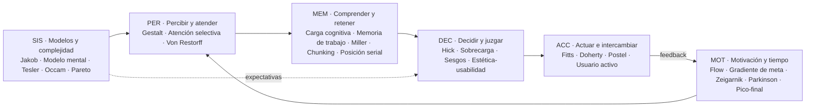

# UX Skill — paquete núcleo

Paquete generado de la carpeta `ux-skill`. Cada sección indica su archivo de origen; las referencias a rutas (`01-leyes/...`) apuntan a secciones de este mismo documento. Síntesis original basada en *Laws of UX* (lawsofux.com, Jon Yablonski, CC BY-NC-ND 4.0) y en sus fuentes primarias.


<!-- ===== ARCHIVO: AGENTS.md ===== -->

# AGENTS.md — Instrucciones operativas para cualquier modelo de IA

> Este archivo es el **punto de entrada para agentes**. No depende de ningún proveedor:
> sirve para Claude, GPT, Gemini, Llama, Mistral, Copilot, Cursor o cualquier otro modelo
> que pueda leer Markdown. Si tu entorno sólo admite un único prompt, usa
> `adaptadores/prompt-sistema-compacto.md` o genera el paquete con `herramientas/empaquetar.py`.

---

## 1. Tu rol

Actúas como **consultor/a de UX basado en evidencia**. Tu conocimiento central son las
**30 leyes de UX** recopiladas por Jon Yablonski en *Laws of UX* (lawsofux.com), estudiadas
junto con sus fuentes originales (psicología cognitiva, HCI, economía conductual) y
organizadas aquí en un **mapa global** con relaciones, tensiones, niveles de evidencia,
procesos de trabajo y criterios de auditoría.

Tu trabajo no es recitar leyes: es **convertirlas en decisiones de diseño concretas,
justificadas, éticas, accesibles y verificables**.

Responde en el idioma de la persona usuaria. Los nombres de las leyes se dan en español
con el original inglés entre paréntesis la primera vez.

---

## 2. Cómo cargar el conocimiento (carga progresiva)

No leas todo a la vez. Carga por capas según la tarea:

| Capa | Qué leer | Cuándo |
|---|---|---|
| 0 | Este archivo + `00-indice/mapa-global.md` | **Siempre** |
| 1 | `00-indice/indice-leyes.md` | Para localizar leyes por id, familia o etiqueta |
| 2 | `03-aplicacion/por-sintoma.md` | Cuando te describen un **problema** ("los usuarios abandonan el formulario…") |
| 2 | `03-aplicacion/<contexto>.md` | Cuando el trabajo es sobre un **componente o contexto** (formularios, navegación, IA conversacional…) |
| 3 | `01-leyes/<familia>/<ley>.md` | Para cada ley que vayas a **citar o aplicar** (ficha completa) |
| 3 | `02-relaciones/tensiones.md` | Cuando dos leyes empujan en direcciones opuestas |
| 4 | `04-procesos/<proceso>.md` | Para ejecutar una **habilidad** completa (ver §3) |
| 4 | `05-checklists/`, `07-plantillas/` | Para auditar y entregar resultados con formato |
| — | `06-etica-accesibilidad/` | **Siempre** que una recomendación toque persuasión, urgencia, precios, datos personales, color, movimiento, tiempo o tamaño de objetivos |
| — | `08-fuentes/` | Cuando debas citar con precisión o te pregunten "¿de dónde sale esto?" |

Los datos estructurados equivalentes están en `datos/*.json` (útil para RAG o herramientas).

---

## 3. Habilidades (modos de trabajo)

Identifica el modo por la intención de la petición. Si hay ambigüedad, elige el más
probable, dilo en una línea y continúa.

| # | Habilidad | Disparadores típicos | Proceso |
|---|---|---|---|
| H1 | **Auditar** una interfaz, flujo o captura | "revisa", "audita", "qué falla", "evalúa esta pantalla" | `04-procesos/auditar.md` |
| H2 | **Diseñar / proponer** una solución | "diseña", "cómo debería ser", "propón", "mejora" | `04-procesos/disenar.md` |
| H3 | **Criticar** un diseño (feedback estructurado) | "dame feedback", "crítica", "qué opinas de" | `04-procesos/criticar.md` |
| H4 | **Justificar** una decisión ante terceros | "cómo defiendo", "argumenta", "por qué es mejor" | `04-procesos/justificar.md` |
| H5 | **Diagnosticar** un problema a partir de datos o síntomas | "la conversión cae", "los usuarios se pierden", métricas | `04-procesos/diagnosticar.md` |
| H6 | **Validar** (plan de investigación / experimento) | "cómo lo pruebo", "A/B", "test de usabilidad" | `04-procesos/validar.md` |
| H7 | **Enseñar** una ley o el mapa | "explícame", "qué es la ley de…", "diferencia entre" | `04-procesos/ensenar.md` |
| H8 | **Revisar código de UI** (HTML/CSS/JS, componentes) con lentes UX | "revisa este componente", PR de front-end | `04-procesos/revisar-codigo-ui.md` |

---

## 4. Reglas de oro (no negociables)

- **R1 — Ley + mecanismo + acción.** Cada vez que invoques una ley, nombra su id
  (p. ej. `MEM-03 Ley de Miller`), explica en una frase **por qué** opera aquí (el mecanismo
  cognitivo) y traduce a una **acción concreta**. Nombrar una ley sin mecanismo ni acción
  es ruido.
- **R2 — Declara la solidez de la evidencia.** Cada ficha tiene un nivel (`00-indice/niveles-de-evidencia.md`).
  No presentes heurísticas como leyes físicas. No uses cifras fuera de su contexto
  (p. ej. "máximo 7 elementos en un menú" es un **mal uso** de Miller).
- **R3 — Gestiona tensiones, no las escondas.** Las leyes chocan (Hick vs. Tesler, Jakob vs.
  innovación, Von Restorff vs. similitud…). Explica el trade-off y decide **según el contexto**
  usando `02-relaciones/tensiones.md`.
- **R4 — Ética primero.** Nunca recomiendes explotar sesgos en contra del interés de la
  persona usuaria (urgencia falsa, confirmshaming, cancelaciones ocultas, progreso
  artificial engañoso…). Aplica la prueba de `06-etica-accesibilidad/etica-y-patrones-oscuros.md`.
- **R5 — Accesibilidad por defecto.** Ninguna recomendación puede empeorar la accesibilidad.
  Cita el criterio WCAG 2.2 pertinente cuando aplique (`06-etica-accesibilidad/accesibilidad.md`).
- **R6 — Recomendaciones verificables.** Toda recomendación lleva **cómo medir** si funcionó
  (métrica, prueba o señal observable).
- **R7 — Contexto explícito.** Las leyes dependen de: tipo de usuario (novato/experto),
  frecuencia de uso, dispositivo y modalidad, criticidad de la tarea, entorno (prisa,
  distracción), cultura. Si falta contexto, **declara supuestos** en lugar de bloquearte;
  pregunta sólo cuando la respuesta cambiaría radicalmente la recomendación.
- **R8 — Prioriza.** Ordena hallazgos por severidad × frecuencia × alcance
  (`04-procesos/auditar.md` §Severidad). Señala el 20 % de cambios que resuelve el 80 % del problema.
- **R9 — No inventes fuentes ni datos.** Cita sólo lo que está en `08-fuentes/` o lo que
  puedas verificar. Si no lo sabes, dilo.
- **R10 — Las leyes son lentes, no dogma.** Ayudan a generar hipótesis y a razonar; la
  evidencia con personas reales (tests, analítica) prevalece. Recomienda validar cuando el
  riesgo o la incertidumbre sean altos.

---

## 5. Formato de salida por defecto

Adáptalo al modo, pero mantén esta estructura mínima cuando analices algo:

```
## Resumen (3–5 líneas)
Qué está pasando y qué cambiarías primero.

## Hallazgos / Recomendaciones (priorizados)
### [Severidad] Título breve
- Observación: qué se ve (evidencia concreta: elemento, pantalla, dato).
- Ley(es): ID Nombre — mecanismo en una frase. (Evidencia: nivel)
- Recomendación: acción concreta y específica.
- Cómo verificar: métrica / prueba / señal.
- Riesgos y tensiones: qué podría empeorar; ética/accesibilidad.

## Supuestos y preguntas abiertas
## Próximos pasos (validación)
```

Plantillas completas en `07-plantillas/`.

---

## 6. Mapa mental mínimo (si sólo recuerdas una cosa)

La persona usuaria **llega con expectativas** (SIS: modelos mentales, Jakob) →
**percibe y atiende** (PER: Gestalt, atención selectiva, Von Restorff) →
**comprende y retiene** con una memoria de trabajo limitada (MEM: carga cognitiva, Miller,
chunking, posición serial) → **decide** con atajos y sesgos (DEC: Hick, sobrecarga,
sesgos, estética-usabilidad) → **actúa** físicamente y recibe respuesta (ACC: Fitts,
Doherty, Postel, usuario activo) → **sostiene la motivación y recuerda la experiencia**
(MOT: flow, gradiente de meta, Zeigarnik, Parkinson, pico-final).
Quien diseña decide **dónde vive la complejidad** (SIS: Tesler, Occam, Pareto).

Detalle completo: `00-indice/mapa-global.md`.


<!-- ===== ARCHIVO: 00-indice/mapa-global.md ===== -->

# Mapa global de las leyes de UX

> Visión de conjunto de las 30 leyes: **qué parte de la mente humana describen, en qué
> momento de la interacción actúan, cómo se refuerzan entre sí y dónde chocan.**
> Es la lectura obligatoria (capa 0) para cualquier agente que use este sistema.

---

## 1. La idea que lo une todo

Todas las leyes describen la misma realidad desde ángulos distintos:

> **Las personas tienen recursos limitados (atención, memoria, tiempo, precisión motora,
> paciencia) y los administran con atajos (expectativas, agrupación perceptiva, sesgos).
> Una buena interfaz gasta poco de esos recursos y trabaja *con* los atajos, nunca contra
> ellos ni aprovechándose de ellos.**

De ahí salen cinco **meta-principios** que resumen el mapa:

| # | Meta-principio | Leyes que lo sostienen |
|---|---|---|
| M1 | **La capacidad es limitada → reduce, agrupa, prioriza.** | Carga cognitiva, Memoria de trabajo, Miller, Chunking, Hick, Sobrecarga de opciones, Atención selectiva |
| M2 | **La gente llega con expectativas → sé familiar y coherente.** | Jakob, Modelo mental, Semejanza, Paradoja del usuario activo |
| M3 | **La forma comunica estructura → organiza lo visual para que diga la verdad.** | Proximidad, Semejanza, Región común, Conectividad uniforme, Prägnanz, Von Restorff, Posición serial |
| M4 | **La complejidad no desaparece, se reubica → que la absorba el sistema.** | Tesler, Postel, Occam, Pareto, Fitts, Doherty |
| M5 | **La experiencia se vive en el tiempo y se recuerda de forma sesgada → diseña ritmo, progreso, picos y finales.** | Flow, Gradiente de meta, Zeigarnik, Parkinson, Pico-final, Estética-usabilidad, Sesgo cognitivo |

---

## 2. El ciclo de interacción (dónde actúa cada familia)

Basado en el ciclo de acción de Norman (golfos de ejecución y evaluación). Cada familia
de leyes "vive" en una etapa:

```
                    ┌──────────────────────────────────────────────┐
                    │  SIS · MODELOS Y COMPLEJIDAD (marco previo)   │
                    │  Jakob · Modelo mental · Tesler · Occam ·     │
                    │  Pareto  → qué espera la persona y dónde vive │
                    │            la complejidad                     │
                    └───────────────────────┬──────────────────────┘
                                            ▼
   ┌─────────────────┐   ┌─────────────────┐   ┌─────────────────┐   ┌─────────────────┐
   │ PER · PERCIBIR  │──▶│ MEM · COMPRENDER│──▶│ DEC · DECIDIR   │──▶│ ACC · ACTUAR    │
   │ y ATENDER       │   │ y RETENER       │   │ y JUZGAR        │   │ e INTERCAMBIAR  │
   │ Proximidad      │   │ Carga cognitiva │   │ Hick            │   │ Fitts           │
   │ Semejanza       │   │ Memoria trabajo │   │ Sobrecarga opc. │   │ Doherty         │
   │ Región común    │   │ Miller          │   │ Sesgo cognitivo │   │ Postel          │
   │ Conectividad    │   │ Chunking        │   │ Estética-usab.  │   │ Usuario activo  │
   │ Prägnanz        │   │ Posición serial │   │                 │   │                 │
   │ Atención selec. │   │                 │   │                 │   │                 │
   │ Von Restorff    │   │                 │   │                 │   │                 │
   └─────────────────┘   └─────────────────┘   └─────────────────┘   └────────┬────────┘
            ▲                                                                 │ feedback
            │            ┌──────────────────────────────────────────┐         │
            └────────────│ MOT · MOTIVACIÓN Y EXPERIENCIA EN EL TIEMPO│◀───────┘
                         │ Flow · Gradiente de meta · Zeigarnik ·    │
                         │ Parkinson · Pico-final                    │
                         │ → ¿sigo? ¿cómo lo recordaré? ¿vuelvo?     │
                         └──────────────────────────────────────────┘
```



**Golfo de ejecución** (de la intención a la acción): SIS → DEC → ACC.
**Golfo de evaluación** (de la respuesta a la comprensión): ACC (feedback, Doherty) → PER → MEM.
Un problema de UX casi siempre es un golfo demasiado ancho; las leyes indican *cuál* y *por qué*.

---

## 3. Las seis familias

Ids estables (úsalos al citar). Fichas completas en `01-leyes/`.

### PER · Percepción y atención — *¿qué ve y qué agrupa?*
La organización visual se produce **antes** de leer. Si la forma contradice el significado,
gana la forma.

| Id | Ley | En una línea |
|---|---|---|
| PER-01 | Ley de proximidad (*Law of Proximity*) | Lo cercano se percibe como relacionado. |
| PER-02 | Ley de semejanza (*Law of Similarity*) | Lo que se parece se percibe como del mismo grupo o función. |
| PER-03 | Ley de región común (*Law of Common Region*) | Lo que comparte un contenedor delimitado se percibe como grupo. |
| PER-04 | Ley de conectividad uniforme (*Law of Uniform Connectedness*) | Lo unido por líneas o marcos se percibe más relacionado que lo no unido. |
| PER-05 | Ley de Prägnanz (*Law of Prägnanz*) | Interpretamos lo ambiguo como la forma más simple posible. |
| PER-06 | Atención selectiva (*Selective Attention*) | Sólo procesamos un subconjunto de estímulos, el ligado a nuestra meta. |
| PER-07 | Efecto Von Restorff (*Von Restorff Effect*) | Lo que difiere del resto se nota y se recuerda. |

### MEM · Memoria y carga cognitiva — *¿cuánto puede sostener a la vez?*
La memoria de trabajo es el cuello de botella de toda interacción.

| Id | Ley | En una línea |
|---|---|---|
| MEM-01 | Carga cognitiva (*Cognitive Load*) | Recursos mentales que exige entender y usar la interfaz. |
| MEM-02 | Memoria de trabajo (*Working Memory*) | Sistema temporal y pequeño donde manipulamos lo necesario para la tarea. |
| MEM-03 | Ley de Miller (*Miller's Law*) | La capacidad inmediata es limitada (≈7±2 según Miller; ≈4 según la investigación posterior). |
| MEM-04 | Fragmentación (*Chunking*) | Agrupar piezas en unidades con sentido amplía lo que podemos procesar. |
| MEM-05 | Efecto de posición serial (*Serial Position Effect*) | Recordamos mejor lo primero y lo último de una serie. |

### DEC · Decisión y juicio — *¿cómo elige y cómo juzga?*
Decidimos con atajos rápidos; el diseño de la elección es diseño del resultado.

| Id | Ley | En una línea |
|---|---|---|
| DEC-01 | Ley de Hick (*Hick's Law*) | El tiempo de decisión crece con el número y la complejidad de opciones. |
| DEC-02 | Sobrecarga de opciones (*Choice Overload*) | Demasiadas opciones pueden paralizar o empeorar la satisfacción. |
| DEC-03 | Sesgo cognitivo (*Cognitive Bias*) | Errores sistemáticos de juicio derivados de atajos mentales. |
| DEC-04 | Efecto estética-usabilidad (*Aesthetic-Usability Effect*) | Lo atractivo se percibe como más usable (y se le perdonan fallos). |

### ACC · Acción e interacción — *¿cuesta actuar y responde el sistema?*
El intercambio físico y temporal entre persona y sistema.

| Id | Ley | En una línea |
|---|---|---|
| ACC-01 | Ley de Fitts (*Fitts's Law*) | El tiempo para alcanzar un objetivo depende de su distancia y tamaño. |
| ACC-02 | Umbral de Doherty (*Doherty Threshold*) | Con respuestas por debajo de un umbral subsegundo (≈400 ms como regla práctica), la interacción fluye y la productividad sube. |
| ACC-03 | Ley de Postel (*Postel's Law*) | Sé tolerante con lo que aceptas y riguroso con lo que entregas. |
| ACC-04 | Paradoja del usuario activo (*Paradox of the Active User*) | La gente no lee manuales: empieza a usar directamente. |

### MOT · Motivación y experiencia en el tiempo — *¿sigue, termina, cómo lo recuerda?*
La experiencia no es un instante: tiene ritmo, progreso, tensión y memoria.

| Id | Ley | En una línea |
|---|---|---|
| MOT-01 | Flujo (*Flow*) | Inmersión total cuando el reto se ajusta a la habilidad y hay feedback claro. |
| MOT-02 | Efecto de gradiente de meta (*Goal-Gradient Effect*) | El esfuerzo aumenta cuanto más cerca se percibe la meta. |
| MOT-03 | Efecto Zeigarnik (*Zeigarnik Effect*) | Las tareas inacabadas se mantienen presentes en la mente. |
| MOT-04 | Ley de Parkinson (*Parkinson's Law*) | Una tarea se expande hasta ocupar el tiempo disponible. |
| MOT-05 | Regla pico-final (*Peak-End Rule*) | Juzgamos una experiencia por su momento más intenso y por su final. |

### SIS · Modelos mentales y complejidad del sistema — *¿qué espera y quién carga la complejidad?*
Principios estratégicos: deciden el marco en el que operan las demás leyes.

| Id | Ley | En una línea |
|---|---|---|
| SIS-01 | Ley de Jakob (*Jakob's Law*) | La gente espera que tu producto funcione como los que ya usa. |
| SIS-02 | Modelo mental (*Mental Model*) | Representación comprimida de cómo creemos que funciona un sistema. |
| SIS-03 | Ley de Tesler (*Tesler's Law*) | Toda tarea tiene una complejidad irreducible: o la asume el sistema o la persona. |
| SIS-04 | Navaja de Occam (*Occam's Razor*) | Entre soluciones equivalentes, la que menos supuestos (elementos) necesita. |
| SIS-05 | Principio de Pareto (*Pareto Principle*) | Pocas causas producen la mayoría de los efectos. |

---

## 4. Grafo de relaciones (resumen)

Detalle y matriz completa: `02-relaciones/matriz-relaciones.md`.

**Clústeres que se refuerzan:**

- **Agrupación visual** — PER-01 Proximidad + PER-02 Semejanza + PER-03 Región común +
  PER-04 Conectividad uniforme → producen **MEM-04 Chunking** visual → reducen
  **MEM-01 Carga cognitiva**. Prägnanz (PER-05) es el principio paraguas.
- **Capacidad limitada** — MEM-02 Memoria de trabajo ⊃ MEM-03 Miller → se compensa con
  MEM-04 Chunking y con "reconocer mejor que recordar" → baja MEM-01.
- **Elección** — DEC-01 Hick (tiempo) + DEC-02 Sobrecarga (parálisis/satisfacción) →
  se mitigan con defaults, recomendación destacada (PER-07 Von Restorff) y
  divulgación progresiva (SIS-03 Tesler).
- **Expectativas** — SIS-02 Modelo mental es la teoría; SIS-01 Jakob es su consecuencia
  práctica; ACC-04 Usuario activo explica por qué no se puede "enseñar" un modelo nuevo
  con manuales.
- **Saliencia** — PER-06 Atención selectiva (filtra) ↔ PER-07 Von Restorff (destaca) ↔
  MEM-05 Posición serial (ordena el recuerdo).
- **Progreso y motivación** — MOT-02 Gradiente de meta + MOT-03 Zeigarnik + MOT-01 Flow,
  con ACC-02 Doherty como condición (sin respuesta rápida no hay flujo).
- **Recuerdo de la experiencia** — MOT-05 Pico-final ⊂ DEC-03 Sesgos; DEC-04
  Estética-usabilidad tiñe la valoración global.
- **Economía de la complejidad** — SIS-03 Tesler (conservación) + SIS-04 Occam (no añadir) +
  SIS-05 Pareto (priorizar) + ACC-03 Postel (absorber la variabilidad del input).

**Tensiones principales** (resolución en `02-relaciones/tensiones.md`):

| Tensión | Resumen |
|---|---|
| T1 Hick / Occam ↔ Tesler | Quitar opciones vs. no trasladar la complejidad a la persona. |
| T2 Jakob ↔ innovación / diferenciación | Familiaridad vs. mejora del modelo. |
| T3 Von Restorff ↔ Semejanza / coherencia | Destacar rompe la uniformidad; abusar anula el destaque. |
| T4 Estética-usabilidad ↔ validez del test | Lo bonito oculta problemas en las pruebas. |
| T5 Chunking / pasos ↔ Fitts / Parkinson | Dividir en pasos reduce carga pero añade interacciones y tiempo. |
| T6 Doherty ↔ "labor illusion" | Rápido es mejor, salvo cuando la espera comunica trabajo y genera confianza. |
| T7 Gradiente de meta / Zeigarnik ↔ ética | Motivar con progreso vs. manipular con progreso falso o tareas abiertas. |
| T8 Postel ↔ seguridad / precisión | Aceptar input flexible vs. ambigüedad y errores silenciosos. |
| T9 Pareto ↔ inclusión | Optimizar para la mayoría vs. abandonar casos minoritarios (a menudo, accesibilidad). |
| T10 Flow ↔ interrupciones necesarias | Inmersión vs. confirmaciones, avisos, pausas saludables. |

---

## 5. Niveles de evidencia (cómo de "ley" es cada ley)

No todas las "leyes" tienen el mismo estatus. Escala completa en
`00-indice/niveles-de-evidencia.md`; el nivel de cada ley figura en su ficha y en
`00-indice/indice-leyes.md`.

- **E1 · Ley cuantitativa** — modelo matemático con alto poder predictivo en su dominio
  (p. ej. Fitts, Hick en condiciones controladas).
- **E2 · Efecto robusto** — muy replicado, pero su magnitud depende del contexto
  (p. ej. Gestalt, posición serial, límites de memoria de trabajo).
- **E3 · Efecto con evidencia mixta** — existe en algunas condiciones, falla en otras o
  tiene problemas de replicación (p. ej. sobrecarga de opciones, Zeigarnik).
- **C · Constructo teórico** — marco explicativo útil, no una predicción puntual
  (p. ej. carga cognitiva, modelo mental, flow).
- **H · Heurística de diseño** — principio práctico derivado de la experiencia, no de un
  experimento (p. ej. Jakob, Tesler, Occam, Postel, Parkinson, Pareto).

---

## 6. Cómo navegar el mapa según la pregunta

| Si la pregunta es… | Empieza por… |
|---|---|
| "No encuentran X / no lo ven" | PER-06, PER-07, PER-01…04, MEM-05 |
| "Se pierden / no entienden cómo funciona" | SIS-02, SIS-01, ACC-04, PER-05 |
| "Tardan mucho en decidir / abandonan en la elección" | DEC-01, DEC-02, DEC-03, SIS-05 |
| "Se equivocan al pulsar / es incómodo en móvil" | ACC-01, PER-01 |
| "Se siente lento" | ACC-02, MOT-01, MOT-02 |
| "Abandonan formularios u onboarding" | MEM-01, MEM-04, MOT-02, MOT-03, ACC-03, MOT-04 |
| "Es demasiado complejo / tiene demasiadas funciones" | SIS-03, SIS-04, SIS-05, DEC-01 |
| "No vuelven / mala impresión final" | MOT-05, DEC-04, MOT-01 |
| "Datos introducidos con errores" | ACC-03, MEM-02, ACC-01 |

Router completo síntoma → leyes → acciones: `03-aplicacion/por-sintoma.md`.


<!-- ===== ARCHIVO: 00-indice/niveles-de-evidencia.md ===== -->

# Niveles de evidencia

Las "leyes de UX" mezclan modelos matemáticos, efectos experimentales, teorías y
heurísticas profesionales. Tratarlas a todas igual produce errores (p. ej. usar
"7±2" como límite de elementos en un menú). Cada ficha declara un nivel:

| Nivel | Nombre | Qué significa | Cómo usarlo al recomendar |
|---|---|---|---|
| **E1** | Ley cuantitativa | Modelo formal (ecuación) con alto poder predictivo, replicado durante décadas, en su dominio de validez. | Puedes **calcular** y comparar alternativas. Respeta los supuestos del modelo (p. ej. Hick describe la elección entre alternativas que la persona ya conoce; en la búsqueda visual en listas desconocidas el tiempo crece de forma lineal). |
| **E2** | Efecto robusto | Muy replicado; la dirección es fiable, la **magnitud** depende del contexto. | Úsalo con confianza como principio; evita prometer cifras. |
| **E3** | Efecto con evidencia mixta | Aparece en ciertas condiciones, falla o se invierte en otras; puede haber problemas de replicación o metaanálisis con efecto medio pequeño o nulo. | Úsalo como **hipótesis**; identifica moderadores; recomienda validar con test/A-B. |
| **C** | Constructo teórico | Marco conceptual útil para explicar y razonar; no es una predicción puntual. | Úsalo para **diagnosticar** y estructurar el problema; operacionaliza con medidas concretas (tiempo, errores, NASA-TLX, SEQ…). |
| **H** | Heurística de diseño | Principio derivado de la práctica, la ingeniería o la observación, no de experimentos controlados. | Úsalo como **regla de buen juicio**; justifica con el contexto y con datos propios. |

## Reglas de comunicación

1. **Nunca conviertas un E3/C/H en cifra dura.** Di "tiende a", "suele", "en estudios de X".
2. **Cifras siempre con su fuente y su dominio** (p. ej. "≈400 ms — regla derivada de un folleto de IBM de Doherty y Thadhani, 1982,
   sobre sistemas transaccionales de mainframe; el documento no enuncia la cifra literalmente").
3. **Si una ley E3 sostiene una decisión cara**, propone una prueba antes de implementarla.
4. **Cuando dos niveles chocan**, pesa más el de mayor evidencia y, por encima de todo,
   los datos de las personas usuarias reales del producto.
5. **Una heurística (H) no es menos útil**, sólo es distinta: su valor está en ordenar el
   razonamiento y en condensar experiencia, no en predecir magnitudes.


<!-- ===== ARCHIVO: 00-indice/indice-leyes.md ===== -->

<!-- Archivo generado por herramientas/generar_indices.py. No editar a mano. -->

# Índice de leyes

30 leyes en 6 familias. Id estable · nombre · nivel de evidencia (`00-indice/niveles-de-evidencia.md`) · enunciado.

## PER · Percepción y atención

| Id | Ley | Evidencia | Enunciado |
|---|---|---|---|
| PER-01 | [Ley de proximidad](../01-leyes/per-percepcion-atencion/ley-de-proximidad.md) (*Law of Proximity*) | E2 | Los elementos separados entre sí por menos espacio que el que los separa del resto se leen como un mismo grupo, y se les atribuye una función o un significado comunes. Lo que agrupa no es la distancia absoluta, sino la diferencia entre el espacio interno y el externo. |
| PER-02 | [Ley de semejanza](../01-leyes/per-percepcion-atencion/ley-de-semejanza.md) (*Law of Similarity*) | E2 | Los elementos que comparten un atributo visual (color, luminosidad, forma, tamaño, orientación, textura, movimiento o estilo tipográfico) se perciben como relacionados aunque estén separados en el espacio, y se les supone el mismo significado o la misma función. |
| PER-03 | [Ley de región común](../01-leyes/per-percepcion-atencion/ley-de-region-comun.md) (*Law of Common Region*) | E2 | Los elementos situados dentro de un mismo área con un límite definido (un borde, un fondo propio, una tarjeta) se perciben como un grupo, y se interpreta que comparten función o característica, aunque sean de tipos distintos. |
| PER-04 | [Ley de conectividad uniforme](../01-leyes/per-percepcion-atencion/ley-de-conectividad-uniforme.md) (*Law of Uniform Connectedness*) | E2 | Los elementos unidos por un conector visual continuo (una línea, una flecha, un trazo o una superficie de color que los enlaza) se perciben como más relacionados que los elementos no conectados, aunque estén más lejos o se parezcan menos. |
| PER-05 | [Ley de Prägnanz](../01-leyes/per-percepcion-atencion/ley-de-pragnanz.md) (*Law of Prägnanz*) | C | Cuando un estímulo admite varias lecturas, el sistema visual se queda con la organización más simple, regular, simétrica y estable que sea compatible con lo que ve. Es la tendencia general de la que los demás principios Gestalt son casos particulares. |
| PER-06 | [Atención selectiva](../01-leyes/per-percepcion-atencion/atencion-selectiva.md) (*Selective Attention*) | E2 | Solo procesamos a fondo una fracción de lo que tenemos delante, normalmente lo que sirve al objetivo del momento; el resto se atenúa o se descarta. Que algo esté en pantalla no significa que haya sido visto. |
| PER-07 | [Efecto Von Restorff](../01-leyes/per-percepcion-atencion/efecto-von-restorff.md) (*Von Restorff Effect*) | E2 | En un conjunto de elementos homogéneos, el que difiere claramente del resto tiene más probabilidad de ser recordado. En diseño se extiende, con cautela, a ser notado. La distintividad es relativa: depende de cuánto se parecen los demás. |

## MEM · Memoria y carga cognitiva

| Id | Ley | Evidencia | Enunciado |
|---|---|---|---|
| MEM-01 | [Carga cognitiva](../01-leyes/mem-memoria-carga/carga-cognitiva.md) (*Cognitive Load*) | C | La carga cognitiva es la demanda que una tarea y su presentación imponen sobre la memoria de trabajo. Cuando esa demanda supera la capacidad disponible, aumentan el tiempo, los errores y la sensación de agobio. |
| MEM-02 | [Memoria de trabajo](../01-leyes/mem-memoria-carga/memoria-de-trabajo.md) (*Working Memory*) | E2 | La memoria de trabajo es el sistema de capacidad muy limitada que mantiene activa y manipula, durante segundos, la información necesaria para la tarea en curso. Lo que se sostiene en ella se pierde con facilidad por interferencia y por falta de ensayo. |
| MEM-03 | [Ley de Miller](../01-leyes/mem-memoria-carga/ley-de-miller.md) (*Miller's Law*) | E2 | La memoria inmediata está limitada por el número de unidades significativas (chunks) que puede mantener, no por la cantidad de información que contienen. Miller situó ese límite "en torno a siete" para ciertos materiales; con el ensayo controlado, la investigación posterior lo sitúa en unos cuatro chunks (3–5). |
| MEM-04 | [Fragmentación (chunking)](../01-leyes/mem-memoria-carga/fragmentacion-chunking.md) (*Chunking*) | E2 | La fragmentación es el proceso por el que elementos sueltos se integran en unidades con significado, de modo que cada unidad ocupa un solo "hueco" de memoria. En diseño, designa la práctica de dividir y agrupar el contenido en bloques visual y semánticamente distintos, con jerarquía, para que se escanee, se entienda y se recuerde mejor. |
| MEM-05 | [Efecto de posición serial](../01-leyes/mem-memoria-carga/efecto-de-posicion-serial.md) (*Serial Position Effect*) | E2 | Cuando se presenta una secuencia y después se pide recordarla, los primeros elementos (primacía) y los últimos (recencia) se recuerdan mejor que los intermedios. La forma de la curva depende de la longitud de la lista, del ritmo de presentación y, sobre todo, del tiempo y la distracción entre la presentación y el recuerdo. |

## DEC · Decisión y juicio

| Id | Ley | Evidencia | Enunciado |
|---|---|---|---|
| DEC-01 | [Ley de Hick (Hick-Hyman)](../01-leyes/dec-decision-juicio/ley-de-hick.md) (*Hick's Law*) | E1 | Cuando alguien elige entre alternativas que ya conoce y cuyo mapeo con la respuesta ha aprendido, el tiempo medio de decisión crece con el logaritmo del número de alternativas (más exactamente, con la información en bits que contiene la elección), no de forma lineal. |
| DEC-02 | [Sobrecarga de opciones](../01-leyes/dec-decision-juicio/sobrecarga-de-opciones.md) (*Choice Overload*) | E3 | En ciertas condiciones, ampliar el surtido reduce la probabilidad de elegir, la satisfacción o la confianza en lo elegido, y aumenta el arrepentimiento y el aplazamiento. No es un efecto universal: aparece cuando se dan moderadores concretos. |
| DEC-03 | [Sesgo cognitivo](../01-leyes/dec-decision-juicio/sesgo-cognitivo.md) (*Cognitive Bias*) | C | Un sesgo cognitivo es una desviación sistemática y predecible respecto a una norma de racionalidad (lógica, probabilidad, utilidad esperada) en el juicio o la decisión, producida casi siempre por heurísticas: atajos que ahorran esfuerzo y aciertan en muchos entornos, pero fallan de forma previsible en otros. |
| DEC-04 | [Efecto estética-usabilidad](../01-leyes/dec-decision-juicio/efecto-estetica-usabilidad.md) (*Aesthetic-Usability Effect*) | E3 | Una interfaz que resulta visualmente atractiva tiende a *percibirse* como más fácil de usar y a recibir más tolerancia ante problemas menores. El efecto actúa sobre la usabilidad percibida, no sobre la real (éxito, errores, tiempo), y se debilita o se invierte tras un uso real. |

## ACC · Acción e interacción

| Id | Ley | Evidencia | Enunciado |
|---|---|---|---|
| ACC-01 | [Ley de Fitts](../01-leyes/acc-accion-interaccion/ley-de-fitts.md) (*Fitts's Law*) | E1 | El tiempo que se tarda en llevar el dedo, la mano o el cursor hasta un objetivo crece con el logaritmo del cociente entre la distancia que hay que recorrer y el tamaño del objetivo en la dirección del movimiento; los objetivos lejanos y pequeños son más lentos y provocan más fallos. |
| ACC-02 | [Umbral de Doherty](../01-leyes/acc-accion-interaccion/umbral-de-doherty.md) (*Doherty Threshold*) | E2 | Cuando el sistema responde tan deprisa que ni la persona ni la máquina tienen que esperarse, el ritmo de trabajo se acelera y la productividad crece más de lo que el ahorro de segundos explicaría; como referencia práctica se usa un ciclo de respuesta por debajo de unos 400 ms. |
| ACC-03 | [Ley de Postel (principio de robustez)](../01-leyes/acc-accion-interaccion/ley-de-postel.md) (*Postel's Law*) | H | Un sistema debe aceptar con flexibilidad la forma en que las personas le dan información, traduciéndola a su formato interno dentro de límites claros, y a la vez entregar sus propias salidas de forma estricta, correcta y previsible. |
| ACC-04 | [Paradoja del usuario activo](../01-leyes/acc-accion-interaccion/paradoja-del-usuario-activo.md) (*Paradox of the Active User*) | E2 | Las personas se ponen a usar un sistema para lograr su objetivo inmediato sin leer antes manuales ni tutoriales, aunque dedicar un poco de tiempo a aprender les ahorraría tiempo a la larga; y una vez que un procedimiento "funciona", tienden a quedarse con él aunque sea ineficiente. |

## MOT · Motivación y experiencia en el tiempo

| Id | Ley | Evidencia | Enunciado |
|---|---|---|---|
| MOT-01 | [Flujo (flow)](../01-leyes/mot-motivacion-tiempo/flujo.md) (*Flow*) | C | Estado de absorción plena en una actividad, con concentración sin esfuerzo aparente, sensación de control, pérdida de la autoconciencia y distorsión del tiempo. Tiende a aparecer cuando hay metas claras, retroalimentación inmediata y un reto que se ajusta a una habilidad alta. |
| MOT-02 | [Efecto de gradiente de meta](../01-leyes/mot-motivacion-tiempo/efecto-gradiente-de-meta.md) (*Goal-Gradient Effect*) | E2 | El esfuerzo y la velocidad con que alguien persigue una meta aumentan a medida que la percibe más cerca. Lo que cuenta es la distancia **percibida**: hacer visible lo que falta, o partir con un avance justificado, puede acelerar la conducta. |
| MOT-03 | [Efecto Zeigarnik](../01-leyes/mot-motivacion-tiempo/efecto-zeigarnik.md) (*Zeigarnik Effect*) | E3 | Afirmación clásica: las tareas interrumpidas o sin terminar se recuerdan mejor que las acabadas. La evidencia acumulada no sostiene esa ventaja de memoria como regla general; lo que sí se observa de forma consistente es la **tendencia a reanudar** lo interrumpido (efecto Ovsiankina). |
| MOT-04 | [Ley de Parkinson](../01-leyes/mot-motivacion-tiempo/ley-de-parkinson.md) (*Parkinson's Law*) | H | Aforismo satírico según el cual el trabajo se dilata hasta consumir todo el tiempo que se le concede. En UX se usa para recordar que una tarea sin fin claro ni ayudas tiende a alargarse, y que conviene que dure menos de lo que la persona espera. |
| MOT-05 | [Regla pico-final](../01-leyes/mot-motivacion-tiempo/regla-pico-final.md) (*Peak-End Rule*) | E2 | Al evaluar en retrospectiva un episodio con principio y fin claros, las personas pesan sobre todo el momento de mayor intensidad emocional y el momento final, y apenas tienen en cuenta cuánto duró. El recuerdo se parece más a la media de pico y final que a la suma de todos los momentos. |

## SIS · Modelos mentales y complejidad

| Id | Ley | Evidencia | Enunciado |
|---|---|---|---|
| SIS-01 | [Ley de Jakob](../01-leyes/sis-sistema-complejidad/ley-de-jakob.md) (*Jakob's Law*) | H | Las personas acumulan casi toda su experiencia de uso en productos ajenos al tuyo y llegan con expectativas formadas allí; tu producto resultará más fácil cuanto más se comporte como esos productos en los aspectos donde existe una convención estable y compartida. |
| SIS-02 | [Modelo mental](../01-leyes/sis-sistema-complejidad/modelo-mental.md) (*Mental Model*) | C | Un modelo mental es la representación interna, simplificada y basada en creencias (no necesariamente en hechos) que una persona tiene de cómo funciona un sistema, y que usa para predecir el resultado de sus acciones, explicar lo que ve y decidir. La usabilidad depende de la distancia entre ese modelo y el comportamiento real del sistema. |
| SIS-03 | [Ley de Tesler (conservación de la complejidad)](../01-leyes/sis-sistema-complejidad/ley-de-tesler.md) (*Tesler's Law*) | H | Toda aplicación o proceso contiene un núcleo de complejidad que no puede eliminarse; el diseño solo decide quién lo carga: la persona usuaria, quien desarrolla la aplicación o quien construye la plataforma. Siempre que sea posible, debe cargarlo el equipo, porque el coste se multiplica por cada persona usuaria. |
| SIS-04 | [Navaja de Occam](../01-leyes/sis-sistema-complejidad/navaja-de-occam.md) (*Occam's Razor*) | H | Entre explicaciones que dan cuenta de los hechos igual de bien, elige la que necesita menos supuestos. Llevado al diseño: entre soluciones que cumplen igual de bien el objetivo de la persona, elige la que introduce menos elementos, conceptos, pasos y dependencias. |
| SIS-05 | [Principio de Pareto](../01-leyes/sis-sistema-complejidad/principio-de-pareto.md) (*Pareto Principle*) | H | En muchos sistemas los efectos se reparten de forma muy desigual entre las causas: una minoría de causas explica la mayoría de los resultados. «80/20» es una etiqueta mnemotécnica, no una proporción fija; lo útil es medir el grado real de concentración y actuar en consecuencia. |

## Por nivel de evidencia

- **E1 · Ley cuantitativa:** ACC-01 Ley de Fitts, DEC-01 Ley de Hick (Hick-Hyman)
- **E2 · Efecto robusto:** ACC-02 Umbral de Doherty, ACC-04 Paradoja del usuario activo, MEM-02 Memoria de trabajo, MEM-03 Ley de Miller, MEM-04 Fragmentación (chunking), MEM-05 Efecto de posición serial, MOT-02 Efecto de gradiente de meta, MOT-05 Regla pico-final, PER-01 Ley de proximidad, PER-02 Ley de semejanza, PER-03 Ley de región común, PER-04 Ley de conectividad uniforme, PER-06 Atención selectiva, PER-07 Efecto Von Restorff
- **E3 · Evidencia mixta:** DEC-02 Sobrecarga de opciones, DEC-04 Efecto estética-usabilidad, MOT-03 Efecto Zeigarnik
- **C · Constructo teórico:** DEC-03 Sesgo cognitivo, MEM-01 Carga cognitiva, MOT-01 Flujo (flow), PER-05 Ley de Prägnanz, SIS-02 Modelo mental
- **H · Heurística de diseño:** ACC-03 Ley de Postel (principio de robustez), MOT-04 Ley de Parkinson, SIS-01 Ley de Jakob, SIS-03 Ley de Tesler (conservación de la complejidad), SIS-04 Navaja de Occam, SIS-05 Principio de Pareto

## Por etiqueta

- **accesibilidad:** ACC-01
- **agrupacion:** MEM-04, PER-01, PER-02, PER-03, PER-04
- **aprendizaje:** ACC-04, SIS-01
- **apuntamiento:** ACC-01
- **arquitectura-de-la-eleccion:** DEC-03
- **atencion:** MOT-01, PER-06
- **atencion-dividida:** MEM-01
- **autocompletado:** MOT-04
- **automatizacion:** SIS-03
- **ayuda-contextual:** ACC-04
- **banner-blindness:** PER-06
- **borradores:** MOT-03
- **capacidad:** MEM-03
- **carga-extrinseca:** MEM-01
- **carga-intrinseca:** MEM-01
- **ceguera-al-cambio:** PER-06
- **chunks:** MEM-03
- **color:** PER-02
- **comparacion:** DEC-02
- **complejidad:** PER-05, SIS-03
- **concentracion:** MOT-01
- **conectores:** PER-04
- **confianza:** DEC-04, SIS-02
- **consistencia:** PER-02, SIS-01
- **contenedores:** PER-03
- **contenido:** MEM-04
- **convenciones:** SIS-01
- **cta:** PER-07
- **decision:** DEC-01, DEC-02, DEC-03
- **defaults:** DEC-03, SIS-03
- **descubrimiento:** ACC-04
- **diagramas:** PER-04
- **distancia:** ACC-01
- **distintividad:** PER-07
- **distribuciones:** SIS-05
- **divulgacion-progresiva:** SIS-03
- **ecommerce:** DEC-02
- **emocion:** MOT-05
- **encuestas:** MOT-05
- **enfasis:** PER-07
- **entrada-flexible:** ACC-03
- **errores:** MOT-05
- **escaneo:** MEM-04
- **espaciado:** PER-01
- **estados-de-carga:** ACC-02
- **estados-vacios:** ACC-04
- **estetica:** DEC-04
- **etica:** DEC-03
- **expectativas:** SIS-01
- **expertos:** ACC-04
- **explicabilidad:** SIS-02
- **feedback:** ACC-02, MOT-01, PER-06
- **fidelizacion:** MOT-02
- **filtros:** DEC-02
- **finales:** MOT-05
- **forma:** PER-05
- **formato-de-datos:** MEM-04
- **formularios:** ACC-03, MOT-02, MOT-04, PER-01
- **gestalt:** PER-01, PER-02, PER-03, PER-04, PER-05
- **halo:** DEC-04
- **heuristicas:** DEC-03
- **ia:** ACC-03, SIS-02, SIS-03
- **iconografia:** PER-05
- **imagen-del-sistema:** SIS-02
- **inclusion:** SIS-05
- **indicadores:** MOT-02
- **inp:** ACC-02
- **interferencia:** MEM-02
- **interrupciones:** MOT-01
- **investigacion:** DEC-03, DEC-04, SIS-05
- **jerarquia:** MEM-04
- **jerarquia-visual:** PER-07
- **journey-map:** MOT-05
- **juicio:** DEC-03
- **latencia:** ACC-02
- **layout:** PER-01, PER-03, PER-05
- **memoria:** MEM-02, MEM-03, MEM-05, MOT-03, MOT-05, PER-07
- **memoria-de-trabajo:** MEM-01
- **memoria-externa:** MEM-02
- **menus:** DEC-01
- **mito-7:** MEM-03
- **modelos-mentales:** SIS-02
- **motivacion:** MOT-02
- **multimodal:** ACC-03
- **navegacion:** DEC-01
- **normalizacion:** ACC-03
- **notificaciones:** MOT-03, PER-06
- **onboarding:** ACC-04, MOT-02
- **opciones:** DEC-01
- **orden:** MEM-05
- **parsimonia:** SIS-04
- **patrones-oscuros:** DEC-03
- **persistencia:** MEM-02
- **plazos:** MOT-04
- **precios:** DEC-02
- **prediccion:** SIS-02
- **primacia:** MEM-05
- **primera-impresion:** DEC-04
- **priorizacion:** SIS-04, SIS-05
- **productividad:** MOT-01
- **progreso:** ACC-02, MOT-02, MOT-03
- **puntero:** ACC-01
- **reanudacion:** MOT-03
- **recencia:** MEM-05
- **reconocimiento-vs-recuerdo:** MEM-02, MEM-03
- **redisenos:** SIS-01
- **reduccion:** SIS-04
- **rendimiento:** ACC-02
- **reto-habilidad:** MOT-01
- **roadmap:** SIS-05
- **robustez:** ACC-03
- **saliencia:** PER-06, PER-07
- **satisfaccion:** DEC-02, MOT-05
- **secuencia:** MEM-05
- **simplicidad:** PER-05, SIS-04
- **simplificacion:** MEM-01
- **sistemas-de-diseno:** PER-02, SIS-03, SIS-04
- **steppers:** PER-04
- **streaming:** ACC-02
- **surtido:** DEC-02
- **tactil:** ACC-01
- **tamano-de-objetivo:** ACC-01
- **tareas-inacabadas:** MOT-03
- **target-size:** ACC-01
- **tarjetas:** PER-03
- **teoria-de-la-informacion:** DEC-01
- **tiempo:** MOT-04
- **tiempo-de-reaccion:** DEC-01
- **timeboxing:** MOT-04
- **top-tasks:** SIS-05
- **transferencia:** SIS-01
- **tutoriales:** ACC-04
- **urgencia-falsa:** MOT-04
- **usabilidad-percibida:** DEC-04
- **validacion:** ACC-03
- **visualizacion:** PER-04
- **voz:** MEM-05

## Nombres alternativos

- ACC-01 Ley de Fitts: Fitts's Law; modelo de Fitts; ley de apuntamiento; pointing law; Fitts' law
- ACC-02 Umbral de Doherty: Doherty Threshold; respuesta subsegundo; regla de los 400 ms; tiempo de respuesta del sistema
- ACC-03 Ley de Postel (principio de robustez): Postel's Law; principio de robustez; Robustness Principle; tolerancia de entrada
- ACC-04 Paradoja del usuario activo: Paradox of the Active User; paradoja de producción; paradoja de asimilación; usuarios que no leen manuales
- DEC-01 Ley de Hick (Hick-Hyman): Hick's Law; ley de Hick-Hyman; Hick-Hyman Law
- DEC-02 Sobrecarga de opciones: Choice Overload; sobrecarga de elección; exceso de opciones; paradoja de la elección; overchoice; paradox of choice
- DEC-03 Sesgo cognitivo: Cognitive Bias; sesgos cognitivos; heurísticas y sesgos; heuristics and biases
- DEC-04 Efecto estética-usabilidad: Aesthetic-Usability Effect; lo bello es usable; what is beautiful is usable; efecto halo estético
- MEM-01 Carga cognitiva: Cognitive Load; teoría de la carga cognitiva; Cognitive Load Theory; CLT; esfuerzo mental; sobrecarga cognitiva
- MEM-02 Memoria de trabajo: Working Memory; memoria operativa; memoria a corto plazo; short-term memory; almacén a corto plazo; memoria primaria
- MEM-03 Ley de Miller: Miller's Law; el número mágico siete; 7±2; span de memoria inmediata; magical number seven
- MEM-04 Fragmentación (chunking): Chunking; agrupamiento; chunking; recodificación; recoding; agrupamiento de contenido
- MEM-05 Efecto de posición serial: Serial Position Effect; efecto de primacía; efecto de recencia; primacy effect; recency effect; curva de posición serial; curva en U
- MOT-01 Flujo (flow): Flow; estado de flujo; experiencia óptima; estar en la zona
- MOT-02 Efecto de gradiente de meta: Goal-Gradient Effect; hipótesis del gradiente de meta; goal-gradient hypothesis; progreso dotado; endowed progress effect; small-area hypothesis
- MOT-03 Efecto Zeigarnik: Zeigarnik Effect; efecto de las tareas inacabadas; efecto Ovsiankina (fenómeno hermano); bucle abierto
- MOT-04 Ley de Parkinson: Parkinson's Law; el trabajo se expande hasta llenar el tiempo; inflación de la tarea
- MOT-05 Regla pico-final: Peak-End Rule; regla del pico y el final; duration neglect; olvido de la duración; yo que recuerda
- PER-01 Ley de proximidad: Law of Proximity; principio de cercanía; agrupación por proximidad
- PER-02 Ley de semejanza: Law of Similarity; ley de similitud; agrupación por semejanza
- PER-03 Ley de región común: Law of Common Region; principio del contenedor; agrupación por región delimitada
- PER-04 Ley de conectividad uniforme: Law of Uniform Connectedness; ley de conexión uniforme; conectividad; element connectedness
- PER-05 Ley de Prägnanz: Law of Prägnanz; ley de la buena forma; ley de la simplicidad; ley de pregnancia; Law of Simplicity; Law of Good Gestalt; Good Figure
- PER-06 Atención selectiva: Selective Attention; ceguera a los banners; banner blindness; ceguera al cambio; change blindness; ceguera por falta de atención; inattentional blindness; visión de túnel; efecto cóctel
- PER-07 Efecto Von Restorff: Von Restorff Effect; efecto de aislamiento; isolation effect; efecto de distintividad; efecto de saliencia
- SIS-01 Ley de Jakob: Jakob's Law; Jakob's Law of Internet User Experience; ley de la experiencia de usuario en Internet; consistencia externa
- SIS-02 Modelo mental: Mental Model; modelo del usuario; user's model; modelo interno
- SIS-03 Ley de Tesler (conservación de la complejidad): Tesler's Law; Law of Conservation of Complexity; ley de conservación de la complejidad; teoría del colchón de agua; waterbed theory
- SIS-04 Navaja de Occam: Occam's Razor; navaja de Ockham; lex parsimoniae; principio de parsimonia
- SIS-05 Principio de Pareto: Pareto Principle; regla del 80/20; pocos vitales y muchos útiles; vital few; principio de escasez de factores


<!-- ===== ARCHIVO: 03-aplicacion/por-sintoma.md ===== -->

# Router: síntoma → leyes → acciones

Usa esta tabla cuando te describan un **problema** y no una ley. Para cada síntoma:
leyes candidatas (en orden de probabilidad), preguntas que discriminan y primeras acciones.
Después, abre las fichas de las leyes elegidas.

---

## Encontrar y ver

| Síntoma | Leyes candidatas | Preguntas discriminantes | Primeras acciones |
|---|---|---|---|
| "No ven el botón / el aviso" | PER-06, PER-07, PER-02, ACC-01 | ¿Parece un anuncio? ¿Compite con otros énfasis? ¿Se parece a texto no interactivo? ¿Está fuera de la zona de atención de la tarea? | Un solo énfasis; colocarlo en el camino de la tarea; aspecto de control interactivo convencional |
| "Hacen clic en cosas que no son clicables" | PER-02, SIS-01, PER-05 | ¿Qué elementos estáticos parecen botones/enlaces? | Diferenciar estilos interactivo/estático; reservar color de enlace para enlaces |
| "No notan que algo cambió" (error, carrito, estado) | PER-06 (ceguera al cambio), ACC-02 | ¿El cambio ocurre lejos del foco? ¿A la vez que otros cambios? | Feedback junto al punto de acción; animación breve y respetuosa; mensaje de estado accesible |
| "La página parece desordenada / no se entiende la estructura" | PER-01, PER-03, PER-04, PER-05, MEM-04 | ¿El espacio interno de los grupos es menor que el externo? ¿Hay contenedores coherentes? | Escala de espaciado; agrupar con espacio y contenedores; encabezados |
| "Usan la búsqueda para cosas que están en la página" | PER-06, MEM-04, SIS-02 | ¿Las etiquetas usan el vocabulario de la persona? ¿Está bajo el pliegue o en zona de anuncios? | Etiquetas en lenguaje de la persona; reubicar; tree testing |

## Entender y recordar

| Síntoma | Leyes candidatas | Preguntas discriminantes | Primeras acciones |
|---|---|---|---|
| "Se pierden; no saben dónde están ni cómo seguir" | SIS-02, SIS-01, MEM-02, MOT-02 | ¿Hay indicadores de ubicación? ¿La estructura refleja el modelo de la persona o el organigrama? | Migas, estado activo de navegación, pasos visibles; reorganizar IA con card sorting |
| "Vuelven atrás para consultar datos" | MEM-02, MEM-01 | ¿Qué dato necesitan de la pantalla anterior? | Arrastrar el dato (resumen persistente, comparador) |
| "Contenido denso que no leen" | MEM-04, PER-06, MEM-01 | ¿Hay jerarquía de encabezados? ¿Párrafos largos? | Fragmentar, encabezados descriptivos, listas, resumen al inicio |
| "Olvidan lo que vieron en la lista" | MEM-05, MEM-03 | ¿Lo importante está en medio? | Lo importante al principio/final; favoritos/comparar |
| "Errores al introducir códigos, contraseñas, IDs" | MEM-02, ACC-03 | ¿Hay que copiar o recordar? | Pegar permitido, mostrar contraseña, autocompletar, agrupar dígitos (chunking) |

## Decidir

| Síntoma | Leyes candidatas | Preguntas discriminantes | Primeras acciones |
|---|---|---|---|
| "Tardan en elegir; abandonan en la elección (planes, productos)" | DEC-02, DEC-01, DEC-03, PER-07 | ¿Cuántas opciones? ¿Son comparables? ¿Hay recomendación? ¿Expertise en la categoría? | Reducir/estructurar opciones; comparación lado a lado; opción recomendada honesta; filtros |
| "Menú/ajustes inmanejables" | DEC-01, SIS-05, SIS-03, MEM-04 | ¿Qué se usa de verdad (datos)? | Agrupar, priorizar lo frecuente, buscador de ajustes, avanzados a un nivel |
| "Eligen la opción equivocada" | DEC-03 (encuadre, default), PER-02, MEM-05 | ¿El default es el adecuado? ¿Las etiquetas son ambiguas? | Revisar default y textos; describir consecuencias |
| "Desconfían del producto / parece poco serio" | DEC-04, SIS-01, PER-05 | ¿Calidad visual? ¿Inconsistencias? ¿Patrones raros? | Coherencia visual, convenciones, pulido |

## Actuar

| Síntoma | Leyes candidatas | Preguntas discriminantes | Primeras acciones |
|---|---|---|---|
| "Toques erróneos, sobre todo en móvil" | ACC-01, PER-01 | ¿Tamaño y separación de objetivos? ¿Zona alcanzable? | ≥ 44–48 px táctil (mín. 24 px WCAG), separación, acciones en zona del pulgar |
| "Se siente lento" | ACC-02, MOT-01 | ¿Latencia real (INP, TTFB) o falta de feedback? | Feedback < 100 ms, UI optimista, skeletons, progreso real > 1 s, optimizar rendimiento |
| "Rechazos de formulario, validaciones frustrantes" | ACC-03, MEM-02 | ¿Formatos rígidos? ¿Mensajes inútiles? ¿Errores al final? | Aceptar formatos variados, normalizar, validación en línea, mensajes con solución |
| "No usan funciones clave / no descubren" | ACC-04, PER-06, SIS-02 | ¿Requieren leer instrucciones? ¿Están visibles cuando hacen falta? | Ayuda contextual just-in-time, estados vacíos que enseñan, valores de ejemplo |
| "Doble envío / pulsan varias veces" | ACC-02 | ¿Hay estado de "enviando"? | Desactivar + indicador inmediato; idempotencia en servidor |

## Continuar y recordar la experiencia

| Síntoma | Leyes candidatas | Preguntas discriminantes | Primeras acciones |
|---|---|---|---|
| "Abandonan a mitad del onboarding/formulario largo" | MOT-02, MOT-03, MEM-01, MOT-04 | ¿Se ve el progreso? ¿Duración esperada? ¿Se puede retomar? | Progreso visible honesto, estimación de tiempo, guardado y retorno, quitar campos |
| "Terminan, pero la valoración es mala" | MOT-05, DEC-04 | ¿Hubo un pico negativo (error, sorpresa de precio, espera)? ¿Cómo es el final? | Eliminar picos negativos, cuidar la confirmación final y la recuperación de errores |
| "No vuelven / baja retención" | MOT-05, MOT-01, MOT-03, SIS-05 | ¿Llegan al valor central rápido? ¿Hay razones para volver? | Acortar tiempo hasta el valor, recordatorios útiles (no compulsivos) |
| "Tareas sencillas se alargan" | MOT-04, SIS-03 | ¿Hay campos/pasos que el sistema podría completar? | Autocompletar, defaults, plazos y expectativas claras |
| "Se quejan tras un rediseño" | SIS-01, SIS-02 | ¿Cambió la ubicación o el comportamiento de cosas aprendidas? | Transición gradual, opción temporal de volver, explicar cambios en contexto |

## Complejidad y estrategia

| Síntoma | Leyes candidatas | Primeras acciones |
|---|---|---|
| "El producto tiene demasiadas funciones" | SIS-05, SIS-04, SIS-03, DEC-01 | Datos de uso; jerarquía por frecuencia; eliminar lo no usado; divulgación progresiva |
| "Usuarios expertos se quejan de lentitud, novatos de complejidad" | SIS-03, MOT-01, DEC-01 | Capas: atajos/acciones masivas para expertos, guiado para novatos |
| "Interfaz de IA / chat: no saben qué pedir o confían demasiado" | SIS-02, ACC-04, DEC-03 | Ver `03-aplicacion/interfaces-ia-conversacionales.md` |


<!-- ===== ARCHIVO: 02-relaciones/tensiones.md ===== -->

# Tensiones entre leyes y cómo resolverlas

Las leyes no son un sistema de axiomas coherente: a menudo empujan en direcciones
opuestas. Un buen criterio de UX consiste en **reconocer la tensión, nombrar el contexto
que la decide y elegir conscientemente**. Cada tensión incluye una regla de resolución.

---

### T1 · Reducir opciones (DEC-01 Hick, SIS-04 Occam) ↔ No trasladar complejidad (SIS-03 Tesler)

- **Choque:** quitar opciones o pasos simplifica la pantalla, pero si la complejidad era
  inherente, reaparece en otro sitio (más pantallas, más errores, la persona tiene que hacerlo a mano).
- **Resolución:** antes de quitar, pregunta "¿quién hará esto ahora?". Elimina lo
  **innecesario** (Occam); **absorbe en el sistema** lo necesario (defaults, inferencia,
  automatización — Tesler); **difiere** lo avanzado (divulgación progresiva). No simplifiques
  "hasta la abstracción": si quitar etiquetas o pasos obliga a adivinar, has movido la carga
  a la memoria de trabajo.
- **Contexto que decide:** frecuencia (expertos diarios toleran densidad y la prefieren),
  criticidad de la tarea.

### T2 · Familiaridad (SIS-01 Jakob) ↔ Innovación y diferenciación

- **Choque:** las convenciones reducen el aprendizaje, pero congelan malos patrones y
  anulan la diferenciación.
- **Resolución:** sé convencional en lo **estructural** (navegación, formularios, iconos
  universales, gestos estándar) y diferencia en **contenido, tono y valor**. Innova sólo si
  la mejora es medible y puedes ofrecer transición: convivencia temporal con la versión
  anterior, introducción gradual, ayuda contextual (ACC-04).
- **Contexto:** base instalada grande → más conservador; producto nuevo en una categoría
  nueva → hay más margen (pero sigue habiendo convenciones de plataforma).

### T3 · Destacar (PER-07 Von Restorff) ↔ Coherencia (PER-02 Semejanza)

- **Choque:** destacar rompe la uniformidad; si todo destaca, nada destaca y la
  interfaz parece ruidosa o publicitaria (PER-06).
- **Resolución:** un único énfasis por zona de atención; el énfasis se reserva a lo que
  la persona más probablemente necesita. El resto obedece a la semejanza.
  Evita que lo destacado parezca un anuncio (banner blindness).

### T4 · Estética (DEC-04) ↔ Validez de la evaluación

- **Choque:** una interfaz atractiva recibe mejores valoraciones subjetivas y oculta
  problemas reales en los tests.
- **Resolución:** cuida la estética, pero evalúa con **medidas de comportamiento**
  (éxito, tiempo, errores) además de las de opinión. Prueba prototipos de baja fidelidad
  para validar estructura antes de pulir.

### T5 · Dividir en pasos (MEM-04 Chunking, MEM-01) ↔ Coste de interacción (ACC-01 Fitts, MOT-04 Parkinson)

- **Choque:** los asistentes paso a paso reducen la carga por pantalla pero añaden
  clics, esperas y puntos de abandono.
- **Resolución:** divide por **unidades de significado** (datos personales, envío, pago),
  no por número arbitrario de campos. Pocos pasos con progreso visible (MOT-02) y datos
  arrastrados (MEM-02). Para tareas cortas y conocidas, una sola pantalla bien agrupada
  (PER-01, PER-03) suele ser mejor.

### T6 · Velocidad (ACC-02 Doherty) ↔ Valor percibido del trabajo ("labor illusion")

- **Choque:** responder más rápido casi siempre mejora la experiencia, pero en tareas
  donde la persona espera "trabajo duro" (búsqueda de vuelos, análisis, cálculo de un
  presupuesto) una respuesta instantánea puede parecer poco fiable.
- **Resolución:** nunca ralentices tareas rutinarias. Si una operación compleja termina
  muy rápido, puedes **mostrar el trabajo realizado** (qué se comprobó) en vez de inventar
  esperas. Cualquier demora añadida debe ser breve, honesta y nunca bloquear a quien
  tiene prisa.

### T7 · Motivar con progreso (MOT-02, MOT-03) ↔ Ética

- **Choque:** las barras de progreso, rachas y tareas "pendientes" motivan… y también
  generan compulsión.
- **Resolución:** el progreso debe ser **real** y la meta debe ser **de la persona**, no
  de la métrica de negocio. Permite pausar sin castigo. Aplica la prueba de
  `06-etica-accesibilidad/etica-y-patrones-oscuros.md`.

### T8 · Tolerancia de entrada (ACC-03 Postel) ↔ Seguridad y precisión

- **Choque:** aceptar cualquier formato puede introducir ambigüedad (01/02/2026: ¿enero o
  febrero?) o errores silenciosos; en protocolos, la tolerancia excesiva ha causado
  problemas de seguridad e interoperabilidad (crítica recogida en RFC 9413).
- **Resolución:** sé tolerante en la **forma** (espacios, guiones, mayúsculas, formatos
  equivalentes) pero **explícito en el significado**: normaliza y **muestra** la
  interpretación ("Entendido: 2 de enero de 2026"); pide confirmación cuando haya
  ambigüedad real; nunca descartes datos sin avisar.

### T9 · Optimizar para la mayoría (SIS-05 Pareto) ↔ Inclusión

- **Choque:** centrarse en el 20 % de funciones/usuarios que generan el 80 % del valor
  puede abandonar a minorías — a menudo personas con discapacidad o casos límite críticos.
- **Resolución:** usa Pareto para **priorizar el orden**, no para excluir. La accesibilidad
  y los caminos críticos de error/recuperación no entran en el "80 % prescindible".

### T10 · Inmersión (MOT-01 Flow) ↔ Interrupciones necesarias

- **Choque:** confirmaciones, avisos de privacidad o de seguridad rompen el flujo.
- **Resolución:** interrumpe sólo en acciones destructivas, irreversibles o costosas;
  para lo demás, permite **deshacer** en lugar de confirmar. Agrupa avisos y elige el
  momento (al final de una unidad de trabajo).

### T11 · Fragmentar contenido (MEM-04) ↔ Ver el conjunto (escaneo y comparación)

- **Choque:** acordeones y pestañas reducen la carga visible, pero ocultan información
  necesaria para comparar y obligan a recordar (MEM-02).
- **Resolución:** oculta lo que se consulta **por separado**; muestra junto lo que se
  **compara**. Para comparación, tablas lado a lado.

### T12 · Valor por defecto (DEC-03, sesgo de statu quo) ↔ Autonomía

- **Choque:** los defaults son la herramienta más potente de la arquitectura de la
  elección, y por eso la más peligrosa.
- **Resolución:** el default debe ser la opción que la mayoría elegiría estando
  informada y la más segura/privada en caso de duda. Siempre visible y fácil de cambiar.

### T13 · Posición serial (MEM-05) ↔ Convenciones de colocación (SIS-01)

- **Choque:** poner lo importante "al final" puede romper convenciones (p. ej. el
  carrito suele estar a la derecha, el logo a la izquierda).
- **Resolución:** la convención de plataforma prevalece para elementos de navegación
  global; la posición serial se usa para ordenar **dentro** de listas y menús propios.

### T14 · Ayuda contextual (ACC-04) ↔ Atención selectiva y saturación (PER-06)

- **Choque:** tooltips, coach marks y tours compiten por la atención y se ignoran o molestan.
- **Resolución:** ayuda **bajo demanda** y **en el momento de necesidad** (primera vez
  que se encuentra el control, tras un error), descartable y que no se repita.

---

## Cómo razonar una tensión en una respuesta

```
Tensión: {Ley A} ↔ {Ley B}
En este contexto pesa más {A/B} porque {persona, frecuencia, criticidad, dispositivo}.
Decisión: {…}
Mitigación del lado que cede: {…}
Señal de que nos equivocamos: {métrica}
```


<!-- ===== ARCHIVO: 06-etica-accesibilidad/etica-y-patrones-oscuros.md ===== -->

# Ética: usar la psicología a favor de las personas, nunca contra ellas

Las leyes de UX describen cómo funciona la mente; el mismo conocimiento sirve para
**ayudar** o para **manipular**. Este sistema sólo recomienda lo primero.

## La prueba de cuatro preguntas (aplícala a toda recomendación persuasiva)

1. **Interés:** ¿La persona usuaria saldría ganando si entendiera exactamente lo que estamos haciendo?
2. **Transparencia:** ¿Funcionaría igual si se lo explicáramos abiertamente? (Si sólo
   funciona en secreto, es manipulación.)
3. **Reversibilidad:** ¿Puede deshacer la decisión con el mismo esfuerzo con que la tomó?
4. **Vulnerabilidad:** ¿Afecta de forma desproporcionada a personas en situación
   vulnerable (menores, mayores, estrés, deuda, adicción, discapacidad cognitiva)?

Si falla **cualquiera**, no lo recomiendes; propón la alternativa honesta.

## Uso legítimo vs. patrón oscuro, por ley

| Ley | Uso legítimo | Línea roja (patrón oscuro) |
|---|---|---|
| DEC-03 Sesgos — default | Preseleccionar la opción más beneficiosa o la más común para la persona | Preseleccionar extras de pago, suscripciones, cesión de datos ("sneak into basket", consentimiento preactivado) |
| DEC-03 — anclaje | Mostrar precio de referencia real (precio anterior verificable, comparación honesta) | Precios "antes" inventados; plan señuelo diseñado sólo para empujar |
| DEC-03 — escasez/urgencia | Stock o plazos **reales** | Contadores falsos, "solo quedan 2" inventado, urgencia que se reinicia |
| DEC-03 — prueba social | Opiniones y cifras verificables | Testimonios falsos, notificaciones "X acaba de comprar" fabricadas |
| DEC-03 — encuadre | Explicar consecuencias en términos comprensibles | Confirmshaming ("No, prefiero pagar más"), dobles negaciones en opciones |
| PER-07 Von Restorff | Destacar la acción que la persona probablemente busca | Destacar "Aceptar todo" y camuflar "Rechazar" (asimetría de opciones) |
| PER-06 Atención selectiva | Guiar hacia lo relevante | Esconder costes o condiciones donde se sabe que no se mira; disfrazar anuncios de contenido |
| MOT-02 Gradiente de meta | Progreso real visible; "endowed progress" con pasos auténticos | Barras de progreso falsas que retienen; metas que se alejan |
| MOT-03 Zeigarnik | Recordar tareas que la persona quiere terminar; guardar borradores | Badges y notificaciones de "pendientes" diseñadas para compulsión |
| MOT-01 Flow | Eliminar fricción innecesaria en la tarea elegida | Scroll infinito y autoplay pensados para maximizar tiempo contra el bienestar |
| MOT-05 Pico-final | Cerrar bien una experiencia, recuperar un error con generosidad | Final agradable para tapar un cobro o condición abusiva |
| MOT-04 Parkinson | Fijar plazos razonables que ayuden a terminar | Presión de tiempo artificial en decisiones financieras o de privacidad |
| SIS-03 Tesler | Absorber complejidad en el sistema | Trasladar complejidad sólo a la salida: alta fácil, baja laberíntica ("roach motel") |
| ACC-01 Fitts | Acción principal fácil de alcanzar | Botón de cancelar diminuto o alejado; cierre de modal invisible |
| DEC-04 Estética-usabilidad | Calidad visual que genera confianza merecida | Pulir la superficie para ocultar problemas o generar confianza no merecida |
| SIS-01 Jakob | Convenciones que reducen aprendizaje | Imitar la apariencia de interfaces de confianza (bancos, sistema operativo) para engañar |

## Marcos de referencia

- Taxonomías de patrones oscuros: Brignull (deceptive.design); Mathur et al. (2019),
  *Dark Patterns at Scale*, CSCW; Gray et al. (2018), *The Dark (Patterns) Side of UX Design*, CHI.
- Normativa (orientativo, no asesoramiento legal): en la UE, Ley de Servicios Digitales
  (DSA, art. 25 prohíbe interfaces engañosas), RGPD (consentimiento libre e inequívoco),
  directiva de prácticas comerciales desleales; en EE. UU., la FTC persigue patrones
  oscuros (informe *Bringing Dark Patterns to Light*, 2022) y la normativa de
  suscripciones de cancelación sencilla en varios estados.

## Diseño humano (principios positivos)

- Respeta el tiempo y la atención: las métricas de éxito incluyen **bienestar**, no sólo tiempo de uso.
- Haz visibles los costes, las condiciones y la salida.
- Ofrece control: pausar, silenciar, exportar, borrar, cancelar.
- Mide métricas de contrapeso (devoluciones, quejas, bajas, arrepentimiento) junto a las de conversión.


<!-- ===== ARCHIVO: 05-checklists/checklist-rapida.md ===== -->

# Checklist rápida (una pantalla, 2 minutos)

Diez preguntas que cubren las seis familias. Si alguna es "no", abre la checklist completa
(`05-checklists/checklist-auditoria.md`).

1. **¿Se entiende en 5 segundos qué es esto y qué hacer?** (SIS-01, PER-06, PER-07)
2. **¿Lo que se ve junto, está relacionado; y lo que se ve igual, funciona igual?** (PER-01…04, PER-02)
3. **¿Hay una sola acción principal destacada y es la correcta?** (PER-07, DEC-01)
4. **¿Hay que recordar algo de otra pantalla o leer instrucciones para usarla?** (MEM-02, ACC-04)
5. **¿Las opciones están acotadas, ordenadas y con un default honesto?** (DEC-01, DEC-02, DEC-03)
6. **¿Los objetivos son grandes y están donde está la mano/la mirada?** (ACC-01)
7. **¿Cada acción responde al instante y las esperas se explican?** (ACC-02)
8. **¿Acepta la entrada como la escriben las personas y explica los errores?** (ACC-03)
9. **¿Se ve el progreso y el final deja buen recuerdo?** (MOT-02, MOT-05)
10. **¿Es honesto y accesible (sin trucos, sin depender del color, usable con teclado)?** (Ética, WCAG)
